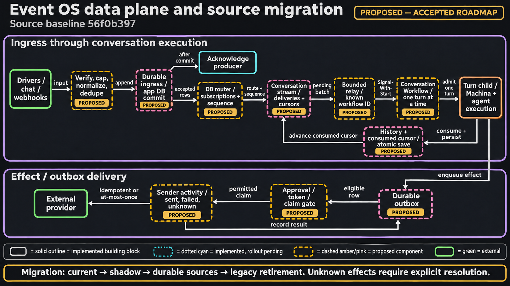
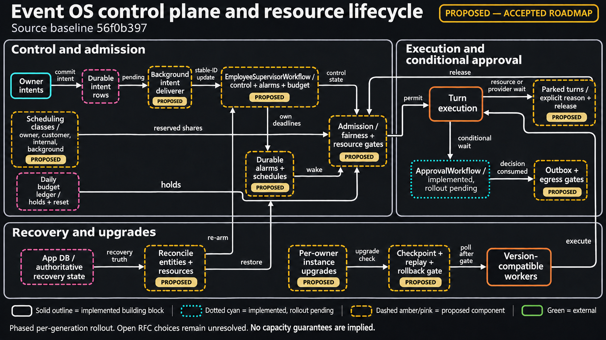

# RFC-0005 — Event OS: Event-Driven AI Employees on Temporal


> **Current-state reading rule:** defect lists, measurements and code sketches below are anchored to their cited baseline commits. Some fixes have since landed. Use the [documentation audit](docs-internal/DOCUMENTATION_AUDIT.md), current runtime references and recorded generation flags for shipped behavior; proposed paths and later rollout phases remain designs until implemented. This audit does not change the accepted owner decisions.

- **Status:** Accepted, 2026-10-23 (owner decisions in §3). Implementation is phased (§24). Phase 0 landed on 2026-10-23 and Phase 1 on 2026-10-24 (§24.4); Phase 1b (RFC-0006 §22.2) was done on 2026-11-02 apart from AP.7, which writes its flag one release after the release that ships AP.1-AP.6. Eleven fixes followed on 2026-11-04, N9's WAL among them, and two more on 2026-11-05 (§24.4). RFC-0006 amended this RFC on 2026-10-24, and RFC-0007 on 2026-10-25 (§30).
- **Created:** 2026-10-23
- **Scope:** the path from every event source to every effect:
  - `server/services/events/` and `server/routers/webhook.py`;
  - the receive and send paths of the channel plugins (`server/nodes/{telegram,whatsapp,whatsapp_business,discord,twitter,email,google,stripe,dodo_payments,...}`);
  - `server/services/chat/` and `server/services/deployment/`;
  - `server/services/temporal/`: new workflow types, and changes to MachinaWorkflow and AgentWorkflow behind input flags;
  - `server/core/database.py` and `server/services/status_broadcaster.py`;
  - the deploy logic (`cli/terraform/`, `cli/commands/deploy/`, `install.sh`, `docker/`).
- **Relationship:**
  - Implements, for the event path, RFC-0004 decisions D7 (bounded events), D8 (routing by known ids), D9 (cancellation), D10 (upgrade contract), D13 (human waits) and D18 (security fixes).
  - Keeps RFC-0002's conversation store and adds a thread to its key.
  - Amended on 2026-10-24 by [RFC-0006](./RFC-0006-TEMPORAL-DESIGN-PATTERNS.md) (Temporal design patterns), wherever a pattern or an owner decision (T1-T20, RFC-0006 §3.1) changed a phase's design. §30 lists the changes.
  - Amended on 2026-10-25 by [RFC-0007](./RFC-0007-APPROVALS-ON-TEMPORAL.md) (approvals): §6.2 I2, §10.1, §10.2, §17.5, §17.7, §24.2 and §24.4. §30 lists the changes.
  - Until a phase lands, [event_framework.md](./docs-internal/event_framework.md), [chat_protocol.md](./docs-internal/chat_protocol.md), [temporal-workflow-control.md](./docs-internal/temporal-workflow-control.md) and [TEMPORAL_ARCHITECTURE.md](./docs-internal/TEMPORAL_ARCHITECTURE.md) stay normative for what it covers.
- **Baseline:** HEAD a8e390ca (2026-10-23), temporalio 1.30.0, Temporal CLI unpinned. Line numbers are as of that date and drift; those changed on 2026-10-24 follow RFC-0006's baseline, HEAD 4f73cb10. Figures marked *est.* are unmeasured and are confirmed by the gates in §26.

<!-- architecture-suite:start -->
## Architecture diagrams

Source baseline: `56f0b397`. [Complete diagram suite](docs/diagrams/architecture/README.md).

**Event OS data plane and source migration — Proposed target · accepted roadmap.**

[](docs/diagrams/architecture/13-event-os-data-plane-v1.png)

[Editable Mermaid](docs/diagrams/architecture/13-event-os-data-plane.mmd) · [Source evidence and limitations](docs/diagrams/architecture/13-event-os-data-plane.brief.md)

**Event OS control plane and resource lifecycle — Proposed target · accepted roadmap.**

[](docs/diagrams/architecture/14-event-os-control-plane-v1.png)

[Editable Mermaid](docs/diagrams/architecture/14-event-os-control-plane.mmd) · [Source evidence and limitations](docs/diagrams/architecture/14-event-os-control-plane.brief.md)

<!-- architecture-suite:end -->

## How to read this

- **Owner:** §1, §3 (decisions), §25 (defaults chosen and what is still open).
- **Reviewer:**
  - §4: what is broken today and where;
  - §6: the architecture and its invariants;
  - §9.5: the delivery protocol;
  - §23: failure modes;
  - §30: what RFC-0006 changed on 2026-10-24.
- **Implementer:** §7 to §21 by layer, §22 (scenarios), §24 (phases), §26 (acceptance gates).

## 1. Summary

OpenCompany's AI employees should run like the processes of an operating system that sleeps until something happens. A message, a webhook, a timer or another employee wakes one. It reacts, schedules its own follow-ups, shares the machine fairly with every other employee, and delivers what it produces through queues that apply backpressure instead of dropping. This RFC designs that system on Temporal, borrowing the Linux kernel's answers to the same problems:
- interrupt top and bottom halves;
- NAPI's switch from push to pull under load;
- scheduling classes with reserved shares;
- epoll-style match rules;
- timer wheels;
- qdisc and BQL on the way out;
- supervisors that cap restart intensity;
- cgroup memory limits applied to model spend.

**Today's event path is at-most-once.** Every event is routed by a Visibility query that is eventually consistent by design. When Temporal is down, a query lags or a Signal fails, the event is dropped with a log line while the producer is told it succeeded. Telegram discards every message sent while the backend was down. One large webhook can wedge a deployment. Start nodes fire again on every restart. Inbound message bodies are broadcast to every connected socket. (§4)

**The design** (§6):
1. **Ingress commits before acknowledging.** Every event is appended to an inbox in the instance's own database (SQLite on the desktop, PostgreSQL on hosted instances) before anything acknowledges it. Nothing else happens in the request path.
2. **A router (DB only) assigns streams.** Match rules compiled from each generation's graph give every input a place in one conversation stream, under per-stream sequence numbers.
3. **A relay delivers by known id.** It sends each stream's pending inputs in bounded batches to a deterministic Temporal entity, one Signal-With-Start in flight per stream, and records progress only after Temporal accepts. Duplicates are dropped by sequence number. An input counts as consumed in the same transaction that saves it into the agent's history.
4. **Each conversation is one entity.** An entity workflow (`ConversationWorkflow`) debounces bursts, starts one turn at a time, and offers new messages to the running turn at its next step.
5. **An employee supervisor workflow holds control and time.** It owns control state, alarms and the daily budget.
6. **Classes and budgets decide who runs.** Four scheduling classes with reserved shares (owner, customer, internal, background) and a daily budget per employee decide who runs when capacity or money is short.
7. **Timers live in Temporal.** Cron jobs are Temporal Schedules addressed by immutable ids. Each polling trigger is one small workflow that runs a single retried activity (T7, RFC-0006 §3.1). Reminders are timers in the supervisor.
8. **Employees talk through the inbox.** Messages between employees are inbox rows carrying causal ids, a hop limit and a breaker.
9. **Sends go through an outbox.** Each send has an idempotency key, and its token buckets slow the producing turn instead of dropping. A send whose outcome is uncertain is shown as `unknown`, never resent on its own.
10. **Temporal is rebuildable.** Everything needed to resume lives in the app database, so Temporal can be rebuilt from it (I10). An instance can therefore move from the free dev server to the free open-source server, or recover a lost Temporal database, without losing an acknowledged event.

**Deployment model (owner decisions, §3).**
- Every owner runs their own instance, each with free Temporal: a desktop app, a container or a VM. There is no shared cluster and no Temporal Cloud.
- Instances with up to about 100 employees use the CLI dev server. Larger hosted instances, up to about 1,000 employees, use the open-source server on the instance's PostgreSQL.
- Releases reach the hosted fleet together in a weekly window.
- Instances report metrics and errors, never content.

**Rollout.** Phase 0 ships nine fixes for verified defects without changing any workflow command. Phase 1 builds the replay safety net. Phase 1b ships the pattern fixes that need no workflow versioning (RFC-0006 §22.2), with RFC-0007's approvals track inside it. Phases 2 to 8 introduce the inbox, drivers, entities, scheduler, timers, messaging, egress and supervision, each versioned per generation. Phase 9 covers instance tiers and fleet operations. Phase 10 retires the old path. (§24)

## 2. Method and sources

- **Research.** Fifteen parallel research passes (RFC-0004's Temporal mirror and audits) and four new parallel design passes (current-state audit, target architecture, bus and scale, migration).
- **Verification.** Claims that changed the design were checked against the code at HEAD; the citations in §4 were re-read.
- **Temporal sources:**
  - a local mirror of 282 docs.temporal.io pages (2026-10-16), especially message passing, entity workflows, the event-accumulator pattern, Schedules, task-queue priority and fairness, multi-tenant patterns, the CLI server reference, the upgrade guide and the production checklist;
  - the temporalio 1.30.0 source (`temporalio/worker/_tuning.py`, `temporalio/common.py`);
  - forum threads on signal throughput and Kafka-to-Temporal consumers.
- **Linux sources:**
  - the kernel documentation for NAPI, generic IRQ handling, EEVDF and CFS scheduling, cgroup v2 (`cpu.max`, `memory.high`, `memory.max`), PSI, timers, qdiscs and BQL, RCU and the soft-lockup watchdog;
  - the `epoll`, `inotify` and `netlink` man pages;
  - systemd's `Restart=`, `StartLimit*=` and `Persistent=`.
- **Agent-OS prior art:**
  - AIOS (arXiv 2403.16971), Letta, Erlang/OTP supervisors, Orleans grains and reminders, Akka mailboxes;
  - peer platforms: Inngest (debounce, batch, throttle), Restate (virtual objects), Hatchet (concurrency strategies), LangGraph (double-texting), DBOS (partitioned queues).
- **Reference systems built on Temporal:** Temporal's chatbot sample (one workflow per conversation), Cursor's agent runs (Signal-With-Start follow-ups, replayed histories in CI), Quo's voice agent (interruptions as Signals).
- **Not done:** no load test and no run against a live server. Throughput figures are estimates.

## 3. Decisions

### 3.1 Owner decisions (2026-10-23)

| # | Decision |
|---|---|
| E1 | **One instance per owner.** Every owner's desktop app, container or VM runs OpenCompany, its database and its own free Temporal. No shared hosted backend, no Temporal Cloud. Target: 100,000+ employees across about 10,000 instances. |
| E2 | **Instance tiers.** The desktop and hosted instances up to about 100 employees run the Temporal CLI dev server. A hosted instance past about 100 employees (up to about 1,000) moves to the free open-source Temporal server on its own PostgreSQL. (§20) |
| E3 | **Databases.** Hosted instances run PostgreSQL for the app database and the inbox. The desktop app stays on SQLite. |
| E4 | **Bus.** The inbox in the instance's database is the only durable store for events. gRPC carries events where a transport is needed: the protocol for out-of-process drivers (the WhatsApp bridge first), with acks and resume, and the relay's calls into Temporal. No message broker. (§7.3, §9) |
| E5 | **Timers.** Cron jobs and reminders run on Temporal Schedules and timers. Each polling trigger runs as one retried activity in a small workflow of its own (amended on 2026-10-24 by T7, RFC-0006 §3.1). (§15) |
| E6 | **Merging.** A new message for an employee that is still working is merged into the running work at its next step. Quick bursts are batched into one input. (§11) |
| E7 | **Internal wake sources:** messages from other employees, self-scheduled wake-ups, task results and delegations, and changes to watched shared data. (§16) |
| E8 | **Employee messaging.** Any employee may message, delegate to and wake any other employee of the same owner without linking. Loop limits apply. Owners live in separate instances, so traffic between owners cannot happen. |
| E9 | **Customer histories.** Each customer conversation keeps its own history. Owner chat stays one conversation. Shared facts go through the Memory tool. (§12) |
| E10 | **Priority.** When capacity is short the order is: owner chat and approvals, then customer conversations, then internal events, then background work. Every class keeps a reserved share. (§13) |
| E11 | **Daily budget per employee.** Past 80%, only owner and customer conversations run. At 100% the employee pauses and the owner gets a notice with Resume. It resumes on its own at midnight in the owner's time zone. (§14) |
| E12 | **Uncertain sends and other side effects.** A send whose outcome is unknown, to a provider without idempotency keys (WhatsApp bridge, Telegram), is never resent automatically. It shows `unknown` with a Retry button. Extended on 2026-10-24 to every side-effecting call (T13, RFC-0006 §3.1): a call that broke off is redone only when its plugin is idempotent or uses a provider idempotency key; otherwise it is recorded `unknown` and the employee is told. (§17) |
| E13 | **Fleet upgrades.** Releases reach all hosted instances together in a fixed weekly maintenance window. (§21) |
| E14 | **Telemetry.** Hosted instances report metrics and errors centrally, never content. (§18.5) |
| E15 | **The Linux model** draws on all three diagrams: the kernel map, the network stack and the storage stack. |
| E16 | **A new Temporal server starts from new.** The Temporal CLI is pinned (RFC-0004 D1). A database the pinned server minor did not create is deleted with the old CLI, and the install starts on an empty Temporal database. No migration code: generations whose controller is gone fail (`controller_execution_missing`), and owners Reset and Start their employees. The first pinned release does this on every install. (Decided 2026-10-23 and confirmed on 2026-10-24 by T5, RFC-0006 §3.1; §24.4) |

### 3.2 RFC-0004 decisions this RFC implements

| RFC-0004 | Decision | Here |
|---|---|---|
| Q7 / D8 | Guaranteed delivery: route by the app database to known ids, retry, answer 5xx when not stored | §8, §9 |
| Q1 / D10 | Runs open on release N-1 survive an upgrade | §24.1, §24.3 |
| Q4 / D12 | Failed runs end as Failed workflows | §10 |
| Q10 / D13 | Human waits become an Update plus a durable timer | §17.5 |
| Q12 | Preview features only behind a flag, off by default | §10.4 |
| Q16 | The Start node runs once per generation | Phase 0.4 |
| Q8 | Sends: at-least-once with idempotency keys where the provider supports them, otherwise at-most-once (E12) | §17 |

RFC-0004 Q2 (which server durable installs run on) is answered by E1 to E3.

## 4. Current state (audit at HEAD, 2026-10-23)

### 4.1 How an event flows today

- **Entry point.** Every source calls `emit` in `server/services/events/dispatch.py:63-106`.
- **Routing.** `emit` runs one Visibility List query per event to find running consumers (`:132-164`), then sends a plain Signal `on_event` to each one (`:250-257`).
- **The consumer.** The consumer is the deployment's `WorkflowControlWorkflow`. It:
  - dedupes the last 4,096 keys;
  - queues FIFO per generation;
  - spawns one `MachinaWorkflow` per event, one at a time, with no cap on concurrent runs (`server/services/temporal/workflow_control_workflow.py:336-484`; `trigger_listener_workflow.py:305-512`).
- **Outside the controller:**
  - Cron uses Schedules that start runs directly.
  - Polling runs inside the controller.
  - Owner chat admits a run in the chat ledger, then emits.

### 4.2 Guarantees today

- **At-most-once ingress.** An event is dropped with a log line when Temporal is down, the Visibility query fails or lags, no consumer is found, or a Signal fails (`dispatch.py:125-206`). Producers always see success: webhooks answer 200 regardless (`server/routers/webhook.py:69-106`).
- **Retries are never deduped for generic webhooks.** They get a random event id. Signed providers (Stripe `evt_`, Dodo `webhook-id`, WhatsApp Business `wamid`) have stable ids.
- **One run per chat session.** Owner chat allows one live run per session, and a second message is refused with `run_in_progress` (`server/services/chat/ledger.py:286-293`). WhatsApp and Telegram messages each start their own run, so replies in one conversation can race.
- **No priority and no per-employee cap.**
  - LLM steps run on `machina-tasks`, not the rate-limited `ai-heavy` queue (RFC-0004 M9).
  - Provider rate limits are per worker (`server/services/temporal/worker.py:584`).
  - One deterministic spawn failure retries the head of a generation's queue every 5 s and blocks everything behind it (`workflow_control_workflow.py:477-480`).
- **Internal events.** Only `agent.task.completed` can wake work, and it is unscoped (H11). An employee cannot schedule its own wake-up or message another employee.

### 4.3 Defects this RFC fixes

| Id | Defect | Evidence | Fixed in |
|---|---|---|---|
| C1 (RFC-0004) | One large webhook wedges a deployment: the body is copied about four times into a child's input, past the 2 MB payload limit | `trigger_listener_workflow.py:394-397`; `workflow_control_workflow.py:705-711` | 0.3, controller lane, P4 |
| C3 (RFC-0004) | Webhook header authentication is never enforced, and an empty path matches every webhook | `server/routers/webhook.py`; `nodes/trigger/webhook_trigger` filter | 0.1 |
| C4 (RFC-0004) | A deployment's Start node fires again on every backend restart | `server/services/deployment/handlers.py:1612-1617`; `manager.py:282` | 0.4 |
| H1 (RFC-0004) | Routing through Visibility drops events silently | `dispatch.py:109-206` | P2 |
| H2 (RFC-0004) | Node activities swallow cancellation: `NodeExecutor` turns a cancel into a failed result, so the activity completes normally after a cancel request | `server/services/node_executor.py:231-239` | 1b.2 |
| H6 (RFC-0004) | Cron overlap is not prevented: the Schedule's policy covers only the short workflow it starts | `server/services/temporal/schedules.py` | P6 |
| H8 (RFC-0004) | Workflow loops swallow cancellation | RFC-0004 §5 | controller lane |
| H11 (RFC-0004) | Task events reach every workflow and every socket | `server/nodes/agent/_events.py:109-134` | 0.2, P6 |
| M3 (RFC-0004) | Polling loses events: a failed detail fetch is marked seen, and mark-as-read runs before the event is recorded | `server/services/plugin/polling.py:233-259` | b8c92614 (the failed fetch), P3 |
| N1 | Telegram discards every message sent while the backend was down (`drop_pending_updates=True`) | `server/nodes/telegram/_service.py:663` | 0.5, P3 |
| N2 | The WhatsApp bridge loop awaits `emit` inline and acknowledges nothing | `server/nodes/whatsapp/_service.py:111-127` | P3 |
| N3 | Discord interactions are acknowledged, then dispatched fire-and-forget | `server/nodes/discord/_router.py:110-117` | P2 |
| N4 | With login on, Discord's interaction POSTs get 401 (not a public path) | `server/middleware/auth.py:14-34` | 0.7 |
| N5 | A deployed `twitterReceive` never fires: its dispatcher is never called | `server/nodes/twitter/_events.py:68` | 0.8 |
| N6 | On PostgreSQL the chat lane index is a full `UNIQUE(session_id)`, so a conversation's second run fails | `server/models/chat.py:69` (only `sqlite_where`) | 0.6 |
| N7 | Inbound bodies are broadcast to every socket, twice for WhatsApp (raw frame plus envelope) | `server/services/status_broadcaster.py:228-281`; `server/nodes/whatsapp/_events.py:214-223` | 0.9 |
| N8 | Every reserved transaction on PostgreSQL takes one global advisory lock: about 60 call sites and 8-12 per turn, so an instance tops out at est. 20-50 turns/s | `server/core/database.py:530`, `:763` | P9b |
| N9 | `workflow.db` has no WAL and no `busy_timeout`; a long reader blocks every commit | only `server/services/temporal/_runtime.py:153-158` sets WAL, and only for Temporal | a2c369d3, ahead of P2 |
| N10 | PostgreSQL has no schema migrations: a missing column fails startup | `server/core/database.py:193` | P9b |
| N11 | A webhook source puts every event on a queue nothing drains | `server/services/events/webhook.py:121` | 0.3 |

## 5. Principles from the Linux stack

### 5.1 Eight principles

1. **Sleep by default; wake on an edge, reconcile the level.** An event is a hint and state is the truth (NO_HZ idle, Orleans virtual actors). A waiting Temporal workflow holds no worker.
2. **Split every event into a tiny top half and a deferred bottom half.**
   - The top half authenticates, dedupes, enqueues and acks.
   - The bottom half is schedulable and may sleep (hard IRQ, then softirq, workqueue or threaded IRQ).
   - Never do slow work at the edge.
3. **Bound every queue and name its overflow policy:** block, coalesce, drop-oldest, or reject plus resync (inotify `IN_Q_OVERFLOW`, netlink `ENOBUFS`). Queue wait time is the primary health signal (PSI, the USE method).
4. **Under load, switch from push to pull and drain a batch against a budget.** NAPI: the first interrupt arms a poll that drains up to a budget before interrupts are re-enabled.
5. **Schedule with strict classes, weighted shares, quotas and reserved floors** (stop, deadline, rt, fair and idle classes; EEVDF weights; `cpu.max`; RT throttling keeps 5% for others). Running work is not preempted, so isolate capacity per class. Bound the depth of downstream queues to protect latency (Kyber, BQL).
6. **Failure is normal.** Supervise hierarchically, back off, cap restart intensity and escalate (systemd `Restart=` and `StartLimitBurst=`, OTP supervisors' MaxR/MaxT). Enforce budgets before thrash: `memory.high` throttles, `memory.max` stops.
7. **Storms need circuit breakers that degrade gracefully** (spurious-IRQ disable, journald rate limits). Agent form: hop and TTL limits, causal ids, a token bucket per edge, and a breaker that turns a hot edge into a periodic digest.
8. **Instrument every edge and measure waiting, not just utilisation** (tracepoints, PSI).

### 5.2 Mapping

| Linux | Agent OS | Here |
|---|---|---|
| process, `task_struct` | an employee and each of its conversations | supervisor and conversation entity workflows (§10) |
| device model: bus, driver, device, probe, hotplug | channel adapters bound to employees | `ChannelDriver` registry (§7) |
| hard IRQ / bottom half | ingress / conversation turn | durable append and ack (§8), then router and relay (§9) |
| NAPI | doorbell and batch drain | at most one delivery in flight per stream, a bounded window, backlog left in the database (§9.4) |
| signal delivery on return to user space | merging new messages | the agent loop's step boundary (§11) |
| scheduling classes, cgroups, HTB | owner, customer, internal, background | Priority keys, class queues with fixed slots, admission with floors (§13) |
| `memory.high` / `memory.max` | spend throttle and pause | daily budget ledger (§14) |
| epoll interest lists, D-Bus match rules, netlink groups | subscriptions | `bus_subscriptions` compiled at Start (§9.3) |
| timer wheel, hrtimers, systemd timers | cron, polls, reminders | Schedules, durable timers and retried poll activities (§15) |
| pipes, signals, D-Bus | employees messaging each other | inbox rows with causal ids (§16) |
| qdisc (TBF, HTB, fq_codel), BQL, writeback throttling | the outbound path | outbox, token buckets, the producer slows down (§17) |
| RCU | a running generation keeps its version | `resource_manifest` flags frozen per generation (§10.4) |
| watchdogs, OOM killer, oomd | stuck and runaway employees | deadlines, restart intensity, quarantine, budgets (§18) |
| journaling (jbd2) | write-ahead before acknowledging | inbox append before any ack (I2) |

### 5.3 Prior art adopted

- **AIOS:** per-resource queues and syscalls with priority and time limits; confirmation before irreversible actions (approvals).
- **Letta:** loop control belongs to the runtime, not the model.
- **Erlang/OTP:** asynchronous messages, let it crash, supervision with restart intensity.
- **Orleans:** virtual actors that activate on demand, durable reminders, turn-based single-threaded execution.
- **Akka:** bounded mailboxes that overflow to dead letters, control-aware priority mailboxes, passivation of idle entities.
- **Peer platforms:**
  - Inngest debounce, batch and throttle are the entity's debounce and the class buckets.
  - LangGraph's double-texting strategies (reject, enqueue, interrupt, rollback) and Hatchet's `CANCEL_IN_PROGRESS` are the entity's merge, next-turn and Interrupt.
  - Restate virtual objects are entity workflows.
  - DBOS partitioned queues are class queues plus fairness keys.

## 6. Architecture

### 6.1 Shape

```
DRIVERS (RX)          TOP HALF (request path)     BOTTOM HALF (database)          RELAY                           PROCESSES (Temporal)                         EGRESS (TX)
WhatsApp bridge  ->   verify, cap, normalize, ->  router: subscriptions,     ->  per conversation stream:   ->   ConversationWorkflow per conversation: ->    outbox row ->
(gRPC), Telegram,     dedupe, INSERT              storm guards, stream seq,       gates (generation, budget),     debounce, admit, turn child,                 send activity
Discord, webhooks,    bus_ingress, commit, ack    bus_deliveries                  window, Signal-With-Start       merge at step boundaries                     (token bucket,
polls, schedules,     (no Temporal, no LLM)                                       "deliver" with the batch        EmployeeSupervisorWorkflow per employee:     priority,
IPC, owner chat                                                                                                   control, alarms, budget                      idempotency key)
```

### 6.2 Invariants

| # | Invariant | Principle |
|---|---|---|
| I1 | A Signal is a hint. The inbox and its cursors are the truth; every consumer reconciles from them. | 1 |
| I2 | No request path calls Temporal or a model. Every request path ends at a durable commit. Owner actions that need Temporal (Start, Stop, Resume, Apply, approval decisions, Interrupt) write an intent row and answer at once. A background deliverer sends the Update by workflow id, with a stable id, until it is applied, and the UI shows "applying" (T10, RFC-0006 §7.3). An approval decision is its own intent: after the commit its workflow is nudged, and the approvals watchdog nudges it again until it takes the decision (RFC-0007 §4.6). | 2 |
| I3 | Every queue is bounded and names its overflow policy. Every drop is a row with a reason. | 3 |
| I4 | One relay per stream at a time and one consumer per stream. An entity runs at most one turn, and an input belongs to exactly one turn. | — |
| I5 | Serialize only where state is shared (an agent's conversation key). Everything else runs in parallel under class floors. | 5 |
| I6 | Routing goes from the app database to known workflow ids. Visibility is for operations only. | — |
| I7 | Nothing over 64 KB enters Temporal; larger bodies travel by reference. An entity holds at most 32 inputs or 512 KB, and any backlog stays in the database. One exception (T6): an agent loop's transcript travels in its LLM-step inputs and its continue-as-new carry, within bounds: at most 393,216 bytes of messages before every step, each step input under 1 MiB, the carry under 1.9 MB and the stored conversation under 1 MB (RFC-0006 §16.8). | 4 |
| I8 | Every event carries `chainid`, `hop` and `causationid`. Internal wakes are checked for hops, cycles and rate. | 7 |
| I9 | Every effect is idempotent, or at-most-once with an explicit `unknown`. Never a silent duplicate. | — |
| I10 | Temporal is rebuildable from the app database: generation snapshots, conversation histories, inbox cursors, alarms, budgets and Schedule definitions all live there. | 6 |

### 6.3 Layers

| Layer | Linux analog | Responsibility | Runs in | Section |
|---|---|---|---|---|
| Drivers | device model, NIC driver | probe, start/stop, normalize, ack after commit, send | app process; edgymeow (Go) | §7 |
| Ingress | hard IRQ | verify, cap, dedupe, append, ack | request path | §8 |
| Router | softirq, match rules | subscriptions, storm guards, stream sequence numbers | in-process task | §9.3 |
| Relay | receive queue, TCP window | gates, window, Signal-With-Start, `delivered_seq` | in-process task | §9.4 |
| Processes | task_struct, run queue | supervisor, conversation entity, turn, agent | Temporal | §10 |
| Scheduler | sched classes, cgroups, HTB | classes, floors, admission, Priority, fairness | DB + Temporal | §13 |
| Budgets | `memory.high` / `memory.max` | daily ledger, holds, pause, auto-resume | DB + supervisor | §14 |
| Timers | timer wheel, systemd timers | Schedules, alarms, durable timers | Temporal | §15 |
| IPC | pipes, D-Bus | employee messages, delegations, watched data | inbox | §16 |
| Egress | qdisc, BQL | outbox, buckets, idempotency, approvals | Temporal activities + DB | §17 |
| Supervision | systemd, OTP, watchdogs, PSI | deadlines, restart intensity, attention, metrics | supervisor + DB | §18 |

## 7. Drivers (the device model)

### 7.1 Contract

A `ChannelDriver` implements:
- `probe(account)` and `start(account)` / `stop(account)`;
- `normalize(raw) -> IngressRecord` (envelope, dedupe key, conversation id, counterpart, size);
- `ack(raw)`, called only after the inbox append has committed;
- `send(outbound) -> SendResult`;
- a `capabilities` declaration: who holds unacknowledged events, ordering, send idempotency, reply window.

The `DriverRegistry` runs a connection driver only while a running generation subscribes to its account (principle 1). It re-probes on credential events (`com.opencompany.credential.*`) and on generation Start or Reset. A lease in `bus_leases` guarantees one reader per account; Telegram, for example, allows only one `getUpdates` consumer per token. An account that stays down for more than 5 minutes becomes an attention item.

Plugins keep their own drivers in `server/nodes/<plugin>/_driver.py` and register them from their package `__init__.py`, like the other plugin registries. The old `register_webhook_source`, `register_filter_builder` and `register_trigger_precheck` remain as shims for one release.

### 7.2 Per-driver behaviour

| Driver | Who holds unacked events | Dedupe key | Ack after commit | Send idempotency |
|---|---|---|---|---|
| WhatsApp (edgymeow bridge) | WhatsApp's server, through whatsmeow `SynchronousAck` plus the bridge's outbox | `whatsapp:<acct>:<chat>:<msgid>` | gRPC `Ack(seq)`; the bridge then acks WhatsApp | none: at-most-once (E12) |
| WhatsApp Business | Meta, retried up to 7 days | `wamid` | 200 | none; 24-hour reply window |
| Telegram | Telegram, 24 hours | `update_id` | the `offset` advances only after commit | none |
| Discord gateway | gateway resume by sequence; REST catch-up after a full reconnect | message id | n/a | `nonce` with `enforce_nonce` |
| Discord interactions | not redelivered; 3-second window | interaction id | deferred reply (type 5) after commit, else 500 | n/a |
| Owner chat | the client re-sends with `client_message_id` | message uid | WebSocket answer after commit | database |
| Signed webhooks (Stripe, Dodo, GitHub, Standard Webhooks, WhatsApp Business) | the provider (Stripe retries for 3 days) | `evt_…`, `webhook-id`, `X-GitHub-Delivery` | 2xx | the provider's `Idempotency-Key` |
| Generic webhook | the caller | a configured header, else a body hash within 10 minutes | 2xx | caller-defined |
| Pollers (Gmail, IMAP, Outlook, Twitter) | provider state | message id, UID, delta token, tweet id | cursor saved in the append transaction; `post_emit` (mark-as-read) after commit | email `Message-ID` check |
| Cron, Start, alarms | Temporal | `<schedule>:<scheduled_time>`, `start:<gen>`, `alarm:<id>` | n/a | n/a |
| Internal (messages, tasks, data changes) | the database | `<producer workflow id>:<activity id or tool_call_id>` (never the run id) | n/a | n/a |

### 7.3 gRPC driver protocol (E4)

Out-of-process drivers stream events into the bus over gRPC: on loopback or a named pipe on the desktop, and on localhost with mTLS where the driver runs in another container.

```proto
service EventIngress {
  // The driver resends every unacknowledged event after a reconnect, in order.
  rpc Publish(stream DriverEvent) returns (stream Ack);
}
message DriverEvent {
  string driver_id = 1;    // "whatsapp:<account>"
  uint64 seq = 2;          // per-driver monotonic sequence from the driver's outbox
  string source_key = 3;   // account scope
  string dedupe_key = 4;   // e.g. whatsapp:<acct>:<chat>:<msgid>
  string type = 5;         // CloudEvents type
  bytes envelope = 6;      // CloudEvents JSON, at most 64 KB
  string body_ref = 7;     // for media and large bodies
}
message Ack { uint64 seq = 1; enum Status { ACCEPTED = 0; DUPLICATE = 1; REJECTED = 2; } Status status = 2; string reason = 3; }
```

- The bus sends `Ack` only after the append commits.
- At most 1,000 events are in flight per stream, with deadlines on every call.
- The driver advances its upstream cursor only after the `Ack`: the WhatsApp acknowledgement, the Telegram offset, the Discord sequence, the IMAP UID.

**edgymeow changes.** edgymeow is its own Go project, published to npm and pinned at `edgymeow@0.0.20` in `server/nodes/whatsapp/_install.py:39`. It changes in its own repository:
- Turn on whatsmeow `SynchronousAck`.
- Write each decrypted event to a local SQLite outbox before acknowledging WhatsApp.
- Stream the outbox over `Publish`, and delete each row on `Ack`.
- Resend from the last acknowledged sequence after a reconnect.

Today the bridge speaks JSON-RPC over WebSocket without acks (`server/nodes/whatsapp/_service.py:111-127`).

gRPC is not used as the bus itself, and no router-side log is built (§9.7).

### 7.4 Driver-level fixes

- **Telegram:** a manual `get_updates(offset)` loop replaces `start_polling(drop_pending_updates=True)`.
- **WhatsApp:** the `_recv` loop only appends (the bridge protocol above).
- **Discord interactions:** append before the deferred reply.
- **Pollers:** a failed detail fetch is not marked seen, and becomes a dead row after 5 failures.
- **Twitter receive** joins the polling path.

## 8. Ingress (the top half)

### 8.1 Pipeline

1. **Resolve the endpoint** from the active generations' subscriptions.
2. **Check size.** Check `Content-Length`, then stream the body with a cap: 256 KiB by default, raisable per endpoint up to 10 MiB.
3. **Verify** with a constant-time comparison of the configured header, or an HMAC over the raw bytes for signed providers.
4. **Normalize** to a CloudEvents envelope. Keep allowlisted headers only; never `authorization`, `cookie`, `proxy-authorization` or the configured secret header.
5. **Store large bodies by reference.** A body over 64 KB is streamed to `event_blobs` (a file plus its sha256). The row keeps `body_ref` and a 4 KB preview.
6. **Append.** `INSERT ... ON CONFLICT (source_key, dedupe_key) DO NOTHING`, commit, and answer.

**Never `reserved_session`.** Ingress uses its own short transaction. On PostgreSQL, `reserved_session` takes the global advisory lock (N8).

**Owner chat.** `admit_message` (`server/services/chat/ledger.py:252`) writes the chat message and the ingress row in one transaction, so it becomes the transactional outbox.

**Internal producers** (the tools in §16, `alarms.fire`, task completion) append with deterministic keys from inside their activity. A failed append raises, so Temporal retries the activity.

`dispatch.emit()` remains as a facade that appends an internal ingress row, so existing producers keep working.

### 8.2 Answers

| Condition | Answer |
|---|---|
| Appended, or a duplicate | 200 (Discord: deferred reply, type 5) |
| Body over the endpoint cap | 413, before reading when `Content-Length` is known |
| Bad signature or header secret; an empty generic path | 401 |
| No running or paused generation declares the path | 404 |
| Wrong method | 405 |
| Per-source rate or backlog over high water | 429 with Retry-After |
| Secret unavailable, or the append failed | 503 with Retry-After |
| Verified but malformed | 200, stored as `dead(malformed)` so the provider stops retrying |

## 9. The bus

### 9.1 Contract

```python
class Bus(Protocol):
    async def append(self, records: list[IngressRecord]) -> list[AppendResult]  # Accepted | Duplicate | Rejected(reason); durable on return
    async def next_ingress(self, router_id: str, limit: int) -> list[IngressRow]  # per-source order
    async def route(self, ingress_ids: list[int], deliveries: list[Delivery]) -> None  # atomic
    async def claim_stream(self, relay_id: str, classes: list[int]) -> StreamLease | None  # (top class, oldest pending) first
    async def pending(self, lease: StreamLease, max_items: int, max_bytes: int) -> list[Delivery]  # seq order, not held
    async def delivered(self, lease: StreamLease, through_seq: int) -> None  # after Temporal accepted
    async def hold(self, scope: Scope, reason: HoldReason) -> int  # budget | paused | window | starting
    async def release(self, scope: Scope, reason: HoldReason) -> int
    async def settle(self, stream: StreamKey, through_seq: int, outcome: Outcome) -> None
    async def dead_letter(self, delivery_id: int, reason: str) -> None
    async def replay(self, selector: ReplaySelector) -> int  # re-route retained ingress; operator-confirmed
    async def lag(self) -> BusLag  # per class: oldest pending age, held count, relay lag
```

There are two drivers, `SqliteBus` and `PostgresBus` (`server/services/bus/sql.py`). Producers, the router, the relay and the entities never see which one is in use. A test-only `DirectBus` performs Signal-With-Start without an inbox. <!-- docs-lint: ignore; proposed path in an unshipped design, not a current implementation citation. -->

### 9.2 Tables (`server/models/events.py`) <!-- docs-lint: ignore; proposed path in an unshipped design, not a current implementation citation. -->

| Table | Columns (main) |
|---|---|
| `bus_ingress` | id, source_key, dedupe_key, type, class, received_at, envelope (≤ 64 KB) or body_ref, size, chainid, hop, causationid, status (`accepted` / `routed` / `no_consumer` / `dead` / `expired`), dup_count, error |
| `bus_dedupe` | (source_key, dedupe_key) UNIQUE, expires_at (dedupe window 7 days). On PostgreSQL it is kept separate from the day-partitioned `bus_ingress`, so the check spans days. |
| `bus_subscriptions` | employee, generation, trigger node or implicit kind, event types (canonical plus legacy), source scope, filter parameters (secret refs only), class, `thread_by`, lane, intake agent, merge, debounce, `on_busy`, reply-capable |
| `bus_streams` | stream_key = (workflow, generation, lane, thread), next_seq, delivered_seq, consumed_seq, top_pending_class, oldest_pending_at, hold_reason, entity_id, default_route, state |
| `bus_deliveries` | (stream_key, seq) UNIQUE, ingress_id, subscription_id, route, class, payload or ref, causal fields, status (`pending` / `held` / `delivered` / `done` / `failed` / `dead`), reason, attempts |
| `bus_leases` | name, owner, until, fencing token |
| `channel_accounts` | id, driver, external id, credential ref, status, cursor JSON, lease, last_seen_at |
| `event_blobs` | id, sha256, path, size, created_at |

**SQLite (desktop):** WAL, `synchronous=FULL` (an acknowledged event must survive power loss) and `busy_timeout=5000`. Appends are single autocommit statements. One relay task. Consumed rows are deleted in chunks after retention. Since a2c369d3 the `workflow.db` engine already runs WAL with `busy_timeout=5000`, but with `synchronous=NORMAL`, so Phase 2 sets `FULL` on the bus's connections or moves the engine to it.

**PostgreSQL (hosted):**
- `bus_ingress` is range-partitioned by day, so retention is `DROP PARTITION`.
- Relays claim streams with `FOR UPDATE SKIP LOCKED`.
- `idle_in_transaction_session_timeout` and `statement_timeout` are set.
- Wake-ups use a post-commit kick plus a 1 s poll of a partial index. `LISTEN/NOTIFY` is used only for idle-to-pending edges, if at all, because every notifying commit serializes on one lock.

### 9.3 Router

Subscriptions are compiled from the generation snapshot in the transaction that creates the `starting` generation. They replace the `register_trigger` Signals and the `ControlEventTypes` search attribute. The new generation's streams are held with reason `starting` until the move to `running` releases them, so an event accepted just after the Start commit is delivered once the generation runs (RFC-0006 §7.2).

For each `accepted` ingress row, in per-source order, one transaction:
1. **Match.** Match subscriptions by type and scope, then by the plugin's `build_filter`. A filter that raises makes a `dead(filter_error)` row; it neither admits nor drops silently.
2. **Guard.** Apply the storm guards (§16.3).
3. **Number.** Lock the stream row, allocate `seq = next_seq` and write the `bus_deliveries` row. This serializes commits per stream.
4. **Mark.** Mark the ingress row `routed`, `no_consumer` or `dead`.

Fan-out is capped at 50 subscriptions per event. Re-running the router after a crash is a no-op.

### 9.4 Relay

The relay claims streams ordered by (highest pending class, oldest pending). When Temporal pushes back, it shares the Signal rate among classes by deficit round-robin with the floors of §13.1. For each claimed stream it checks, in order:
1. **The generation is active.** Otherwise the deliveries become `dead(reset)`. Admission checks the generation again (§13.3), because a Reset can land between this check and the call.
2. **Budget and pause holds** (§14). `high` holds C3 and C4; `max` or a paused employee holds every class.
3. **The window.** If `delivered_seq - consumed_seq` has reached 32 inputs or 512 KB, the stream is held with reason `window`, and the backlog stays in the database (principle 4).
4. **Send.** It reads at most 16 pending deliveries or 256 KB and calls `client.start_workflow("ConversationWorkflow", <cursor>, id=<entity id>, start_signal="deliver", start_signal_args=[batch], id_reuse_policy=ALLOW_DUPLICATE, priority=Priority(priority_key=<lane key>, fairness_key=<employee id>))`. The workflow argument is the stream cursor (`consumed_seq`): the entity seeds `applied_seq` from it on every start, a restart after passivation included (RFC-0006 §7.2). The priority key is the lane's (§13.2).
5. **Commit.** It commits `delivered_seq` only after Temporal accepts.

**Limits:** at most one Signal-With-Start in flight per stream, and at most 4 per entity per second.

**When Temporal fails:**
- A breaker opens on unavailability, with backoff and a 5 s probe.
- RESOURCE_EXHAUSTED slows the lowest class first.
- A deterministic rejection marks the delivery dead after 5 attempts. The stream keeps moving, so there is no head-of-line blocking.

### 9.5 Delivery protocol: exactly one effect per event

1. **Ingress or driver:** append, commit, acknowledge.
2. **Router:** writes the delivery with its stream `seq`.
3. **Relay:** sends `deliver(rows, upto_seq)` and commits `delivered_seq` after Temporal accepts.
4. **Entity:** drops any row with `seq <= applied_seq`. That counter is carried across continue-as-new and seeded from the relay's cursor on every start (§9.4), so a relay crash between the accept and the commit makes only a harmless duplicate.
5. **Consumption.** For agent turns, `save_conversation` writes the transcript and advances the stream's `consumed_seq` in one transaction, so an input counts as consumed exactly when its text is in the agent's history. Under `event_os_version=1` this save raises on failure and the step retries; today's save is best effort and swallows errors (RFC-0006 §16.8). Graph turns without an agent settle at turn end with `settle`.
6. **Effects.** Effects carry idempotency keys (§17). The `run_runtime_mutation` ledger (`server/core/database.py:731`) covers the database effects.

### 9.6 Why the relay pushes rather than having entities pull

The alternative was a payload-free doorbell Signal with the entity fetching from the database. The relay pushes bounded batches instead, for three reasons:
- Every driver presents the same contract to the entity.
- A wake costs one action instead of three (signal, fetch, claim).
- Workflow workers never read the inbox.

This is the documented consumer pattern: Signal-With-Start, then commit after the server accepts. NAPI's property is kept: once the window fills, the relay stops pushing and the entity drains its window in one turn.

### 9.7 Alternatives rejected

| Option | Why not |
|---|---|
| Signal-With-Start straight from ingress, no inbox (RFC-0004's in-workflow mailbox) | Ingress must refuse or lose events whenever Temporal is down or throttling. No replay, no dead letters, nowhere to hold work for a budget, and every event costs 2-3 state transitions. |
| gRPC streams between services as the bus | gRPC moves events and never stores them: a crash loses whatever was buffered. Adding a log means building a broker. |
| A broker (Kafka, NATS JetStream, KurrentDB, Pub/Sub) | One more stateful service in every instance (desktops have none; Redis Streams were retired in Wave 15.3). An instance peaks at about 50 events/s, while PostgreSQL handles est. 2,000-5,000/s. |
| Dapr pub/sub | Adds a sidecar and no durability of its own. |

### 9.8 Conformance suite

`server/services/bus/conformance/` runs against both drivers:
- kill -9 at every step loses no acknowledged event;
- duplicate appends;
- FIFO per stream;
- hold and release order;
- the window;
- replay;
- a burst of 10,000 messages to one conversation, appended before the relay runs, costs fewer than 1,000 Signals per entity run (EG7).

## 10. Processes (the workflow types)

### 10.1 Granularity and ids

| Workflow | Id | Started by |
|---|---|---|
| EmployeeSupervisorWorkflow | `emp-<workflow_id>-g<gen>` | Start, with `REJECT_DUPLICATE`. A lost supervisor (terminated or failed) is rebuilt in place from the database with `ALLOW_DUPLICATE_FAILED_ONLY`, keeping chat and Context; after 3 rebuilds within an hour, an attention item asks the owner to Reset (T20, RFC-0006 §8.2) |
| ConversationWorkflow (the entity) | `conv-<workflow_id>-g<gen>-<lane>-<thread>` | the relay, by Signal-With-Start with `ALLOW_DUPLICATE` |
| Turn (MachinaWorkflow, input `event_os_version=1`) | `turn-<conv id>-<n>`, where admission allocates `<n>` (§13.3) | the entity: a child with `REQUEST_CANCEL` and `WAIT_CANCELLATION_COMPLETED`. The turn's own agent children use the same policies (1b.12, which ships in RFC-0006's cancellation lane), and a cancelled turn cancels and drains its running work (§10.2) |
| AgentWorkflow (input `merge_version=1`) | existing child ids (`_agent_child_workflow_id`) | the turn |
| ScheduleFireWorkflow | Schedule actions | Schedules `cron-…` and `alarm-…` (§15) |
| PollWorkflow | `poll-<workflow_id>-g<gen>-<node_id>` | Start and re-arm, with `USE_EXISTING` (T7, §15) |
| ApprovalWorkflow | `approval-<id>` | the agent's turn, as a child, when the agent answering a chat run holds a tool call (generations with `approval_wait_version=1`, RFC-0007 §4.6); from Phase 7 also the turn, for an approvalGate node (§17.5) |

Ids use the immutable workflow id, never the slug. Every new type:
- uses `@workflow.init`;
- has signal handlers that only buffer;
- continues as new only from the main loop, after `workflow.all_handlers_finished()`;
- runs in the sandbox, passing through only side-effect-free leaf modules (RFC-0006 §17.18); RFC-0007's ApprovalWorkflow is the exception and runs unsandboxed (RFC-0006 §17.18 item 2);
- cleans up only on exit exceptions, never on a bug in workflow code (RFC-0006 §18.2);
- keeps one live timer over named absolute deadlines, and never waits with a timeout of zero or less (RFC-0006 §8.4);
- schedules no UI-only activities: progress broadcasts become best-effort local activities (RFC-0006 §14.2);
- rolls over when the server suggests it or at 1,800 Updates, whichever comes first (2,000 is the limit per run);
- makes every activity id that feeds an idempotency or spend key explicit and unique across the continue-as-new chain, because the SDK's default id is a per-run counter (RFC-0006 §17.11).

### 10.2 Per-type specification

| Type | State | Messages | Timers | Continue-as-new |
|---|---|---|---|---|
| Supervisor | control state and revision; alarm `next_due` and version; budget state and version; health window | **Updates** with validators. Each carries absolute values and the row revision, and its validator rejects a stale revision. The T10 deliverer sends them with a stable id (§6.2 I2):<br>• `set_control_state` (fans Stop/Resume out to the live turns in `sched_leases`; a durable Stop barrier that fixes H9);<br>• `wait_for_checkpoint`;<br>• `set_limits`;<br>• `resume_after_budget`.<br>**Signals:** `alarms_changed`, `budget_changed`, `turn_failed`.<br>**Query:** `status`. | one timer over named absolute deadlines: the earliest alarm and the budget period end. The period ends at midnight in the owner's time zone plus a stable per-employee offset of 0-10 minutes, computed outside workflow code and carried as a UTC instant. No upkeep timer: an instance-wide sweep every 5 minutes signals only employees with overdue work (RFC-0006 §8.4) | when suggested, daily, or at 1,800 Updates; carries about 2 KB |
| Entity | pending window per class; `applied_seq`; offered set for the running turn; running turn handle; `turn_no` (allocated by admission, §13.3); debounce anchors; failure window | **Signals:** `deliver`, `inputs_consumed`, `turn_suspended`, `wake`.<br>**Update:** `interrupt_turn` (validator: that turn is running; sent by the T10 deliverer).<br>**Query:** `status`. | customer debounce on an absolute deadline (§11); admission retry every 60 s; slow-turn alert per class and the 24-hour no-progress cancel (§13.1); idle passivation; restart backoff | only between turns, when suggested, past 4,000 events or 4,000 Signals (every Signal type counted), or at 1,800 Updates. Carries cursors, not payloads: `consumed_seq`, `turn_no` and the debounce anchors. `applied_seq` equals the consumed cursor, and one activity before the close rewinds the stream's `delivered_seq` to it, so the relay delivers pending inputs again. Close sequence, for continue-as-new and for passivation: `wait_condition(all_handlers_finished)`, a final check for pending inputs, then the close with no `await` between (RFC-0006 §7.4). |
| Turn | today's MachinaWorkflow state, plus the offered inputs | **Signal:** `offer_inputs`, forwarded to the intake agent. If that agent has already finished, the turn answers `inputs_returned`. | none new | none. Loads the graph by reference (generation plus trigger node), which fixes H10 and M6. Its result adds the consumed inputs and usage. When cancelled, it cancels its running agent children and node activities and waits for them, at most 2 minutes (RFC-0006 §6.2). |
| AgentWorkflow | plus offered inputs, consumed ids, merges, current class, park reason | **Signals:** `offer_inputs`, `released{reason}` | From Phase 5, for generations with `scheduler_version=1` (§10.4, T18), budget suspension generalizes to parks (T11, RFC-0006 §11.8). A turn parks for its budget, provider billing or quota, a provider account problem, or a provider outage past the step budget. An outage park probes every 15 minutes on a durable timer; the others wait for `released` without a timer. Each park sets the lease `suspended` and raises an attention item. A turn parked for 7 days fails, and its input is dead-lettered with an attention item (T19) | its existing continue-as-new; the resume marker adds consumed ids, class and merges, and already carries `usage_total` (`agent_workflow.py:2997`) |
| ScheduleFire | none | none | none | one activity: append a tick |
| PollWorkflow | none | none | none: the activity's retry delay is the interval | one activity that never completes. Each attempt polls once, then raises a BENIGN error with `next_retry_delay`, so Temporal retries it after the interval and the history stays near zero (T7, §15) |
| Approval | none: the approval row is the record | **Signal:** `nudge()`, with no payload; duplicates are harmless (RFC-0007 §4.6). | one wait until the expiry, with a re-read after each nudge; from Phase 7 also a reminder 24 h before expiry | none. It returns approved, declined, expired or cancelled, and its parent runs the send. A gate's run is a child of the turn and returns its outcome (§17.5) |

### 10.3 Failure semantics

- A turn that fails ends as a Failed workflow (RFC-0004 D12). A parked turn (§10.2) has not failed and spends no retry (T11).
- The entity retries its inputs once, then dead-letters them with an attention item. A retried turn resumes from the saved conversation, and a graph-only turn from its failed node, so completed side effects do not repeat (RFC-0006 §11.8). Restart intensity is described in §18.2.
- A bug in workflow code leaves that entity or supervisor stuck and visible (`TemporalReportedProblems`). This holds only with the bug guard of Phase 1b (1b.13, RFC-0006 §18.2): cleanup that runs on any exception re-raises a workflow bug first. The inbox keeps accepting, and nothing acknowledged is lost (I10).

### 10.4 Versioning

- **Generation flags.** New generations get `resource_manifest.event_os_version=1` from `begin_generation` (`server/services/deployment/control.py:112`, `:160`). Older generations keep `WorkflowControlWorkflow` until they are Reset.
- **The Phase 5 flag.** Phase 5's behaviour (class queues, the LLM step budget, parking) gets its own generation flag, `resource_manifest.scheduler_version=1`, frozen at Start, so Phase 4 runs recorded without it replay unchanged (T18, RFC-0006 §11.3). Generations without it keep today's unlimited LLM-step retries and today's fail-and-pause.
- **Per-run versions.** `context_pressure_version=2` is recorded per run in `agent.prepare_payload`'s result, as version 1 is today, and chosen only for generations with `event_os_version=1` (RFC-0006 §16.8).
- **Patches.** New types need no patches. Shared types (MachinaWorkflow, AgentWorkflow) branch only on input flags frozen at admission, which no history from an older release contains.
- **Preview features** stay unused (RFC-0004 Q12): Workflow Streams, External Storage, Workflow Pause and eager start.
- **Worker Versioning** is declined because of topology, not maturity: the desktop runs one process and every instance upgrades in place in the weekly window, so old builds cannot keep polling until their runs drain. Temporal's worker page now calls Worker Versioning the default and patching the fallback (RFC-0006 §18.13).

## 11. Merging and batching (E6)

1. **Debounce.** An idle entity that receives `deliver` waits with a sliding window and an absolute cap:

   | Class | Sliding window | Cap |
   |---|---|---|
   | Owner chat | none: the turn starts at once (T9) | none |
   | Customer chats | 2 s | 8 s |
   | Customer groups | 3 s | 10 s |
   | Other classes | none | none |

   The debounce runs on an absolute deadline, `min(last + window, first + cap)`, re-armed in a loop with `workflow.wait_condition`. When the deadline has passed, the entity starts the turn without waiting. Owner chat has no debounce (T9, RFC-0006 §7.4): a new owner message starts its turn at once, and messages sent while it runs merge at B1. Temporal timers are accurate only from one second up (https://docs.temporal.io/workflow-execution/timers-delays).
2. **Admit.** `admission.acquire(class)` (§13.3) answers granted, queued (the entity waits for `wake`), or denied by budget or pause (it also waits for `wake`). An entity whose generation Reset retired completes without a turn.
3. **Start.** The entity takes the longest pending prefix that shares one reply route (at most 50 inputs or 256 KB) and starts turn n with references to those inputs.
4. **Offer.** When `deliver` arrives during turn n on the same route, the entity sends `offer_inputs` to the turn, which forwards it to the intake agent. The agent merges at two points:
   - **B1.** At the top of each iteration, after `_wait_until_resumed` (`server/services/temporal/agent_workflow.py:1152-1172`), it appends offered inputs as user messages before the model call.
   - **B2.** After a final answer that has not been sent (`:3078-3096`), at most twice per turn and on customer channels only (§25): it keeps the unsent draft as an assistant message, adds a one-line note that more messages arrived, and takes one more step. A customer who double-texts gets one coherent reply.

   The save at that step advances `consumed_seq`, and the agent tells the entity with `inputs_consumed`. Tool batches are never interrupted.
5. **Priority inheritance.** If a merged input has a higher class than the turn, the agent's later steps use that class's queue and Priority key, and the entity upgrades its admission lease (the PI-futex analog).
6. **Turn end.** Offered but unmerged inputs, and inputs for another route, start the next turn immediately, without debounce. The consumed inputs of a failed turn are retried once, then dead-lettered with an attention item.

**Graph runs** whose first node after the trigger is not an agent take one input per turn; `on_busy` controls overlap (`queue` by default, `skip` for cron). In a batch, the trigger output is the last input's data plus `batch: [...]`, so existing templates keep working. Subgraphs without an agent that has Context are stateless and get a stream per event, so they run in parallel.

**Passivation.** After an idle period (owner 24 h, customer 30 min, others 10 min), the entity completes. A `deliver` that lands while it is closing is not lost: the server rejects a completion while new Signals are unhandled (the Unhandled Command rule, https://docs.temporal.io/references/workflow-task-errors), and the relay's re-ring of an undelivered window covers the rest. This needs the close sequence of §10.2: wait for all handlers to finish, check for pending inputs a last time, then complete with no `await` between.

**Chat changes** (`server/services/chat/`, `docs-internal/chat_protocol.md`):
- `send_chat_message` no longer answers `run_in_progress` or `engine_unavailable`. A message sent while Temporal is down is stored and shown as queued.
- The entity is the only writer of `ChatRun`. `chat_run.open` runs at turn start, and a new `chat_run_inputs` table records merged messages.
- New run events: `run.input_merged`.
- An owner message during a running owner turn is merged at B1, or starts the next turn right away.

## 12. Conversation streams, lanes and memory (E9)

**Threads**

| `thread` | Used for |
|---|---|
| `main` | owner chat, cron, webhooks, polls and task reviews (today's continuity) |
| `t_<sha256(account, chat)[:24]>` | each customer conversation; ids carry no personal data |
| `peer_<employee>` | messages from another employee |
| origin thread | task results and approvals |
| `e_<delivery id>` | ephemeral, per event, for stateless subgraphs |

**Lanes.** Triggers whose subgraphs share an agent with Context form one lane.

**Implicit subscriptions** need no node. They are routed to the front agent: the talk agent, else the lead, else the first agent.

| Subscription | Class | Thread |
|---|---|---|
| `employee.inbox` | C3 | `peer_<sender>` |
| `employee.task_result` | C3 | origin |
| `alarm.fired` | C4 | the alarm's thread |
| `approval.decided` | C1 | origin |

**Conversation key.** It becomes (workflow, generation, agent node, thread). `agent_conversations` gains `thread_id` with default `main`, and its unique key widens to match. This is the first Alembic migration (§21.4).

**Unchanged.** RFC-0002's rules stay in force:
- requests are built from messages;
- the store records what was sent;
- loads are loud and saves are best effort, except the consuming save of §9.5 under `event_os_version=1`;
- a carried rollover transcript beats the stored one.

**Changed** (T6, RFC-0006 §16.8). Transcript relief runs before every LLM step (`context_pressure_version=2`), a firing's first step and turns without tool calls included. With compaction off, the oldest whole turns are dropped with a note. Transcripts stay in Temporal history within the bounds of I7.

## 13. Scheduler (E10)

### 13.1 Classes

| Class | Sources | Priority key | LLM queue | Floor (share of admitted turns) | Slow-turn alert |
|---|---|---|---|---|---|
| C1 owner | owner chat, approval decisions | 1 | `llm-c1` | 30%, plus one reserved slot per employee | 15 min |
| C2 customer | WhatsApp, WhatsApp Business, Telegram, Discord, email replies | 2 | `llm-c2` | 40% | 15 min |
| C3 internal | employee messages, delegations, task results, signed provider webhooks | 3 | `llm-c3` | 15% | 30 min |
| C4 background | alarms, cron, polls, watched data, generic webhooks, Start ticks | 4 | `llm-c4` | 15% | 60 min |
| C5 upkeep | digests, sweeps | 5 | `machina-tasks` | none | n/a |

A trigger may override its class. A class's unused share flows down the order. Floors are shares of admitted turns, enforced only by admission (§13.3); worker slots have none.

A turn past its class's slow-turn time raises a "slow turn" attention item and metric, and keeps running. Time spent parked or paused does not count (T19). As a backstop, the entity cancels a turn that has completed no step for 24 hours, not counting time parked, paused or waiting for the owner (an approval draft, the owner's browser); each completed step restarts that clock. It cancels the turn, waits up to 2 minutes, then terminates the turn and its agent children by id. Turn n+1 starts only after turn n has closed, and consumption checks the turn's lease, so a cancelled turn's late save advances nothing. The backstop is a default (RFC-0006 §24.1, §6.4), not part of T19.

### 13.2 Temporal mapping

- **Priority keys.** Every top-level workflow start sets an explicit priority key, and an AST test fails a start without one: an unkeyed start runs at 3, and unkeyed children and activities inherit their parent's key. Entities are keyed by lane (talk 1, customer 2, worker 3). The supervisor, ApprovalWorkflow, manual canvas Runs and Workspace tasks run at 1; cron, polls and Start-node runs at 4. Turn children carry the class of their inputs (§11), and sends carry theirs (RFC-0006 §13.3).
- **Fairness key = employee id**, with weight 1. Each instance has one owner, so there are no tenant keys.
- **The dev server** gets three `--dynamic-config-value` flags from Phase 1 (T17, RFC-0006 §3.1): `matching.enableFairness=true`, `matching.numTaskqueueReadPartitions=1` and `matching.numTaskqueueWritePartitions=1`. Read partitions can be lowered safely only on a database created with the lower value, and Phase 1 creates every Temporal database empty (E16). Priority is on by default (`matching.useNewMatcher`).
- **No per-install gating.** Every install runs server 1.32 from the first pinned release (E16, T5), so priority and fairness work everywhere.
- **Task queues.**
  - Workflow tasks share `machina-tasks`. It is never capped, because a queue-wide rate cap turns off eager activity dispatch.
  - LLM and compaction steps (`agent.execute_llm_step`, `agent.compact_context`) run on the four class queues and leave `machina-tasks` (RFC-0004 M9), the Pi override included. Each run freezes its route, recorded in `agent.prepare_payload`'s result, and a queue stays polled while any open run can target it.
  - Tools stay on their plugin queues with Priority keys; sends run on their own `egress` queue.
- **No shared slot pool.** Each class queue has a fixed-size slot supplier, sized at least to admission's grant for its class. Class floors live only in admission (§13.3). A shared pool on `CustomSlotSupplier` was dropped, because `reserve_slot` runs before polling (RFC-0006 §13.3).
- **Starvation shows without timeouts.** No queue gets a `schedule_to_start` timeout. Schedule-to-start and backlog are measured per queue, from the SDK metrics (Phase 8) and the dev server's metrics on a pinned loopback port (1b.33), and a long wait raises an attention item. Metric labels carry no employee or thread ids.

### 13.3 Admission

Tables:
- `sched_leases`: turn, employee, class, state `running` or `suspended`, control revision. It is also the live-turn registry used by Stop and Reset. A `suspended` lease (a budget hold or a parked turn, §10.2) counts toward no floor and no shared capacity, and re-acquires under the same turn id when released.
- `sched_waiters`: entities waiting for a turn, and delegations waiting for a permit.

`acquire` is one transaction:
1. Generation, budget and pause gate. An entity started for a generation that Reset retired (a Reset between the relay's check and its call) completes without a turn.
2. Per-employee cap: 4 by default, plus the reserved owner slot.
3. Grant if the class is below its floor. Grant from shared capacity only if no higher class is waiting. Otherwise queue the request. A grant allocates the turn number in the same transaction, so turn ids, agent child ids and spend keys stay unique after passivation (RFC-0006 §8.2).

`release` serves waiters in this order:
- classes below their floor;
- strict class order;
- round-robin by employee within a class.

It then wakes the waiting entity with `wake`. The upkeep sweep reaps leases whose turn is confirmed closed.

**Delegation permits** move into admission (RFC-0006 §12.4). A delegation that needs a permit waits in `sched_waiters` instead of in an activity retry loop, and a grant wakes it with a `permit_granted` Signal by workflow id. Leases are reaped by liveness, not by age, and Reset releases the generation's permits.

### 13.4 Provider depth and priority inversion

- **Concurrency.** Worker slots cap concurrent LLM activities. Per-credential token buckets cap requests and tokens per minute for each class. Bucket values come from 429 and Retry-After responses and from the Gateway's own limits; a shipped table only seeds them, and a 429 with Retry-After pauses that credential for every class.
- **Retry-After.** Responses that carry it become BENIGN retries with `next_retry_delay`. Honoured values are capped at 5 minutes, with the raw hint kept for the UI. `x-should-retry` is read, and 409 is retried for OpenAI and Anthropic (RFC-0006 §16.5). From Phase 5, a wait longer than the step's remaining time budget parks the turn, with the hinted time as its first probe (T11, RFC-0006 §11.5).
- **Priority inversion is avoided by:**
  - floors;
  - priority inheritance on merge (§11);
  - no lock held across turns;
  - the owner's **Interrupt** (`interrupt_turn`): when a lower-class turn holds the same conversation, it is cancelled at its next merge point and its inputs return to pending.

## 14. Budgets (E11)

**Ledger:**
- `employee_budgets`: daily limit, soft ratio 0.8, the owner's time zone, revision.
- `employee_spend`: day, reserved, settled, state (`normal` / `high` / `max`), version.
- `spend_events`: a UNIQUE key. Gateway calls use `{workflow_id}:{activity_id}`, because the Gateway replays a retried call at no cost. Own-key calls use `{workflow_id}:{activity_id}:{attempt}`, because every attempt may bill. The activity id is explicit and unique across the continue-as-new chain (§10.1).

The OpenCompany Gateway already records spend per call and replays retried calls at no cost. The ledger also covers calls made with the owner's own keys.

| Where | Rule |
|---|---|
| Relay, before delivery | Reads the cached state (refreshed by transition events, 30 s TTL). `high` holds C3 and C4; `max` or paused holds every class. |
| Entity, before each turn | `admission.acquire` reads the ledger, which is authoritative. |
| LLM step (`agent.execute_llm_step`) | `budget.reserve(key, upper_estimate)` (input tokens times price, plus `max_tokens` times output price), then `settle(key, actual)` after the call. If the reservation would pass 100%, it raises `BudgetExceeded`: non-retryable and BENIGN. The agent suspends, it does not fail. A C3 or C4 turn that sees `high` suspends at its next step and holds no slot. Own-key calls reserve per attempt: a clean rejection settles 0, and an ambiguous loss settles the reservation. Provider billing, quota (the Gateway's `budget_exceeded` included), authentication and permission failures take the same suspend path, as a park (§10.2, Phase 5). |

**Transitions:**
- The transaction that crosses a threshold appends `employee.budget.changed` to the supervisor.
- At `max`, the supervisor runs Stop with `pause_reason="budget"`, through the existing automatic-pause path (`_automatic_pause_values`, `server/services/deployment/handlers.py:1030`). The owner gets an attention item and a notice with **Resume**.
- At midnight in the owner's time zone plus the employee's stable offset of 0-10 minutes (so supervisors do not all wake at once), the supervisor's period timer resets the day and resumes, with a notice.
- `resume_after_budget` (raise or top up the limit) does the same at once.
- Held inputs are released in (class, seq) order, and suspended turns get `released{reason=budget}`.
- Account and billing parks (§10.2) also pause the employee. Resume, a top-up or a key change sends `released`.

**Continue-as-new and retries.** Enforcement uses only the ledger. Reservation keys are explicit activity ids, plus the attempt for own-key calls, and iteration numbers continue across continue-as-new, so no key repeats and each billed attempt counts once.

**Overshoot** is bounded by price-table error, because reservations use the upper estimate.

## 15. Timers (E5)

- **Cron.**
  - Schedule `cron-<workflow_id>-g<gen>-<node_id>`, built from immutable node ids (fixes RFC-0004 M2).
  - Its action is ScheduleFireWorkflow, which appends a C4 tick, so ticks obey class floors and the 80% gate.
  - Overlap `BUFFER_ONE` covers the tiny fire workflow. Jitter is 60 s, and catch-up is one interval, at most 1 hour.
  - The business overlap rule is the entity's `on_busy`, default `skip` (fixes H6).
  - Stop pauses Schedules by id and Reset deletes them by id. Re-arm recreates them from the snapshot (I10).
- **Polls** (T7, RFC-0006 §9.2).
  - Each polling trigger is one PollWorkflow, `poll-<workflow_id>-g<gen>-<node_id>`, started at Start and on re-arm. It runs one activity that never completes, under `RetryPolicy(backoff_coefficient=1, maximum_attempts=0)`.
  - Each attempt polls once. It appends at most one page (50 items or 512 KB) and its cursor in one transaction, advancing the cursor only over appended items, then runs `post_emit` (fixes M3).
  - The attempt then raises a BENIGN error with `next_retry_delay`: the interval plus jitter of up to 10% (at most 30 s). Temporal retries it after that delay, so the history stays near zero. BENIGN retries log at DEBUG and never count toward retry alerts.
  - Failures double the interval, up to 1 hour. 5 consecutive failures raise "driver down" (§18.3).
  - While the employee is stopped or budget-held, an attempt skips the fetch. When the generation ends, the activity retires with a non-retryable error.
- **Alarms (self-scheduled wake-ups).**
  - Tools `set_alarm`, `cancel_alarm` and `list_alarms` write `alarms`:
    - `id = hash(turn, tool_call_id)`, thread, `due_at` (UTC);
    - `if_late`: fire with a note, or `skip_after:<duration>`;
    - `cancel_on: inbound`, repeat, status.
  - They then signal `alarms_changed`.
  - The supervisor's single timer covers the earliest due alarm, alongside the budget period end (§10.2). `alarms.fire_due` moves the alarm to `fired` by compare-and-swap and appends an input stamped with `scheduled_for`, `fired_at` and its lateness.
  - Recurring alarms become Schedules `alarm-<id>`. Limit: 500 per employee.
- **Follow-ups** are alarms with `cancel_on=inbound`; the router cancels them in the same transaction as the inbound message.
- **The Start node** fires once per generation (dedupe key `start:<gen>`; Phase 0.4).
- **Approval expiry** is the ApprovalWorkflow's timer. `expire_due` stays as a backstop.

## 16. Employee messaging and watched data (E7, E8)

### 16.1 Messages and delegation

- **Tools** (`server/nodes/tool/employee_mail/`): `send_to_employee`, `delegate_to_employee` and `complete_task`. They write `ipc_tasks` (task id, requester employee, generation and thread, assignee, state, deadline, `reply_to`) and append to the inbox in the sender's own transaction, as an outbox.
- **Scope.** Any employee in the instance may address any other.
- **Routing.**
  - The target's implicit `employee.inbox` subscription puts the message in thread `peer_<sender>`.
  - Results route through the explicit `reply_to`, never a broadcast. The router accepts a completion only from the assignee (`assigned` to `completed`, by compare-and-swap). A deadline alarm delivers `timed_out`.
  - Team tasks inside one employee become scoped inputs to their origin thread (fixes H11).

### 16.2 Watched shared data

- The Context, Canvas and Memory stores emit `com.opencompany.data.<store>.<entity>.changed` (subject = the record id) from their write paths. Each event carries the writing turn's causal fields.
- Subscriptions add match rules on store and subject.
- Inputs coalesce per (subscription, record) and are delivered level-triggered: "changed N times; re-read the record". Up to 200 subjects, then a single `resync` input.

### 16.3 Storm guards (`server/services/bus/causal.py`, `token_buckets`) <!-- docs-lint: ignore; proposed path in an unshipped design, not a current implementation citation. -->

- At most 8 hops.
- **Cycle check.** An input whose target is already on its `path` (at most 16 entries) is suppressed as `loop_suppressed`.
- No self-wake from an employee's own writes.
- A token bucket per edge: 10 per minute, burst 20.
- **Breaker.** After 3 exhausted windows the breaker opens: the edge becomes a 15-minute digest and an attention item names both employees. It half-opens after 1 hour.
- **Merged turns.** A merged turn's outputs carry the maximum hop and the union of the input paths.

## 17. Egress

### 17.1 Outbox

`outbound_messages` holds:
- the idempotency key (UNIQUE), employee, thread, turn, account, recipient (encrypted), kind, class;
- body or ref;
- status: `held`, `queued`, `sending`, `sent`, `failed`, `unknown` or `expired`;
- approval id, `held_reason` (§17.7), `not_before`, claim token, `provider_called_at` (§17.2), provider message id, receipt.

The reply key is a hash of (thread, route, consumed input set, node). A retried turn that answers the same inputs is therefore deduplicated even when its text differs.

### 17.2 Sending

`egress.send` runs on its own `egress` queue with Priority = class and fairness key = channel account:
1. Take a token from the per-account and per-recipient bucket. If none is free, raise a retryable error with `next_retry_delay`, so no worker slot is held while waiting.
2. Claim the row by compare-and-swap.
3. Call the provider with its idempotency key where it has one.

Taking the token before the claim means a bucket wait longer than the claim lease can never mark an uncalled send `unknown`. A send that claims first must instead mark `provider_called_at` just before the call, and only rows with that mark can become `unknown` (§17.3). The activity's retry policy is unlimited: the claim already makes the call at-most-once, and `next_retry_delay` waits still count toward attempts (RFC-0006 §11.5).

### 17.3 Uncertain outcomes (E12)

For a provider without idempotency keys, a retry that finds an expired `sending` claim marks the row `unknown`. That raises an attention item and offers a Retry button. It never resends on its own.

This covers every side-effecting plugin, not only sends (E12 as extended by T13). Each operation that changes something outside OpenCompany has an effect class: `read_only`, `idempotent` (a provider key or a natural key) or `unsafe`, with `unsafe` the default. Plugins declare nothing: one service table lists the calls that are safe to repeat (`services/approvals/repeats.py`, 1b.1a), and every other call is unsafe. A later attempt of an `unsafe` call that broke off records `unknown` and tells the employee instead of calling again. Until the outbox exists, the redo guard of Phase 1b (1b.1, RFC-0006 §11.2) covers graph-node sends too, including the reply after the approval gate.

### 17.4 Order and backpressure

- Sends are awaited inside turns, so each thread stays FIFO.
- Above high water the producing turn waits (BQL, writeback throttling).
- C4 sends may use only the top half of a bucket.

### 17.5 Approvals

- A send that needs approval is `held`.
- **What it is.** ApprovalWorkflow (RFC-0007 §4.6; RFC-0004 D13) waits on the approval row. A nudge Signal or the expiry wakes it; it re-reads the row and returns approved, declined, expired or cancelled. Its parent runs the send once.
- **When it arrives.** Before Phase 7, for held tool calls: those of the agent answering a chat run, in generations with `approval_wait_version=1`. `ApprovedToolCallWorkflow` stays for drafts and for Retry. Drafts are older generations, runs that answer no chat run, and CLI and in-process calls.
- **Phase 7** moves three more waits onto it (`approval_wait_version=2`):
  - the approvalGate node;
  - the reviewed-delivery gate in `EmployeeJobWorkflow` and `AgentWorkflow`;
  - the resolution in `EmployeeJobDeliveryWorkflow`.

  A gate's ApprovalWorkflow is a child of the turn and returns its outcome instead of sending (RFC-0006 §9.6). Phase 7 keeps the outbox.
- **Decisions** are written to the database first; the workflow is then nudged. The approvals watchdog nudges again any decided row still not consumed after 10 s. For approval decisions this is all of T10's deliverer (RFC-0007 §5).
- Stop completes while a draft waits (T12, RFC-0006 §3.1). A decision taken while the employee is stopped is recorded at once, and its send waits for Resume.
- One reminder goes out 24 h before expiry, as an attention item. Drafts whose whole life is 24 h or less get none.
- Approved sends go out in the order the owner decides them.

### 17.6 Receipts and UI

- Provider status events update the row, and a failure becomes an input to the thread.
- `StatusBroadcaster.broadcast` requires an audience: owner, workflow or system. Frames that carry content need an owner or workflow audience, so content never reaches every socket.
- Chat streaming through the chat hub is unchanged.

### 17.7 Content rules (T15)

Every outgoing message passes content rules before it is sent, even with Ask first off (T15, RFC-0006 §3.1). A match holds the message for the owner. Rules only ever add a hold; they never let a held message through.
- **Built-in rules:** the message goes to a recipient outside the conversation. The recipient rule never applies to owner chat. The saved-credential and secret-token rules were dropped by the owner on 2026-10-25 (RFC-0007 §3).
- **Owner rules:** the owner can add and edit their own rules.
- **Records.** The outbox row records `held_reason`: the rule id, never the matched secret. The model is not told which rule fired, so a prompt-injected model cannot learn to split a secret across messages.
- **Rollout.** The recipient rule and owner rules ship in Phase 7: the recipient rule needs per-thread histories (Phase 4b), and owner rules need the outbox to cover every send (RFC-0006 §16.9). The approval gate reaches them through the approvals service in one line.

## 18. Supervision, observability and telemetry

### 18.1 Watchdogs

- Slow-turn alerts per class, owned by the entity; parked and paused time does not count (T19). A turn with no completed step for 24 hours, not counting time parked, paused or waiting for the owner, is cancelled (§13.1; a default, RFC-0006 §24.1).
- A stuck-turn alarm when there has been no progress for 10 minutes, not counting parked time.
- Router stalled: the oldest `accepted` row is older than 30 s.
- A window full while its entity is idle (a credit leak).
- `TemporalReportedProblems`.
- The chat watchdog reads turns by known id, never Visibility.

### 18.2 Restart intensity (OTP MaxR/MaxT)

- **Per thread.** 3 failed turns in 10 minutes back off 1, 5, then 30 minutes. 5 in an hour quarantine the thread, with its inputs held.
- **Per employee.** 30% of turns failing (at least 10 in 15 minutes), or 3 quarantined threads, makes the employee `degraded`: C3 and C4 pause and the owner is told.

### 18.3 Attention items

`attention_items` (kind, severity, ref, first and last seen, count, state) appear in the employee summary. The kinds are:
- quarantined thread, dead input, unknown or failed send;
- budget high, budget max;
- driver down, Temporal problem, stuck turn;
- loop suppressed or breaker open, missed alarm, expired approval;
- parked turn (with its reason), stuck retry, slow turn, approval expiring (RFC-0006 §11.7, §11.8).

### 18.4 Metrics (measure waiting)

| Area | Metrics |
|---|---|
| Ingress | append latency |
| Bus | relay lag; oldest pending age and held count per class |
| Scheduling | admission wait and slot wait per class; `schedule_to_start` and backlog per queue, from the SDK metrics and the dev server's metrics on a pinned loopback port |
| Temporal | Signals and history size per run |
| Retries | activity attempts above threshold, by activity type (8 for LLM steps and compaction, 10 elsewhere; planned BENIGN retries excluded) |
| Turns | duration and outcome |
| LLM | token usage and call duration under the OpenTelemetry gen_ai names (`gen_ai.client.token.usage`, `gen_ai.client.operation.duration`), with no content attributes |
| Egress | depth and latency |
| Health | dead letters by reason, open breakers, budget transitions, event-loop lag |

Three pieces shipped earlier, in Phase 1b: an event-loop lag watchdog that only logs (1b.39), a `stuck_runs` attention item for runs whose workflow tasks keep failing (1b.38b), and the retry alert's attention item (1b.30). The SDK metrics runtime, the starter alerts and the rest of this section ship in Phase 8.

A per-employee `employee_timeline` view joins ingress, deliveries, turns, outbox, alarms, messages and attention on `chainid`.

### 18.5 Fleet telemetry (E14)

- **Hosted instances export** metrics and error reports over OpenTelemetry (OTLP) to a central collector. Error reports carry the exception type, version, count and traceback frames without local values.
- **Tags.** Global tags are an opaque instance id, the tier and the release; never employee or workflow ids.
- **Never exported:** message text, prompts, customer data and credentials.
- **Enforcement.** A content-filter test checks every exported attribute name and value type.
- **Desktop.** The desktop app exports nothing unless the owner opts in. It keeps a local metric buffer instead, drained into its health view and attention items (RFC-0006 §17.10).

## 19. Delivery semantics, ordering and overflow

**Delivery at each stage**

| Stage | Semantics |
|---|---|
| Provider to ingress | at-least-once |
| Acceptance | exactly once within the 7-day dedupe window |
| Routing | exactly once |
| Relay delivery | at-least-once, deduplicated by `seq` |
| Consumption | exactly once (transcript and cursor in one transaction) |
| Processing | at-least-once, with one retry |
| Effects | effectively once through idempotency keys; at-most-once with `unknown` where a provider has none |

**Ordering**
- FIFO per stream and reply route.
- Across routes in one stream: sequence order at turn boundaries, but a running turn may absorb later inputs on its own route first.
- No order across streams.
- Sends are FIFO per thread.

**Overflow (defaults)**

| Source | Bound | When full | Staleness |
|---|---|---|---|
| Owner chat | 100 pending per session | `queue_full` at send; nothing saved | never expires |
| Customer chats | entity window 32; 5,000 per account | never dropped; above high water the driver stops reading (Telegram, bridge) or answers 429 (WhatsApp Business) | delivered late with a lateness note; WhatsApp Business needs a template after 24 h |
| Signed webhooks | 10,000 unrouted per endpoint; 50/s | 429 | none |
| Generic webhooks | 1,000 unrouted; 10/s | 429 | none |
| Polls | 1,000 unrouted | cycle skipped; cursor stays | n/a |
| Cron | 1 pending tick per Schedule | the newest wins; `on_busy` | older than one interval: `expired` |
| Alarms, open tasks | 500 alarms, 200 open tasks per employee | creation refused | `if_late`; task deadline |
| Team tasks | 50 open per team, 200 per employee | `assign_task` refused with a tool error that names the limit | n/a |
| Employee messages | 10 per minute per edge; 500 pending per target | breaker, then digest | 24 h TTL, then `expired` |
| Watched data | 1 per (subscription, record); 200 subjects | coalesce, then `resync` | level-triggered |
| Receipts, typing, presence | 1,000 in memory per account | drop oldest | 30 s |

## 20. Instance tiers (E1-E3)

| | Desktop | Hosted tier S | Hosted tier L |
|---|---|---|---|
| Employees | any, warning above about 100 | up to about 100 | up to about 1,000 |
| App database and inbox | SQLite | PostgreSQL 16 | PostgreSQL 16 |
| Temporal | CLI dev server on SQLite | CLI dev server on SQLite | open-source `temporal-server` on the instance's PostgreSQL (databases `temporal` and `temporal_visibility`), 64 history shards fixed at creation |
| Processes | one | API with relay, polling an instance queue for the activities bound to it; the Temporal workers in a second process (T8) | API with relay; a workflow worker; activity workers per class |
| Peak load (est., about 2x low) | below tier S | about 5 events/s, 50 Temporal actions/s, 65 LLM calls in flight | about 50 events/s, 500 actions/s, 650 LLM calls in flight |
| Limit | dev server est. 100-500 actions/s on one shard | same | 64 shards; app database after the advisory-lock fix (N8) |

The peaks are scaled from a 20-employee model: 2,600 turns/day, about 35k Temporal actions/day and 8-10 actions/s at peak. The replay corpus (0.3.1) puts a deployed chat turn at about 185 events, 22 activities and 27 actions, about twice the 13.5 actions per turn behind "35k actions a day", so the peaks are about 2x low (est.) until EG14 measures them (RFC-0006 §17.4). At tier L the owner's LLM provider limits bind before Temporal does, and the class floors decide who waits.

**Tier S hardening.** The CLI documentation warns that the dev server "is not intended for production use" and skips some HTTP security checks. Tier S therefore:
- pins the CLI version and checksum (RFC-0004 D1), and deletes a database from another server minor rather than migrating it (E16);
- persists to `--db-filename` with the WAL pragmas already set (`_runtime.py:153-158`);
- binds to 127.0.0.1 only;
- names every dev-server listener with a `*_PORT` variable (`--http-port`, `--metrics-port`), so `services/netpolicy.py` keeps agent tools away from them (1b.33, RFC-0006 §17.8);
- sets the namespace retention to 7 days;
- passes the dynamic config for priority and fairness, and one task-queue partition (T17, §13.2);
- keeps its database in the instance backups.

If its database is lost, the inbox and I10 bring the instance back without losing an acknowledged event.

**Tier L setup**, all in the deploy logic:
- The single-process `temporal-server` runs all services.
- Its schema is created and upgraded with `temporal-sql-tool`.
- It binds to localhost.
- It is upgraded one minor version at a time, as the production checklist requires.
- The shard count is fixed when the cluster is created, so 64 is confirmed by the tier-L load test before the first tier-L instance exists.

**Moving from S to L** runs in the maintenance window, and only once every generation runs on the new path (Phase 4 or later):
1. Stop every generation at its checkpoint. Inputs keep arriving in the inbox.
2. Wait for running turns. Turns that outlast the wait are cancelled, and their inputs return to pending.
3. Start the full server, and create the namespace and search attributes.
4. Re-arm from the app database: supervisors, Schedules and alarms come back. Then Resume, and the inbox drains.

Temporal histories are not migrated (I10). The old `temporal.db` is kept for 7 days.

## 21. Fleet operations (E13, E14)

### 21.1 Deploy logic

Every instance change lives in the deploy logic, never in a hand-configured VM: `cli/terraform/gcp/`, `cli/terraform/aws/`, the startup scripts, `install.sh` and `docker/`. Hosted instances:
- install PostgreSQL 16 and create the app and Temporal databases;
- pin the OpenCompany and Temporal versions;
- choose their tier;
- configure the telemetry exporter.

**Today's behaviour that must change.** The GCP startup script reinstalls the package on every boot, and the installer service follows npm latest within minutes of a publish. Hosted instances must instead stay on their pinned version until the next window.

### 21.2 Weekly window

All hosted instances upgrade together in one fixed weekly UTC window (default: Sunday 03:00).

**Before the window:**
- The release must pass the replay gate, the golden identity test and the bus conformance suite.
- Our own staging instances run it from 3 days earlier.

**During the window, each instance:**
1. snapshots its databases;
2. applies forward-only migrations;
3. restarts;
4. before workers poll, replays every open run with the new code. Generations whose runs cannot replay are marked "needs Reset", and the upgrade continues (T14, RFC-0006 §17.12);
5. checks `/health/ready`;
6. if the check fails, rolls back to the previous version and snapshot on its own, and reports the outcome through telemetry.

A rollback is replay-safe only before the new release has completed a workflow task, unless its patches shipped dormant (§24.3).

**Temporal** moves at most one minor version per window. Inputs arriving during the restart wait at their providers (webhook retries, the Telegram backlog, the bridge's outbox) and land in the inbox afterwards.

### 21.3 Backups and restore

- **Daily backups.** A PostgreSQL dump with WAL archive, plus a snapshot of the data directory, go to the instance's bucket.
- **Restore** always runs the reconcile:
  - deliveries `delivered` but not consumed return to pending;
  - Schedules and alarms are re-armed;
  - orphaned chat runs fail.
- **No duplicate sends.** Send keys come from workflow ids and explicit activity ids unique across the continue-as-new chain (§10.1), so in-flight activities that run again send nothing twice.

### 21.4 Schema migrations

- Alembic manages both databases with expand-then-contract changes: a release only adds, and removals ship two releases later.
- This replaces the ad-hoc `_migrate_*` startup steps and `_validate_shared_schema` (N10).
- The first migration adds `agent_conversations.thread_id`. Until Alembic lands (Phase 9b), Phase 0.6's index change uses an explicit startup step under the existing advisory lock.

## 22. Scenarios

**(a) Three WhatsApp messages in 2 s while turn 7 is replying to message 41**
1. The bridge streams each event over `Publish`.
2. The bus appends each one (key `whatsapp:A:C:<id>`) and acks.
3. The bridge then acks WhatsApp and deletes its outbox row.
4. The router writes deliveries 42, 43 and 44 to stream T as C2.
5. The relay sends `deliver[42..44]` to `conv-W-g7-L-T` and commits `delivered_seq`.
6. Turn 7 is running on the same route, so the entity offers them; the turn forwards them to the agent.
7. The agent's step 2 returns a final answer. At B2 it keeps the unsent draft, appends the three messages and takes step 3, which writes one reply covering all four.
8. The save advances `consumed_seq` to 44.
9. The send step writes an `outbound_messages` row keyed over inputs 41-44, takes a token for account A and recipient C, and sends.

If the employee had been idle, one debounced turn takes 42-44 at 3.6 s. If the reply had already gone out, 42-44 start turn 8 immediately.

**(b) A Stripe webhook delivered twice, with a restart in between**
1. Delivery 1: size check, signature verified over the raw bytes, appended with key `evt_X`, answered 200.
2. The backend crashes. On boot, the router resumes from `accepted` rows and the relay from pending deliveries.
3. If the crash came after Temporal accepted the Signal but before `delivered_seq` was committed, the entity drops the repeat by `seq`.
4. Delivery 2 has the same `evt_X`: it is a duplicate, gets 200 and routes nothing.
5. One turn handles the event. Its Stripe calls and emails carry keys derived from (input, node).

If the crash came before the append, Stripe never saw a 2xx, and its retry becomes the first append.

**(c) The owner chats while the same employee's cron job runs**
1. The 08:00 Schedule appends a tick (C4, thread `main` of the worker lane), which runs on `llm-c4` with priority 4.
2. At 08:03 the owner's message (message plus ingress row in one transaction) goes to the talk lane as C1.
3. At once, admission grants the employee's reserved owner slot, and the turn runs on `llm-c1`. That queue has its own slots, so the cron turn's steps do not delay it.
4. The two turns use different conversation keys and run side by side.

If an editor graph wires both triggers into one agent and one thread, the owner's message waits as "next", and the owner can press Interrupt.

**(d) A reminder for tomorrow 09:00, with the laptop asleep at 09:00**
1. `set_alarm` writes the row and signals the supervisor, which sets its timer.
2. On wake at 09:47 the dev server fires the overdue timer. `alarms.fire_due` appends an input that is 47 minutes late.
3. Signal-With-Start restarts the passivated entity.
4. The agent reads "Reminder due 09:00, firing 47 min late".

With `skip_after:2h`, a later wake marks the alarm `missed` and raises an attention item instead.

**(e) Employee A delegates to B, and B's result wakes A**
1. `delegate_to_employee` checks hops, the edge bucket and the open-task cap, then writes `ipc_tasks` and appends. A's turn ends with "assigned".
2. B's inbox puts the task in thread `peer_A` as C3, and B runs.
3. `complete_task` (assignee only, by compare-and-swap) appends a result with `reply_to = (A, T_A)`.
4. The router puts it in T_A. A's next turn uses the same conversation key, so A remembers its plan.

If the deadline passes first, A gets `timed_out`.

**(f) A CRM record changes, waking two employees, and one would wake the other**
1. Chain c0 creates inputs for E1 and E2 at hop 1 (C4).
2. E1 writes the record: hop 2, path [E1]. E1 itself is not woken. E2's input is coalesced, or merged into its running turn.
3. E2 writes the record: hop 3, path [E1, E2]. The input for E1 is a cycle, so it is suppressed.
4. If the ping-pong continues through new chains, the edge bucket runs out, the breaker turns the edge into a digest, and an attention item names E1 and E2.

**(g) The dev server is down for 10 minutes while Telegram messages and webhooks keep arriving**
1. Drivers, ingress and the router depend only on the database.
2. Telegram's offset advances after each append, webhooks get 200, and owner messages show as queued.
3. The relay's breaker probes every 5 s.
4. Backlogs past high water pause Telegram reads (Telegram keeps them for 24 h) or answer 429.
5. On recovery the relay drains by class floors, owner first. Alarms and catch-up ticks fire late and coalesce.

Nothing acknowledged is lost.

**(h) A 5 MB webhook body**
1. `Content-Length` is above the 256 KiB default cap, so the answer is 413 before the body is read.
2. If the endpoint declares 10 MiB, the body is streamed to `event_blobs` with an incremental HMAC. The row keeps `body_ref`, a 4 KB preview and the allowlisted headers.
3. Turns carry only the reference, and nodes read it through a FileRef.

No Temporal payload can exceed a limit (C1), and the body is never broadcast.

**(i) The budget crosses 80% and then 100% (limit $20 a day)**
1. A C2 step reserves $0.20 at $15.90 spent, reaching 80.5%. The ledger moves to `high`.
2. The relay holds the employee's C3 and C4 inputs, and the admission for a cron turn is denied. A running C4 turn suspends at its next step. C1 and C2 continue.
3. A reservation that would pass $20 raises `BudgetExceeded`, and that turn suspends.
4. The ledger moves to `max`. The supervisor stops the employee with `pause_reason=budget`, and the owner gets a notice with Resume.
5. The owner adds $10, or midnight arrives. The state returns to `normal`, held inputs are released in (class, seq) order, and suspended turns get `released{reason=budget}`.

## 23. Failure modes

| Failure | Detected by | Effect | Recovery |
|---|---|---|---|
| Crash before the append | the provider saw no 2xx | none | the provider retries |
| Crash after the append, before routing | age of the oldest `accepted` row | delay | the router resumes |
| Crash after Temporal accepted, before `delivered_seq` | none needed | duplicate delivery | the entity drops it by `seq` |
| Relay dies holding a stream lease | lease expiry | delay | another relay task claims it; the fencing token stops stale updates |
| Temporal (dev server) down or restarting | relay breaker | backlog, 2xx continues | probe, then drain by class floors |
| `temporal.db` lost or corrupt | server fails to start | in-flight turns lost | rebuild: start empty, re-arm from the app database (I10); unconsumed inputs re-run |
| App database unavailable | ingress errors | 503; drivers stop reading | providers retry; Telegram holds 24 h; the bridge's outbox grows |
| `RESOURCE_EXHAUSTED` from Temporal | relay error rate | slower delivery | lowest class slowed first; backoff |
| Window leak | window full while the entity is idle | stream held | the entity reports consumption when idle; upkeep resets |
| Entity or supervisor bug | `TemporalReportedProblems` | that thread or employee stuck | fix, then replay; attention item |
| Turn fails | child failure | inputs `failed` | retried once, then dead-lettered; restart intensity |
| Turn hangs | slow-turn alert; progress watchdog | slot held | a slow-turn attention item (T19); after 24 hours with no completed step, not counting time parked, paused or waiting for the owner, the turn is cancelled (a default, RFC-0006 §24.1), then the retry policy |
| Poison input | repeated failures | thread quarantined | input dead-lettered; the thread continues |
| Continue-as-new carry too large | size check before continue-as-new | none | excess returned to the database |
| Signal or Update limits near | counters | none | earlier continue-as-new; relay batching |
| Two readers on one account | lease fencing | duplicate ingest | dedupe |
| Loop between employees | path, hop, bucket | suppressed or digest | breaker half-opens after 1 hour |
| Budget overshoot | ledger | bounded by price error | pause |
| Missed Schedule while asleep | lateness metrics | late or coalesced ticks | catch-up window, `on_busy`, `if_late` |
| Provider outage or 429 | step retries (BENIGN) | slower turns | Retry-After; spend is not double-counted; past the step budget the turn parks (Phase 5) |
| Unknown outcome of a send or other side effect | expired claim; a later attempt of an `unsafe` call | `unknown`; the employee is told | the owner's Retry (E12, T13) |
| Reset while work is in flight | generation fence | old entities cancelled; inputs `dead(reset)` | none needed |
| A weekly upgrade fails on an instance | readiness check | instance down briefly | automatic rollback to the previous version and snapshot |

## 24. Rollout

### 24.1 Rules

1. **Durable before fast.** Every phase leaves an append-only record, so a rollback never drops an acknowledged event.
2. **Versioned per generation.** New behaviour is a `resource_manifest` flag frozen into workflow input. `workflow.patched` is used only inside shared types.
3. **One path per generation.** Each generation uses exactly one event path, never a choice per event, so no conversation gets two replies during cutover.
4. **Replay gate.** No change to workflow code merges until histories recorded on the previous release replay green.
5. **Expand-only schema.** Additive migrations only.

### 24.2 Phases

| Phase | Content |
|---|---|
| 0 | Nine independent fixes without workflow-command changes:<br>• 0.1 webhook route table, 401/404/405 and empty path (C3);<br>• 0.2 scoped task events (H11);<br>• 0.3 body cap and the undrained queue (C1, N11);<br>• 0.4 Start once per generation (C4);<br>• 0.5 Telegram backlog (N1);<br>• 0.6 PostgreSQL chat lane (N6);<br>• 0.7 Discord public ingress (N4);<br>• 0.8 Twitter receive (N5);<br>• 0.9 broadcast audience (N7). |
| 1 | Safety net:<br>• fixture recorder and replay gate;<br>• golden identity test;<br>• pinned Temporal CLI (RFC-0004 D1);<br>• `TEMPORAL_TEST_CLI` in CI;<br>• fairness and one task-queue partition on the dev server, in the fresh-start release (T17). |
| 1b | Pattern fixes that need no workflow versioning, before Phase 2 (RFC-0006 §22.2), one commit each, simplified on 2026-10-25 (safeguards stay in their services; plugins change only to self-register or to fix their own bug), plus RFC-0007's approvals track, versioned per generation:<br>• side effects never happen twice: the repeat table and the redo guard (1b.1), cancellation re-raised (H2), approved drafts wait while stopped;<br>• approvals (RFC-0007, in batch A after 1b.2): for generations with `approval_wait_version=1`, the held tool calls of chat runs wait in the turn on ApprovalWorkflow, with modes, classes and always-allow rules, and graph gates stop holding Stop;<br>• waits survive restarts: the Timer node's text, reviewed delivery, gate expiry;<br>• lifecycle and cancellation: the bug guard, bounded Update calls, poll deadlines and a byte cap, a slim agent carry;<br>• compensation and Reset;<br>• errors and retries: LLM-step fixes, non-retryable step bugs, BENIGN retries, the retry alert with attention items;<br>• platform and workers: the Start-snapshot secret fix, named dev-server ports and netpolicy, one main-queue registration, a stuck-runs item, a loop-lag watchdog that logs;<br>• tests and docs. |
| 2 | Durable ingress and router delivering to today's controllers by known id (H1, N3, N9):<br>• WAL on `workflow.db` (landed early, a2c369d3);<br>• bus tables and both drivers;<br>• rollout per source behind `EVENT_INGRESS_MODE`, after a shadow soak that compares Visibility targets with registry targets. |
| 3 | Drivers with durable acks (N1, N2, M3):<br>• registry and leases;<br>• Telegram offsets;<br>• the edgymeow gRPC protocol with outbox and `SynchronousAck` (cross-repo);<br>• Discord catch-up;<br>• polls as retried activities (T7) in a sandboxed PollWorkflow, with BENIGN retries logged at DEBUG;<br>• send idempotency keys, and provider idempotency keys for other writes where providers offer them (RFC-0006 §11.2). |
| 4 | Entities for new generations (`event_os_version=1`):<br>• supervisor, conversation entity, turn mode, merge points;<br>• chat as the entity's single writer;<br>• 4b: customer channels and per-thread histories;<br>• RFC-0006 additions (§22.3): the stream cursor as start input, turn numbers from admission and the close sequence; no owner-chat debounce (T9); the T10 deliverer; priority keys at every start site; `placement_version=1` routing and the frozen dispatch map; relief before every LLM step and the consuming save that raises; sandboxed types with progress as local activities; Apply for new generations; slow-turn alerts (T19) and the 24-hour no-progress backstop (a default); one timer over absolute deadlines in each new type, and the instance-wide upkeep sweep. |
| 5 | Scheduler and budgets:<br>• class queues with fixed slots and explicit routes for LLM and compaction steps, Priority and fairness;<br>• admission as the only floor; per-credential buckets;<br>• daily ledger, holds, pause, midnight resume;<br>• RFC-0006 additions (§22.3): the LLM step budget and parking for new generations, under `scheduler_version=1` (T11, T18, T19); HTTP retry details; own-key spend per attempt; budget timers spread over 10 minutes; namespace retention and search attributes at creation. |
| 6 | Timers and messaging:<br>• cron Schedules by immutable ids with `on_busy` (H6, M2);<br>• alarms and follow-ups;<br>• employee messaging;<br>• watched data;<br>• storm guards;<br>• RFC-0006 additions (§22.3): alarms join the supervisor's one timer; the durable Timer node behind a flag; delegation permits in admission and the team-task cap; versioned `alarms_changed`. |
| 7 | Egress and approvals:<br>• outbox, buckets, `unknown`;<br>• ApprovalWorkflow, which held tool calls use from RFC-0007 on, for the approvalGate node and reviewed delivery (`approval_wait_version=2`);<br>• audience-scoped broadcasts;<br>• RFC-0006 additions (§22.3): Stop not waiting for drafts (T12) and one reminder; owner and recipient content rules (T15), which the approval gate reaches through the approvals service; sends on their own `egress` queue, with the token before the claim; checkpointed external job ids. |
| 8 | Supervision:<br>• restart intensity, quarantine, degraded mode;<br>• attention items;<br>• metrics, timeline;<br>• RFC-0006 additions (§22.3): attention items in the employee summary for parked turns, slow turns, expiring approvals and stuck retries (which 1b.30 already raises on the instance); the attempt-threshold metric; gen_ai metric names; core logs at WARN; activity summaries without user text; the SDK metrics runtime and its four alerts, moved from 1b.38. |
| 9 | Instance tiers and fleet:<br>• 9a: pinned versions, the weekly-window upgrader with rollback, telemetry, staging, backups;<br>• 9b: PostgreSQL in hosted instances, Alembic, the advisory-lock replacement (N8, N10);<br>• 9c: tier L server, the S-to-L move, load tests;<br>• RFC-0006 additions (§22.3): the upgrade replays open runs before workers poll and marks failures "needs Reset" (T14); the EG14 capacity driver; the rollback check that relies on dormant patches (§24.3); opt-in spans with the telemetry content filter; T8's worker split on hosted tier S, per instance once every live generation carries `placement_version=1`. |
| 10 | Retirement:<br>• R_k: new generations default to the new path;<br>• R_k+1: old generations are upgraded at boot (drain at the Stop checkpoint, then Reset and Start with the same snapshot and conversation store, with a notice);<br>• R_k+2: remove Visibility emit, the poll-coroutine registry and the legacy listener registrations once none is open. |

RFC-0006 §22.3 lists what each phase gains in full, with the owning sections, Phases 2 and 10 included.

**Critical path:** 0, then 1, 1b, 2, 4, 5, 6 and 10.

**Parallel lanes:**
- Phase 3 after Phase 2.
- Controller hardening for old generations after Phase 1, serialized with any other controller edit:
  - a size guard on child input (C1);
  - poll loops re-raise cancellation (H8);
  - a slim continue-as-new carry (H10);
  - from RFC-0006 §22.4: poison events dead-lettered after 5 spawn attempts, with spawn backoff (built in 64fe733b, dormant for one release); stable execution-control Update ids and slim Update results; `register_trigger` hardening and triggers in the start input; seen keys carried as digests; the trigger filter and status broadcasts as local activities behind a patch; the rollover request to every live controller at the first boot of each release, once the slim carry and the cancellation fix have shipped. Graph approval gates that stop holding Stop moved into Phase 1b with RFC-0007.
- Cancellation, after Phase 1b and before Phase 4 (RFC-0006 §22.4):
  - 1b.12: agent children request cancellation (`REQUEST_CANCEL`, `WAIT_CANCELLATION_COMPLETED`), with the re-raise that stops a plain agent on the cancel (`agent-delegation-drain-v1`);
  - MachinaWorkflow and AgentWorkflow cancel and drain their running work, with a 2-minute bound, behind a patch;
  - one failure policy: running nodes finish and nothing new starts;
  - the delegation-window fix, and child-start failures as node failures.
- Durable delegations, before T8's worker split (RFC-0006 §22.4): Claude Code and RLM delegations run as durable child workflows instead of asyncio tasks.
- Phases 7 and 8 after Phase 4.
- 9a after Phase 1; 9b before the first hosted PostgreSQL instance; 9c after Phase 5.

### 24.3 Patch markers

Markers retire in four stages, as in Temporal's patching sample (RFC-0006 §18.9):
1. the original code;
2. `workflow.patched` keeps both branches;
3. `deprecate_patch`, one release after no open history can lack the marker;
4. removal, one release later.

No marker is ever deleted in one step. Open histories move past a marker through Phase 10's upgrade or a rollover. To help, every live controller is asked to roll over (`request_rollover`) at the first boot of each release, once the slim carry and the cancellation fix have shipped, so idle controllers pick up new code too (RFC-0006 §8.3).

After the upgrade to SDK 1.34.0, new patch ids ship dormant for one release (`patch_activation_callback`), and per-generation flags are read one release before any release writes them, so a rollback in the weekly window still replays (§21.2). Fixes for sends, money and approvals may activate at once.

### 24.4 Progress

**Phase 0 landed on 2026-10-23**, one commit per item. Where an item differs from §24.2, the difference is noted.

| Item | Commit | Notes |
|---|---|---|
| 0.1 Webhook routing and auth | db55d4e9 | Route table in `nodes/trigger/webhook_trigger/_routes.py`. The expected header value is read from the saved node parameters. It is blocked from snapshots, Temporal input and workflow export. The Start-path parameter snapshot carried it until 1b.31; a controller started before 1b.31 keeps its copy until 1b.32 (RFC-0006 §17.8). |
| 0.2 Scoped task events | daddf460 | The broadcast frame is an identity-only envelope. |
| 0.3 Body cap | 1ebfd5d9 | `WEBHOOK_MAX_BODY_BYTES` lives in `.env.template` and is read through `core.env_defaults`. Poll results are capped per cycle since 1b.18 (512,000 bytes and a time budget); Phase 3 pages polls in its poll workflow. |
| 0.4 Start once per generation | b4656c22 | A runtime-mutation ledger claim alone; no `rearm` flag, no deterministic run id. |
| 0.5 Telegram backlog | 40c73daf | No age limit, because customer messages are never dropped (E11 overflow policy). |
| 0.6 PostgreSQL chat lane | fff57583 | |
| 0.7 Discord public ingress | 2f9a2aa8 | New registry `register_public_ingress_path`. |
| 0.8 Twitter receive | edf29a76 | Refused at Start and on a canvas Run rather than ported. A port needs paid X API access to test. |
| 0.9 Broadcast audience | 7745ca14 | `emit`'s `broadcast` has no default. No client read any channel or provider frame, so those are no longer broadcast, and no audience-scoped broadcast was needed. |

**Phase 1** (started 2026-10-24). The owner's decisions of 2026-10-23 and 2026-10-24 set its order and scope:
- **Order:** pinned CLI, CI, fixture recorder, replay gate, golden identity test, then the temporalio upgrade from 1.30.0 to 1.34.0 (RFC-0004 D5).
- **Fresh start:** E16, with no migration code. T5 (RFC-0006 §3.1) confirmed it on 2026-10-24: Phase 1 reverts the code that keeps an install's old Temporal database and server (commit 49177427), so every install runs server 1.32.
- **Fairness and one partition (T17):** the fresh-start release passes the dev server `matching.enableFairness=true`, `matching.numTaskqueueReadPartitions=1` and `matching.numTaskqueueWritePartitions=1`, because read partitions can be lowered safely only on a database created with the lower value. Namespace retention and search attributes at creation stay deferred to Phase 5 (RFC-0004 D4).
- **CI:** the whole server suite runs on Linux, Windows and macOS with the pinned CLI.
- **Fixtures:** a release-pipeline check fails a release that has no `fixtures/<version>/`.

Phase 1 ended on 2026-10-24. Commit 49177427 came from another session.

| Step | Commit | Notes |
|---|---|---|
| 1.1 Pinned CLI | b357b22e, 7caa49e4, 1ffb3f69 | CLI v1.9.1 (server 1.32.0) is pinned in `server/config/temporal_cli.json` and verified with pooch's `known_hash`. It is installed under `packages/temporal/<version>/`, and every other CLI file there is deleted. `_install.prepare_database` deletes a `temporal.db` without the pinned server minor's marker. The dev server also gets fairness and one task-queue partition from the pin's `dynamic_config` (T17); the marker records the partitions, and a database created with others starts from new. Commit 49177427 (another session) had replaced the deletion with keep-and-refuse; that was reverted after T5. **Release note:** the first release with the pin starts every install on an empty Temporal database, so every employee needs Reset and Start. |
| 1.2 CI | a9ee6675, 49177427, 449bfb6c | `backend-tests` runs on ubuntu, windows and macos with full history. The app's installer puts the pinned CLI into a throwaway `DATA_DIR` and exports it as `TEMPORAL_TEST_CLI`, so the real-server tests run instead of skipping. Locally on Windows, all 8 of those items passed against the pinned binary. The first CI run on macOS is the first on that OS. A gate step runs the replay and identity tests before the full suite, with `TEMPORAL_REQUIRE_NATIVE_REPLAY=1`. |
| 1.3 Fixture recorder | 46994a80, 49177427, c182f6f9 | `server/tests/temporal/record_fixtures.py` records all 14 production types along 21 scenarios on a throwaway dev server, from a git archive of `--source-commit`. The 0.3.1 set, first recorded on CLI 1.8.0, was recorded again on the pinned 1.9.1 from the same commit: 51 histories. |
| 1.4 Replay gate | 49177427, 72d460a9 | `test_replay_corpus.py` replays every set with `workflow_registry.replay_workflows()`, checking source provenance and coverage of all 14 types. A release-pipeline check fails a version without `fixtures/<version>/` or with a set recorded on another CLI than its pin. |
| 1.5 Golden identity test | 49177427, d3f8e873 | `fixtures/workflow_identities.json` holds the release's commands and ids, handler names and plugin activity names. The test fails on unreviewed command changes, a patched marker that vanishes without a release of `deprecate_patch`, and a renamed or removed handler. |
| 1.6 temporalio 1.34.0 | 2ea28bdf | The floor is `temporalio>=1.34.0` (RFC-0004 D5), and only temporalio moved in `server/uv.lock`. The upgrade itself needed no code change:<br>• nothing used `PayloadSizeWarning`, removed in 1.31 when payload limits moved into the SDK's core;<br>• every `workflow.continue_as_new` call is in a `@workflow.run` method. From 1.33, continuing as new from an Update handler fails the workflow task.<br>On 1.34.0 the 0.3.1 corpus replays, and the full server suite shows no failure caused by the upgrade. From the next release, new patch markers ship dormant for one release (RFC-0006 §18.9). One follow-up came later, 4735ab00: 1.34 moved the `[TMPRL1104]` slow-workflow-task warning into Core, which both runtimes filtered at ERROR, so `CORE_LOG_FILTER` keeps that one Core module at WARN. |

**Phase 1b** (RFC-0006 §22.2; started 2026-10-25).
- The owner's answers of 2026-10-24 and 2026-10-25 and a plan check on 2026-10-25 set its scope and order.
- 1b.12 moved into RFC-0006's cancellation lane, where it ships with the re-raise that lets a plain agent stop on a cancel (RFC-0006 §6.2 R1, §22.4).
- **The owner's direction of 2026-10-25 simplified it:** safeguards stay in their services; plugins change only to self-register or to fix their own bug; each item takes the simplest change. As a result:
  - 1b.4, 1b.7, 1b.40, 1b.41 and 1b.44 are dropped;
  - 1b.6 merges into 1b.5, and 1b.38a into 1b.30;
  - 1b.8 keeps only its text.

  RFC-0006 §22.2 gives each item's scope.
- **RFC-0007 (approvals)** was written as b3b7cdf3, then checked against the code and revised as 554cf308, both on 2026-10-25.
  - Its steps AP.1-AP.6 run in batch A, after 1b.2. AP.7 starts writing its flag one release later.
  - It shrinks 1b.5 to drafts and Retry, and 1b.14 does not count time spent waiting on an approval (RFC-0007 §6).
  - At that baseline, the Codex launch fix left it because Codex never started; making it run was a separate item. Launch, isolated login, JSONL execution, null-list compatibility and Auto model selection later shipped in `7e9c2f03`, `2c95bcd6` and `958203c1` (2026-11-04). See the [current Codex guide](docs-internal/codex_agent.md); interactive approval integration remains separate.

| Item | Commit | Notes |
|---|---|---|
| SDK 1.34's slow-task warning | 4735ab00 | Found by the Phase 1b research; see row 1.6. |
| Saved settings survive a re-arm | f0966791 | Found by the Phase 1b research. The boot re-arm no longer overwrites saved node settings with the generation's sanitized snapshot, which had erased their secrets: a header-authenticated webhook answered 401 after a restart. |
| Apify client 3.x | c76d6215 | The Apify node runs on apify-client 3.x (floor 3.1.0). |
| 1b.11 Cancel-path fixtures | 0194d836 | `fixtures/0.3.1-cancel/`: 6 scenarios, 16 histories, recorded from a9ee667 on temporalio 1.30.0 and CLI 1.9.1. They cover:<br>• a root cancelled while its agent child runs, uncontrolled and controlled;<br>• an uncontrolled branch failure;<br>• a cancelled Task Manager runner whose assignee turns the cancel into a tool error;<br>• the same runner cancelled while its generation is stopped;<br>• a stopped team job cancelled before its lead starts.<br>They replay on 1.30 and 1.34. |
| WhatsApp and Drive downloads | 276d833b | A security fix outside the numbered items. WhatsApp media files stay inside the workspace, and the WhatsApp and Drive downloads check their URLs through `services/netpolicy.py` (`fetch_policy`, `resolved_url_block_reason`), which 1b.33 reuses for the HTTP request node. |
| 1b.45a The patch rule in CLAUDE.md | 24c2907f | CLAUDE.md's durability contract says option and retry-policy changes need no patch (RFC-0006 §5 rule 6). The rest of 1b.45 runs last. |
| 1b.1a The repeat table | f76b1dc3 | `services/approvals/repeats.py`: `REPEATABLE`, `REPEATABLE_WHEN` and `repeatable(node_cls, data, *, tool_call)`. An unlisted node type is unsafe to repeat, and no plugin declares anything; this replaces RFC-0006's per-plugin effect classes. 1b.1b calls it. |
| 1b.1c The client's effect card | 4e0f1675 | The `effect` kind and the `dismiss` decision in the client: "{name} tried to …", "May have happened", then Dismiss. It came before 1b.1b, because the client read an unknown kind as `gate`. |
| 1b.1b The redo guard and recording | e02cc61f | A later attempt of a call that is not safe to repeat answers `SendOutcomeUnknown` or `OutcomeUnknown` (`tool_calls.redo_refusal`). `record_unknown` leaves an `unknown` card; an `effect` row is keyed `e:`. The guard runs in `BaseNode.as_activity`, the Coding Agent's workspace tools and the legacy node activity. API keys are still injected before template resolution. |
| 1b.2 Cancellation reaches the activity | 8f1db2df | A cancel inside `_node_activity` records `unknown` for a call that is not safe to repeat, and so does a worker shutdown mid-call, answering at once; `NodeExecutor` re-raises the cancel. On a worker shutdown, a call safe to repeat instead fails its attempt retryably (`NodeWaitInterrupted`), so the retry runs it again. The cron and Timer nodes no longer turn a cancel into a `RuntimeError`. |
| RFC-0007 AP.1 The class table | a9a85fde | `services/approvals/classes.py`: read, write, send, money, and a type it does not list is a send. It classes 157 types. A spec's `when` lowers only `send` to `write`, never `money` (RFC-0007 §4.1). |
| 1b.31 The sanitized Start snapshot | 461e9e56 | Landed whole before AP.2a. The sanitizer drops `authorization`, `proxyauthorization` and `cookie`, and `restore_dropped` puts them back where a run reads the saved settings. 1b.32 landed as ded22c7d, so the two ship in one release. |
| RFC-0007 AP.2a Modes and classes | fc4b11f4 | `workflow_rules.mode` and `set_mode` (on PostgreSQL the new column needs a manual `ALTER`). In a v1 generation `tool_calls.check` asks by mode and class for every tool, on a generic card when it has no spec. It writes turn rows, and holds the Browser only when it fetches a URL. `get_ask_first` and `set_ask_first` carry `mode`. |
| RFC-0007 AP.2b Turn rows and rules | 1ee6c023, 6ec3522d | A turn row gets no Undo, Restore, `ApprovedToolCallWorkflow` or `[update]` note. Decline carries a note (`approval_requests.note`, a manual `ALTER` on PostgreSQL). Always-allow rules: `services/approvals/allows.py`, the `approval_allows` table and three WS commands. They are offered only on turn rows, never for money. |
| RFC-0007 AP.2c CLI and in-process drafts | af9c0607, 334fceff | In v1, `check_in_process` holds a draft keyed by the call id (an MCP call's request digest) instead of refusing. CLI agents read the chat's notes (`with_chat_notes`); the Claude Code node passes its chat stream, a one-argument edit. |
| RFC-0007 AP.3 The client | 4568fc7e, 1e94a3f8, 22d767fa, 3152dfd4 | The card's class pill, Always allow, and Decline with a note. Where the generation is v1, the Ask first menu with "Allowed without asking". A waiting turn reads "Waiting for your OK" and keeps its cards, and the composer sends a message as the owner's answer while a call waits. |
| 1b.42 Plugin task queues in the golden | 8d308b9a | `write_golden` records each plugin's task queue, and a test keeps the release's queues. |
| RFC-0007 AP.4a `ApprovalWorkflow` | 0374b5b7 | `services/temporal/approval_workflow.py`: unsandboxed, with Signal `nudge`, every wait timed to the row's expiry. `services/approvals/waiting.py` reads the row. The chat watchdog re-nudges a decided row its wait has not read, and Stop's tree walk skips the child. The golden accepts a reviewed entry that names a new type. |
| RFC-0007 AP.4b The turn's wait | dfdff73b | AgentWorkflow ends the call's admitted action and waits in `ApprovalWorkflow`. Allowed, it claims, runs and records the call itself through `run_approved_call`, which `ApprovedToolCallWorkflow` shares; that workflow's commands replay as recorded. The flag rides `GENERATION_FLAGS`, and the golden accepts a reviewed flag. Reset cancels the rows its turns waited on. CLI and RLM tool calls get the flag inside the Pi inline scope. |
| RFC-0007 AP.4c The chat side | 9d43d7aa | A message sent while the turn waits declines the call (`declined`, no thread row). The watchdog doesn't time out a waiting run, and the owner's answer restarts its window. A closed run cancels its waits. |
| RFC-0007 AP.5 The gate outside Stop | 2fabb9ea | In a v1 generation the Approval node's activity is no admitted action, so Stop completes while it waits; the node after it runs after Resume. |
| RFC-0007 AP.6 Approvals docs | a290bf2d | chat_protocol, normal_mode and the CLAUDE.md rows describe modes, the turn's wait and the gate outside Stop; this table through AP.5. |
| 1b.3 Declared tool options | 0b0225f0 | `_declared_tool_options` reads a plugin's `start_to_close_timeout`, `heartbeat_timeout` and `retry_policy`. The legacy tool path and the Task Manager preflight use all three; the allowed call's fallback uses the timeouts with `SEND_ONCE`. They had a fixed 10 min / 2 min and no retry policy, so Temporal retried without limit. |
| 1b.8 The Timer's limits | b7a575be | The tool text, the skill and the card say about 9 minutes as a tool call and 24 h as a node. The anchored deadline waits for Phase 6's durable timer. |
| 1b.5, 1b.6 Sends while stopped | 32c082de | An approved send waits while its employee is stopped (`execution.send_state`, `cancel_ended`), `recover_sends` runs every watchdog round, and a draft's Undo works until the send is claimed; the "Sends when you resume" card. A Resume within about 65 s of Send waits for the next watchdog round after the 60 s start grace. |
| 1b.10 Stranded gate drafts | 780d9ba9 | `reconcile.expire_due` expires a gate's drafts too. |
| 1b.28 Benign LLM retries | 0c427055 | A retryable LLM error is `ApplicationErrorCategory.BENIGN`, so the SDK logs its attempts at DEBUG. |
| 1b.26 Errors that never retry | 444c70a5 | `PayloadsTooLarge` is in `NON_RETRYABLE_ERROR_TYPES` and in the plugin `RetryPolicy` default. `LLMStepFailed` (before the call) and `LLMStepInternalError` (after the answer) are raised non-retryable. |
| 1b.25 The LLM step's timeout | 663cb651 | The heartbeat wait returns the request's own `TimeoutError`, a retryable `timeout`. Ollama, LM Studio and OpenAI-compatible endpoints get 30-minute attempts for every generation (`attempt_timeout_seconds`, recorded as `llm_attempt_timeout_seconds`). There is no in-attempt deadline and no Gemini client timeout. |
| 1b.32 The re-sent snapshot | ded22c7d | `register_trigger` takes a known listener's re-sent parameter snapshot in place, so a generation started before 1b.31 drops its raw copy at its next re-arm. |
| 1b.27 Compaction's errors | 427c4ac4 | An empty summary fails and records nothing. `agent.compact_context` runs under `LLM_STEP_RETRY` with a heartbeat and the step's attempt timeout; `COMPACT_MEMORY_TIMEOUT` is gone. |
| 1b.29 Failed activations at ERROR | 5635ac6c | `WorkflowTaskFailureFilter` raises the SDK's "Failed activation" record to ERROR; the standalone worker configures logging. |
| 1b.30 The retry log and attention items | bc26edc8 | `activity_retry` WARNs at attempt 2, at the limit (8 for the LLM step and compaction, 10 otherwise) and every 10th attempt after it; planned waits log at DEBUG. Past the limit an attempt touches a `stuck_retry` attention item (`services/attention.py`, one line on Home), and a success resolves it. The per-attempt `activity_end` failure line WARNed for a BENIGN failure too until 48aebf17 (RFC-0006 §9.2 rec 4). |
| 1b.9 Reviewed delivery | 0c582e64 | `REVIEWED_DELIVERY_RETRY` (unlimited) at the two `employee.job.deliver` calls, `employee.job.resolve_delivery` and the lead's reviewed delivery. `lease_holder` lets the same activity's retry re-attach; a refused sink ends the job `failed`. |
| 1b.13 The bug guard | 1416f5b5, 8d24efb4 | `services/temporal/_exits.is_workflow_bug`: 7 run methods skip their exit cleanup for a bug, and 4 delegation-start arms and 4 per-event sites re-raise it. No patch marker. AgentWorkflow's tool, LLM-step and compaction arms, the controller's poll-task arms and cron are left. 8d24efb4: a NaN in a Pi tool result raises `PiProtocolConflict`, not a plain `ValueError`. |
| 1b.14 A timed-out chat run | e6fb360a | The chat watchdog cancels a run's workflow before the run ends `timed_out` (`ledger._cancel_workflow`, shared with Stop's grace). |
| 1b.15 Bounded Updates | 03504492 | `update_calls.bounded_update` raises `UpdatePending`: Stop and Resume answer `transition_pending` within 10 s, a Workspace submit waits 15 s and its reset 240 s, and Safe Apply 30 s (`waiting`, never rolled back). |
| 1b.16 Queue paging | 3e0d91f5 | `QUEUE_PAGING_RETRY`, unlimited, at the controller's three paging calls. |
| 1b.17 Poll deadlines | c6c55451 | `POLL_ACTIVITY_MAX_S = 180` caps both poll deadlines. An annotated credential `PermissionError` becomes `NodeUserError`. No heartbeats. |
| 1b.18 The poll result cap | 2f62393e | A cycle takes new ids oldest first and stops at 512,000 bytes (the first event always) or at two thirds of its deadline; the rest stays unseen for the next cycle. |
| 1b.19 The slim agent carry | 675375dc | The continue-as-new carry drops `conversation`, `memory_content` and `parameter_snapshot`. |
| 1b.21 Reset closes open work | a6f9af68 | Reset runs `close_open_work` (teams, tasks, and queued and open requests). `dispatch_job` cancels a job of an ended generation (`LIVE_STATES`), and a delivery keeps a cancelled job cancelled. No permit release. |
| 1b.22 Start's undo | a95120ed, 986b8484 | A failed Start undoes its steps last in, first out, the row last, and runs as a task of its own. 986b8484: the local cancel and the sweep run only while the row is still this generation's `starting`; a clean shutdown leaves a running Start `starting` for the boot reconcile. |
| 1b.20 Compensations retry | 2dcd53f9 | `DELEGATION_CLEANUP_RETRY` is unlimited, `BOOKKEEPING_RETRY` covers `employee.job.failed` and the runtime-v2 `fail_job`, and `cancel_delegation` answers `absent`. |
| 1b.23 The boot Reset | 9357689a | Boot runs an interrupted Reset once more, inline; a failure leaves it `resetting`. |
| 1b.24 The breaker counts a run once | 525736d2 | `BREAKER_COUNT_RETRY` (one attempt) at `pause_on_failure`. |
| 1b.46 Deploy needs a live generation | 7959e5c3 | `deploy_workflow` answers `generation_required` or `generation_not_live` before the lock; the client's `deployWorkflow` is gone. |
| 1b.33 Ports and the fetch policy | ad038ae6, 5862af23 | The HTTP request node checks `fetch_policy()`; the dev server's HTTP and metrics ports are pinned (5684, 5685); `register_port_source` adds the Browser's and Android's live ports. 5862af23: only the shared Browser runtime registers. |
| 1b.34 The pool always polls | 02800a04 | `TEMPORAL_WORKER_POOL_ENABLED` only routes new runs. |
| 1b.35 The standalone worker in distributed mode | 032953de | It refuses to start unless `DISTRIBUTED_MODE` is true. |
| 1b.37 Workers stop together | 02c002c3 | The worker stops are gathered, so their grace windows overlap. |
| 1b.36 One main-queue registration | d379ab3e, 56f0b397 | `_main_queue_activities` and `temporal_plugins()` serve all three main-queue workers. 56f0b397: the standalone worker polls `TEMPORAL_TASK_QUEUE` in `TEMPORAL_NAMESPACE`. |
| 1b.38b Stuck runs | 77c1a3aa | The server sets `TemporalReportedProblems` after 5 failed tasks in a row (`temporal_cli.json`), and the dev-server watchdog counts those runs every 5 minutes into a `stuck_runs` attention item. Metrics and alerts stay in Phase 8. |
| 1b.39 The loop watchdog | 4ef27b5a | `services/loop_watchdog.py` logs one WARNING per episode of ticks 250 ms late or more. It only logs. |
| 1b.43 The Update limit | c195b617 | With the limit lowered to 50, the pinned server suggests continue-as-new at the 45th Update, and no Update is refused; `controller-message-budget-v1` is not needed (RFC-0006 §12.1). |
| 1b.45 The docs pass | a4c9da25, 614f9115 and the two RFC commits after them | Comments, docstrings, env and config text, the internal docs, the transaction rule (`DESIGN.md` §5, RFC-0006 §5 rule 27) and these ledgers. The `agent_activities.py` header waited on another session's work in that file. |

Phase 1b's items were done on 2026-11-02, apart from AP.7. Test-only fixes (a34f2b98, 45f4843e, 07e6d4c2) have no row.

**After Phase 1b** (2026-11-04). The owner asked on 2026-11-03 for "high priority for the high impact items first and easy to implement ones". The first eight rows come from findings this RFC, RFC-0006 and the Phase 1b checks listed; the last three are holes their reviews found on `main`. Each was built in its own worktree and reviewed adversarially before it landed. None changes a workflow command.

| Item | Commit | Notes |
|---|---|---|
| N9 WAL on `workflow.db` | a2c369d3 | Phase 2's first bullet, early: every SQLite connection of the `Database` engine sets WAL, `synchronous=NORMAL` and `busy_timeout=5000`. A database's `-wal` and `-shm` files go with it (`company clean` already removed them, and the docs now say so). §9.2's `synchronous=FULL` for bus appends is Phase 2's to set. |
| The code sidecar's token | 03fa1449 | The JS sidecar runs code only for requests carrying the token the backend started it with (`NODEJS_EXECUTOR_TOKEN`, made per backend process unless the operator sets one); a port held by a process the backend did not start gets nothing. |
| Redirect hops in downloads | f5756510 | fileDownloader, httpScraper and montyExecutor check every redirect hop (`netpolicy.check_request`, `net.is_public_url`), proxyRequest checks its URL, and fileDownloader writes off the event loop. |
| M3, the failed detail fetch | b8c92614 | A failed `fetch_detail` stays new for the next cycle, and the byte cap measures a datetime. M3's other half, mark-as-read before the event is recorded, stays in Phase 3. |
| Reset cancels a waiting Apply | 87176ba4 | A waiting or applying `EmployeeApply` survived Reset, and `recover_applies` applied its old snapshot over the next Start's graph. Reset now cancels them, and an apply that read the control before Reset re-reads it where it saves its request. |
| BENIGN failures at DEBUG | 48aebf17 | The interceptor logs a BENIGN failure's `activity_end` line at DEBUG; the retry alert still counts it. The poll half of RFC-0006 §9.2 rec 4 waits for T7. |
| The wiring tests' stubs | 0e7de749 | `tests/llm/test_wiring.py` undoes its `sys.modules` stubs and its `Settings` override after each test. |
| A deploy arms its recorded graph | 5dabe753 | `deploy_workflow` reads nodes, edges and settings from the live generation's `graph_snapshot`, so a deploy sent after `cancel_deployment` cannot register a trigger the generation never admitted. |
| The fetch check's host name | 0d1297b5 | `resolved_url_block_reason` writes the URL as httpx sends it before looking it up, so a name whose IDNA 2003 form ("strasse") or unencoded ASCII form differs from what httpx connects to no longer passes the check while httpx connects elsewhere. |
| Media downloads' redirect hops | 7e10f2d0 | `fetch_to_workspace` checks every redirect hop; `is_public_url` refuses 100.64.0.0/10 (Alibaba Cloud's metadata at 100.100.100.200) and turns a malformed URL into a refusal. |
| fileDownloader file names | 78890283 | The name is the last segment of the decoded path, with `/` and `\` both separators and `:` replaced, so a link cannot place the file outside the output folder. |

**Batch 2** (2026-11-05). The owner chose both on 2026-11-04, and they were built and reviewed the same way. The first changes a workflow command, behind a patch marker that ships dormant.

| Item | Commit | Notes |
|---|---|---|
| Poison events back off and are dead-lettered | 64fe733b | RFC-0006 §11.6 rec 2 with §7.4 A1, under `controller-spawn-backoff-v1`: a failed spawn waits behind the queue for 5 s, 30 s, 2 min and 10 min while later events start, and its fifth failure writes it to `<controller id>:dead` rows, which the queue never reads back; Reset deletes them. The marker ships dormant (`DORMANT_PATCHES` in `services/temporal/patches.py`, RFC-0006 §18.9 rec 2), so this release's runs keep the head-of-line retry; the next release removes it from the set. |
| Home's Retry reset | c5d35ddd | A Reset whose Workspace cleanup passes 240 s (1b.15) stays `resetting`, and Home offered no way to send it again. Retry reset is now the employee's main action while the control is `resetting`; it reads the control status first and sends the Reset only while the generation the summary shows is still resetting. |

## 25. Defaults chosen and open items

### 25.1 Defaults (change at review)

- **B2 late merge** applies to customer channels only. In owner chat, a new message starts the next turn right away, so no streamed draft is ever replaced.
- **Class floors** are 30/40/15/15 shares of admitted turns, enforced only by admission, plus one reserved owner slot per employee.
- **Webhook classes.** Signed provider webhooks are C3; generic webhooks and polls are C4; any trigger can override.
- **Debounce windows, passivation times, overflow bounds and storm limits** are as given above.
- **Retention:**
  - ingress bodies: 7 days;
  - deliveries and the timeline: 30 days;
  - dead letters: 90 days;
  - Temporal history: 7 days.
- **Late alarms** fire with a lateness note; `skip_after` is optional per alarm.
- **Messages that providers held during downtime** are delivered with a lateness note.
- **Generic webhook dedupe** uses a configured header, otherwise a body hash within 10 minutes.
- **The maintenance window** is Sunday 03:00 UTC; staging instances upgrade 3 days earlier.
- **Tier L** uses 64 history shards, confirmed by its load test.
- **From RFC-0006 §24.1** (2026-10-24; that list gives each reason and alternative):
  - owner chat has no debounce (T9);
  - one instance-wide upkeep sweep every 5 minutes replaces a timer per supervisor;
  - budget periods end at midnight plus a stable per-employee offset of 0-10 minutes;
  - every live controller is asked to roll over at the first boot of each release;
  - polls: jitter up to 10% of the interval (at most 30 s), failures doubling the interval to 1 hour, "driver down" after 5 failures, pages of 50 items or 512 KB;
  - one approval reminder, 24 h before expiry;
  - LLM steps (Phase 5, new generations): attempts of 10 min for cloud and 30 min for local endpoints (the 30-minute local attempts already ship for every generation, 1b.25), budgets of 15 and 45 min, a park probe every 15 min, a park limit of 7 days;
  - park reasons: the employee's daily budget, provider billing, quota, authentication, permission and the step budget's expiry; account and billing parks also pause the employee;
  - priority keys: owner-started work at 1, cron, polls and Start-node runs at 4, entities by lane;
  - no schedule-to-start timeouts; fixed slots per class queue; sends on their own `egress` queue;
  - team tasks: at most 50 open per team and 200 per employee; long-lived types roll over at 1,800 Updates;
  - after SDK 1.34.0, new patch ids ship dormant for one release.

### 25.2 Still open

- **History encryption** with a payload codec on hosted instances (RFC-0004 Q13). RFC-0006 §24.1 proposes no codec, 7-day retention and encrypted backups.
- **Temporal retries for graph nodes** marked safe (RFC-0004 Q9). This depends on Phase 1b's redo guard (1b.1). RFC-0006 §24.2 proposes retries for `read_only` and `idempotent` plugins, and for `unsafe` ones only when the failure came before the provider was contacted. Answered on 2026-11-04: Temporal retries a transient failure only when the call is listed as safe to repeat and is not a send (RFC-0006 §11.4 item 3).
- **When old generations are upgraded automatically** (§24.2, Phase 10), and what the owner is told.

**Settled on 2026-10-24** (RFC-0006 §3.1):
- **Startup verification of open runs** (RFC-0004 Q15): the release starts, and generations whose runs cannot replay are marked "needs Reset" (T14, §21.2).
- **A lost supervisor** is rebuilt in place (T20, §10.1).

RFC-0006 §24.2 lists the further questions still open for the owner.

## 26. Acceptance gates

| Gate | Check |
|---|---|
| EG1 | Under kill -9 at any step, no acknowledged event is lost (conformance suite on both drivers) |
| EG2 | Turning a flag back off drains the inbox; nothing already appended is dropped |
| EG3 | One user's socket never receives another user's content; webhook and provider payloads are never broadcast |
| EG4 | A second chat run in one session succeeds on PostgreSQL |
| EG5 | Five customer messages within the debounce window produce one turn. An owner message starts its turn with no timer; owner messages sent during it merge at the next step (B1), or start one more turn when there is no next step (T9). A message sent mid-turn appears in the next step's model input; tool batches are never split |
| EG6 | A generation paused on the previous release resumes after every phase (pinned CLI, end to end) |
| EG7 | A burst of 10,000 messages to one conversation, all appended before the relay runs, costs fewer than 1,000 Signals per entity run (full batches of 16 make about 625), and its history stays under 10 MB |
| EG8 | SQLite append p99 is under 25 ms at 50 events/s |
| EG9 | Webhooks answer 401, 404, 405 and 413 as specified; 2xx only after commit; 503 when the append fails |
| EG10 | Restarting the backend twice starts no second Start-node run (RFC-0004 AG17) |
| EG11 | Budget: past 80% background inputs are held while chats run; at 100% the employee pauses with a notice; at midnight it resumes |
| EG12 | An event accepted 10 ms after Start committed is delivered once the generation runs (RFC-0004 AG12, where "started" means the Start commit) |
| EG13 | A Temporal database replaced by an empty one loses no acknowledged event; re-arm restores generations, Schedules and alarms |
| EG14 | Tier S sustains 100 employees on the dev server; tier L sustains 1,000 employees at about 500 actions/s. Measured with a repeatable driver that reports events and workflow tasks per second (RFC-0006 §17.4) |
| EG15 | The telemetry export contains no message text, prompts, customer data or credentials |
| EG16 | A weekly-window upgrade with a forced readiness failure rolls the instance back by itself |
| EG17 | Two customers' conversations never share an agent history |
| EG18 | An employee-to-employee loop is cut at 8 hops, and a hot edge becomes a digest with an attention item |

RFC-0006 §23 adds gates for Phase 1b and for each phase's new items (§24.2). They apply with these.

## 27. What this RFC does not change

- The plugin model (`BaseNode`, the registries, NodeSpec as the source of truth).
- The WebSocket protocol envelope and the CloudEvents `WorkflowEvent`.
- The chat wire contract, except the additions in §11.
- RFC-0002's store semantics, except the thread in its key and the consuming save of §9.5, which raises under `event_os_version=1`.
- Canvas Runs: `event_waiter` stays for manual Runs, and the relay notifies local waiters.
- The cooperative pause design (Temporal's native Workflow Pause stays unused).
- The decision to leave workflow execution and run timeouts unset.
- The provider-neutral agent loop.

## 28. Docs to update with each phase

| Document | Change |
|---|---|
| `docs-internal/event_framework.md` | Inbox, router and relay replace Visibility routing; drivers; subscriptions; storm guards |
| `docs-internal/chat_protocol.md` | Merged messages, no `run_in_progress` or `engine_unavailable`, `run.input_merged`, queued while Temporal is down |
| `docs-internal/temporal-workflow-control.md` | Supervisor, entities, Start once per generation, re-arm and I10 |
| `docs-internal/TEMPORAL_ARCHITECTURE.md` | New workflow types, class queues with fixed slots, Priority and fairness, tiers |
| `docs-internal/discord_service.md` | Public ingress prefix; append before the deferred reply |
| `docs-internal/docker.md`, deploy runbooks | PostgreSQL per hosted instance, tiers, weekly window, telemetry, backups |
| `CLAUDE.md` | The rows on the event framework, chat protocol, Temporal architecture and Docker |
| `.env.template` | `WEBHOOK_MAX_BODY_BYTES`, `EVENT_INGRESS_MODE`, `EVENT_OS`, the telemetry endpoint, the maintenance window |

## 29. References

- **Temporal:**
  - Python SDK guide: https://docs.temporal.io/develop/python (message passing, continue-as-new, child workflows, schedules, workers, testing).
  - Task queue priority and fairness: https://docs.temporal.io/develop/task-queue-priority-fairness
  - Design patterns (entity workflow, event accumulator, signal-with-start, approval, fairness): https://docs.temporal.io/design-patterns
  - Limits: https://docs.temporal.io/workflow-execution/limits
  - Multi-tenant patterns, the CLI server reference (https://docs.temporal.io/cli/command-reference/server), the upgrade guide (https://docs.temporal.io/self-hosted-guide/upgrade-server) and the production checklist (https://docs.temporal.io/self-hosted-guide/production-checklist).
- **SDK source:**
  - temporalio 1.30.0: `temporalio/worker/_tuning.py` (`CustomSlotSupplier`) and `temporalio/common.py` (`Priority`).
- **Linux:**
  - NAPI: https://docs.kernel.org/networking/napi.html
  - EEVDF: https://docs.kernel.org/scheduler/sched-eevdf.html
  - cgroup v2: https://docs.kernel.org/admin-guide/cgroup-v2.html
  - RCU: https://docs.kernel.org/RCU/whatisRCU.html
  - epoll(7): https://man7.org/linux/man-pages/man7/epoll.7.html
  - systemd.service and systemd.timer (`Restart=`, `StartLimitBurst=`, `Persistent=`).
- **Agent OS and actors:**
  - AIOS (arXiv 2403.16971);
  - Letta;
  - Erlang/OTP design principles, supervisor behaviour;
  - Microsoft Orleans (grains, reminders);
  - Akka (mailboxes, passivation).
- **Peer platforms:** Inngest (debounce, batch, throttle), Restate (virtual objects), Hatchet (concurrency strategies), LangGraph (double-texting), DBOS (queues).
- **Drivers:** whatsmeow, https://pkg.go.dev/go.mau.fi/whatsmeow (`Client.SynchronousAck`).
- **PostgreSQL:** "Postgres LISTEN/NOTIFY does not scale" (Recall.ai), https://recall.ai/blog/postgres-listen-notify-does-not-scale
- **Related RFCs:** RFC-0002 (agent context and memory), RFC-0004 (Temporal SDK adoption), RFC-0006 (Temporal design patterns).

## 30. Amendment log

**2026-10-24, RFC-0006** ([RFC-0006](./RFC-0006-TEMPORAL-DESIGN-PATTERNS.md); owner decisions T1-T20 in its §3.1):
- Header and How to read this: Phase 1 in progress; RFC-0006 named; line references from HEAD 4f73cb10; §30 listed.
- §1, §3.1 E5, §5.2, §6.1: polls are retried activities, one small workflow each (T7); the supervisor has no upkeep; Phase 1b in the rollout summary.
- §3.1 E12: extended from sends to every side-effecting call (T13).
- §3.1 E16: confirmed (T5).
- §4.2, §4.3: `worker.py:584`; RFC-0004 H2 added, fixed in Phase 1b (1b.2).
- §5.2: class queues with fixed slots instead of a slot pool.
- §6.2 I2: owner actions write an intent and a background deliverer applies them (T10).
- §6.2 I7: an exception for agent transcripts, with byte bounds (T6).
- §9.1, §9.3: subscriptions compiled with the `starting` generation; streams held with reason `starting`.
- §9.4: admission re-checks the generation; the stream cursor is the start argument; entities keyed by lane.
- §9.5: `applied_seq` seeded on every start; the consuming save raises under `event_os_version=1`.
- §9.8: the 10,000-message test is a burst.
- §10.1: supervisor rebuilt in place (T20); turn cancellation; PollWorkflow split out; ApprovalWorkflow as a gate's child; six new rules for every new type.
- §10.2: supervisor with revisioned Updates, an offset period end and no upkeep; entity carrying cursors with a close sequence; turn cancel and drain; parks (T11, T18); PollWorkflow; ApprovalWorkflow via the deliverer.
- §10.3: a parked turn has not failed; retries resume; "stuck and visible" needs the bug guard (1b.13).
- §10.4: Worker Versioning declined for topology, not maturity; the Phase 5 flag `scheduler_version=1` (T18); `context_pressure_version=2` per run, for Phase 4 generations.
- §11: no owner-chat debounce (T9); an absolute debounce deadline; admission's generation check; passivation needs the close sequence.
- §12: relief before every LLM step (`context_pressure_version=2`); the consuming-save exception.
- §13.1: slow-turn alerts (T19); a default 24-hour no-progress cancel that skips time parked, paused or waiting for the owner; floors are shares of admitted turns.
- §13.2: explicit priority keys; fairness and one partition from Phase 1 (T17); no gating (T5); frozen LLM and compaction routes; no shared slot pool; no schedule-to-start timeouts, with queue waits measured from the SDK metrics (1b.38) and the dev server's metrics (1b.33); the `egress` queue.
- §13.3: the generation gate; turn numbers from admission; suspended leases count toward no capacity; delegation permits.
- §13.4: bucket sources; the Retry-After cap, `x-should-retry` and 409; a wait past the step budget parks.
- §14: per-attempt own-key reservations; the provider suspend path; the midnight offset; `released{reason}`.
- §15: the PollWorkflow design; the supervisor's single timer.
- §17.1, §17.2: `held_reason` and `provider_called_at`; token before claim; an unlimited policy; the `egress` queue.
- §17.3: `unknown` for every side-effecting plugin (T13).
- §17.5: ApprovalWorkflow's four waits, the deliverer, Stop not waiting for drafts (T12), one reminder.
- §17.7 (new): content rules (T15).
- §18.1, §18.3, §18.4, §18.5: slow-turn alerts; new attention kinds and metrics; Phase 1b observability; telemetry tags; the desktop metric buffer.
- §19: the team-task cap.
- §20: per-turn cost from the replay corpus; peaks about 2x low; tier S worker split (T8); named dev-server ports and one partition; no turn deadline in the S-to-L move.
- §21.2, §21.3: replay before workers poll, "needs Reset" (T14) and the rollback rule; chain-unique activity ids.
- §22 (c), (i): no owner debounce; fixed class-queue slots; `released{reason=budget}`.
- §23: slow-turn handling (T19); parking past the step budget; `unknown` for every side effect.
- §24.2: Phase 1b; fairness and one partition in Phase 1; Phases 3-9 additions; the critical path; controller-hardening additions and two new lanes.
- §24.3: four-stage retirement, the rollover request at first boot, dormant patches.
- §24.4: the Start-snapshot exception to 0.1; T5 and T17 recorded for Phase 1.
- §25.1, §25.2: RFC-0006 defaults; Q9 depends on 1b.1; Q15 (T14) and the supervisor rebuild (T20) settled.
- §26: EG5, EG7, EG12 and EG14 reworded; RFC-0006 §23 gates apply.
- §27, §28, §29: the consuming-save exception; fixed class-queue slots; RFC-0006 referenced.

RFC-0006 §20 gives each change with its basis.

**2026-10-25, the Phase 1b plan check** (owner answers of 2026-10-25):
- Header: Phase 1b in progress.
- §10.1, the turn row: the turn's agent children get their policies through 1b.12, which the owner moved into RFC-0006's cancellation lane together with the re-raise of a cancelled tool call.
- §24.4: a Phase 1b progress table.

**2026-10-25, RFC-0007 and the Phase 1b simplification** ([RFC-0007](./RFC-0007-APPROVALS-ON-TEMPORAL.md); owner decisions D1-D19 in its §3):
- **Header:** RFC-0007 named.
- **§1:** Phase 1b without a fixed count, with RFC-0007's track inside it.
- **§6.2 I2:** an approval decision is delivered by a nudge after its database write.
- **§10.1, §10.2:** ApprovalWorkflow in its nudge-and-re-read form, as the child of a chat run's turn for held tool calls.
- **§17.5:** ApprovalWorkflow arrives before Phase 7, for tool calls; Phase 7 moves the gate and reviewed delivery onto it.
- **§17.7:** no built-in key checks (owner, 2026-10-25).
- **§24.2:**
  - Phase 1b's simplified scope and the approvals track;
  - graph gates leave the controller lane;
  - 1b.12 joins the cancellation lane;
  - Phases 7 and 8.
- **§24.4:** the simplification, RFC-0007 and its check, and rows for 276d833b, 24c2907f and f76b1dc3.
