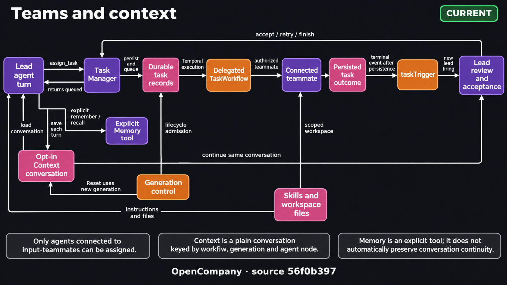

# Agent-to-Agent Delegation (Nested Agents)

New generations record `agent_lifecycle_version=1`. They use connected nodes as
templates, reusable instances as conversations, and tasks as reviewed work.
This document describes execution ownership and adapter boundaries. See
[Agent Teams](agent_teams.md#reusable-instances-lifecycle-version-1) for lifecycle,
receipts and recovery, and the [Task Manager contract](node-logic-flows/ai_tools/taskManager.md#lifecycle-version-1-tool-contract)
for model-facing arguments. Generations without the recorded marker retain the
version 0 path documented later in this file.

## Version 1 execution path

```mermaid
sequenceDiagram
    participant Talk as Talk contact
    participant Store as Durable job and inbox store
    participant Lead as Lead instance owner
    participant Worker as Teammate instance owner
    participant Runtime as Native / Pi / CLI / RLM
    Talk->>Store: Talk Task Manager calls submit_job(instructions)
    Store-->>Talk: job ID and saved status
    Store->>Lead: explicit handoff, isolated conversation
    Lead->>Store: Lead Task Manager calls spawn_<teammate>(instructions, after?)
    Note over Store: Commit instance, task, attempt and input together
    Store-->>Lead: agent ID and current task_ref
    Store->>Worker: wake hint; inbox remains authoritative
    opt Owner asks for progress
        Talk->>Store: get_job_status(job_id)
        Store-->>Talk: saved job state and task counts
    end
    Worker->>Store: claim one fenced run
    Worker->>Runtime: execute with instance history and frozen template
    Runtime->>Store: checkpoint transcript and consumed receipts
    Worker->>Store: submit result and enqueue owning-lead review atomically
    Store->>Lead: review input through the same owner
    Lead->>Store: inspect_task; accept_task or request_changes
    Lead->>Store: final result through reviewed delivery gates
    Store-->>Talk: append final result using original delivery identity
```

### Admission and one execution owner

`AgentWorkflow.run` bootstraps a version 1 `ai_employee` or
`orchestrator_agent` lead into `AgentInstanceSessionWorkflow`. Hire uses the
`ai_employee` as its lead. Its top output connects to the `aiAgent` Talk
contact's Team input. This edge identifies the destination for a job.
Talk keeps its chat execution and uses its own Task Manager for
`submit_job` and `get_job_status`. The lead's separate Task Manager binds a
spawn operation for each specialist connected to its `input-teammates`.
`bootstrap_instance` captures the admitted graph and configuration, and
`turn_context` projects each claimed run from that durable snapshot.

Spawning creates a fresh instance and its first task in one database
transaction. Assigning again queues a new task on the selected instance.
Queued work acquires no concurrency capacity. The instance owner claims one
run, acquires capacity for an active descendant, and invokes the existing
native/Pi child workflow or the direct opaque-runtime Activity. Follow-up
messages and reviews enter that same inbox; they do not start another executor
against the conversation.

The instance ID, run fence, transcript revision and owning-run ID protect the
plain MessageWire transcript. Each task attempt also records its assigned
instance/run and contract snapshot. Cancelling an attempt invalidates its
writer; a late response cannot overwrite the transcript or submit a newer
attempt. Retry reuses the contract and conversation; reassignment creates a
fresh target instance while preserving the task ID and feedback.

The session workflow drains a busy period, exits when idle and can restart
under the deterministic `agent-instance:<id>` workflow ID. Database input and
physical owner/run identity survive worker restart and Temporal rollover.
Signals only accelerate recovery. Fair reconciliation revisits queued input,
interrupted owners, completed-job retirement and recorded permit cleanup.

### What crosses the boundary

| Input | Source and isolation |
|---|---|
| Work instructions and `after` | Validated model arguments; stored exactly, with explicit prerequisite task references |
| Provider, model, tools, skills and capabilities | Frozen connected template configuration; peer text cannot grant access |
| Conversation | Instance's built-in transcript, independent of the template node and other jobs |
| Upstream values | Captured source outputs for the job; instance output/session namespace prevents sibling fallback reads |
| Runtime authority | Trusted workflow, generation, job, team, lead and run metadata supplied by the runtime |
| Peer messages | Ordered inbox deliveries labelled as another agent's input, never owner approval |
| Final destination | Original durable job source and approval policy; not the instance's session ID |

Temporal preparation captures the shared graph and runtime context once for
the instance or Talk turn. Each lifecycle tool binding carries a compact
identity. Dispatch attaches the shared context to the selected tool call.
This keeps the prepare result from repeating the full graph for every
connected specialist's spawn and reassignment tools.

Instance turns strip Talk's live chat run scope. Their output/session IDs are
`agent-instance:<id>`, while generation control and original delivery provenance
retain their admitted identities. Reviews return to the original lead
instance. A duplicate version 1 `taskTrigger` event validates the persisted
task/owner/lead/job/generation and wakes that lead; it never calls `ensure_lead`
to manufacture a replacement review conversation.

### Adapter continuation and mailbox boundaries

| Runtime | Continuation | Input and stopping boundary |
|---|---|---|
| Native | Instance-scoped canonical transcript | Admit queued input only after the complete model/tool round and all tool results are recorded |
| Pi | Same transcript, with Pi receipts/checkpoints and original call ordering | Complete tool boundary; durable waits park and release driver resources |
| Claude CLI | Instance-specific pool key, workspace and stored provider session UUID | Sequential warm turns or explicit session resume; queued input reaches the next turn |
| Codex CLI | Persist returned thread ID; subsequent process uses explicit `codex exec resume <ID>` in the retained instance workspace | Next-turn delivery, process result as completion evidence |
| RLM | Replay instance conversation into the next completion | REPL variables are ephemeral; next-turn delivery; root, nested, fallback and effectful requests honor admission fencing |

Provider-session files must remain on durable storage or their recorded owning
worker. Missing or incompatible continuation blocks the turn rather than
silently starting a fresh conversation. OpenCompany owns team lifecycle and
does not depend on Claude's native team availability in the pipe-based launch
mode. Adapter behavior is also described in [CLI agent framework](cli_agent_framework.md)
and [agent context flow](agent_context_flow.md).

### Capacity, waits and interruption

The root-wide active-descendant limit is captured at admission (default three,
excluding the lead). One instance never has two execution owners. Native/Pi
`wait_for_agents` releases the active permit while parked; continuation obtains
a fresh physical lease. Lease records are attached to the durable run, so a
confirmed terminated owner can be cleaned up without freeing a live sibling's
capacity. Transport failure alone cannot authorize release.

The wait schema permits `timeout_seconds` from zero to 30, default 30. Opaque
adapters that cannot yield their execution lease return a current `pending`
snapshot immediately. A wait or idle state says nothing about task acceptance.

Generation Stop preserves queued inputs, tasks and continuations behind the
generation control gate. It is distinct from `stop_agent`, which halts and
fences an instance's current execution, and `cancel_task`, which cancels a
particular attempt. Resume does not silently retry a failed task. Reset closes
old recipients and disposes pending deliveries explicitly. A closed recipient
is never redirected to a replacement instance.

Three classified malformed orchestration requests halt the logical turn. The
budget and original call IDs survive continuation/retries; successful unrelated
calls do not reset it. Already admitted operations can settle, while no new
provider request or effect is admitted. Existing child work remains durable.
For a recoverable blocked job lead, the owner uses **Retry review** to resume
that same lead and review existing work. See the
[recovery contract](agent_teams.md#stop-resume-reset-and-review-recovery).

## Legacy delegation (version 0)

**Everything below describes retained version 0 or non-team compatibility.**
Its `task_manager(operation="assign_task", ...)`, `delegate_to_*`, detached
task runners and process-local background tasks are not the version 1 tool
surface or ownership model. In version 0, Orchestrator and AI Employee models
use the intrinsic Task Manager, while delegate names remain internal dispatch
identities. Direct non-team agent-tool connections retain their separate
compatibility behavior.

The [tool-building pipeline](tool_building_pipeline.md) describes the common
`AgentToolSpec` / `ToolDef` construction and the legacy
`{"status": "delegated"}` lifecycle opt-out.

<!-- architecture-suite:start -->
## Architecture diagrams

Source baseline: `56f0b397`. [Complete diagram suite](../docs/diagrams/architecture/README.md).

**Teams and context — Historical version 0 baseline.** This image predates
reusable instances; use the version 1 sequence above for current ownership.

[](../docs/diagrams/architecture/09-teams-context-v1.png)

[Editable Mermaid](../docs/diagrams/architecture/09-teams-context.mmd) · [Source evidence and limitations](../docs/diagrams/architecture/09-teams-context.brief.md)

<!-- architecture-suite:end -->

## Overview

AI Agents can delegate tasks to other agents connected to their `input-tools` handle. The parent agent's LLM decides when to call the child agent by invoking a `delegate_to_<agent>` tool.

**Two execution paths** depending on whether the parent is running under Temporal F4.B:

- **F4.B (default, `TEMPORAL_AGENT_WORKFLOW_ENABLED=true`):** Task Manager assignment persists first, then `AgentWorkflow` starts a detached **`DelegatedTaskWorkflow`** with `ParentClosePolicy.ABANDON` and immediately returns `queued` to the lead. The runner owns the root-wide permit, task claim, child `AgentWorkflow`, compact result/usage persistence, `taskTrigger`, and permit release. The LLM's `{task, context}` args travel as `child_context["invocation"]`; `prepare_agent_payload` applies them after stored config resolution, so saved defaults cannot override the mission. Parent identity still travels in `parent_node_id` for status mirroring. Completion starts a separately scoped lead review instead of blocking the assigning invocation — see [TEMPORAL_ARCHITECTURE.md §F4.B](./TEMPORAL_ARCHITECTURE.md#agent-as-child-workflow-f4b).
- **Legacy / F4.A-only:** the rest of this doc. `_execute_delegated_agent` spawns the child as an independent `asyncio.Task` and the parent continues working immediately — the **fire-and-forget** pattern. Applies the same task/context semantics by overwriting `child_params` AFTER loading them from the DB. Still the path for `rlm_agent` / `claude_code_agent` (excluded from `AGENT_WORKFLOW_TYPES`) and any deployment with F4.B disabled.

In both paths the parent passes only a `task` string and optional `context` string — per-invocation input that always wins over stored configuration. Everything else -- the child's provider, model, memory, skills, and tools -- comes from the child's own configuration and workflow connections.

## Generation Stop/Resume ownership

The F4.B path has two lifetimes. Direct non-team delegation starts an attached
`AgentWorkflow` child and collects its result through the existing child
handle. Task Manager assignment starts a detached `DelegatedTaskWorkflow`
runner with `ParentClosePolicy.ABANDON`; the runner can outlive the assigning
lead and owns its attached agent child, permit, and terminal bookkeeping.
Native parent discovery alone cannot find the runner after the lead closes.

For new `execution_control_version=1` generations, every detached runner
enrolls with the existing generation controller through an acknowledged Update
before admitting business work. The maintenance Activity/client bridge returns
current pause/revision/hold posture so a late runner cannot bypass Stop.
Attached agent children inherit the scope and require no separate registration.
The controller's independent-root map and membership epoch survive rollover;
control checks the execution chain while addressing the current Workflow ID.

Stop closes admission throughout the discovered topology before waiting for
admitted Activities and result bookkeeping to drain. A child-start gate counts
only until start acknowledgement, enabling reliable native enumeration. A
parent waiting for child completion or a runner waiting for a subagent permit
does not hold the local drain count; its child is acknowledged separately.
Stopped children therefore do not deadlock a parent's checkpoint. Completion
persistence and permit cleanup for work already completed still run normally.
No task is cancelled or re-queued merely because its generation is stopped.

Resume publishes a newer revision with producers held, releases descendants and
registered roots, reconciles membership, and releases controller/local/schedule
producers. It uses existing handles and pending continuations rather than
creating replacement runners or repeating completed tools. Pending task events
remain queued for later processing. Agent continuation carries prepared
configuration and bindings; rollover is deferred while child handles or Task
Manager tasks remain live.

The stronger guarantee is limited to version 1 Temporal generations. It does
not turn process-local `asyncio.Task` delegation inside an opaque node into
independent Temporal roots. Claude Code and RLM nodes remain
whole-Activity boundaries; their internal calls may continue until that
Activity settles. Unlimited LLM retries can delay complete Stop acknowledgement,
and ambiguous external effects remain subject to tool retries/idempotency.
See [Temporal workflow control](temporal-workflow-control.md) and
[Agent continuation](TEMPORAL_ARCHITECTURE.md#agent-continuation-under-history-pressure).

## Architecture

```
Parent Agent (chatAgent / aiAgent / specialized)
  |
  |  LLM calls: delegate_to_ai_agent(task="...", context="...")
  |
  v
tool_executor callback (closure in ai.py)
  |  Injects: ai_service, database, nodes, edges, workflow_id,
  |           parent_node_id, execution_id
  |
  v
execute_tool() dispatcher (handlers/tools.py)
  |  Routes node_type in AI_AGENT_TYPES to _execute_delegated_agent()
  |
  v
_execute_delegated_agent() (handlers/tools.py)
  |  1. Fetches child_params from DATABASE
  |  2. Injects API key + default model from credential store
  |  3. task -> system_message (directive),
  |     context-or-task -> prompt
  |  4. Builds child_context with all nodes/edges
  |  5. Spawns asyncio.create_task()
  |  6. Returns immediately: {status: "delegated", task_id: "..."}
  |
  v                                           v
Parent continues reasoning            Child runs independently
(non-blocking)                           |
                                         v
                                    plugin_cls().execute(child_node_id, child_params, child_ctx)
                                         |  (BaseNode.execute -> the agent plugin's
                                         |   @Operation method in nodes/agent/<plugin>/)
                                         |
                                    collect_agent_connections(child_node_id)
                                         |  (services/plugin/edge_walker.py)
                                         |  Filters edges by child's ID
                                         |  Finds child's own memory/skills/tools/task
                                         |
                                    AIService.execute_agent() / execute_chat_agent()
                                         |  Uses child's provider/model
                                         |  Uses child's memory (isolated session)
                                         |  Uses child's skills + tools
                                         |  system_message = delegated task,
                                         |  prompt = delegated context
                                         |
                                    Result broadcast via WebSocket
                                    (NOT returned to parent LLM)
```

## The Delegation Chain (7 Steps)

### Step 1: Parent Builds Tool from Child Agent Node

**File:** `server/services/ai.py`, `_build_tool_from_node()`

When the parent agent starts executing and finds a child agent connected to its `input-tools` handle, `_build_tool_from_node()` is called during tool setup:

```python
for tool_info in tool_data:
    tool, config = await self._build_tool_from_node(tool_info)
    tools.append(tool)
    tool_configs[tool.name] = config
```

For agent node types, the method:

1. Resolves the tool name via `_resolve_default_tool_name_description(node_type)` — a closure inside `_build_tool_from_node()` that reads the plugin class's `tool_name` ClassVar (each agent plugin declares `tool_name = "delegate_to_<x>"`). There is no central `DEFAULT_TOOL_NAMES` dict; the name comes from the plugin class via `services.node_registry.get_node_class`. The delegation branch is gated by `_get_tool_schema()`'s `_AGENT_DELEGATION_TYPES` tuple in `services/ai.py`, which mirrors the authoritative `AI_AGENT_TYPES` frozenset in `server/constants.py`. The `tool_name = f"delegate_to_{cls.type}"` default is stamped by `BaseNode.__init_subclass__` in `services/plugin/base.py`; `aiAgent` and `chatAgent` declare their names explicitly.

2. Creates a `DelegateToAgentSchema` Pydantic model in `_get_tool_schema()` with two fields (`task` -> the child's mission directive / system message, `context` -> the child's input data / prompt):
   ```python
   class DelegateToAgentSchema(BaseModel):
       task: str = Field(
           description=f"The mission directive for '{agent_label}'. ..."
       )
       context: Optional[str] = Field(
           default=None,
           description="Input data or specific details the agent needs to work with, ..."
       )
   ```

3. Returns a config dict:
   ```python
   config = {
       'node_type': node_type,          # e.g., 'aiAgent'
       'node_id': node_id,              # child's node ID
       'parameters': node_params,       # child's stored params (from tool_info)
       'label': node_label,
       'connected_services': []
   }
   ```

The LLM sees a tool like `delegate_to_ai_agent(task="...", context="...")`. It does NOT see or fill the child's actual configuration (provider, model, temperature, etc.).

---

### Step 2: Tool Executor Callback Injects Services

**File:** `server/services/ai.py`, `tool_executor` / `chat_tool_executor` closures

Both `execute_agent()` and `execute_chat_agent()` define nearly identical tool executor callbacks as closures. When the parent's LLM decides to call the delegation tool, the callback fires.

The callback captures from outer scope:

| Variable | Source | Purpose |
|----------|--------|---------|
| `tool_configs` | Built in step 1 | Maps tool name to config dict |
| `self` | AIService instance | Provides `.database`, `.auth` |
| `broadcaster` | Function parameter | WebSocket status broadcasts |
| `workflow_id` | Function parameter | Scopes broadcasts to workflow |
| `context` | Function parameter | Contains `nodes` and `edges` arrays |

Before calling `execute_tool()`, the callback injects the service + graph fields into the config:

```python
config["workflow_id"]    = workflow_id
config["ai_service"]     = self               # AIService instance (shared)
config["database"]       = self.database      # Database instance (shared)
config["parent_node_id"] = node_id            # parent's node id (duplicate tracking)
if context:
    config["nodes"]        = context.get("nodes", [])   # ALL workflow nodes
    config["edges"]        = context.get("edges", [])   # ALL workflow edges
    config["workspace_dir"] = context.get("workspace_dir", "")
    config["execution_id"]  = context.get("execution_id")  # stable per-run id
```

These injected fields are what enable the child agent to discover its own connections and execute independently. Without them, the child would have no access to the workflow graph or services.

---

### Step 3: Dispatch to Delegation Handler

**File:** `server/services/handlers/tools.py`, `execute_tool()`

The dispatcher checks `node_type` against the `AI_AGENT_TYPES` frozenset (`server/constants.py`) and routes every agent type to `_execute_delegated_agent()`:

```python
from constants import AI_AGENT_TYPES

if node_type == "_builtin_check_delegated_tasks":
    return await _execute_check_delegated_tasks(tool_args, config)

if node_type in AI_AGENT_TYPES:
    return await _execute_delegated_agent(tool_args, config)
```

`AI_AGENT_TYPES` in `server/constants.py` is the single source of truth for standard delegatable agents and the CLI/REPL agents that bypass the standard loop.

---

### Step 4: Delegated Agent Execution (Fire-and-Forget)

**File:** `server/services/handlers/tools.py`, `_execute_delegated_agent()`

This is where the actual parameter assembly happens.

**4a. Extract injected services from config:**
```python
ai_service  = config.get("ai_service")
database    = config.get("database")
nodes       = config.get("nodes", [])
edges       = config.get("edges", [])
workflow_id = config.get("workflow_id")
```

A `(parent_node_id, node_id, task_hash)` duplicate guard (`_active_delegations`) short-circuits with `status: "ALREADY_DELEGATED"` if the LLM calls the same delegation twice. A per-child counter (`_active_delegated_nodes`) keeps the child's canvas glow alive past the parent run's end (the background task outlives the `delegate_to_<x>` tool return).

**4b. Fetch child's OWN parameters from database:**
```python
child_params = await database.get_node_parameters(node_id) or {}
```

The child's stored parameters (provider, model, temperature, etc.) come from the database -- whatever the user configured in the child node's parameter panel. They are NOT inherited from the parent. The stored `system_message` and `prompt` are loaded here too, but step 4e overwrites both with the delegated `task` / `context`.

**4c. Inject API key if missing:**
```python
if not child_params.get("api_key"):
    provider = detect_ai_provider(node_type, child_params)
    key = await ai_service.auth.get_api_key(provider, "default")
    if key:
        child_params["api_key"] = key
```

The child gets its API key from the credential store based on its own provider setting. If the child is configured for Anthropic and the parent uses OpenAI, the child gets the Anthropic key.

**4d. Inject default model if not set:**
```python
if not child_params.get("model"):
    provider = detect_ai_provider(node_type, child_params)
    models = await ai_service.auth.get_stored_models(provider, "default")
    if models:
        child_params["model"] = models[0]
```

**4e. Map the delegated task/context onto the child's params:**
```python
# task -> mission directive (system message), context -> input data (prompt)
child_params["system_message"] = task_description
child_params.pop("systemMessage", None)   # drop pre-migration camelCase mirror
child_params["prompt"] = task_context if task_context else task_description
```

These two strings are the **only inputs the parent passes to the child**. `task` becomes the child's `system_message` (its mission directive); `context` becomes its `prompt` (its input data), falling back to the task text when no context is given. Everything else comes from the child's own stored configuration.

**4f. Build child execution context:**
```python
child_context = {
    "nodes": nodes,              # ALL workflow nodes (not just child's)
    "edges": edges,              # ALL workflow edges (not just child's)
    "workflow_id": workflow_id,  # Parent's workflow ID (for status scoping)
    "outputs": {},               # Empty -- child starts fresh
    "parent_task_id": task_id,   # Link back to parent's delegation task
    "execution_id": config.get("execution_id"),  # shared per-run id (session-keyed tools)
}
```

**4g. Spawn as background task and return immediately:**
```python
task = asyncio.create_task(run_child_agent())
_delegated_tasks[task_id] = task

return {
    "success": True,
    "status": "delegated",
    "task_id": task_id,
    "agent_node_id": node_id,
    "agent_name": agent_label,
    "message": f"Task delegated to '{agent_label}'. Agent is now working independently...",
}
```

Inside `run_child_agent()`, the child executes through its own plugin class (Wave 11.E.3 — the legacy `handle_ai_agent` / `handle_chat_agent` imports are gone). Every agent type owns an `@Operation` method that wraps `prepare_agent_call` + `AIService` dispatch, so delegation just goes through `BaseNode.execute`:

```python
from services.node_registry import get_node_class
from services.plugin import NodeContext

plugin_cls = get_node_class(node_type)
instance = plugin_cls()
child_ctx = NodeContext.from_legacy(
    node_id=node_id, node_type=node_type, context=child_context,
)
result = await instance.execute(node_id, child_params, child_ctx)
```

---

### Step 5: Child Handler Collects Its Own Connections

**File:** `server/nodes/agent/_inline.py`, `prepare_agent_call()` (called by every agent plugin's `@Operation`)

The spawned child's `execute()` runs `prepare_agent_call()`, which calls `collect_agent_connections()` (from `server/services/plugin/edge_walker.py`) with **its own node_id**. The function returns a **5-tuple** — `(context_data, skill_data, tool_data, input_data, task_data)` (`edge_walker.py:181-199`; the first element is the Context descriptor, or the legacy Memory descriptor on `input-memory` graphs):

```python
context_data, skill_data, tool_data, input_data, task_data = await collect_agent_connections(
    node_id,       # CHILD's node ID
    child_context, # Contains ALL nodes/edges
    database,
    log_prefix="[AI Agent]",
)
```

---

### Step 6: Connection Filtering by Node ID

**File:** `server/services/plugin/edge_walker.py`, `collect_agent_connections()`

This function receives ALL nodes/edges but filters by the child's `node_id`:

```python
for edge in edges:
    if edge.get("target") != node_id:   # Only edges pointing TO this child
        continue

    target_handle = edge.get("targetHandle")
    source_node_id = edge.get("source")
```

For each matching edge, it checks the target handle:

| Handle | Action |
|--------|--------|
| `input-context` | Resolves the child's conversation-store descriptor (RFC-0002). Memory is an ordinary tool on `input-tools`. |
| `input-skill` | Loads skill instructions; expands masterSkill into individual enabled skills |
| `input-tools` | Discovers directly connected tool nodes, including Android services |
| `input-main` / `input-chat` | Reads upstream node output for auto-prompt fallback |
| `input-task` | Collects `taskTrigger` output for the conversational task-report pattern |

The child only gets connections that are physically wired to it in the workflow graph. If the child has no Context node connected, `context_data` is `None` (and it runs without stored conversation history). If the child has its own tools — including a `simpleMemory` tool node — it gets those tools -- and can delegate further.

---

### Step 7: Child Executes with Its Own Resources

**File:** `server/services/ai.py`, `execute_agent()` / `execute_chat_agent()`

The child now executes with:

| Resource | Source |
|----------|--------|
| Prompt | Delegated `context` from parent's LLM (falls back to `task`) |
| System message | Delegated `task` from parent's LLM (replaces the child's stored system message) |
| Provider / model | Child's own (from its DB params) |
| API key | Injected from credential store based on child's provider |
| Temperature / max tokens | Child's own (from its DB params) |
| Memory | Child's own connected simpleMemory node (if any) |
| Skills | Child's own connected skill nodes (if any) |
| Tools | Child's own connected tool nodes (if any) |

The child's result is broadcast to the UI via WebSocket but is NOT fed back into the parent's reasoning loop.

---

## Memory Isolation

Parent and child agents have separate conversation contexts. On current
(V2) graphs the child's conversation is its own RFC-0002 Context store row,
keyed by `(workflow_id, generation, <child agent_node_id>)`, and `simpleMemory`
is an explicit tool the child calls on its own `input-tools`; the table below
describes the legacy markdown model, which survives only for graphs recorded
with an `input-memory` edge:

| Aspect | Parent Agent | Child Agent |
|--------|-------------|-------------|
| Memory source | Parent's connected simpleMemory | Child's connected simpleMemory |
| Session ID | From parent's memory node params | From child's memory node params |
| Memory content | Parent's conversation markdown | Child's conversation markdown |
| Vector store | `_memory_vector_stores[parent_session]` | `_memory_vector_stores[child_session]` |
| Memory updates | Parent appends its own exchanges | Child appends its own exchanges |
| Shared? | **No** -- completely isolated | **No** -- completely isolated |

If the child has **no memory node connected**, it has no conversation history and executes statelessly with just the delegated task prompt.

---

## Parameter Flow Summary

### What the parent passes to the child

| Parameter | How it arrives |
|-----------|---------------|
| `task` (string) | Parent's LLM generates it via `DelegateToAgentSchema` tool call; becomes the child's `system_message` |
| `context` (optional string) | Parent's LLM generates it via `DelegateToAgentSchema` tool call; becomes the child's `prompt` (falls back to `task`) |
| `workflow_id` | Injected by tool_executor callback from parent's execution context |
| `nodes` / `edges` | Injected by tool_executor callback -- ALL workflow nodes and edges |
| `ai_service` / `database` | Injected by tool_executor callback -- shared instances (by reference) |

### What the child gets from its own config

| Parameter | Source |
|-----------|--------|
| `provider` | Child's DB params (e.g., `'openai'`, `'anthropic'`) |
| `model` | Child's DB params (e.g., `'gpt-4o'`), or first stored model as fallback |
| `temperature` | Child's DB params |
| `max_tokens` / `maxTokens` | Child's DB params |
| `thinking_enabled` / `thinking_budget` | Child's DB params |
| `api_key` | Credential store, resolved by child's own provider |
| Memory | Child's own connected simpleMemory node |
| Skills | Child's own connected skill nodes |
| Tools | Child's own connected tool nodes |

### What the parent does NOT pass

- Provider, model, temperature, max tokens
- The parent's own system message (the child's stored one is replaced by the delegated `task` instead)
- Memory or conversation history
- Skills or skill instructions
- Tool configurations
- API keys

---

## What the Parent Receives Back

### Immediate Response (Fire-and-Forget)

The parent LLM receives this immediate response from the tool call:

```json
{
  "success": true,
  "status": "delegated",
  "task_id": "delegated_node123_a1b2c3d4",
  "agent_node_id": "child_agent_node_123",
  "agent_name": "Research Agent",
  "message": "Task delegated to 'Research Agent'. Agent is now working independently..."
}
```

The parent does NOT wait for the child's result. The child's output is broadcast to the UI via WebSocket (`broadcaster.update_node_status`).

### Optional Blocking Delegation (delegation_wait_seconds)

Callers may opt into a bounded wait for a delegated child result:

- The caller sets `config["delegation_wait_seconds"]` on the dispatch config for agent-type tools.
- `_execute_delegated_agent` then awaits the spawned child via `wait_for_delegation` (`asyncio.wait_for(asyncio.shield(task))` — a timeout cancels the WAITER, never the child) and returns the child's REAL result as the function result, shaped by `_delegation_result_reply`.
- The reply carries `delegation_lifecycle: True`; `execute_tool` pops it and skips its terminal `success` broadcast (the child's `run_child_agent` already owns the terminal status — an awaited `error` result must not be stomped by a `success` glow).
- On timeout the child keeps running in the background and the parent receives the standard `status: "delegated"` ack. The parent can retrieve the result through `check_delegated_tasks` on a later turn. An identical re-call after a timeout hits the `_active_delegations` dedupe and awaits the existing in-flight task instead of duplicating work.
- Absent `delegation_wait_seconds` (all native agents), behavior is byte-identical fire-and-forget.

Contract locked by `TestDelegationWait` (`tests/nodes/test_ai_tools.py`).

### Result Retrieval (check_delegated_tasks Tool)

When a parent agent has delegation tools, a `check_delegated_tasks` tool is automatically injected. The parent LLM can call this tool to check on child status and retrieve results:

```python
# LLM calls:
check_delegated_tasks(task_ids=["delegated_abc123"])

# Returns:
{
  "total_tasks": 1,
  "completed": 1,
  "running": 0,
  "errors": 0,
  "tasks": [{
    "task_id": "delegated_abc123",
    "status": "completed",
    "agent_name": "Research Agent",
    "result": "The research findings show..."
  }]
}
```

### 3-Layer Result Storage (Celery AsyncResult / Ray ObjectRef Pattern)

Results are stored in a 3-layer hierarchy for fast access and durability:

| Layer | Storage | Survives Restart | Access Speed |
|-------|---------|------------------|--------------|
| 1 | `asyncio.Task` in `_delegated_tasks` | No | O(1), task.result() |
| 2 | `_delegation_results` dict | No | O(1), dict lookup |
| 3 | `NodeOutput` SQLite table | Yes | DB query |

**Layer 1**: Live tasks are tracked in `_delegated_tasks`. When a task completes, `task.result()` extracts the return value.

**Layer 2**: Results are cached in `_delegation_results` dict immediately after child completion/error. This survives the task cleanup in the `finally` block.

**Layer 3**: Results are persisted to the existing `NodeOutput` table with `session_id="delegation_{task_id}"`. This survives server restarts indefinitely.

```python
# On child completion:
_delegation_results[task_id] = {
    "task_id": task_id,
    "status": "completed",
    "agent_name": agent_label,
    "result": result.get('result', {}).get('response', ...),
}

# Persist to NodeOutput table
await database.save_node_output(
    node_id=node_id,
    session_id=f"delegation_{task_id}",
    output_name="delegation_result",
    data={...}
)
```

### Auto-Injection Logic

The `check_delegated_tasks` tool is only injected when the parent has delegation tools:

```python
# In execute_agent() and execute_chat_agent():
if any(name.startswith('delegate_to_') for name in tool_configs):
    check_info = {
        'node_type': '_builtin_check_delegated_tasks',
        'node_id': f'{node_id}_check_tasks',
        'parameters': {},
        'label': 'Check Delegated Tasks',
    }
    check_tool, check_config = await self._build_tool_from_node(check_info)
    if check_tool:
        tools.append(check_tool)
        tool_configs[check_tool.name] = check_config
```

---

## Recursive Delegation

If the child agent has other agents connected to its own `input-tools` handle, it can delegate further. Each level follows the same pattern:

1. Child's `_build_tool_from_node()` creates a `DelegateToAgentSchema` tool for the grandchild
2. Child's `tool_executor` callback injects services and the same `nodes`/`edges` graph
3. Grandchild spawns as its own `asyncio.create_task()`
4. Grandchild collects its own connections by filtering edges with its own `node_id`

Delegation is depth-bounded. `MAX_DELEGATION_DEPTH` defaults to 2 and accepts
1–2 child layers (`core/config.py`); `services/handlers/tools.py` rejects a
request at the resolved limit before starting the child. Each agent remains
independently configured. Its Context is private; durable facts can be shared
only through explicitly connected Memory tools. Managed team assignments use
the Task Manager contract and must also satisfy the topology limits.

---

## Status Broadcasting

Every delegated agent broadcasts status at key phases via WebSocket:

| Phase | When | Broadcast to |
|-------|------|-------------|
| `delegated_task` | Child starts executing | Child's node ID |
| `initializing` | Creating LLM model | Child's node ID |
| `loading_memory` | Parsing markdown history (legacy `input-memory` graphs only; not emitted when a Context node resolves) | Child's node ID |
| `building_tools` | Converting tool nodes to `AgentToolSpec` values | Child's node ID |
| `invoking_llm` | Calling model | Child's node ID |
| `executing_tool` | Running a tool called by child's LLM | Tool node ID |
| `delegated_complete` | Child finishes successfully | Child's node ID |
| `delegated_error` | Child fails | Child's node ID |

All broadcasts include `workflow_id` for UI scoping. The frontend uses these to show real-time execution animations on the child agent node.

---

## Key Files

| File | Role |
|------|------|
| `server/services/ai.py` | `_build_tool_from_node()`, `_get_tool_schema()` (incl. `_AGENT_DELEGATION_TYPES` + `DelegateToAgentSchema`), `_resolve_default_tool_name_description()`, `tool_executor` / `chat_tool_executor` closures, `execute_agent()` / `execute_chat_agent()` |
| `server/services/plugin/edge_walker.py` | `collect_agent_connections()` (5-tuple: context / skill / tool / input / task) |
| `server/nodes/agent/_inline.py` | `prepare_agent_call()` — the 3-step pre-dispatch flow (connection collection + param prep) every agent plugin's `@Operation` runs |
| `server/nodes/agent/<plugin>/__init__.py` | Per-agent plugin classes (`ai_agent`, `chat_agent`, the specialized agents) with their delegation `tool_name` ClassVar + `@Operation` execute method |
| `server/services/handlers/tools.py` | `execute_tool()` dispatcher, `_execute_delegated_agent()`, `_execute_check_delegated_tasks()`, `_delegated_tasks` / `_delegation_results` / `_active_delegations` tracking |
| `server/constants.py` | `AI_AGENT_TYPES` frozenset, `detect_ai_provider()` |
| `client/src/components/AIAgentNode.tsx` | Frontend rendering of execution phase animations |
---

## Key Findings

1. **Only task/context strings flow from parent to child.** No other parameters (model, temperature, memory, skills) are inherited.

2. **Child configuration comes from its own database params.** Whatever the user set in the child's parameter panel is what the child uses.

3. **Context is private to each agent.** Each agent loads its own conversation row. Memory is an explicit facts tool: isolation or sharing follows the connected Memory nodes rather than an automatic parent-to-child transcript copy.

4. **The child sees the full workflow graph** via `nodes`/`edges`, but `collect_agent_connections()` filters by the child's own `node_id`, so it only gets resources physically connected to it.

5. **Services are shared, not duplicated.** `ai_service` and `database` are passed by reference. They share the same credential store and DB connection.

6. **Delegation is non-blocking.** `asyncio.create_task()` spawns the child; the parent continues immediately. The child's result is NOT returned to the parent's LLM.

7. **Recursive delegation is bounded.** A child with connected agents may delegate only below the resolved `MAX_DELEGATION_DEPTH` limit (default 2, supported range 1–2).

8. **Task Trigger enables workflow-based result handling.** The `taskTrigger` node fires when delegated tasks complete, allowing workflows to process child agent results.

---

## Event-Driven Task Completion (taskTrigger)

In addition to the `check_delegated_tasks` tool (LLM-driven result checking), the system provides an event-driven approach via the `taskTrigger` workflow node. This enables parent workflows to react to child completion without polling.

### Architecture

```
Child Agent completes (success or error)
       ↓
tools.py: _execute_delegated_agent.run_child_agent()
       ↓
broadcaster.send_custom_event('task_completed', event_data)
       ↓
event_waiter dispatch ('task_completed', event_data)
       ↓
Matching taskTrigger nodes resolve their Futures
       ↓
Downstream workflow nodes execute with delegation result
```

> Note (Wave 12/13): `taskTrigger` is one of the canary-registered trigger types. Under the canary path the producer's CloudEvents envelope routes via `dispatch.emit`; the legacy `event_waiter.register` / `send_custom_event` path is retained for the in-process fallback. See [event_framework.md](./event_framework.md) and the trigger-architecture notes in CLAUDE.md.

### Event Data Schema

The `task_completed` event carries:

```python
{
    'task_id': str,           # e.g., "delegated_abc123_xyz"
    'status': str,            # 'completed' or 'error'
    'agent_name': str,        # Label of child agent
    'agent_node_id': str,     # Node ID of child agent
    'parent_node_id': str,    # Node ID of parent that delegated
    'result': str,            # Response text (if completed)
    'error': str,             # Error message (if error)
    'workflow_id': str,       # For scoping
}
```

### Filter Options

The `taskTrigger` node supports filtering to match specific delegation events:

| Filter | Description |
|--------|-------------|
| `task_id` | Exact match on specific task ID |
| `agent_name` | Partial match on child agent name |
| `status_filter` | `all`, `completed`, or `error` |
| `parent_node_id` | Only trigger for delegations from specific parent |

### Usage Example

```
[Parent Agent] --delegates--> [Research Agent]
                                    ↓ (completes)
                              [task_completed event]
                                    ↓
                         [Task Trigger]
                            (filters: agent_name="Research")
                                    ↓
                         [Process Results Node]
                            (uses {{taskTrigger.result}})
```

### Key Files

| File | Changes |
|------|---------|
| `server/services/event_waiter.py` | TriggerConfig, filter builder, FILTER_BUILDERS entry |
| `server/services/handlers/tools.py` | `send_custom_event()` calls (success + error paths) |
| `server/constants.py` | `taskTrigger` in EVENT_TRIGGER_TYPES, WORKFLOW_TRIGGER_TYPES |
| `client/src/components/parameterPanel/InputSection.tsx` | Output schema for draggable variables |

### LLM-Driven vs Event-Driven vs Agent-Handled

| Approach | Tool/Handle | When to Use |
|----------|-------------|-------------|
| **LLM-Driven** | `check_delegated_tasks` | Parent LLM decides when to check results and how to process them |
| **Event-Driven** | `taskTrigger` | Workflow automatically reacts to completion, processes via downstream nodes |
| **Agent-Handled** | `input-task` handle | Parent agent receives task result and reports to user conversationally |

All approaches can coexist. The LLM-driven approach is better for dynamic reasoning about results; the event-driven approach is better for deterministic post-processing workflows; the agent-handled approach is best when you want the parent agent to interpret and communicate results naturally.

---

## Agent Task Input Handle (input-task)

All AI agents (`aiAgent`, `chatAgent`, and the specialized agents — live count via `glob server/nodes/agent/*/__init__.py`) have an `input-task` handle on the left side that can receive task completion events from `taskTrigger` nodes. This enables a conversational pattern where the parent agent reports delegated task results to the user.

### Architecture

```
[Child Agent] completes
       ↓
[taskTrigger] fires (filters by agent_name/status)
       ↓
[Parent Agent] (input-task handle)
       ↓
Agent generates conversational response about completed task
```

### How It Works

1. **Backend Detection**: `collect_agent_connections()` in `server/services/plugin/edge_walker.py` detects nodes connected to the `input-task` handle and returns the collected `task_data` (5th element of the tuple)
2. **Task Data Collection**: Collects output from the connected `taskTrigger` node
3. **Context Injection**: `prepare_agent_call` (`server/nodes/agent/_inline.py`) calls `format_task_context()` (from `edge_walker.py`) to render `task_data` as prompt context
4. **Prompt Prepending**: Task context is prepended to the agent's prompt before execution

### Task Context Format

When a task completes successfully:
```
A delegated task has completed:
- Agent: Research Agent
- Task ID: delegated_abc123_xyz
- Status: Completed Successfully
- Result: [child agent's response]

Please report this result to the user in a conversational way.
```

When a task fails:
```
A delegated task has failed:
- Agent: Research Agent
- Task ID: delegated_abc123_xyz
- Status: Error
- Error: [error message]

Please report this error to the user and suggest next steps if appropriate.
```

### Key Files

| File | Changes |
|------|---------|
| `client/src/components/AIAgentNode.tsx` | Spec-driven; renders the `input-task` handle from the backend NodeSpec (no per-agent config map) |
| `server/services/plugin/edge_walker.py` | `task_data` collection via `collect_agent_connections()`, `format_task_context()` |
| `server/nodes/agent/_inline.py` | `prepare_agent_call()` injects the formatted task context into the prompt |

### Usage Example

```
[Parent Agent] ──delegates──> [Research Agent]
                                     ↓ (completes)
                              [Task Trigger]
                              (filters: agent_name="Research")
                                     ↓
                              [Chat Agent]
                              (input-task handle)
                                     ↓
                              Generates response:
                              "The research task has completed!
                               Here's what was found: ..."
```

### Shared Input/Output Handles (backend SSOT)

Post-Wave-11 the frontend `specializedAgentNodes.ts` definition file no longer exists — handle topology is declared on the backend plugin classes and the frontend renders it from each NodeSpec via `useNodeSpec(type)`. Every specialized agent subclasses `SpecializedAgentBase` (`server/nodes/agent/_specialized.py`), which provides the standard handle set through `std_agent_handles()` (declared in `server/nodes/agent/_handles.py`):

- **Left**: `input-main` (Input), `input-context` (Context), `input-task` (Task)
- **Bottom**: `input-skill` (Skill), `input-tools` (Tool)
- **Right**: `output-main` (Output)
- **Top**: `output-top` (Output)

Team-lead agents (`orchestrator_agent`, `ai_employee`) add an extra `input-teammates` handle for delegation. `AIAgentNode.tsx` is type-agnostic — it reads `handles` / `icon` / `color` / `displayName` / `uiHints` straight from the spec, with no `AGENT_CONFIGS` map.
