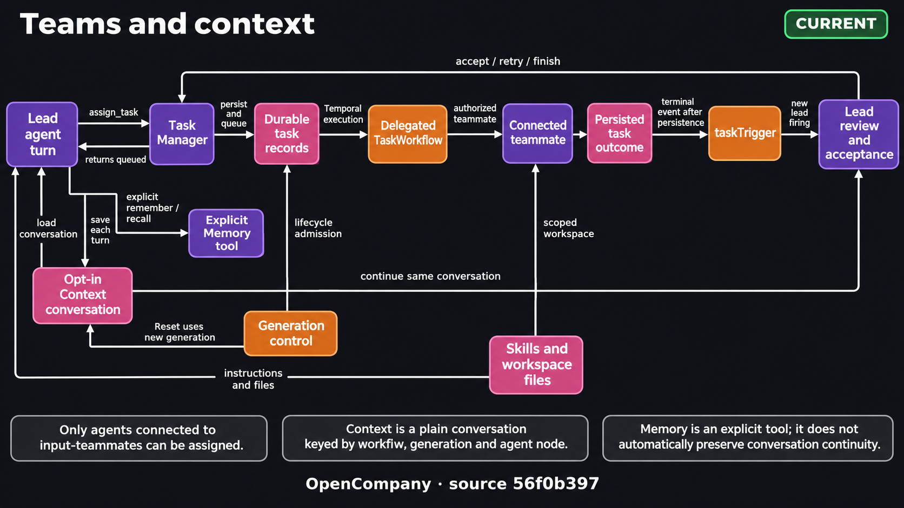

# Durable Agent Teams

OpenCompany team leads (`orchestrator_agent` and `ai_employee`) coordinate
agents connected to their canonical `input-teammates` handle. The topology is
the authorization boundary: ordinary tool edges and agents belonging to other
leads cannot receive team tasks.

Managed employee creation and Builder changes give each concrete tool node
one owning agent. The lead delegates work requiring a specialist's tools
through Task Manager instead of attaching that same callable node to itself.
Private utility instances may repeat a node type; their IDs and bindings stay
separate. This does not restrict intentional custom wiring in existing Dev
graphs.

<!-- architecture-suite:start -->
## Architecture diagrams

Source baseline: `56f0b397`. [Complete diagram suite](../docs/diagrams/architecture/README.md).

**Teams and context — Current implementation.**

[](../docs/diagrams/architecture/09-teams-context-v1.png)

[Editable Mermaid](../docs/diagrams/architecture/09-teams-context.mmd) · [Source evidence and limitations](../docs/diagrams/architecture/09-teams-context.brief.md)

<!-- architecture-suite:end -->

## Runtime model

1. `build_teammate_descriptors()` expands connected agents into stable
   identities (node ID, type, label, `delegate_tool_name`).
   `collect_teammate_connections()` enriches each with the teammate's
   parameters, `child_tools` (its `input-tools` edges), `child_skills` (its
   `input-skill` edges, Master Skill nodes expanded to their enabled
   entries) and a rendered `capabilities` sentence:
   `tools: TikHub (Scrape TikTok, Douyin, ...); skills: tikhub-skill (...)`.
   Tool blurbs come from the plugin's `description` ClassVar, skill blurbs
   from the SKILL.md frontmatter description; the runtime `skill` entry and
   `*-personality` skills are skipped. `format_teammate_roster_line()` turns
   that into the one line per teammate both runtimes put in the lead's
   system prompt (`- <node_id>: <label> (<type>) - <capabilities>`). This
   roster is the lead's ONLY view of what a teammate can do, because the
   `delegate_to_*` tools that carry the long capability description are
   hidden from the lead's model (point 4), so a teammate labelled "Web
   Agent" holding TikHub would otherwise be indistinguishable from one
   holding nothing. Locked by `tests/test_team_topology.py`.
2. Task Manager is intrinsically and non-removably bound to every team lead.
   It is not a palette node or an Agent Builder-addable tool.
3. The lead delegates only by calling `task_manager` with
   `operation="assign_task"`, a title, a bounded mission, context, acceptance criteria,
   and an exact connected `assignee_node_id`. Its locked Pydantic ToolInput
   rejects missing required arguments and unknown fields before persistence;
   see the [Task Manager contract](./node-logic-flows/ai_tools/taskManager.md#operations).
4. Delegate tool identities remain internal to the workflow. They resolve the
   selected teammate after persistence but are hidden from the lead's LLM.
5. Temporal and legacy execution share the durable task lifecycle and use the
   same precreated task ID; neither path creates a second tracking record.
   Native assignment can start the teammate through its injected service
   bridge. Off-Temporal retries and reassignments still need a runner consumer;
   see "Known limitations" below.

## Topology

```text
                              input-teammates
          Coding Agent ───────────┐
          Web Agent ──────────────┼──> Orchestrator / AI Employee
          Custom aiAgent ─────────┘            │
                                                ├── intrinsic Task Manager
                                                └── output-main -> Team Monitor
```

Only `aiAgent` may repeat within one team. Specialized agent types are unique.
Validation rejects invalid endpoints, ambiguous delegate names, cycles, and
delegation depth beyond two child layers.

## Durable task lifecycle

```text
blocked -> queued -> running -> submitted -> accepted
                        |
                        +-> failed
```

Lead-driven transitions (`AgentTeamService.mutate_durable_task`):

| Operation | Allowed from | Result |
|---|---|---|
| `modify_task` | `blocked`, `queued` | edits title, mission, context or acceptance criteria |
| `cancel_task` | `blocked`, `queued`, `running` | `cancelled` |
| `accept_task` | `submitted` | `accepted` |
| `retry_task` / `reassign_task` | `failed`, `submitted`, `cancelled` | `queued`, as a new attempt |

- `submitted` means the worker finished and the lead must review the result.
- `accepted` is the completed/Done state shown by Team Monitor.
- `failed` is unresolved until retried or reassigned; a failed task cannot be
  cancelled.
- `cancelled` is not final: a cancelled task can be retried or reassigned.
- `finish_team` succeeds only when every task is accepted or cancelled.

Mutations are optimistic and execution-scoped. Callers pass `task_id` and,
optionally, `expected_revision`; the service verifies team ownership and
current state. When `expected_revision` is omitted, Task Manager reads the
task's current revision first, so the check then only covers the moment
between that read and the write. When exactly one task is submitted,
`accept_task` may safely infer its ID and current revision. It never guesses
among multiple submissions.

Task reads include `allowed_actions` for their observed status. A task can move
from queued to running between review and mutation, so the database's atomic
state/revision check remains authoritative. A rejected mutation reports a
`TaskMutationConflict` with the latest observed state and revision. The Task
Manager tool returns an ordinary `NodeUserError` directing the lead to read
`get_task` and choose an allowed action; it does not retry the mutation or
cancel work automatically. In particular, `modify_task` cannot edit running
work even with its current revision.

## Parallel scheduling

The default root-wide limit is three active descendants, including
grandchildren and excluding the root lead. Assignments persist before children
start. Eligible tasks enter a deterministic FIFO queue, dependencies remain
blocked, and one sibling failure does not cancel successful siblings. Multiple
`assign_task` calls in one Temporal turn are preflighted together. Each returns
`queued` after starting a detached `DelegatedTaskWorkflow`; the lead reports
the assignment and returns without polling. The runner owns admission, claim,
child execution, terminal persistence, event emission, and permit release.

Physical concurrency leases belong to one Temporal workflow run and Activity
attempt. A Task Manager retry keeps the durable task ID but starts a new
runner, so it must acquire a different lease from the one its previous runner
released. Capacity being free does not make a released lease reusable. Acquire
retries reconcile only leases from the same owning workflow run.

Each child receives an isolated AgentWorkflow context containing only its
bounded mission, relevant context, and its own connected tools, skills, and
memory. The parent receives a compact result; full child output remains
inspectable through task attempts and execution traces.

## Generation Stop and Resume

New Temporal generations carry `execution_control_version=1`. Detached
`DelegatedTaskWorkflow` runners enroll independently with the generation
controller before business work, so Stop still reaches their attached agents
after the assigning lead completes or the controller rolls over. Attached
children use their native parent relationships rather than a per-tool registry.

Stop preserves assigned tasks, lane/permit ownership, and existing continuations.
Already-admitted model/tool Activities and their result bookkeeping drain;
queued work, later calls, and new child starts wait behind the admission gate.
Permit waits and child-result waits do not count as local business drain, so
paused children cannot deadlock the checkpoint. Completion persistence and
permit release for completed work continue normally. `pausing` describes the
request/drain phase; `paused` requires topology-wide checkpoint acknowledgement.
Stop adds no second persisted task pause lifecycle and does not cancel tasks.

Resume applies the next revision with producers held, releases descendants and
independent roots, reconciles membership, then releases producers. It continues
the existing task attempt without another model response or completed tool
being explicitly scheduled. Completion events accumulated while stopped remain
pending for review; handlers do not batch inactivity or discard them.

Existing generations preserve their legacy protocol. Unlimited LLM retries may
leave Stop in `pausing` during an outage; a tool's policy/idempotency still governs
unrecorded external effects. Opaque managed agents finish the whole node
Activity before acknowledging Stop. Direct Workspace tasks and separately
approved sends remain independent. See
[Temporal workflow control](temporal-workflow-control.md),
[Delegation ownership](agent_delegation.md#generation-stopresume-ownership), and
[Agent context flow](agent_context_flow.md#stopped-turns-and-unanswered-calls).

## Completion and events

After durable persistence, lifecycle transitions emit deterministic events such
as `team.task.submitted`, `team.task.accepted`, `team.task.failed`, and
`team.task.cancelled`. A canonical task completion CloudEvent feeds
`taskTrigger` with owning team/execution/root, task, trace, result/error, and
usage context. A connected lead starts a separate review invocation scoped to
the original execution, reads Task Manager, and reports without duplicating work.

Assignment and completion identities distinguish durable task attempts while
remaining stable when an Activity retries. The first attempt keeps its original
event IDs; later attempts use an attempt namespace. Lifecycle writes check the
owning attempt, so a delayed result from an earlier runner cannot finish the
newer task. Legacy runner inputs recover their attempt from the stored runner
identity instead of assuming the task's latest attempt.

The specialist does not call Task Completed manually: its runner persists the
finished result and emits the completion event. A lead may then accept the
submission or request revisions with `retry_task`; that review is a separate
invocation with its own Temporal history.

## Human interfaces

### Task Manager

Selecting a team lead opens its full-height operational middle panel. It shows
durable tasks across workflow restarts by default. Archived executions remain
individually selectable. A chip per status carries its count and filters the
table. Rows show the assignee, the status, local started/completed timestamps,
live or frozen elapsed duration, the attempt and input/output/total tokens.

A row opens the task in one of the editor's modals
(`parameterPanel/taskManager/TaskDetailModal.tsx`): its name and status at the
head, a Details tab (times, tokens, mission, acceptance criteria, context,
result or error, attempts, the Temporal ids; a field with nothing in it is left
out) and a Temporal trace tab, and at the foot the authorized controls: Accept,
Retry, Reassign, Edit mission and Cancel task. Finish team is in the panel's
head. The opened task is read from the list, so it follows each refresh, and
the revision an action sends is the latest one.

A status is a dot beside neutral words, and Finish team, Accept and Confirm are
the only strong buttons
([Theme System](./theme_system.md#colour-marks-state-or-role)).

### Team Monitor

Team Monitor is read-only and uses only the middle parameter-panel section.
Connect the lead's output to it. It shows graph-connected teammates immediately,
then merges persisted `working`/`idle` state, lifecycle counts, and current
execution tasks. Its Done count includes accepted tasks, not submitted work.

## Public Task Manager operations

| Operation | Purpose |
|---|---|
| `assign_task` | Persist and dispatch work to a connected teammate |
| `list_tasks` / `get_task` | Inspect state, result, attempts, and revision |
| `modify_task` | Edit blocked or queued work |
| `cancel_task` | Stop blocked, queued or running work |
| `retry_task` | Queue a new attempt of failed, submitted or cancelled work on the same teammate |
| `reassign_task` | Queue a new attempt on another connected teammate |
| `accept_task` | Approve submitted work |
| `inspect_task_trace` | Read or search the sanitized Temporal events of a task attempt (`detail`: `summary`, `failures`, `timeline` or `search`) |
| `finish_team` | Complete a fully resolved team execution |

`mark_done` is a deprecated alias for `accept_task` and never deletes history.

## Known limitations

- **Off-Temporal retry and reassignment need a runner consumer.** `assign_task`
  can start a teammate through the native bridge when `ai_service` and
  `database` are present; the in-process plugin adapter supplies both.
  `retry_task` and `reassign_task` return a `delegation_request` for the next
  attempt without starting it themselves. `AgentWorkflow` consumes that
  envelope. An in-process caller must also arrange execution or the task
  remains queued.

## Key files

- `server/services/plugin/edge_walker.py` — canonical teammate discovery and
  intrinsic Task Manager binding.
- `server/nodes/tool/task_manager/__init__.py` — model-facing contract.
- `server/services/agent_team.py` and `server/core/database.py` — authorized
  durable service and persistence.
- `server/services/temporal/agent_workflow.py` — concurrent child orchestration.
- `server/services/handlers/tools.py` — legacy execution bridge.
- `client/src/components/parameterPanel/TaskManagerPanel.tsx` — operational UI
  (the opened task, the status mark and the task model are in
  `parameterPanel/taskManager/`).
- `client/src/components/parameterPanel/TeamMonitorPanel.tsx` — read-only UI.

See [agent_delegation.md](agent_delegation.md) for low-level compatibility
delegation mechanics. Direct `delegate_to_*` calls documented there are not the
team-lead model-facing contract.
