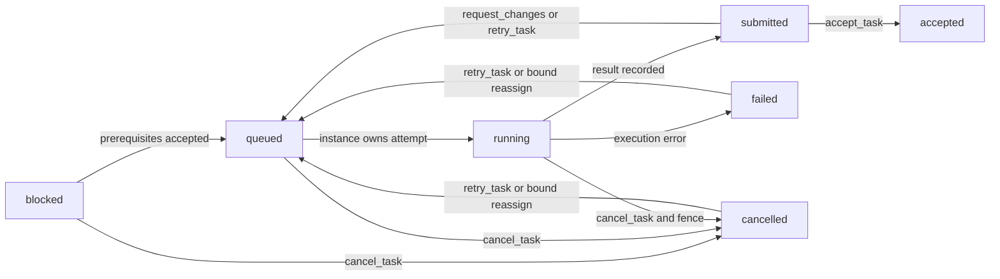
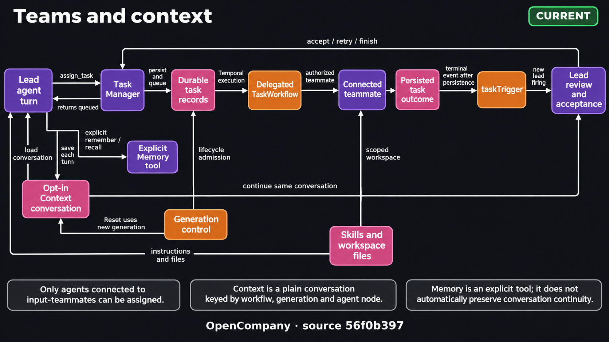

# Durable Agent Teams

## Reusable instances (lifecycle version 1)

Start records `agent_lifecycle_version=1` and the compatibility spelling
`agent_protocol_version=1` in the generation manifest. Runtime routing uses that
recorded selection. A generation admitted without the marker retains version 0
on Resume, later trigger firings and Temporal replay; upgrading workers does
not replace its tool contract. Employee recipe version, graph version and
`execution_control_version` are separate selections.

### Identities and isolation

| Identity | Meaning and lifetime |
|---|---|
| Template node | Connected graph configuration: provider, model, tools, skills and authorized capabilities |
| Agent instance | One reusable conversation within a job and generation; several instances may use the same template |
| Agent run | One execution owned by that instance's session workflow |
| Task | A reviewed work item, retained through changes, retries and reassignment |
| Task attempt | One execution contract, including instructions, feedback, dependencies and configuration |

Recipe v3 creates a Chat Employee (`ai_employee`) with a dedicated
Orchestrator (`orchestrator_agent`) as its direct report. Each role's
`output-top` connects to its immediate manager's `input-teammates`. The
admitted team plan records role IDs and reporting lines. Earlier recipe v2
graphs identify the lead through the Talk contact's `input-employee-team`.

Chat retains the owner conversation. Its Task Manager's
`submit_job(instructions)` admits a durable job for substantive work. In v3
the outer task appears on Chat's board with the Orchestrator as assignee.
`get_job_status(job_id)` returns the saved job state and task counts. Omitting
the ID reads the most recently updated job for the same employee.
Each job has isolated agent instances. Its handoff contains the request and
captured source context. A job admitted while its agent answers a chat run
records that run (`EmployeeJob.chat_run_id`), so the usage service can add the
job's cost to the reply that started it; see
[Pricing Service](./pricing_service.md). Instance transcripts do not replace
Talk history.
Chat reviews the outer submission and authors the final reply on the original
conversation branch. A busy conversation queues delivery. After a clear,
the result is available on the original assignment. App jobs use their
captured destination and approval gate. [Managed team workflow](employee_teams.md)

The canonical `input-teammates` connections authorize templates. A bound spawn
tool selects one of those templates; model arguments cannot select another
workflow, generation, team or provider configuration. Instances use their own
`agent-instance:<id>` output/session namespace and built-in plain MessageWire
history even without a Context connection. They retain captured upstream
outputs for input resolution. Peer messages stay inside the job and generation
and are marked as agent input, never owner approval.

### Model-facing tools

The shared typed manifest is `services/agent_instances/tools.py`. It supplies
the JSON schema, Pydantic validator, authorized binding and execution traits
to native, Pi, CLI/MCP and RLM. Unknown arguments are rejected. Runtime dispatch
uses the binding traits; the original model call ID and arguments remain in
the transcript.

| Available to | Tools |
|---|---|
| Chat intake (Talk) | `submit_job(instructions)`, `get_job_status(job_id?)` |
| Manager with connected reports | Bound `spawn_<teammate>` and `reassign_<teammate>`, assignment, review and peer tools |
| Chat's job reviewer | Peer tools, `request_changes`, `accept_task`, `retry_task`, `cancel_task`, `finish_team` |
| Job lead in earlier recipes | Manager tools, `stop_agent`, `resume_agent`, `close_agent`, `finish_team` |
| All job roles | `send_message`, `list_agents`, `get_agent`, `wait_for_agents`, `list_tasks`, `get_task`, `inspect_task` |

`<teammate>` is the exposed binding suffix, derived from node type and a stable
node-ID hash. Use the published name. Labels do not retarget a binding.
Spawning requires only `instructions`; the runtime derives the display title
and commits the instance, task, first attempt and startup inbox delivery
together. `assign_task(agent, instructions, after?)` creates new reviewed work
on an existing instance. Neither call asks a second model to invent acceptance
criteria. The exact instruction text defines success.

See the [complete tool contract](node-logic-flows/ai_tools/taskManager.md#lifecycle-version-1-tool-contract)
for arguments and limits.

### Reviewed task lifecycle



Retry and reassignment return to `blocked` when prerequisites are unresolved.
Only an `accepted` prerequisite satisfies `after`; a cancellation, idle worker,
message receipt or submitted result never does. Dependencies must belong to
this job/generation and cannot form a cycle.

Task reads return `task_ref` and `allowed_actions`. The opaque, versioned
reference carries the observed team, task, revision, attempt and status.
Mutations validate those observations atomically in a reserved write
transaction. A `stale_reference` requires a fresh read; it does not consume the
invalid-request budget. A raw task ID is accepted for reads, but cannot replace
the required mutation reference.

| Operation | Allowed source state | Effect |
|---|---|---|
| `modify_task(task_ref, instructions, after?)` | `blocked`, `queued` | Replace unstarted instructions; omitted `after` preserves dependencies |
| `request_changes(task_ref, feedback)` | `submitted` | Append feedback and create the next attempt on the same instance |
| `accept_task(task_ref)` | `submitted` | Accept the result and unblock eligible dependents |
| `retry_task(task_ref)` | `failed`, `submitted`, `cancelled` | New attempt with the same requirements, feedback and instance history |
| `reassign_<teammate>(task_ref)` | `failed`, `submitted`, `cancelled` | Fresh target instance, same task and retained contract, new attempt |
| `cancel_task(task_ref, reason?)` | `blocked`, `queued`, `running`. Recipe v3 also allows `submitted` and `failed` | Stop active work. Closing a submission or failure requires the assigner's blocker reason and retains the evidence. |

Attempts snapshot the effective contract. Feedback is appended once under the
mutation's request identity; it does not overwrite the original instructions.
The stored task attempt budget defaults to three retries after attempt zero.
A late or superseded executor cannot submit into a later attempt.

`finish_team` requires all tasks accepted or cancelled; managed employee teams
must also have assigned work. Final employee delivery is a separate, stricter
gate: at least one task and every task accepted. Failed or cancelled work must
be resolved before delivery. A nonempty final lead response and the original
delivery/approval gates still apply. A finish receipt or model response alone
does not bypass those gates.

**Review auto-accept.** With the owner's "Skip reviews when sure" set
(`UserSettings.review_auto_accept_percent`, 0 and off by default), the
`agent.instance.claim` activity may settle a reviewer's run before any model
turn (`services/agent_instances/auto_review.py`). It applies only to a run
woken by fresh review notices of submitted teammate work, never to the lead's
runs, so Chat always reviews the final answer. Each task is judged with the
calibrated noul "The result fully completes these instructions"
([Judgment Service](./judgment_service.md#where-it-is-used)). When every task
is judged at least as sure as the setting, `settle_auto_review` accepts each
through the same `accept_task` with the trusted scope, marking the task's
`context.auto_accepted` (`{attempt, confidence}`). It then checkpoints one
transcript line and completes the run with the accepted work. The review tools
forbid extra fields, so a model cannot send that marker. The review gate then
submits the reviewer's own task as after a model turn. Anything short of that,
or a failure while settling, leaves the review to the reviewer's turn. A
settled claim comes back `completed`, which the session loop already skips,
so no Temporal patch is involved.

### Serialized execution and durable messaging

`AgentInstanceSessionWorkflow` owns the instance's turns. Assignments, peer
messages, review notices and follow-ups enter its inbox. One active run owns
the transcript; revision and run-fence checks prevent concurrent or late writes.
The outcome and its assigner's inbox notification commit together. In recipe
v3 the task's assigning run identifies the parent instance and upstream attempt.
A manager with pending children checkpoints its turn and releases its slot.
A child submission or failure wakes that manager. After accepting its children,
the manager submits its own result for review one level up. A scoped
`taskTrigger` validates the persisted task, job, generation and assigner before
waking the owner. Reset fences stale attempts and review notifications.

| Delivery state | Meaning |
|---|---|
| `queued` | Committed for a recipient, awaiting admission |
| `admitted` | Assigned to an owning run |
| `consumed` | A durable response/checkpoint was recorded with receipt advancement |
| `held` | Explicit recovery is needed, for example a peer-chain limit or a failed run before checkpoint |
| `cancelled` | The input was superseded or its owning execution was interrupted |
| `recipient_closed` | Job retirement or Reset disposed the pending delivery |

`consumed` does not assert understanding, task completion or acceptance.
Admission assigns an ordered recipient sequence and fingerprints the trusted
sender, request and payload. A duplicate request returns its original receipt;
reusing that identity with changed content raises `idempotency_conflict`.
Transcript changes and consumed receipts commit atomically. CLI continuation
uses the provider session; native/Pi mailbox input is admitted only after all
outstanding tool results have been recorded. Opaque runtimes use the next turn.

After committing a delivery, the runtime signals its Temporal session. If the
signal is missed, a worker periodically scans the application database and
retries the start or wakeup using the same session ID. A shared database lease
coordinates this scan across workers. Recovery scans rotate across recipients,
skip blocked-only inboxes and check active owners for interrupted work.
Run records retain physical execution permits so confirmed terminated owners
can release them. Transport errors do not prove that an executor stopped.

Queueing does not acquire root concurrency. Active descendants acquire capacity
once; idle instances hold none. Native/Pi waits park, release capacity and Pi
driver resources, then acquire fresh physical leases on continuation. Opaque
adapters that cannot yield their execution lease return `pending` immediately.
`wait_for_agents` accepts at most 30 seconds and never implies task acceptance.

### Coordination limits

| Setting | Default | Enforcement |
|---|---|---|
| `AGENT_PEER_MESSAGE_BYTES` | 8,192 bytes | UTF-8 bytes in one peer message |
| `AGENT_PENDING_MESSAGES` | 256 | Pending peer deliveries per recipient, including queued, admitted and held |
| `AGENT_PENDING_BYTES` | 1,048,576 bytes | Combined UTF-8 peer content per recipient |
| `AGENT_PEER_CHAIN_TURNS` | 8 | Automatically induced turns in a causal peer-message chain |

Excess peer sends return `message_too_large` or `inbox_full` before persistence.
Mandatory assignment/review notices bypass peer quotas. Chain identity follows
replies and induced reviews; reaching the limit holds further messages and
records a notice. Explicit `resume_agent` releases held input and grants the
chain another configured allowance. Automatic wakeups cannot clear a halt.

### Stop, Resume, Reset and review recovery

| Control | Effect |
|---|---|
| `stop_agent(agent)` | Halt new admission, fence the current executor and record interruption; do not silently retry its task |
| `resume_agent(agent)` | Once the executor has drained, reopen the same instance and held inbox; failed tasks still need `retry_task` |
| `close_agent(agent)` | Atomically require no active run, unresolved assigned work or pending inbox before closing |
| Generation Stop / Resume | Preserve queues and continuations under the generation controller; resume existing work |
| Generation Reset | Close/fence old instances, cancel queued/blocked/running tasks and explicitly dispose pending deliveries; never redirect them to replacement instances |
| **Retry review** | Resume the assigning employee's review of its saved task attempt |

The third classified invalid orchestration request halts the logical run after
the initial error and two correction opportunities. The counter and original
call identities survive continuation and retries; unrelated successes do not
reset it. Infrastructure failures and revision conflicts are not counted.
Already admitted operations may settle, but new provider requests and effects
are fenced, including RLM root, nested and fallback calls.

A failed/halted lead with existing child work leaves the employee job
`review_blocked` when no protected delivery/approval outcome already exists.
Valid child work remains available. `retry_employee_review` and the employee
Work view's **Retry review** button resume review of the existing assignment.
In recipe v3, a missed decision first queues one reminder for the same task
revision. A repeated omission leaves review available for the owner to resume.

### Observation and implementation

Team Monitor distinguishes graph templates, instances, active runs and reviewed
tasks. Public task, attempt and run results are bounded summaries; full results
remain in storage. `inspect_task` exposes a 4,000-character `result_excerpt`
and `next_cursor`, including literal searches over retained results. Result
cursors are distinct from Temporal trace cursors. Stored results remain
readable when the trace service is unavailable.

The current implementation is in `server/services/agent_instances/`,
`server/models/agent_instances.py` and
`server/services/temporal/agent_instance_workflow.py`. The
[delegation runtime guide](agent_delegation.md#version-1-execution-path) describes
adapter continuation and execution ownership. Deterministic tests establish
protocol behavior; they do not establish comparative small-model performance.
The [validation record](agent_lifecycle_validation.md) lists the exercised
acceptance scenarios, exact suite results, skipped cases and environment limits.

## Legacy generations (version 0)

The remaining sections document the retained compatibility protocol for
already-admitted histories, not version 1 arguments or conversation identity.

OpenCompany team leads (`orchestrator_agent` and `ai_employee`) coordinate
agents connected to their canonical `input-teammates` handle. The topology is
the authorization boundary: ordinary tool edges and agents belonging to other
leads cannot receive team tasks.

Managed employee creation and Builder changes give each concrete tool node
one owning agent. The lead delegates work requiring a specialist's tools
through Task Manager instead of attaching that same callable node to itself.
Private utility instances may repeat a node type; their IDs and bindings stay
separate. This does not restrict intentional custom wiring in existing Dev
graphs.

<!-- architecture-suite:start -->
## Architecture diagrams

Source baseline: `56f0b397`. [Complete diagram suite](../docs/diagrams/architecture/README.md).

**Teams and context — Historical version 0 baseline.** This image predates
reusable instances and is not the lifecycle version 1 ownership diagram.

[](../docs/diagrams/architecture/09-teams-context-v1.png)

[Editable Mermaid](../docs/diagrams/architecture/09-teams-context.mmd) · [Source evidence and limitations](../docs/diagrams/architecture/09-teams-context.brief.md)

<!-- architecture-suite:end -->

## Runtime model

1. `build_teammate_descriptors()` expands connected agents into stable
   identities (node ID, type, label, `delegate_tool_name`).
   `collect_teammate_connections()` enriches each with the teammate's
   parameters, `child_tools` (its `input-tools` edges), `child_skills` (its
   `input-skill` edges, Master Skill nodes expanded to their enabled
   entries) and a rendered `capabilities` sentence:
   `tools: TikHub (Scrape TikTok, Douyin, ...); skills: tikhub-skill (...)`.
   Tool blurbs come from the plugin's `description` ClassVar, skill blurbs
   from the SKILL.md frontmatter description; the runtime `skill` entry and
   `*-personality` skills are skipped. `format_teammate_roster_line()` turns
   that into the one line per teammate both runtimes put in the lead's
   system prompt (`- <node_id>: <label> (<type>) - <capabilities>`). This
   roster is the lead's ONLY view of what a teammate can do, because the
   `delegate_to_*` tools that carry the long capability description are
   hidden from the lead's model (point 4), so a teammate labelled "Web
   Agent" holding TikHub would otherwise be indistinguishable from one
   holding nothing. Above the list, `TEAMMATE_ROSTER_NOTE` (both runtimes)
   says those tools and skills are the teammate's: the lead uses only its
   own and assigns work that needs one of theirs (a small model had asked
   its own Skill tool for a teammate's skill by name). Skill
   blurbs come from the skill loader's last scan (`get_available_skills()`),
   not a rescan per teammate. Locked by `tests/test_team_topology.py`.
2. A legacy lead with no connected Task Manager receives a built-in binding.
   Agent Builder reserves Task Manager for the employee creation path.
3. The lead delegates only by calling `task_manager` with
   `operation="assign_task"`, a title, a bounded mission, context, acceptance criteria,
   and an exact connected `assignee_node_id`. Its locked Pydantic ToolInput
   rejects missing required arguments and unknown fields before persistence;
   see the [Task Manager contract](./node-logic-flows/ai_tools/taskManager.md#operations).
4. Delegate tool identities remain internal to the workflow. They resolve the
   selected teammate after persistence but are hidden from the lead's LLM.
5. Temporal and legacy execution share the durable task lifecycle and use the
   same precreated task ID; neither path creates a second tracking record.
   Native assignment can start the teammate through its injected service
   bridge. Off-Temporal retries and reassignments still need a runner consumer;
   see "Known limitations" below.

## Topology

```text
                              input-teammates
          Coding Agent ───────────┐
          Web Agent ──────────────┼──> Orchestrator / AI Employee
          Custom aiAgent ─────────┘            │
                                                ├── intrinsic Task Manager
                                                └── output-main -> Team Monitor
```

Only `aiAgent` may repeat within one team. Specialized agent types are unique.
Validation rejects invalid endpoints, ambiguous delegate names, cycles, and
delegation depth beyond two child layers.

## Durable task lifecycle

```text
blocked -> queued -> running -> submitted -> accepted
                        |
                        +-> failed
```

Lead-driven transitions (`AgentTeamService.mutate_durable_task`):

| Operation | Allowed from | Result |
|---|---|---|
| `modify_task` | `blocked`, `queued` | edits title, mission, context or acceptance criteria |
| `cancel_task` | `blocked`, `queued`, `running` | `cancelled` |
| `accept_task` | `submitted` | `accepted` |
| `retry_task` / `reassign_task` | `failed`, `submitted`, `cancelled` | `queued`, as a new attempt |

- `submitted` means the worker finished and the lead must review the result.
- A worker's failure that only the owner can fix (`requires_user_action`: out
  of credits, no key) fails the task at once, since another attempt would meet
  it too, and the lead hears of it through `taskTrigger`
  (`fail_task(..., retryable=False)`).
- `accepted` is the completed/Done state shown by Team Monitor.
- `failed` is unresolved until retried or reassigned; a failed task cannot be
  cancelled.
- `cancelled` is not final: a cancelled task can be retried or reassigned.
- `finish_team` succeeds only when every task is accepted or cancelled.

Mutations are optimistic and execution-scoped. Callers pass `task_id` and,
optionally, `expected_revision`; the service verifies team ownership and
current state. When `expected_revision` is omitted, Task Manager reads the
task's current revision first, so the check then only covers the moment
between that read and the write. When exactly one task is submitted,
`accept_task` may safely infer its ID and current revision. It never guesses
among multiple submissions.

Task reads include `allowed_actions` for their observed status. A task can move
from queued to running between review and mutation, so the database's atomic
state/revision check remains authoritative. A rejected mutation reports a
`TaskMutationConflict` with the latest observed state and revision. The Task
Manager tool returns an ordinary `NodeUserError` directing the lead to read
`get_task` and choose an allowed action; it does not retry the mutation or
cancel work automatically. In particular, `modify_task` cannot edit running
work even with its current revision.

## Parallel scheduling

The default root-wide limit is three active descendants, including
grandchildren and excluding the root lead. Assignments persist before children
start. Eligible tasks enter a deterministic FIFO queue, dependencies remain
blocked, and one sibling failure does not cancel successful siblings. Multiple
`assign_task` calls in one Temporal turn are preflighted together. Each returns
`queued` after starting a detached `DelegatedTaskWorkflow`; the lead reports
the assignment and returns without polling. The runner owns admission, claim,
child execution, terminal persistence, event emission, and permit release.

Physical concurrency leases belong to one Temporal workflow run and Activity
attempt. A Task Manager retry keeps the durable task ID but starts a new
runner, so it must acquire a different lease from the one its previous runner
released. Capacity being free does not make a released lease reusable. Acquire
retries reconcile only leases from the same owning workflow run.

Each child receives an isolated AgentWorkflow context containing only its
bounded mission, relevant context, and its own connected tools, skills, and
memory. The parent receives a compact result; full child output remains
inspectable through task attempts and execution traces.

## Generation Stop and Resume

New Temporal generations carry `execution_control_version=1`. Detached
`DelegatedTaskWorkflow` runners enroll independently with the generation
controller before business work, so Stop still reaches their attached agents
after the assigning lead completes or the controller rolls over. Attached
children use their native parent relationships rather than a per-tool registry.

Stop preserves assigned tasks, lane/permit ownership, and existing continuations.
Already-admitted model/tool Activities and their result bookkeeping drain;
queued work, later calls, and new child starts wait behind the admission gate.
Permit waits and child-result waits do not count as local business drain, so
paused children cannot deadlock the checkpoint. Completion persistence and
permit release for completed work continue normally. `pausing` describes the
request/drain phase; `paused` requires topology-wide checkpoint acknowledgement.
Stop adds no second persisted task pause lifecycle and does not cancel tasks.

Resume applies the next revision with producers held, releases descendants and
independent roots, reconciles membership, then releases producers. It continues
the existing task attempt without another model response or completed tool
being explicitly scheduled. Completion events accumulated while stopped remain
pending for review; handlers do not batch inactivity or discard them.

Existing generations preserve their legacy protocol. Unlimited LLM retries may
leave Stop in `pausing` during an outage; a tool's policy/idempotency still governs
unrecorded external effects. Opaque managed agents finish the whole node
Activity before acknowledging Stop. Direct Workspace tasks and separately
approved sends remain independent. See
[Temporal workflow control](temporal-workflow-control.md),
[Delegation ownership](agent_delegation.md#generation-stopresume-ownership), and
[Agent context flow](agent_context_flow.md#stopped-turns-and-unanswered-calls).

## Completion and events

After durable persistence, lifecycle transitions emit deterministic events such
as `team.task.submitted`, `team.task.accepted`, `team.task.failed`, and
`team.task.cancelled`. A canonical task completion CloudEvent feeds
`taskTrigger` with owning team/execution/root, task, trace, result/error, and
usage context. A connected lead starts a separate review invocation scoped to
the original execution, reads Task Manager, and reports without duplicating work.

Assignment and completion identities distinguish durable task attempts while
remaining stable when an Activity retries. The first attempt keeps its original
event IDs; later attempts use an attempt namespace. Lifecycle writes check the
owning attempt, so a delayed result from an earlier runner cannot finish the
newer task. Legacy runner inputs recover their attempt from the stored runner
identity instead of assuming the task's latest attempt.

The specialist does not call Task Completed manually: its runner persists the
finished result and emits the completion event. A lead may then accept the
submission or request revisions with `retry_task`; that review is a separate
invocation with its own Temporal history.

## Human interfaces

### Task Manager

Selecting a team lead opens its full-height operational middle panel. It shows
durable tasks across workflow restarts by default. Archived executions remain
individually selectable. A chip per status carries its count and filters the
table. Rows show the assignee, the status, local started/completed timestamps,
live or frozen elapsed duration, the attempt and input/output/total tokens.

A row opens the task in one of the editor's modals
(`parameterPanel/taskManager/TaskDetailModal.tsx`): its name and status at the
head, a Details tab (times, tokens, mission, acceptance criteria, context,
result or error, attempts, the Temporal ids; a field with nothing in it is left
out) and a Temporal trace tab, and at the foot the authorized controls: Accept,
Retry, Reassign, Edit mission and Cancel task. Finish team is in the panel's
head. The opened task is read from the list, so it follows each refresh, and
the revision an action sends is the latest one.

A status is a dot beside neutral words, and Finish team, Accept and Confirm are
the only strong buttons
([Theme System](./theme_system.md#colour-marks-state-or-role)).

### Team Monitor

Team Monitor is read-only and uses only the middle parameter-panel section.
Connect the lead's output to it. It shows graph-connected teammates immediately,
then merges their persisted `working`/`idle` state and lists the execution's
tasks, with a count per status (accepted work apart from submitted). A
teammate's state and a task's status are marked as in the Task Manager: a dot
beside neutral words.

## Public Task Manager operations

| Operation | Purpose |
|---|---|
| `assign_task` | Persist and dispatch work to a connected teammate |
| `list_tasks` / `get_task` | Inspect state, result, attempts, and revision |
| `modify_task` | Edit blocked or queued work |
| `cancel_task` | Stop blocked, queued or running work |
| `retry_task` | Queue a new attempt of failed, submitted or cancelled work on the same teammate |
| `reassign_task` | Queue a new attempt on another connected teammate |
| `accept_task` | Approve submitted work |
| `inspect_task_trace` | Read or search the sanitized Temporal events of a task attempt (`detail`: `summary`, `failures`, `timeline` or `search`) |
| `finish_team` | Complete a fully resolved team execution |

`mark_done` is a deprecated alias for `accept_task` and never deletes history.

## Known limitations

- **Off-Temporal retry and reassignment need a runner consumer.** `assign_task`
  can start a teammate through the native bridge when `ai_service` and
  `database` are present; the in-process plugin adapter supplies both.
  `retry_task` and `reassign_task` return a `delegation_request` for the next
  attempt without starting it themselves. `AgentWorkflow` consumes that
  envelope. An in-process caller must also arrange execution or the task
  remains queued.

## Key files

- `server/services/plugin/edge_walker.py` — canonical teammate discovery and
  intrinsic Task Manager binding.
- `server/nodes/tool/task_manager/__init__.py` — model-facing contract.
- `server/services/agent_team.py` and `server/core/database.py` — authorized
  durable service and persistence.
- `server/services/temporal/agent_workflow.py` — concurrent child orchestration.
- `server/services/agent_instances/auto_review.py` — review auto-accept, called
  from the `agent.instance.claim` activity; `AgentInstanceService.review_candidates`
  and `settle_auto_review` in `server/services/agent_instances/service.py`.
- `server/services/handlers/tools.py` — legacy execution bridge.
- `client/src/components/parameterPanel/TaskManagerPanel.tsx` — operational UI
  (the opened task, the status mark and the task model are in
  `parameterPanel/taskManager/`).
- `client/src/components/parameterPanel/TeamMonitorPanel.tsx` — read-only UI.

See [agent_delegation.md](agent_delegation.md) for low-level compatibility
delegation mechanics. Direct `delegate_to_*` calls documented there are not the
team-lead model-facing contract.
