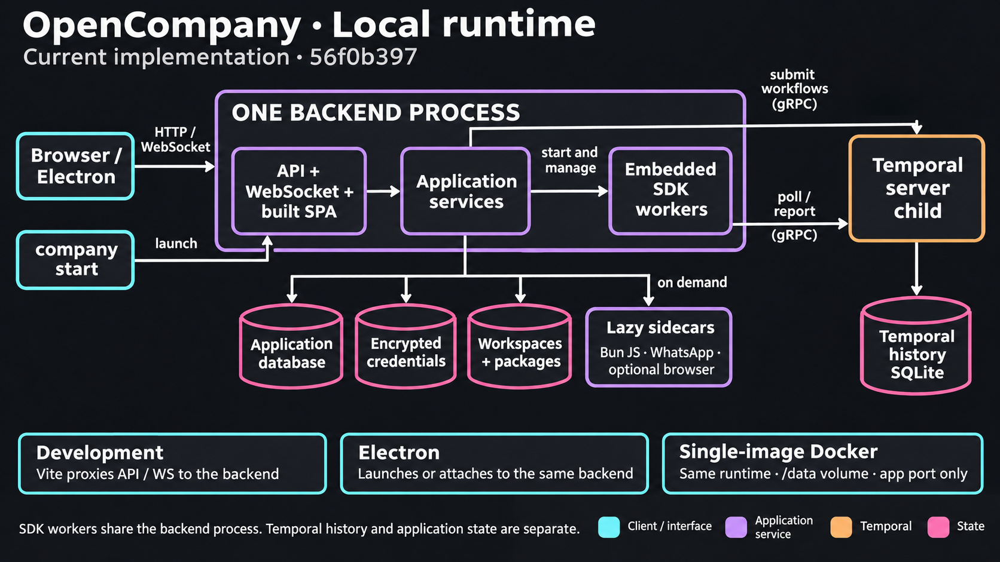

# Desktop Host Contract

How a GUI shell (the Electron desktop app, or any host) owns the OpenCompany
backend process. Everything here is shell-independent: it is the backend's
side of the deal, implemented in `server/core/approot.py`,
`server/core/env_defaults.py`, `server/core/desktop.py`,
`server/routers/desktop.py`, and the `/health/ready` route in
`server/main.py`. The Electron side lives in `desktop/` and is documented in
[desktop_app.md](./desktop_app.md).

<!-- architecture-suite:start -->
## Architecture diagrams

Source baseline: `56f0b397`. [Complete diagram suite](../docs/diagrams/architecture/README.md).

**Local runtime — Current implementation.**

[](../docs/diagrams/architecture/02-local-runtime-v1.png)

[Editable Mermaid](../docs/diagrams/architecture/02-local-runtime.mmd) · [Source evidence and limitations](../docs/diagrams/architecture/02-local-runtime.brief.md)

<!-- architecture-suite:end -->

## Why this exists

`company serve` used to be the only launcher. It sets the cwd to `server/`,
layers `.env.template` < `.env` into the process environment, spawns
`<venv>/python -m uvicorn main:app`, enrolls the child in a Windows Job
Object, and stops it with CTRL_BREAK / SIGTERM. A desktop shell cannot
reuse that path: it must not depend on the CLI venv, it relocates the tree
into a read-only bundle, it cannot deliver CTRL_BREAK from Node, and it may
be force-quit without running any of its own shutdown code.

## 1. Relocatable tree: `core.approot`

The backend ships as a sibling layout that a checkout, the published tarball
(`bun add -g`), and the bundle share:

```
<app root>/
  .env.template            canonical env defaults (ports SSOT)
  .env                     operator overrides (optional)
  package.json             published version
  .opencompany/workflows/  shipped example seeds
  client/dist/             built SPA the backend serves on one port
  server/                  the code
```

Exactly one module locates these: `core/approot.py`. Overrides:

| Env var | Default | Purpose |
|---|---|---|
| `OPENCOMPANY_APP_ROOT` | two levels above `core/approot.py` | bundle's `app-root/` |
| `OPENCOMPANY_CLIENT_DIST` | `<app root>/client/dist` | where the SPA was staged |
| `OPENCOMPANY_ENV_TEMPLATE` | `<app root>/.env.template` | canonical defaults |
| `OPENCOMPANY_ENV_FILE` | `<app root>/.env` | writable overrides (bundle is read-only on macOS/Linux, so the shell points this into its data dir) |

`server_root()` is always the directory the code runs from, never derived
from the override, so a wrong `OPENCOMPANY_APP_ROOT` cannot make the backend
look for its own `config/` elsewhere. `tests/test_no_root_climb.py` locks
the rule: no other module under `server/` may climb above `server/` with
`parents[N]` or a `.parent` chain, or spell `client/dist`, `.env.template`,
`package.json` in a path join.

`resolve_static_asset(base_dir, relative)` lives here too, for the one route
that maps an attacker-controlled path onto the tree: the SPA fallback in
`main.py`. It joins, `os.path.normpath`s, and returns `None` unless the
result sits under the real base directory — so `..` traversal, an absolute
path, and a prefix sibling such as `client/dist2` all serve no file. Keeping
it beside `client_dist()` is what lets the route itself build no paths at
all. `is_spa_route(relative)` beside it decides what a miss gets: a path
whose last segment has a dot names a file and gets a 404 (the "dot rule" of
connect-history-api-fallback), anything else gets the SPA shell, sent with
`Cache-Control: no-cache`. Answering a missing script with the shell is how
the Home orb went flat on 2026-10-12: an old self-host container on the dev
port answered the orb engine's URL with HTML, which the browser refused as a
module, and with no `Cache-Control` a browser may keep reusing such a
response after the real file is back.

## 2. Env layering without the CLI

`core.env_defaults.apply_file_defaults_to_environ()` runs at the top of
`main.py` before `Settings()`: `.env.template` < `.env` < process env via
`os.environ.setdefault`, byte-for-byte the same parser semantics as
`cli.config._load_env_file` (locked by
`tests/core_config/test_env_defaults_apply.py`). `Settings.model_config["env_file"]`
is the absolute tuple `(template, .env)` so `Settings()` no longer depends
on the cwd being `server/`. Result: a shell may spawn uvicorn from any cwd
and every `os.environ.get` in a plugin still sees the canonical defaults.

## 3. Spawn

```
<venv>/bin/python -m uvicorn main:app --host 127.0.0.1 --port <PORT> --log-level warning --timeout-graceful-shutdown 5
cwd: <app root>/server
```

`--timeout-graceful-shutdown` matters: uvicorn's default waits forever for
open connections and in-flight handler tasks before it runs the lifespan
shutdown. A renderer that disappears with a TCP reset (the window closing)
can leave its WebSocket handler task lingering, and without the bound the
backend never reaches the teardown that reaps Temporal / the bun sidecar / edgymeow.
`company serve` / `company start` pass the same bound
(`cli/_common.py::UVICORN_GRACEFUL_SHUTDOWN_SECONDS`).

Environment the shell sets:

```
OPENCOMPANY_DESKTOP=1
OPENCOMPANY_PARENT_PID=<shell pid>
OPENCOMPANY_DESKTOP_TOKEN=<random per launch>
OPENCOMPANY_DESKTOP_STDIN=1            # shell keeps stdin as an open pipe
OPENCOMPANY_APP_ROOT=<bundle>/app-root
OPENCOMPANY_CLIENT_DIST=<bundle>/app-root/client/dist
OPENCOMPANY_ENV_FILE=<data dir>/desktop.env
OPENCOMPANY_BUN_BIN=<bundle>/runtime/bun/bun[.exe]  # when the bundled bun exists (core/js_runtime.py)
BUN_INSTALL=<data dir>/bun                          # same condition; bun's global state, kept out of a dev install's ~/.bun
BUN_INSTALL_CACHE_DIR=<data dir>/bun/install/cache
OPENCOMPANY_UV_BIN=<bundle>/runtime/uv/uv[.exe]     # when the bundled uv exists
PORT=<PORT>  PYTHON_BACKEND_PORT=<PORT>  HOST=127.0.0.1
SERVE_STATIC_CLIENT=1  PYTHONUTF8=1  PYTHONUNBUFFERED=1
PYTHONPYCACHEPREFIX=<data dir>/pycache          # bundle is read-only
LOG_FILE=<data dir>/logs/backend.log  LOG_FORMAT=json
TEMPORAL_GRACEFUL_SHUTDOWN_SECONDS=10
UV_PROJECT_ENVIRONMENT=<data dir>/pyenv/venv    # the backend's venv
UV_PYTHON_INSTALL_DIR=<data dir>/pyenv/python  UV_CACHE_DIR=<data dir>/pyenv/cache
UV_TOOL_DIR=<data dir>/pyenv/tools  UV_TOOL_BIN_DIR=<data dir>/pyenv/tools/bin
UV_NO_CONFIG=1  UV_SYSTEM_CERTS=1
PATH=<bundle>/runtime/bun:<bundle>/runtime/uv:<data dir>/pyenv/tools/bin:$PATH  # bun and uv only when bundled; no Node, no npm
```

The shell starts from its own environment (minus `VIRTUAL_ENV`, `PYTHONHOME`,
`PYTHONPATH` and `ELECTRON_RUN_AS_NODE`), lays the values above over it, then
applies `<data dir>/desktop.env` on top for every key except those in
`LOCKED_KEYS` (`desktop/src/main/env.ts`: the desktop identity and token keys,
the app-root / client-dist / env-file paths, the port and host keys,
`SERVE_STATIC_CLIENT` and `UV_PROJECT_ENVIRONMENT`). `PATH` is computed last
from the inherited `PATH`, so `desktop.env` cannot replace it.

`DATA_DIR` is left at its default (`~/.opencompany`) so the desktop app and
a CLI install share workflows, credentials, and downloaded binaries.

Bind `127.0.0.1` and load the SPA from `http://127.0.0.1:<PORT>` — the same
origin as the API and WebSocket. `CORS_ORIGINS` and the `SameSite=lax`
session cookie both assume it; a custom scheme or `file://` breaks WS URL
derivation and cookies.

## 4. Readiness: `GET /health/ready`

`/health` is liveness and answers as soon as uvicorn serves HTTP, seconds
before Temporal is connected and the workers poll. `/health/ready` returns
200 only when the database is reachable and (Temporal is disabled or the
worker manager has started), else 503 with a `phase` the splash can show:

```
starting -> installing_temporal | starting_temporal -> connecting -> starting_workers -> ready
```

Body: `{ready, phase, database, temporal: {enabled, phase, client_connected,
worker_ready, pool_ready}, version}`. Public path (no cookie). Verdict logic
is `core.health.readiness_report`, locked by `tests/test_health_ready.py`.

## 5. Stop

Primary: `POST /api/desktop/shutdown` with header `X-Desktop-Token:
<OPENCOMPANY_DESKTOP_TOKEN>`. Returns 202, then after 0.2 s the backend
raises the signal uvicorn already handles (SIGINT on Windows, SIGTERM
elsewhere). The lifespan teardown then runs: plugin shutdown hooks, the
process manager, every registered supervisor (Temporal dev server, the JS
executor sidecar on bun, WhatsApp bridge) through `terminate_then_kill`, then database
close. Plugin hooks run one after another, each capped at `HOOK_TIMEOUT_SECONDS`
(10 s, `services/plugin/shutdown_hooks.py`). The route exists only under
`OPENCOMPANY_DESKTOP=1` and refuses every request when the token is unset.
Locked by `tests/test_desktop_shutdown_endpoint.py`.

Also acceptable on POSIX: SIGTERM to the process. Do not `TerminateProcess`
first on Windows; that skips the lifespan.

The shell waits longer than the backend's own deadline (§6), then
tree-kills as a fallback (Windows: `taskkill /PID <pid> /T /F`; POSIX:
SIGKILL to the process group, so spawn the backend detached in its own
group). The Electron shell waits 75 s (`STOP_TIMEOUT_MS`,
`desktop/src/main/shutdown.ts`).

The backend's deadline, `SHUTDOWN_DEADLINE_SECONDS` (65 s), covers the CLI's
shutdown allowance (`backend_shutdown_grace_seconds`, `cli/_common.py`) at
the shell's `TEMPORAL_GRACEFUL_SHUTDOWN_SECONDS=10`: 5 s of connection
drain, 10 s for each of the three Temporal stops (worker pool, manager
worker, dev server) and 30 s for the rest. A slow teardown therefore ends in
the backend's own deadline, not the shell's tree-kill. The order matters
because a kill before the plugin hooks run skips `mark_clean_shutdown`, and
the next launch then treats the quit as a crash and pauses running
deployments. `cli/tests/test_backend_shutdown.py` locks allowance <=
deadline < shell wait.

## 6. Parent death

Armed by `start_desktop_mode()` at lifespan start:

- **PID watchdog**: polls `OPENCOMPANY_PARENT_PID` every 2 s with a
  create-time guard against PID reuse; on death calls `request_shutdown`.
- **stdin watchdog** (`OPENCOMPANY_DESKTOP_STDIN=1`): a thread blocks on
  stdin; EOF means the parent is gone, noticed in milliseconds. The shell
  must keep the pipe open for the process lifetime and close it as part of
  quitting.
- **Deadline**: `request_shutdown` arms a daemon thread that, after
  `SHUTDOWN_DEADLINE_SECONDS` (65 s, see §5), tree-kills our children and
  `os._exit(1)`s if the graceful path wedges.
- **Windows Job Object**: the backend enrolls itself in a kill-on-close job
  (ctypes, no pywin32). Children inherit membership, so if the backend is
  terminated by any means the kernel kills Temporal / the bun sidecar / edgymeow with
  it. Locked by `tests/test_job_object.py` (Windows only).

`tests/test_desktop_watchdog.py` covers the watchdogs and the single
shutdown funnel.

## 7. Runtime binaries

The backend spawns exactly one JavaScript runtime, bun, and resolves it in one
place: `core/js_runtime.py` (`OPENCOMPANY_BUN_BIN`, else `bun` on PATH). `uv`
is resolved through `OPENCOMPANY_UV_BIN` / `shutil.which`. So the bundled
runtime dirs prepended to PATH (plus the two overrides) satisfy the JS
executor sidecar (`nodes/code/_runtime.py`, `[bun, dist/index.js]`), the
plugin installers that `bun add` into the shared `<DATA_DIR>/packages/` tree
(claude-code, edgymeow, cf, vercel — `core.js_runtime.add_package`),
the codex provider (`bun x @openai/codex` when no system `codex` exists), and
the Browser runtime's pinned `uv tool install browser-use==<pin>` installation.
The Browser installer respects `UV_TOOL_DIR` / `UV_TOOL_BIN_DIR`; otherwise it
uses `<DATA_DIR>/packages/browser-use/{tools,bin}`. OpenCompany supervises installed Chrome/Edge/Chromium in a dedicated profile,
rendering headless inside the workspace by default. `BROWSER_FAMILY=chrome` selects
Chrome by name through dynamic discovery; `BROWSER_CHROME_PATH` is an optional override;
`BROWSER_HEADLESS=false` additionally opens a desktop window. Chrome for Testing is downloaded only with
`BROWSER_RUNTIME=testing`, never as a fallback when no installed browser exists. See [browser.md](./browser.md) and
[browser_workspace.md](./browser_workspace.md). `BUN_INSTALL` / `BUN_INSTALL_CACHE_DIR`
keep bun's own cache and global state under the app's data dir rather than a
dev install's `~/.bun`. There is no Node in the bundle and nothing looks for
one — `tests/core_config/test_js_runtime.py::test_backend_never_spawns_node_or_npm`
forbids `shutil.which("node"|"npm"|"npx")` anywhere under `server/`, and the
desktop staged-tree invariants boot the sidecar on the bundled bun with Node
stripped from PATH. Do not put the bundled bare Python on PATH: plugins must
never pick it up instead of the venv interpreter.

## 8. Logging

`LOG_FILE` turns on the RotatingFileHandler (10 MiB x 5). Set
`LOG_FORMAT=json`: text mode is deliberately timestamp-less because the CLI
supervisor prefixes timestamps, and nothing does that under a shell. The
console handler still writes to stdout, so redirect stdout/stderr to a file
in the data dir; that also captures import-time crashes that happen before
`configure_logging`.

## Verifying by hand

```
set OPENCOMPANY_DESKTOP=1
set OPENCOMPANY_PARENT_PID=<pid of a sleeper>
set OPENCOMPANY_DESKTOP_TOKEN=abc
set OPENCOMPANY_APP_ROOT=<repo>
set DATA_DIR=<scratch>
cd <anywhere>
<repo>/server/.venv/Scripts/python -m uvicorn main:app --app-dir <repo>/server --host 127.0.0.1 --port 5690
curl http://127.0.0.1:5690/health/ready
curl -X POST -H "X-Desktop-Token: abc" http://127.0.0.1:5690/api/desktop/shutdown
```

Kill the sleeper instead of POSTing and the backend exits on its own.
