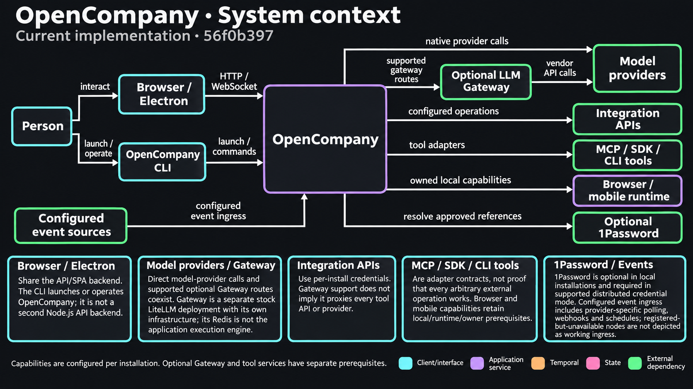

# LLM Gateway (LiteLLM)

OpenCompany's hosted LLM gateway is the stock open-source LiteLLM Proxy, deployed from `gateway/` with BerriAI's official Terraform module. Invited people call LLMs on platform-owned vendor keys, each with a monthly allowance, and spend is recorded per person and per session. The repository holds only configuration and tests; there is no custom gateway code. The operator runbook (deployment, adding people, upgrades) is [gateway/README.md](../gateway/README.md).

**Status:** the gateway is in `gateway/`; OpenCompany's side is `server/services/gateway/` and covers chat through ChatUnifier (agents, chat runs, employee setup, translate), OpenAI embeddings (long-term memory, the Embedding Generator), OpenAI speech (Text to Speech, Speech to Text, chat dictation), the vision tool, the RLM agent and Claude Code. Codex and the Gemini CLI stay on their own logins. `gateway/tests/test_gateway_contract.py` pins the contract below against the local stack; `server/tests/gateway/` covers OpenCompany's side.

<!-- architecture-suite:start -->
## Architecture diagrams

Source baseline: `56f0b397`. [Complete diagram suite](../docs/diagrams/architecture/README.md).

**System context — Current implementation.**

[Editable Mermaid](../docs/diagrams/architecture/01-system-context.mmd) · [Source evidence and limitations](../docs/diagrams/architecture/01-system-context.brief.md)

<!-- architecture-suite:end -->

## OpenCompany's side

**On by default.**
- `OPENCOMPANY_GATEWAY_ENABLED` (`gateway_enabled`, default `true`) lists the **Gateway** card, by OpenCompany, under AI models in Connectors. It is gated by `requires_setting` in `server/config/credential_providers.json`, honoured by `CredentialRegistry.get_all_providers`.
- **Where it appears:** in normal mode, the Connect an AI model dialog (the credentials dialog on AI models) and Connectors; in dev mode, API Credentials. Both shells use the same `CredentialsBrowser`.
- `OPENCOMPANY_GATEWAY_URL` (`gateway_url`) points at the gateway.
- `false` hides the card and turns the routing off, so behaviour is exactly as without the gateway.
- **Gateway source limitation:** this router currently reads its key from the local encrypted store on every call, and the credential card declares that a 1Password source is unsupported (`catalogue_extras`). Ordinary provider credential resolution can use approved per-call 1Password bindings; that capability has not been integrated into this gateway path. Distributed mode keeps the gateway off.

**The key.** One gateway key per install, saved like any API key (`OpenCompanyGatewayCredential`, `services/gateway/credential.py`, default `validate`). Its probe calls the gateway's `/user/info` with the key: 401 means a wrong key; 403 means an LLM-API key, and the person is told to create a Default one. The card's `ws.status` hook (`gateway_status`, `services/gateway/handlers.py`) returns the allowance as one line, which the API-key panel shows under the key (`statusSummary` in `useCredentialPanel`).

**Routing: own keys first** (`services/gateway/routing.py`). A call whose provider has a key of the install's own goes to that vendor as always. Otherwise, if the gateway is enabled, its key is stored and the provider has a `"gateway"` block in `server/config/llm_defaults.json`, `ChatUnifier.chat` builds the client with the gateway key and base URL (instead of the `{ref}_proxy` row) and passes the block's `model_prefix` to `OpenAIProvider`, which applies it to the wire model only. The gateway key stays inside the router and ChatUnifier: callers pass no key (`_resolve_activity_api_key` returns `""`), and it never enters node parameters or Temporal payloads. `ChatUnifier.fetch_models` never routes (it validates a key against its own vendor); `AIService.fetch_models` lists a gateway-covered provider's curated models with no network call. The checks that used to refuse "no key configured" accept gateway coverage (`GatewayRouter.covers`, or `gateway_covers` outside the DI graph): the three in `services/ai.py`, `_resolve_activity_api_key` and `prepare_agent_payload`, `Connections.ai_providers` (employee setup and the chat model picker), the global model list, and translate.

**Default model** (`gateway_default`, the `"gateway"` entry in `server/config/llm_defaults.json`). Where the owner has set no global model, an install that relies on the gateway uses Gemini's `default_model`, Gemini 3.8 Flash:
- chat Auto (`services/chat/choice.py`);
- employee setup, before the first usable provider (`services/employees/llm.py`);
- the global model the editor shows (`get_validated_ai_providers`).

It applies only while the gateway serves Gemini, and the owner's own choice always wins.

**Embeddings, speech and vision** call the gateway from their own clients, with the same rule and the provider's same `"gateway"` block: the gateway's key, its URL plus the block's `base_path`, the `model_prefix` on the wire model only, and the attribution headers built per call.
- **The key.** `key_or_route(ctx, credential_id, provider)` gives a plugin node its key: its own through `ctx.connection`, else the gateway's with the route. With neither, the annotated missing-key error still reaches the Credentials modal.
- **Embeddings** (`services/memory/vector_store.py`): `openai_embedding_access` tries the given key, then the stored OpenAI key, then the gateway. It routes only on OpenAI's own endpoint: an `endpoint` override names a server of the user's, which never gets the gateway key. `OpenAIEmbedder` never falls back to `OPENAI_API_KEY` from the environment.
- **Speech** (`nodes/speech/`): only providers marked `"gateway": true` in `speech_defaults.json` are routed (`provider_key`, `gateway_serves`). That is OpenAI, both directions; Groq is not, because 1.103.4 bills its transcription at $0. The gateway has no `/audio/translations` route, so Translate falls back to in-language transcription there. Dictation takes the first provider with an own key, else the first the gateway serves.
- **Vision** (`nodes/vision/vision_analyze`): routes all three SDK clients. The node now declares its OpenAI, Anthropic and Gemini credentials. It never did, so every real run failed at `ctx.connection`.
- **Error wording.** Failures of these calls get gateway wording from `describe` (`services/gateway/errors.py`), which reads LiteLLM's error type from an SDK or `httpx` error.

**The RLM agent** (`services/rlm/`) uses the rlms library, which reaches a custom URL only in OpenAI's format.
- **Route:** with no own key, `BackendAdapter` gives it the gateway's `/v1` route (`gateway_route(provider, openai_format=True)`) for every provider. The model goes under LiteLLM's name: the block's `model_prefix`, or for Anthropic and Gemini, which OpenCompany otherwise calls on native routes, the block's `openai_prefix`. Its client sends the run's attribution headers as `default_headers`.
- **Scope:** the same applies to a connected small model. The supported providers are unchanged; there is no replay cache.

**Claude Code** (`nodes/agent/claude_code_agent/_oauth.py`, `api_access`).
- **When the gateway serves Anthropic:** own access still comes first: the CLI's login (`claude auth status`), then the install's Anthropic key (`ANTHROPIC_API_KEY`), then the gateway. On the gateway, the spawn gets `ANTHROPIC_BASE_URL`, `ANTHROPIC_AUTH_TOKEN` and the run's attribution headers in `ANTHROPIC_CUSTOM_HEADERS`.
- **Without the gateway,** or with API settings in the server's own environment, nothing changes.
- **No reuse:** a gateway process carries its run's headers, so it is terminated after its turn instead of staying warm. The next turn resumes the conversation from the memory node's session id, as after an idle eviction.
- **Credential tool:** the MCP `getCredential` tool never returns the gateway key, allowlisted or not.

**Attribution** (`services/gateway/attribution.py`). Ids come from the structlog log context: `BaseNode.execute` binds the workflow, execution, root execution, chat run, employee job and user ids; the Temporal activity interceptor binds `temporal_workflow_id`, `temporal_run_id`, `temporal_activity_id` and `temporal_attempt`; the LLM-step and compaction activities bind the `attribution` dict their payload carries (`_attribution_ids` in `agent_workflow.py`). `log_context` restores outer values on exit, so a tool node run inside an agent keeps the agent's ids. Headers: session = chat run, else root execution, else execution, else Temporal workflow; tags `source:`, `workflow:`, `user:`; every allowlisted id as metadata. Inside a Temporal activity, calls send a replay-cache namespace from the key's fingerprint and the Temporal workflow, run and activity ids (not the attempt), so a retried activity replays at $0 and a re-run never replays another run's answer. Gemini's native route is the exception: LiteLLM 1.103.4 records its session id and tags but drops the metadata header, and ignores the cache body, so OpenCompany sends no cache body there and a retried Gemini step is billed again.

**Errors** (`services/gateway/errors.py`, `services/llm/protocol.py`). `_classify_error` maps the `budget_exceeded` type to BILLING before any status check, so the run fails once with no retry loop, and a deployment-spawned run pauses its deployment. Failures of gateway calls get gateway wording through `public_message` and the new `public_hint` (allowance used up; model not on the gateway, from `model_cost_map_missing`; reconnect the gateway key). Compaction inside the agent workflow handles them like an LLM step (`raise_llm_errors`), so they fail once instead of retrying.

## Layout

| Path | Contents |
|---|---|
| `gateway/litellm/config.yaml` | Production proxy config: provider wildcards, budget defaults, unpriced-model refusal, opt-in Redis cache, spend-log retention |
| `gateway/local/` | Local stack: Postgres 16, Redis 7, LiteLLM with mock models, and `fake_upstream.py`, fake Anthropic, Gemini and OpenAI-audio upstreams. Mocks reuse one response id on `/v1/messages` (LiteLLM keys spend rows by it and drops repeats), carry no HTTP response on the native Gemini route (LiteLLM's logging drops those) and don't apply on the audio routes, so those tests use the fake upstreams |
| `gateway/tests/test_gateway_contract.py` | Contract tests against the local stack (skipped when it isn't running) |
| `gateway/tests/test_pins.py` | Offline checks: version and price-list pins agree; every served default chat, speech and embedding model is priced; every vendor key the config reads has a Terraform secret; Gemini goes to Vertex with the Agent Platform key |
| `gateway/infra/terraform/` | Wrapper around `BerriAI/litellm/aws`: ECS Fargate, Aurora Postgres (IAM auth), ElastiCache, ALB, ACM, Route 53 records in the delegated `gw.opencompany.sh` zone |
| `.github/workflows/gateway-ci.yml` | Terraform checks, cosign verification of the pinned images, locked and audited test dependencies, contract and pin tests |

## Pins

- **LiteLLM 1.103.4**, in four places that `test_pins.py` keeps in agreement: `local.litellm_version` and the module `version` in `main.tf`, the compose image tag, and `LITELLM_VERSION` in CI. 1.103.x is the only stable line with the streamed-alias billing fix (LiteLLM PR #44341).
- **The price list**: `LITELLM_MODEL_COST_MAP_URL` points at one reviewed commit of LiteLLM's `model_prices_and_context_window.json`, in `main.tf` and the compose file. Unpinned, the gateway downloads upstream `main` at every start, so prices would change unannounced; the list bundled with 1.103.4 predates `gpt-6-sol` and the Claude 5.5 models. `GET /model/cost_map/source` shows the list a process loaded (on the deployed stack it is routed to the backend service, not the gateway tasks).

## Served providers

OpenAI, Anthropic, Gemini, Groq, Cerebras, xAI, Moonshot (OpenCompany's `kimi`) and Mistral for chat (a `"gateway"` block in `server/config/llm_defaults.json`). Gemini runs on Vertex AI express mode with an Agent Platform key (`GOOGLE_AGENT_API_KEY`, an `AQ.` key billed to its Google Cloud project): the Gemini Developer API refuses these keys, so `gateway/litellm/config.yaml` points the `gemini` provider's `api_base` at `https://aiplatform.googleapis.com/v1/publishers/google`, keeping Gemini's request format and price-list entries. OpenAI speech (`"gateway": true` in `server/config/speech_defaults.json`); OpenAI embeddings. `test_pins.py` checks each one's default models against the pinned price list, counting any `cost_per` field as a price, as LiteLLM does when it refuses unpriced models.

Not served: OpenRouter, DeepSeek and Sarvam (no price for their default models), Groq speech (1.103.4 bills its transcription at $0), ElevenLabs and Deepgram (OpenCompany speaks their native formats), and every tool API.

**Price override:** `gpt-4o-mini-tts`, OpenCompany's Text to Speech default.
- **Why:** the speech route returns no usage for the audio, so LiteLLM would bill the input text only, roughly 1% of the cost.
- **How:** `gateway/litellm/config.yaml` gives the model its own deployment, priced per input token (`input_cost_per_token: 0.000075`). That is about $0.015 per minute of speech, at roughly 200 text tokens a minute.
- **Checks:** `test_pins.py` keeps the local config at the same price, and the contract test checks the row.

`tts-1` and `tts-1-hd` are billed per character, and transcription per second of audio, measured from the file.

## Contract OpenCompany relies on

| Behaviour | Detail | Test |
|---|---|---|
| Wire model names | OpenAI-format calls use `<litellm prefix>/<model>` on `/v1` (`openai/`, `groq/`, `cerebras/`, `xai/`, `moonshot/`, `mistral/`). Anthropic SDK calls and Claude Code send bare `claude-*` ids to `/v1/messages`; Gemini SDK calls use the native `/v1beta/models/<id>:generateContent` route with the key in `x-goog-api-key`. Both are also served in OpenAI's format as `anthropic/` and `gemini/` (the RLM agent) | `test_anthropic_messages_route_accepts_bare_model_ids`, `test_gemini_native_route_accepts_virtual_key`, `test_native_providers_answer_in_openai_format` |
| Spent allowance | Refused with error type `budget_exceeded` on all three routes; HTTP 429 on 1.103.x, 402 from 1.104. Recognise it by type | `test_budget_refusal_is_typed_on_every_route` |
| Unpriced model | HTTP 403, error type `model_cost_map_missing` | `test_unpriced_model_is_refused` |
| Allowance | `GET /user/info` with the person's key returns `user_info.spend`, `max_budget` and `budget_reset_at`. Needs a Default-type key; LLM-API keys are refused; another user's id is refused | `test_user_info_needs_a_default_key_and_stays_scoped` |
| Attribution | `x-litellm-session-id`, `x-litellm-tags` (comma-separated, low cardinality: `workflow:`, `source:`, `user:`) and `x-litellm-spend-logs-metadata` (JSON) land on the spend row, queryable with `/spend/logs/v2?session_id=`. On the native Gemini route only the session id and tags land: there the router's metadata goes to `litellm_metadata`, which the spend row prefers, and only key fields are copied across | `test_attribution_headers_reach_spend_logs`, `test_messages_route_writes_a_priced_row_for_the_session`, `test_gemini_native_route_writes_a_priced_row_for_the_session` |
| Retry replay | Request body `cache: {"use-cache": true, "namespace": <stable per activity>, "ttl": 172800}` (OpenAI format through `extra_body`). A repeated call with the same namespace is a cache hit billed at $0, streamed or not, on `/v1/chat/completions` and `/v1/messages`. The native Gemini route ignores it | `test_cache_namespace_replays_retry_for_free`, `test_streamed_retry_replays_for_free`, `test_anthropic_messages_cache_namespace` |
| Streamed pricing | A real upstream stream through a dotted alias is billed at the deployment's price | `test_streamed_alias_is_priced_at_the_deployment` |
| Embeddings and speech | `/v1/embeddings`, `/v1/audio/speech` and `/v1/audio/transcriptions` with the `openai/` prefix bill the person and keep all three attribution headers; `gpt-4o-mini-tts` at the override price. There is no `/v1/audio/translations` | `test_embeddings_route_writes_an_attributed_row`, `test_speech_routes_write_attributed_rows`, `test_the_gateway_has_no_audio_translation_route`, `test_price_overrides_agree` |
| Known gaps | Groq transcription billed at $0; on the native Gemini route, metadata dropped and the cache body ignored. Strict xfail: each test fails the suite once a LiteLLM upgrade closes its gap, so the workaround can be lifted | `test_groq_transcription_is_billed`, `test_gemini_native_route_keeps_the_spend_logs_metadata`, `test_gemini_native_route_replays_retry_for_free` |

## Keys

People create one Default-type key per install in the console. A key draws on its person's monthly allowance, and LiteLLM reserves the worst-case cost of each call in Redis before admitting it (the model's full context plus its maximum output), so a request with a large `max_tokens` can be refused near the cap. An allowance smaller than a model's worst case refuses that model outright, even unspent: with $1, `gemini-3.5-flash`, `gemini-3.1-pro-preview` and `gemini-2.5-pro` were refused, while the $50 default admits every curated model. A Default key can also create and delete that person's own keys (not raise the allowance); a leaked key is revoked in the console.
