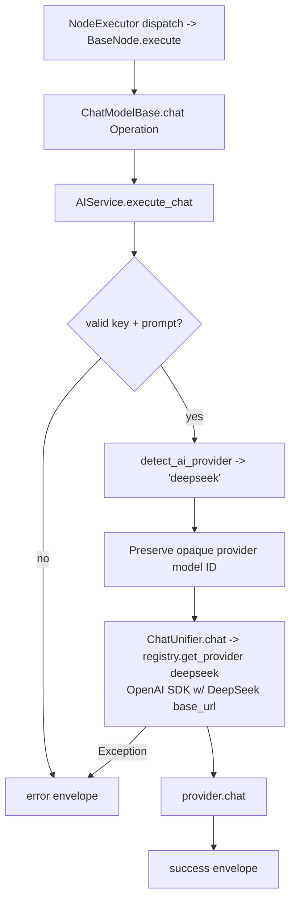

# DeepSeek Chat Model (`deepseekChatModel`)

| Field | Value |
|------|-------|
| **Category** | ai_chat_models |
| **Backend handler** | [`server/nodes/model/deepseek_chat_model/__init__.py`](../../../server/nodes/model/deepseek_chat_model/__init__.py) (dispatch via `BaseNode.execute()` -> `@Operation("chat")` in [`server/nodes/model/_base.py`](../../../server/nodes/model/_base.py)) |
| **AI service** | [`server/services/ai.py::AIService.execute_chat`](../../../server/services/ai.py) |
| **Tests** | [`server/tests/nodes/test_ai_chat_models.py`](../../../server/tests/nodes/test_ai_chat_models.py) |
| **Skill (if any)** | n/a |
| **Dual-purpose tool** | no (group `('model',)`) |

## Purpose

DeepSeek's API models: `deepseek-flash` (the default, served by DeepSeek-V4.1-Flash-1017), `deepseek-v4-pro` (DeepSeek-V4-Pro-0813) and the legacy name `deepseek-v4-flash`, which DeepSeek still accepts and serves with V4.1 Flash. Uses the OpenAI-compatible DeepSeek endpoint via the `services/llm/providers` layer (native path). The `ChatModelBase.chat` operation calls `AIService.execute_chat`. Since 2026-11-23 `llm_defaults.json` and `pricing.json` follow DeepSeek's own docs, not the OpenRouter snapshot: the default until then, `deepseek-v4.1-flash`, is OpenRouter's name for V4.1 Flash and appears nowhere in DeepSeek's docs, and OpenRouter's DeepSeek rows carry other hosts' limits and prices.

## Inputs (handles)

| Handle | Connection type | Required | Purpose |
|--------|-----------------|----------|---------|
| (none declared) | - | - | Configure `prompt` directly or resolve it through saved parameter templates; the model connection uses `output-model`. |

## Parameters

| Name | Type | Default | Required | displayOptions.show | Description |
|------|------|---------|----------|---------------------|-------------|
| `prompt` | string | `""` | yes | - | User message |
| `system_prompt` | string | `""` | no | - | System prompt |
| `model` | string | `""` (injected) | no | - | `deepseek-flash` (default) / `deepseek-v4-pro` / `deepseek-v4-flash` |
| `temperature` | number\|null | `null` | no | - | 0-2 |
| `max_tokens` | number\|null | `null` (8-64K) | no | - | 1-200000 |
| `top_p` | number\|null | `1.0` | no | - | Declared schema field; not forwarded by the standalone chat path |
| `frequency_penalty` | number\|null | `0.0` | no | - | Declared schema field; not forwarded by the standalone chat path |
| `presence_penalty` | number\|null | `0.0` | no | - | Declared schema field; not forwarded by the standalone chat path |
| `api_key` | string\|null | `null` (injected) | no | - | `auth_service.get_api_key('deepseek', 'default')` |

(Field names are snake_case on `DeepseekChatModelParams`; unknown keys ignored.)

## Standalone chat parameter boundary

See the [shared standalone chat contract](./_pattern.md) for the declared-but-unforwarded tuning fields, numeric thinking_budget requirement, direct/model/advisor execution paths and provider-policy limits. The Params table is not a promise that every field reaches the provider.

## Outputs (handles)

| Handle | Shape | Description |
|--------|-------|-------------|
| `output-model` | object | Model output; standard envelope payload |

### Output payload

```ts
{
  response: string;
  thinking: string | null;   // reasoning_content when the model emits one; null otherwise
  thinking_enabled: boolean;
  model: string;
  provider: 'deepseek';
  finish_reason: string;
  timestamp: string;
  input: { prompt: string; system_prompt: string };
}
```

## Logic Flow



## Decision Logic

- **Validation**: missing api_key / empty prompt -> error envelope.
- **Provider routing**: `detect_ai_provider` matches `'deepseek' in node_type.lower()` **first** (before kimi/mistral/cerebras/groq/openrouter/anthropic/gemini), so routing is unambiguous.
- **Native path**: uses the OpenAI SDK with DeepSeek's base URL from `llm_defaults.json`. The compatible provider sends `max_tokens` directly in the Chat Completions request; the same parameter mapping applies to current chat and agent executions.
- **Model ID handling**: only the UI-only `[FREE] ` decoration is stripped. The remaining model ID is preserved.
- **Reasoning trace**: when DeepSeek returns `reasoning_content` the native provider extracts it into `LLMResponse.thinking`, regardless of `thinking_enabled`. This normalization does not establish which models are currently available from the vendor.

## Side Effects

- **Database writes**: none on bare chat path.
- **Broadcasts**: none.
- **External API calls**: `POST https://api.deepseek.com/v1/chat/completions` (via OpenAI SDK with overridden base URL).
- **File I/O**: none.
- **Subprocess**: none.

## External Dependencies

- **Credentials**: `auth_service.get_api_key('deepseek', 'default')` plus optional `deepseek_proxy`.
- **Services**: `services/llm/providers/openai.py` (reused w/ DeepSeek base_url).
- **Python packages**: `openai`.
- **Environment variables**: none.

## Edge cases & known limits

- **`thinking_enabled=false` does not suppress a trace**: it only means the UI will not highlight one. If the model returns `reasoning_content`, the response still carries it.
- **`thinking_budget` has no effect**: DeepSeek reasoning is not budget-configurable; the field is silently ignored.
- **Context and output**: all three curated models have a 1,048,576-token context window and a 393,216-token output ceiling, as DeepSeek's List Models gives them. The provider block sets `"registry_lookup": false`, so these figures are what requests use, never the OpenRouter snapshot's. A node that leaves `max_tokens` unset requests the whole ceiling (`resolve_max_tokens`); one that names `deepseek-v4.1-flash` gets the 8,192-token `_default`, and should name `deepseek-flash` instead.
- **Cost**: booked at DeepSeek's peak-hour prices (`deepseek-flash` $0.30/$1.20 per MTok, cache hit $0.006; `deepseek-v4-pro` $1.32/$3.96, cache hit $0.044). DeepSeek bills half of that off-peak, so an off-peak call is booked at up to twice its cost.
- **OpenAI-compatible but not OpenAI**: features like `response_format: json_object` have subtly different behavior.
- **Error boundary**: typed OpenAI SDK failures become user-safe `NodeUserError` values in `ChatUnifier` and are re-raised to `BaseNode.execute()`, which produces the standard failure envelope. Unexpected failures are logged and returned by `execute_chat`.

## Related

- **Peer nodes**: see the other chat-model docs in this folder.
- **Architecture docs**: [Native LLM SDK](../../native_llm_sdk.md).
