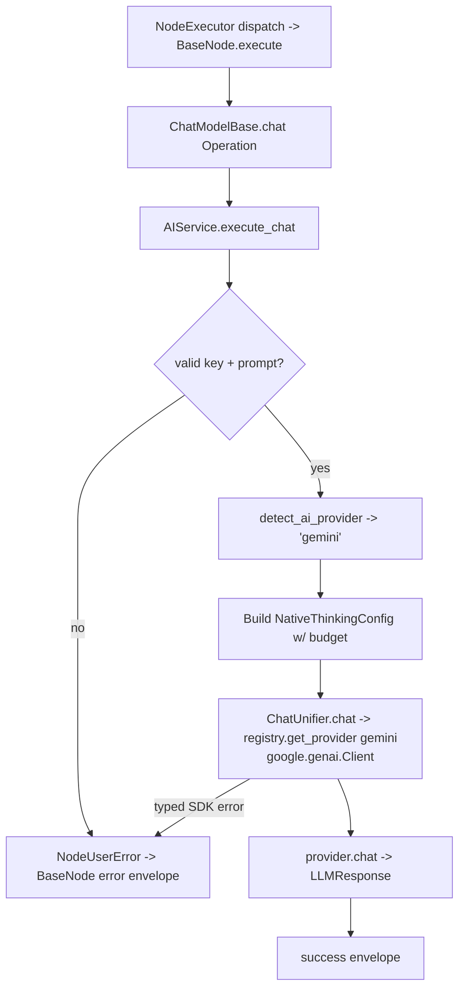

# Gemini Chat Model (`geminiChatModel`)

| Field | Value |
|------|-------|
| **Category** | ai_chat_models |
| **Backend handler** | [`server/nodes/model/gemini_chat_model/__init__.py`](../../../server/nodes/model/gemini_chat_model/__init__.py) (dispatch via `BaseNode.execute()` -> `@Operation("chat")` in [`server/nodes/model/_base.py`](../../../server/nodes/model/_base.py)) |
| **AI service** | [`server/services/ai.py::AIService.execute_chat`](../../../server/services/ai.py) |
| **Tests** | [`server/tests/nodes/test_ai_chat_models.py`](../../../server/tests/nodes/test_ai_chat_models.py) |
| **Skill (if any)** | n/a |
| **Dual-purpose tool** | yes - tool name `gemini_chat_model` (advisor; `usable_as_tool = True`, group `('model', 'tool')`) |

## Purpose

Single-turn chat completion against Google's Gemini API (google-genai native SDK). The `ChatModelBase.chat` operation calls `AIService.execute_chat`. Also wired as an AI-agent advisor tool (`usable_as_tool = True`) so an agent can consult Gemini mid-task.

## Inputs (handles)

| Handle | Connection type | Required | Purpose |
|--------|-----------------|----------|---------|
| (none declared) | - | - | Configure `prompt` directly or resolve it through saved parameter templates; the model connection uses `output-model`. |

## Parameters

| Name | Type | Default | Required | displayOptions.show | Description |
|------|------|---------|----------|---------------------|-------------|
| `prompt` | string | `""` | yes (non-empty) | - | User message |
| `system_prompt` | string | `""` | no | - | System prompt |
| `model` | string | `""` (injected) | no | - | e.g. `gemini-2.5-pro`, `gemini-2.5-flash`, `gemini-3-pro` |
| `temperature` | number\|null | `null` | no | - | 0-2 range |
| `max_tokens` | number\|null | `null` (clamped to ceiling) | no | - | 1-200000; up to 65K output |
| `top_p` | number\|null | `1.0` | no | - | Declared schema field; not forwarded by the standalone chat path |
| `top_k` | number\|null | `40` | no | - | Declared schema field; not forwarded by the standalone chat path |
| `thinking_enabled` | boolean | `false` | no | - | Enable thinking (2.5 Pro/Flash, 3.x) |
| `thinking_budget` | number\|null | `2048` | no | `thinking_enabled=[true]` | 1024-16000 token budget for internal reasoning |
| `safety_settings` | enum | `default` | no | - | Declared schema field; not forwarded by the standalone chat path |
| `api_key` | string\|null | `null` (injected) | no | - | `auth_service.get_api_key('gemini', 'default')` |

(Field names are snake_case on `GeminiChatModelParams`; unknown keys ignored.)

## Standalone chat parameter boundary

See the [shared standalone chat contract](./_pattern.md) for the declared-but-unforwarded tuning fields, numeric thinking_budget requirement, direct/model/advisor execution paths and provider-policy limits. The Params table is not a promise that every field reaches the provider.

## Outputs (handles)

| Handle | Shape | Description |
|--------|-------|-------------|
| `output-model` | object | Model output; standard envelope payload |

### Output payload

```ts
{
  response: string;
  thinking: string | null;
  thinking_enabled: boolean;
  model: string;
  provider: 'gemini';
  finish_reason: string;
  timestamp: string;
  input: { prompt: string; system_prompt: string };
}
```

## Logic Flow



## Decision Logic

- **Validation**: missing api_key / empty prompt -> error envelope.
- **Provider routing**: matches `'gemini' in node_type.lower()`.
- **Native SDK**: `ChatUnifier` uses `google.genai.Client` for both chat and
  current agent requests.
- **Thinking budget**: the standalone path builds `NativeThinkingConfig.budget`; the native provider sends `thinking_budget` when thinking is enabled and no explicit level applies. Owner-selected effort on eligible agent requests can instead send `thinking_level`; that is a separate caller path.
- **Model ID handling**: only the UI-only `[FREE] ` decoration is stripped; the remaining provider model ID is preserved.

## Side Effects

- **Database writes**: none on bare chat path.
- **Broadcasts**: none.
- **External API calls**: the endpoint selected by the native `google-genai` SDK. A proxy credential can override the Developer API base URL; Vertex Express mode uses the Vertex endpoint and ignores that proxy.
- **File I/O**: none.
- **Subprocess**: none.

## External Dependencies

- **Credentials**: `auth_service.get_api_key('gemini', 'default')` plus optional `gemini_proxy`.
- **Services**: `services/llm/providers/gemini.py`.
- **Python packages**: `google-genai` (native).
- **Environment variables**: none.

## Edge cases & known limits

- **Windows/Python 3.13 quirk**: the native `google-genai` provider avoids the
  former adapter's gRPC import deadlock. Both current chat and agent
  executions use the native path.
- **Standalone thinking budget units**: a token count, default 2048. The shared Params do not declare `thinking_level`, so extra values with that name are ignored on this node path.
- **Safety settings**: the declared field is not forwarded by `execute_chat` or the native Gemini provider. Typed API failures still follow the shared user-safe error boundary.
- **`max_tokens` clamp**: capped at the model's ceiling (65K for 2.5/3.x).
- **Error boundary**: typed Google SDK failures become user-safe `NodeUserError` values in `ChatUnifier` and are re-raised to `BaseNode.execute()`, which produces the standard failure envelope. Unexpected failures are logged and returned by `execute_chat`.

## Related

- **Peer nodes**: [`openaiChatModel`](./openaiChatModel.md), [`anthropicChatModel`](./anthropicChatModel.md), [`openrouterChatModel`](./openrouterChatModel.md), [`groqChatModel`](./groqChatModel.md), [`cerebrasChatModel`](./cerebrasChatModel.md), [`deepseekChatModel`](./deepseekChatModel.md), [`kimiChatModel`](./kimiChatModel.md), [`mistralChatModel`](./mistralChatModel.md).
- **Architecture docs**: [Native LLM SDK](../../native_llm_sdk.md).
