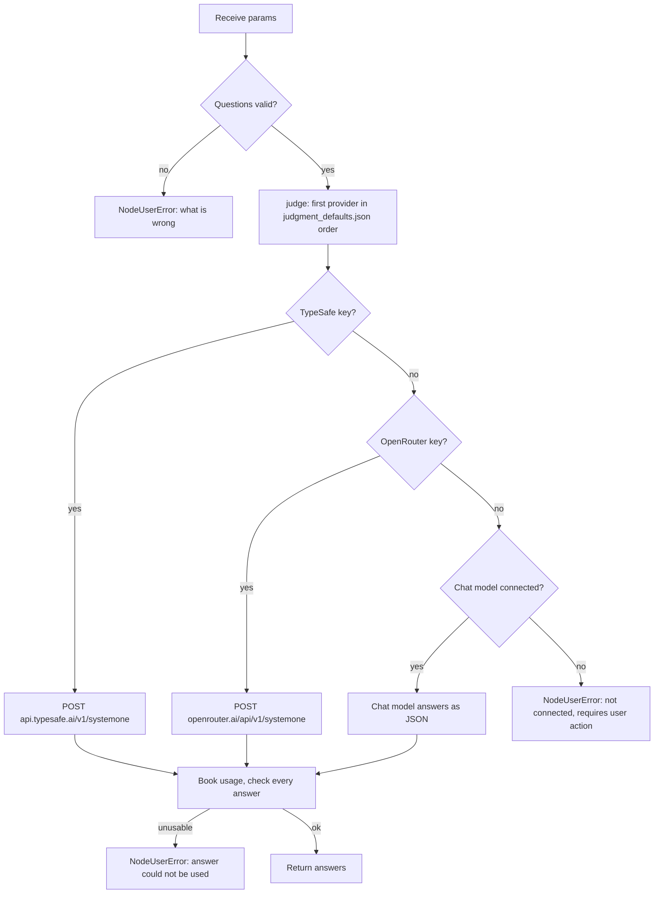

# Jev Classifier (`classify`)

| Field | Value |
|------|-------|
| **Category** | ai |
| **Shown as** | "Jev Classifier", subtitle "TypeSafe", with TypeSafe's mark ([`icon.svg`](../../../server/nodes/judgment/icon.svg), the same file as the TypeSafe card's `typesafe.svg`), so the owner can find it by Jev or TypeSafe; the type and the tool name stay `classify` |
| **Backend handler** | [`server/nodes/judgment/classify.py`](../../../server/nodes/judgment/classify.py) - `ClassifyNode`; dispatched via `BaseNode.execute()` + the `@Operation("classify")` method |
| **Judgment service** | [`server/services/judgment/`](../../../server/services/judgment/) (`judge`), providers in [`server/nodes/judgment/_providers/`](../../../server/nodes/judgment/_providers/) |
| **Providers config** | [`server/config/judgment_defaults.json`](../../../server/config/judgment_defaults.json) |
| **Tests** | [`server/tests/nodes/test_judgment.py`](../../../server/tests/nodes/test_judgment.py), [`server/tests/services/judgment/test_judgment_service.py`](../../../server/tests/services/judgment/test_judgment_service.py) |
| **Skill (if any)** | none |
| **Dual-purpose tool** | yes - tool name `classify` |
| **Direct Run** | supported; needs a TypeSafe key, an OpenRouter key or a connected AI model |
| **Controlled execution** | per-type activity on the `rest-api` queue; listed in `REPEATABLE` (a repeated call re-asks the same questions) |
| **Workspace task** | not applicable |

## Purpose

Answer typed questions about a text, with probabilities instead of prose:
whether a statement is true (`noul`), which of several options fits
(`choice`), or where the text sits on ordered levels (`score`). All the
questions are answered in one call. A workflow then branches on the answers
with ordinary conditional edges, and an agent can call the node as a tool
when a yes, a no or a label is all it needs.

The answer comes from TypeSafe's Jev, a "System One" judgment model that
charges only for input tokens, with the owner's TypeSafe key or through the
owner's OpenRouter key. With neither connected, the owner's chat model
answers as JSON instead (`calibrated: false`).

## Inputs (handles)

| Handle | Connection type | Required | Purpose |
|--------|-----------------|----------|---------|
| `input-main` | main | no | Upstream data, read into `text` through a template such as `{{whatsappReceive.text}}` |

Handles are declared visible explicitly (`hide_input_handle = False` /
`hide_output_handle = False`) because `usable_as_tool = True` otherwise
hides both.

## Parameters

| Name | Type | Default | Description |
|------|------|---------|-------------|
| `tool_name` | string | `classify` | Name shown to the LLM when used as a tool |
| `tool_description` | string | the node's tool description | Description shown to the LLM when used as a tool (`rows: 3`) |
| `text` | string | - | The text to judge (required) |
| `questions` | JSON object | an example with `urgent` (noul) and `topic` (choice) | Named questions; see below |

`questions` is a JSON editor field. Each key is a name made of letters,
digits and underscores, not starting with a digit, so that an edge can read
`result.answers.<name>`. Each value is:

```json
{
  "urgent": {"type": "noul", "description": "The message needs a reply today."},
  "topic": {"type": "choice", "description": "What the message is about.", "options": ["billing", "support", "sales", "other"]},
  "priority": {"type": "score", "description": "How soon it needs attention.", "levels": ["can wait", "this week", "today"]}
}
```

- `choice` takes 2 to 255 distinct `options`.
- `score` takes 2 to 10 distinct `levels`, lowest first.
- `noul` takes neither.
- `box` is refused: it needs an image, and this node judges text.

No Params field is named `model` or `api_key` (the parameter panel rewrites
fields with those names).

## Outputs (handles)

| Handle | Shape | Description |
|--------|-------|-------------|
| `output-main` | object | `ClassifyOutput` payload (below) |
| `output-tool` | - | Auto-appended for `usable_as_tool` |

### Output payload (TypeScript shape)

```ts
{
  answers: Record<string, {
    type: "choice" | "score" | "noul";
    choice?: string;                              // choice: the most likely option
    score?: number;                               // score: the expected level, from 0, may be fractional
    probability?: number;                         // noul: the probability the statement is true
    probabilities?: Record<string, number> | number[];  // choice: per option; score: per level, lowest first
    confidence?: number;
  }>;
  provider: "typesafe" | "openrouter" | "llm";
  judge_model: string;     // the model that answered, as reported
  calibrated: boolean;     // true for Jev; false for the chat-model fallback
  cost_usd: number;        // what the call was booked at
}
```

Edges branch with no new code, for example `result.answers.urgent.probability`
`gte` `0.8`, or `result.answers.topic.choice` `eq` `billing`.

## Logic Flow



## Decision Logic

- **Validation**: no question; a name that is not an identifier; a choice
  with fewer than 2 or more than 255 options, a score with fewer than 2 or
  more than 10 levels, duplicate or empty labels; `options` or `levels` on
  the wrong type; a box question. All are refused before any call.
- **Provider order**: `typesafe`, then `openrouter`, then `llm`, from
  `judgment_defaults.json`. A provider without a key is skipped. The chosen
  provider gets one attempt; a failure is final, and no other provider is
  tried.
- **Error paths**: `not_connected` raises `NodeUserError` with
  `requires_user_action` (the run stops with its reason and hint);
  `timeout`, `provider_error` and `invalid_reply` raise `NodeUserError`
  with the provider's reason.

## Side Effects

- **Paid call**: one System One request (TypeSafe or OpenRouter), or one chat
  completion for the fallback. The text and questions leave the machine.
- **Usage rows**: a Jev call is booked in `api_usage_metrics` under
  `typesafe` or `openrouter`, operation `judge`, `resource_count` = input
  tokens, priced at $0.042 per million input tokens from `pricing.json`;
  OpenRouter's own `usage.cost` is booked instead when its reply carries
  one. A fallback call is booked in `token_usage_metrics` like any model call.
- **Broadcasts / files**: none.

## External API Calls

| Service | Endpoint | Auth |
|---------|----------|------|
| TypeSafe | `POST https://api.typesafe.ai/v1/systemone` | `Authorization: Bearer <TypeSafe key>` |
| OpenRouter | `POST https://openrouter.ai/api/v1/systemone` | `Authorization: Bearer <OpenRouter key>` |
| Chat model | through `ChatUnifier` | the owner's model and key (`resolve_llm_choice`) |

## Edge cases

- **The fallback is not calibrated.** A chat model's probabilities are its
  own guess, renormalised over the declared options. Callers that need a
  measured answer (review auto-accept) ask with `calibrated_only`, which never
  reaches the fallback.
- **A refusal** (`{"type": "refusal"}` from OpenRouter) or a missing answer
  makes the whole judgment unusable.
- **A score is the expected level**, so `1.7` means between the second and
  third level; `probabilities` gives each level's share.

## Related

- **Service**: [Judgment service](../../judgment_service.md)
- **Pricing**: [Pricing Service](../../pricing_service.md)
