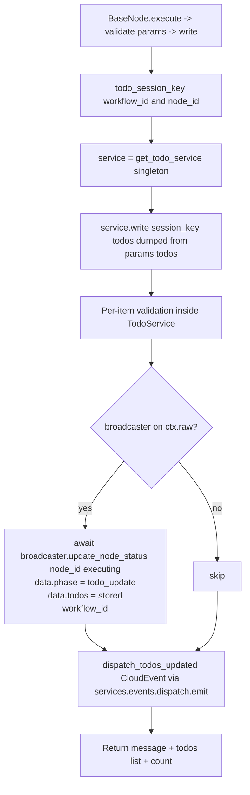

# Write Todos (`writeTodos`)

| Field | Value |
|------|-------|
| **Category** | ai_tools (tool-only ToolNode; group ("tool", "ai")) |
| **Backend handler** | [`server/nodes/tool/write_todos/__init__.py`](../../../server/nodes/tool/write_todos/__init__.py) — `WriteTodosNode`, dispatched via `BaseNode.execute()` + the `@Operation("write")` method (logic inlined; the standalone `services/handlers/todo.py::handle_write_todos` / `execute_write_todos` still exist but are no longer the dispatch path) |
| **Service** | [`server/services/todo_service.py::TodoService`](../../../server/services/todo_service.py) |
| **Tests** | [`test_ai_tools.py`](../../../server/tests/nodes/test_ai_tools.py), [`test_write_todos_handlers.py`](../../../server/tests/nodes/test_write_todos_handlers.py), [`memory/test_state.py`](../../../server/tests/services/memory/test_state.py) |
| **Skill (if any)** | [`server/skills/assistant/write-todos-skill/SKILL.md`](../../../server/skills/assistant/write-todos-skill/SKILL.md) |
| **Dual-purpose tool** | ToolNode - tool name `write_todos` |

## Purpose

Lets an AI Agent maintain a structured checklist while working
on a multi-step task. Each call **replaces** the entire todo list for the
selected Write Todos node with the new snapshot the agent produces, then broadcasts the new
state over WebSocket so the UI can render a live checklist. Storage is an
in-process `TodoService` singleton keyed by workflow **and node**. The live
list is not persisted to a database or workspace file.

## Pi Coding Agent compatibility

Connect this node's `output-tool` handle to the Coding Agent's `input-tools`
handle to expose `write_todos` to Pi. It uses OpenCompany's existing tool
execution, approval and result-recording path, just like other connected
tools. The node remains **Write Todos** (`writeTodos`), not a Pi-prefixed node.

The pinned Pi SDK 1.1.0 does not include a built-in todo tool. It supplies an
optional `examples/extensions/todo.ts` example that registers a different
`todo` tool and stores its state in SDK session entries. OpenCompany's Pi
host disables ambient extensions, so that example is not loaded. Its
session-backed persistence does not apply to this node's `TodoService`.

New Coding Agent creation automatically connects the Pi file, search and
shell tools listed in
[`coding_agent_recipe.py`](../../../server/services/coding_agent_recipe.py).
Write Todos is an additional, explicit connection and is not part of that
default set. See [Pi Coding Agent](../../pi_coding_agent.md).

## Parameter-panel editor (editable Current Todos)

The node's middle section is an **editable** Current Todos manager, not the empty
generic-params card. `uiHints.isTodoEditor` (declared on the plugin) routes
`MiddleSection` to [`client/src/components/parameterPanel/TodoEditor.tsx`](../../../client/src/components/parameterPanel/TodoEditor.tsx).

- **Source of truth = the live `TodoService` list**, using the same
  `todo_session_key(workflow_id, node_id)` as the `write` op, not
  `parameters.todos`. Each Write Todos node has its own list, including when
  several nodes belong to the same workflow.
- **Read / write WS handlers** (self-registered from the plugin folder via
  `register_ws_handlers`, see `server/nodes/tool/write_todos/_handlers.py`):
  - `get_todos` `{workflow_id?, node_id?}` → `{success, todos, session_key}`.
    The panel sends both identities and uses TanStack Query key
    `['todos', 'v2', workflow_id ?? 'unsaved', node_id]`, fetched on open.
  - `set_todos` `{workflow_id?, node_id?, todos}` → `{success, todos, session_key}`;
    replaces the list via `TodoService.write`. This manual path uses the
    service's permissive normalization; tool calls first pass the stricter
    Pydantic parameter validation described below.
- **Edits**: add / remove / inline edit content / click-to-cycle status; optimistic
  cache update + `set_todos`. While a row's content input is focused, incoming
  remote updates are suppressed so they can't clobber an in-progress edit.
- **Live updates**: both the tool `write` op AND `set_todos` emit the typed
  `todos_updated` CloudEvent via the centralized `services.events.dispatch.emit`
  (`server/nodes/tool/write_todos/_events.py`); the FE `todos_updated` case in
  `WebSocketContext` writes the inner `todos` into the exact workflow/node
  query key. Legacy events without `node_id` use `['todos', session_key]`. This
  is a plain CloudEvent (NOT a `node_status` "executing" broadcast), so a manual
  edit never makes the canvas node glow.

## Inputs (handles)

| Handle | Connection type | Required | Purpose |
|--------|-----------------|----------|---------|
| `input-main` | main | no | Upstream data (declared but not consumed by the `write` op) |

## Parameters

The `WriteTodosParams` model field IS the LLM-provided tool arg (no separate
`toolName` / `toolDescription` node params — those live on the class as
`tool_name` / `tool_description`).

| Name | Type | Default | Required | displayOptions.show | Description |
|------|------|---------|----------|---------------------|-------------|
| `todos` | `Array<TodoItem>` | `[]` | no | - | Full replacement snapshot. `TodoItem = {id?: string, content: string, status?: 'pending' \| 'in_progress' \| 'completed'}`; omitted status defaults to `pending`. The service discards `id`. A JSON-encoded string is coerced to a list by the `_coerce_todos` `field_validator(mode="before")` (handles Gemini stringified-array args). |

## Outputs (handles)

| Handle | Shape | Description |
|--------|-------|-------------|
| `output-tool` | object | Tool result returned to the LLM (`WriteTodosOutput` has `extra="allow"`, so the dict below passes through) |

### Output payload (TypeScript shape)

```ts
{
  message: string;   // "Updated todo list (<N> items)"
  todos: Array<{ content: string; status: 'pending' | 'in_progress' | 'completed' }>;
  count: number;     // len(stored)
}
```

Note: the op returns the validated `todos` LIST, not a JSON string. The
pre-fix `format_for_llm()` call that stringified this leaked a raw JSON string
into the key, which the `WriteTodosOutput` contract now rejects — the
LLM-facing serialization happens downstream.

## Logic Flow



## Decision Logic

- **Session key**: with a node ID, `todo:v2:<workflow_id>:<node_id>`; missing
  workflow IDs use `todo:v2:unsaved:<node_id>`. Legacy callers without a node
  ID retain `workflow_id` or literal `"default"`.
- **Tool validation**: Pydantic rejects malformed items and invalid status
  values before any write. Omitted status defaults to `pending`; malformed
  JSON strings are also validation errors.
- **Service normalization**: `TodoService.write` drops non-dict entries and
  empty trimmed content, coerces unknown statuses to `pending`, and retains
  only `content` and `status`. Tool inputs have already passed Pydantic;
  manual WebSocket edits reach this service directly.
- **Full replacement semantics**: each call overwrites `_store[session_key]`
  entirely - there is no merge / append. Agents are expected to send the
  complete snapshot.
- **Broadcast guarded**: `update_node_status` is called when
  `ctx.raw['broadcaster']` is truthy, so direct invocations without a
  broadcaster still succeed silently.
- **Status `"executing"`** (not `"success"`): the broadcast uses the status
  string `"executing"` with `data.phase = "todo_update"`, which the frontend
  uses to refresh the checklist without moving the node out of its current
  execution state.

## Side Effects

- **In-memory state writes**: `TodoService._store[session_key] = json.dumps(validated)`.
  State persists for the lifetime of the Python process only.
- **Database writes**: the live `TodoService` list has none. Normal workflow
  execution may separately persist the tool result; that does not hydrate
  the live editor state after restart.
- **Broadcasts** (two per successful write):
  - `StatusBroadcaster.update_node_status(node_id, "executing",
    {"phase": "todo_update", "todos": [...]}, workflow_id=...)` — drives the
    canvas glow; only when a broadcaster is present on `ctx.raw`.
  - `dispatch_todos_updated(...)` — typed `todos_updated` CloudEvent
    (`com.opencompany.todos.updated`) via `services.events.dispatch.emit`
    (`server/nodes/tool/write_todos/_events.py`), refreshing the open Current
    Todos panel's exact workflow/node query. Emission is awaited for every
    successful service write after the optional status broadcast.
- **External API calls**: none.
- **File I/O**: none.
- **Subprocess**: none.

## External Dependencies

- **Credentials**: none.
- **Services**: `TodoService` singleton (`get_todo_service()`);
  `StatusBroadcaster` via `context['broadcaster']`.
- **Python packages**: stdlib `json`, Pydantic parameter/output models, and
  the application's plugin/event infrastructure.
- **Environment variables**: none.

## Edge cases & known limits

- **Process-local state**: a server restart clears every todo list.
  Horizontal scaling never shares state across workers.
- **No automatic TTL**: lists remain until replaced, cleared or the process
  exits. [`clear_agent_session_state`](../../../server/services/memory/state.py)
  clears all node-scoped todo keys for the workflow and its legacy fallback
  keys. Scope contains no run or agent ID: agents sharing the same node
  overwrite the same list, and later runs can see it while the process lives.
- **Validation differs by entry point**: the tool rejects invalid models;
  direct service/manual edits normalize their entries. Dropped empty content
  and discarded IDs have no per-item warning in the result.
- **Broadcast failures bubble up**: the `write` op awaits
  `update_node_status`; if the broadcaster raises, the exception bubbles up
  to `BaseNode.execute()` (no `try/except` inside the op). CloudEvent emission
  failures also propagate. The in-memory replacement has already happened,
  so a failed call can still leave updated live todos.
- **`todos` returned as a list, not a JSON string**: the Output contract
  declares `todos: Optional[list]`; returning a stringified list is rejected
  by `BaseNode._serialize_result`.
- **Content is trimmed** (`.strip()`) but otherwise not sanitised - markdown
  or HTML in content survives untouched.

## Related

- **Sibling tools**: [`calculatorTool`](./calculatorTool.md), [`currentTimeTool`](./currentTimeTool.md), [`duckduckgoSearch`](./duckduckgoSearch.md), [`taskManager`](./taskManager.md), [`agentBuilder`](./agentBuilder.md)
- **Skill using this tool**: [`write-todos-skill/SKILL.md`](../../../server/skills/assistant/write-todos-skill/SKILL.md)
- **Architecture docs**: [Status Broadcaster](../../status_broadcaster.md), [Agent Architecture](../../agent_architecture.md)
