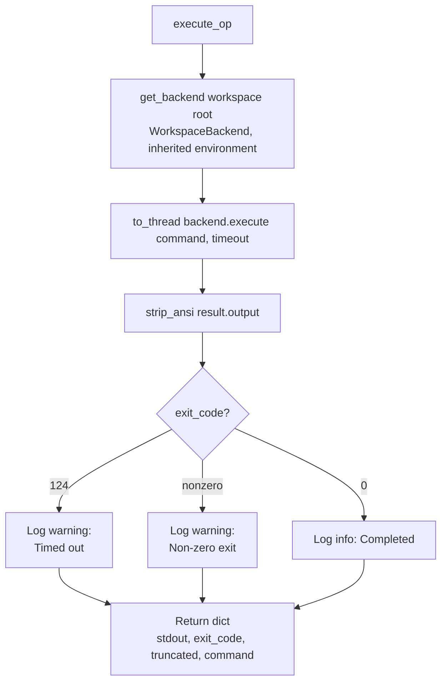

# Shell (`shell`)

| Field | Value |
|------|-------|
| **Category** | code_fs_process / filesystem |
| **Backend handler** | [`server/nodes/filesystem/shell/__init__.py::ShellNode.execute_op`](../../../server/nodes/filesystem/shell/__init__.py) (dispatched via `BaseNode.execute()` + `@Operation("execute")`) |
| **Backend** | `WorkspaceBackend.execute` (with `NushellBackend` retained as a compatibility alias) in [`server/nodes/filesystem/_backend.py`](../../../server/nodes/filesystem/_backend.py) |
| **Tests** | [`server/tests/nodes/test_code_fs_process.py`](../../../server/tests/nodes/test_code_fs_process.py), [`server/tests/nodes/test_coding_workspace_tools.py`](../../../server/tests/nodes/test_coding_workspace_tools.py) (the Coding Agent's automatic copy of the tool) |
| **Skill (if any)** | [`server/skills/terminal/shell-skill/SKILL.md`](../../../server/skills/terminal/shell-skill/SKILL.md) |
| **Dual-purpose tool** | yes - tool name `shell_execute` |

## Purpose

Runs a short-lived shell command inside the per-workflow workspace. The native
`WorkspaceBackend` is constructed with `inherit_env=True`, so external tools
like `npm`, `node`, `python`, and `git` ARE reachable on PATH. It uses Nushell
when `nu` is installed and otherwise uses the host shell (`sh` or `cmd.exe`).
When Nushell is selected, `&&` / `||` / `$VAR` / backticks / `>` do not use
bash semantics; see `shell-skill/SKILL.md` for conditional Nu guidance. When
Nushell is absent, all other syntax is interpreted by the host shell. For
long-running processes (dev servers, watchers), users are directed to
[`processManager`](./processManager.md); this node kills the command at
`timeout`. Node metadata describes this as short-lived execution from the
workflow workspace and marks the tool as open-world.

The tool description (`tool_description`) is the model's whole contract,
because a model rarely loads the skill before its first command. It says
which runners exist and gives the forms that work under all of them:

- one program with plain arguments per call (no pipes, redirection or
  chaining);
- inline code (`python -c "..."`) only as one line with no backslashes or
  double quotes inside, and longer code in a file written with `file_modify`;
- file edits through `file_modify`, not `sed`.

Every agent reads that description as it is: the Coding Agent's automatic
workspace tool (`services/coding_workspace_tools.py`) adds nothing to it. The
command reaches the runner unchanged, so its syntax errors are the runner's
own (Nushell's message for `&&` names `;`).

A 2026-11-13 run showed the cost of the old one-line description ("Execute a
shell command"). Three of its 24 model steps sent commands written for bash,
and Nushell rejected all three:

- a multi-line `python -c` whose `\n` Nushell turned into a newline;
- a multi-line `python -c` piped into `sort -u` (Nushell's `sort` has no
  `-u`);
- `sed -i` with `\[` (an invalid escape in Nushell), chained to the next
  command with `;`.

Each failed step re-sent the whole conversation: about 142,000 input tokens,
an eighth of the run.

Runs synchronously under `asyncio.to_thread()` so the event loop keeps
servicing other requests while the command executes.

## Inputs (handles)

| Handle | Connection type | Required | Purpose |
|--------|-----------------|----------|---------|
| `input-main` | main | no | Not consumed by the handler |

## Parameters

| Name | Type | Default | Required | displayOptions.show | Description |
|------|------|---------|----------|---------------------|-------------|
| `command` | string | (required, `min_length=1`) | yes | - | One program with plain arguments, such as `python script.py`; parsed by Nushell when `nu` is installed, otherwise by the host shell |
| `cwd` | string | `""` | no | - | Declared param, but `get_backend` resolves the working dir from `working_directory` (not exposed) / `ctx.workspace_dir`, so `cwd` does NOT change the backend root |
| `timeout` | number | `30` (ge=1, le=600) | no | - | Max seconds |

`ShellParams` uses `extra="ignore"` — `working_directory` is NOT exposed; the
backend root is `ctx.workspace_dir`.

## Outputs (handles)

| Handle | Shape | Description |
|--------|-------|-------------|
| `output-main` | object | Standard envelope payload (node declares only `input-main` / `output-main`; `usable_as_tool=True` exposes the same payload as the `shell_execute` tool result) |

### Output payload

```ts
{
  stdout: string;      // Combined output (backend merges stderr into stdout unless truncated); ANSI-stripped
  exit_code: number;   // 124 = timed out, else the process exit code
  truncated: boolean;  // Whether the backend truncated the output buffer
  command: string;     // Echo of the requested command
}
```

The plugin's `ShellOutput` (server/nodes/filesystem/shell/__init__.py) declares `stdout` / `exit_code` / `truncated`; `command` rides through on `extra="allow"`.

## Logic Flow



## Decision Logic

- **Validation**: empty `command` is rejected by Pydantic `min_length=1` (no
  manual check). Nothing else inspects the command: the runner parses it.
- **Runner selection**: `_find_nu()` caches `shutil.which("nu")`. A match runs
  `[nu, "-n", "--no-history", "-c", command]`; otherwise
  `subprocess.run(command, shell=True, ...)` delegates syntax to the host
  shell.
- **Inherited PATH**: `WorkspaceBackend(inherit_env=True)` — external tools
  (`npm`, `node`, `python`, `git`, …) ARE reachable. The previous "scrubbed
  PATH" framing no longer holds. AI agents are still steered toward
  `process_manager` for long-running daemons (the shell kills at `timeout`).
- **Timeout handling**: `timeout` is forwarded to
  `backend.execute(command, timeout=timeout)`. On timeout the backend kills
  the process and sets `exit_code=124` (POSIX convention). Logged at WARNING.
- **Non-zero exit still returns `success: true`**: the envelope-level success
  reflects whether the handler itself finished, not whether the command
  succeeded. Users must inspect `exit_code` in the payload.
- **Truncation**: the native backend caps output at 100,000 characters by
  default; when capped, `truncated=true` and the returned `stdout` contains
  `... Output truncated at 100000 bytes.` after the retained prefix. For a
  non-zero process exit, the subsequently appended `Exit code: N` line follows
  that marker.
- **ANSI stripping**: `result.output` is run through `core.ansi.strip_ansi`
  (a wrapper over **`click.unstyle`**) before being returned as `stdout` (and
  before the operator-log line), so colour/cursor codes from tools like
  `vite`/`npm` don't render as garbage in the Output panel. `click.unstyle` is
  byte-faithful apart from the stripped escapes.
- **No catch-all error wrapper**: the op does not wrap `backend.execute` in a
  try/except — non-zero exit codes are returned as a normal success envelope
  with `exit_code != 0`. An unexpected backend exception surfaces with a full
  traceback via `BaseNode.execute()`'s generic path.

## Side Effects

- **Database writes**: none.
- **Broadcasts**: none (but the process stdout/stderr is NOT streamed to
  Terminal - only `processManager` does that).
- **External API calls**: none.
- **File I/O**: `get_backend` ensures the workspace root exists. The command
  itself may read/write under that root.
- **Subprocess**: one per call, via the backend's subprocess (synchronous,
  inherited PATH). Finished before the operation returns.

## External Dependencies

- **Python packages**: standard library plus `core.ansi`.
- **Environment variables**: `WORKSPACE_BASE_DIR`.
- **OS utilities**: optional `nu` (Nushell) on PATH; otherwise the platform
  host shell. Whatever the command references is reachable because PATH is
  inherited.

## Edge cases & known limits

- **Conditional shell grammar**: chaining, variables, substitutions,
  redirection, pipelines, and builtins follow Nushell grammar only when `nu`
  is installed; otherwise they follow the host shell. The tool description
  steers the model to forms that work under both. See `shell-skill/SKILL.md`.
- **Truncation corrupts JSON output**: if a command prints JSON and the
  backend truncates, the `stdout` string becomes invalid JSON because the
  backend appends its human-readable truncation marker; `truncated=true`
  provides the machine-readable signal.
- **`exit_code=124` is exit-code polysemy**: real programs can legitimately
  exit 124; the handler does not distinguish those from the backend's timeout
  result.
- **`timeout` covers the direct subprocess**: the backend uses
  `subprocess.run(..., timeout=)` and kills the direct child on expiry.
  Descendant processes started by that shell may not be terminated as a
  process group.
- **Stdin is empty**: the node exposes no way to pipe data into the
  command - `input_data` from upstream nodes does not reach it.
- **No environment variable override**: users cannot inject env vars via
  parameters; the backend inherits the server's env (`inherit_env=True`).
- **Shell commands are open-world**: filesystem helper methods enforce
  workspace containment, but a shell command can use absolute paths or invoke
  external programs. This preserves the node's historical shell behavior.

## Related

- **Skills using this as a tool**: [`shell-skill/SKILL.md`](../../../server/skills/terminal/shell-skill/SKILL.md), [`bash-skill/SKILL.md`](../../../server/skills/terminal/bash-skill/SKILL.md), [`powershell-skill/SKILL.md`](../../../server/skills/terminal/powershell-skill/SKILL.md), [`wsl-skill/SKILL.md`](../../../server/skills/terminal/wsl-skill/SKILL.md)
- **Sibling nodes**: [`processManager`](./processManager.md), [`fileRead`](./fileRead.md), [`fsSearch`](./fsSearch.md)
