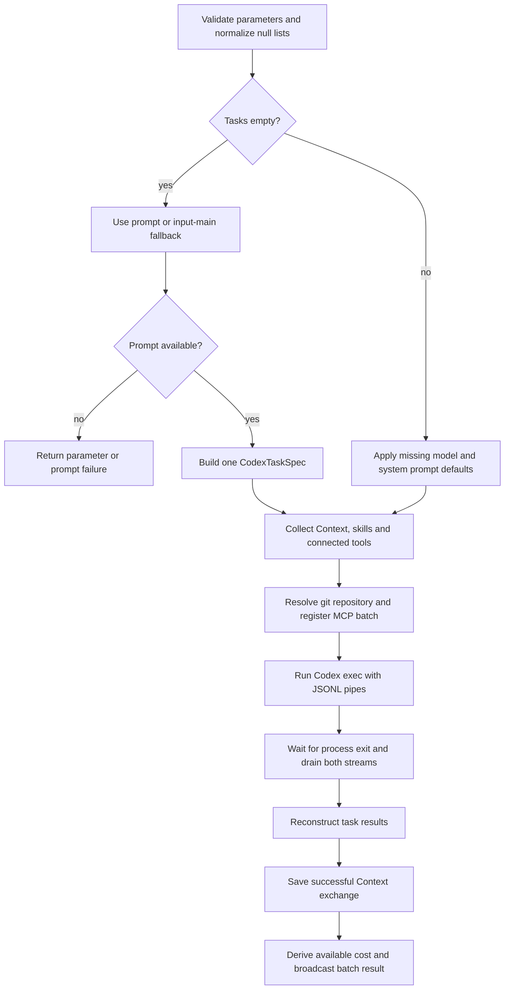

# Codex (`codex_agent`)

| Field | Value |
|------|-------|
| **Category** | specialized_agents |
| **Plugin** | [`CodexAgentNode.execute_op`](../../../server/nodes/agent/codex_agent/__init__.py) (dispatch via `BaseNode.execute()`) |
| **Backend service** | [`AICliService.run_batch`](../../../server/services/cli_agent/service.py) (provider `"codex"`) |
| **Provider / process** | [`OpenAICodexProvider`](../../../server/services/cli_agent/providers/openai_codex.py) / [`AICliSession`](../../../server/services/cli_agent/session.py) |
| **Connection collection** | [`collect_agent_connections`](../../../server/services/plugin/edge_walker.py) |
| **Tests** | [Parameters and Temporal Activity execution](../../../server/tests/nodes/test_codex_parameters.py), [Context wiring](../../../server/tests/nodes/test_specialized_context_bridges.py), [provider protocol](../../../server/tests/services/cli_agent/test_providers.py), [subprocess lifecycle](../../../server/tests/services/cli_agent/test_codex_session.py) |
| **Dual-purpose tool** | no |
| **Direct Run** | supported with a saved prompt/tasks, managed Codex login, and a discoverable git repository |
| **Controlled execution** | whole-node Temporal Activity; see the Temporal execution boundary below |
| **Workspace task** | no separate Workspace task execution path |

## Purpose

Runs one Codex CLI subprocess per `CodexTaskSpec` through
`AICliService.run_batch("codex", ...)`. Each task uses an isolated git worktree;
Codex enforces the selected sandbox. A single `prompt` synthesizes a one-task
batch, while `tasks` supports parallel work up to `max_parallel`.

The native Codex CLI supports more capabilities than this node exposes.
OpenCompany currently provides no native Codex resume, warm session pool,
budget cap, or maximum-turn control. Its generation-bound Context continuity
uses the shared stored-conversation bridge. See the [Codex guide](../../codex_agent.md)
for login, model selection, troubleshooting, and source references.

## Inputs (handles)

The node uses [`std_agent_handles()`](../../../server/nodes/agent/_handles.py).
Graph normalization pairs it with a system-managed Context node; a Context
descriptor requires an admitted conversation scope, so a manual canvas run
can report `context=no`.

| Handle | Connection type | Required | Purpose |
|--------|-----------------|----------|---------|
| `input-main` | input/main | no | Prompt fallback from `ctx.raw.outputs[source]` |
| `input-context` | input/context | system-managed | Generation-bound stored conversation, rendered into the task prompt and saved after a successful response |
| `input-skill` | input/skill | no | Skill names and descriptors passed to the scoped MCP bridge |
| `input-tools` | input/tools | no | Connected tools passed through the canonical tool surface to the scoped MCP bridge |
| `input-task` | input/task | no | Collected by the edge-walker; this node does not derive its prompt from the returned task descriptor |

Older graphs may contain `input-memory`. The node forwards only a descriptor
whose `kind` is `"context"`; it does not resume a native Codex session from a
legacy memory descriptor.

## Parameters

`CodexAgentParams` uses `extra="ignore"`. Saved `tasks: null` and
`allowed_credentials: null` normalize to `[]`, matching Claude Code.
Other malformed non-list values still fail validation.

| Name | Type | Default | Required | displayOptions.show | Description |
|------|------|---------|----------|---------------------|-------------|
| `tasks` | `CodexTaskSpec[]` | `[]` | no | - | Explicit task list; empty selects the single-prompt path |
| `prompt` | string | `""` | no | - | Used only when `tasks` is empty |
| `model` | string or null | Auto | no | - | Optional override for tasks without their own model; blank leaves selection to Codex configuration or the account-recommended model |
| `sandbox` | string | `workspace-write` | no | - | Sandbox for a synthesized single task: `read-only`, `workspace-write`, or `danger-full-access` |
| `ask_for_approval` | string | `never` | no | - | Approval policy for a synthesized single task: `untrusted`, `on-request`, or `never` |
| `system_prompt` | string or null | `None` | no | - | Optional prompt prefix; the provider wraps it in `<system>` tags before the user prompt |
| `working_directory` | string or null | `None` | no | - | Explicit git repository root; otherwise the service discovers an enclosing repository |
| `max_parallel` | int | `5` | no | - | Concurrency cap, from 1 to 20 |
| `allowed_credentials` | string[] | `[]` | no | - | Credential names the CLI may request through MCP |

Each explicit `CodexTaskSpec` also accepts `task_id`, `branch`, `model`,
`system_prompt`, and `timeout_seconds` (default 600, range 10–3600), plus
`sandbox` and `ask_for_approval`. Populated task lists inherit only missing
node-level `model` and `system_prompt`; their sandbox and approval values
come from their own task specifications.

## Outputs (handles)

`Output = CodexAgentOutput` (`extra="allow"`) returns the aggregated batch.

| Handle | Shape | Description |
|--------|-------|-------------|
| `output-main` / `output-top` | object | Batch result (see payload below) |

### Output payload

```ts
{
  success: boolean;                 // n_failed == 0
  n_tasks: number;
  n_succeeded: number;
  n_failed: number;
  total_cost_usd: number | null;     // centralized pricing may derive a value
  wall_clock_ms: number;
  tasks: SessionResultModel[];
  provider: "codex";
  timestamp: string;
  response: string | null;          // populated only for a one-task batch
}
```

Each task contains its response, success/error, worktree metadata, and
`canonical_usage`. The provider reads the answer from the last
`item.completed` agent-message item and token counts from `turn.completed`.
Cached input is separated from uncached input; failed turns can have zero usage.
The returned task response is limited to 4,000 characters by the session layer.

`provider_data.thread_id` is observational metadata. Failed provider requests
can also include `provider_data.error_code` and `provider_data.status_code`.
A thread identifier is not a node resume contract. On Context-bound runs,
ordinary task output clears `session_id` while retaining provider metadata.

The exec JSONL protocol does not supply native USD cost. The service attempts to derive cost through
the central pricing service; it remains `null` when the model or pricing cannot
be resolved. Auto selection therefore does not guarantee a cost estimate.

`codex_agent` is not in
[`node_output_schemas.py::_AGENT_TYPES`](../../../server/services/node_output_schemas.py).
The frontend Input Data panel uses live execution data rather than a registered
generic agent output schema.

## Logic Flow



## Decision Logic

- **Prompt resolution:** a non-empty `params.prompt` wins. Otherwise
  `_infer_prompt_from_inputs` scans `input-main` or untagged incoming edges
  and uses the first source output it can render. For a dictionary, the order
  is `message`, `text`, `content`, `prompt`, then `str(dict)`. No prompt
  raises `RuntimeError`.
- **Model selection:** a task model wins over a node model; the provider then
  considers its configured default. With no explicit choice, it omits
  `--model`. Unsupported explicit models remain errors, with guidance to
  choose Auto or an available account model.
- **Workspace and repository:** the workflow workspace holds per-task
  worktrees. An explicit `working_directory` must resolve to a git repository.
  Without it, the service tries the workspace and then the backend working
  directory, using `git rev-parse --show-toplevel`; it can therefore select an
  enclosing repository. No repository produces `working_directory_not_git_repo`.
- **Connections:** skill names/descriptors, connected tools, and the
  credential allowlist register a per-batch MCP scope. A Context descriptor
  augments the prompt and records successful responses through
  `SpecializedAgentContextBridge`; it does not invoke native Codex resume.
- **Completion:** success requires process exit 0 and `turn.completed`
  without a failed turn. The session waits for process exit and both output
  streams, rather than completing as soon as a terminal event arrives.

### Temporal execution boundary

Codex and Claude Code stay on whole-node Activities, outside
`AGENT_WORKFLOW_TYPES`. The workflow puts the node's captured parameters into
`node_data`; both legacy WebSocket dispatch and per-type
`BaseNode.as_activity()` reach the shared NodeExecutor and plugin validation.
The null-list compatibility therefore applies to saved parameters and frozen
Temporal payloads without rewriting deployment history.

The node declares `TaskQueue.AI_HEAVY` and
`RetryPolicy(maximum_attempts=1)`. Activity heartbeats keep the whole
subprocess run alive. Task timeout or cancellation terminates the Codex process
tree and runs worktree/MCP cleanup. For generations with
`execution_control_version=1`, Stop/Resume controls admission and continuation
of the whole Activity; it does not pause or resume native Codex turns. See
[Temporal workflow control](../../temporal-workflow-control.md)
and [CLI Agent Framework](../../cli_agent_framework.md#generation-stop-and-cli-session-resume).

## Side Effects

- **Subprocesses:** the app-managed CLI runs `exec --json` over pipes, with no
  PTY, using the same isolated `CODEX_HOME` as login/status/logout.
- **MCP:** the batch registers an HTTP server scope. Its bearer token is
  supplied through an environment variable, not command-line credentials or
  persistent Codex configuration. MCP initialization is required.
- **Broadcasts:** node status changes from executing to success/warning;
  streamed events can appear in terminal logs.
- **File I/O:** git worktrees are created under the workflow workspace and
  removed during cleanup; Codex's own state remains under the managed home.
- **External API:** the native Codex CLI calls OpenAI using its own login.

## External Dependencies

- **Binaries:** Git and the pinned Codex package configured in
  [`ai_cli_providers.json`](../../../server/config/ai_cli_providers.json).
  Bun installs it into the app's shared package tree when needed.
- **Python packages:** the `services/cli_agent/` framework and shared
  process supervision.
- **Credentials:** use the Credentials panel's browser or device login.
  The CLI owns its credential store under `CODEX_HOME=<DATA_DIR>/codex`;
  OpenCompany stores a connection marker. `allowed_credentials` separately
  gates credentials that MCP tools may fetch. See [Codex login](../../codex_agent.md).

## Edge cases & known limits

- **No prompt or tasks:** the node raises a prompt error before spawning a CLI.
- **Saved null lists:** `tasks=null` and `allowed_credentials=null` normalize
  to empty lists. Strings or objects are not silently accepted as lists.
- **Unsupported model:** `model_not_found` / HTTP 400 with an empty response
  and zero usage can mean the selected model is unavailable to the login.
  A rollout containing the user message proves input was delivered; clear an
  obsolete Model value instead of rewriting the prompt.
- **`input=no` in collection logs:** this reports the upstream Input
  connection data, not whether the saved `prompt` or task prompt exists.
- **Premature stream end:** exit 0 without `turn.completed` still fails.
  Failed turns remain failures even if the subprocess exit code is 0.
- **Resume and cost:** this node exposes no native Codex continuation or
  budget/turn controls; USD cost may be unavailable.
- **No output schema registration:** see the Outputs note above.

## Related

- **Setup and troubleshooting:** [Codex guide](../../codex_agent.md)
- **Dedicated-path siblings:** [Claude Code](./claude_code_agent.md), [RLM](./rlm_agent.md)
- **Generic pattern:** [`_pattern.md`](./_pattern.md)
- **Architecture:** [CLI Agent Framework](../../cli_agent_framework.md)
