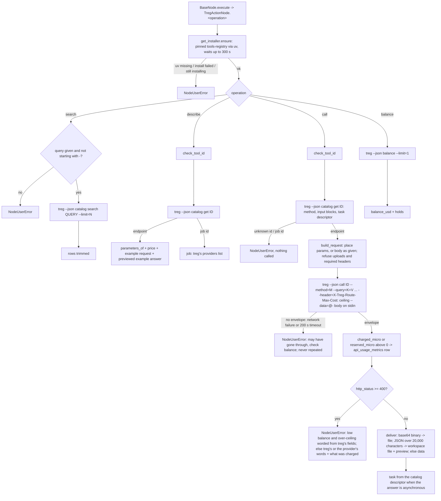

# treg (`tregAction`)

| Field | Value |
|------|-------|
| **Category** | web_automation / api / tool (dual-purpose) |
| **Backend handler** | [`server/nodes/treg/treg_action.py::TregActionNode`](../../../server/nodes/treg/treg_action.py) - dispatch via `BaseNode.execute()` -> `@Operation("search" / "describe" / "call" / "balance")`; the CLI's environment and runs in [`_service.py`](../../../server/nodes/treg/_service.py), its install in [`_install.py`](../../../server/nodes/treg/_install.py), parameter placement in [`_request.py`](../../../server/nodes/treg/_request.py), large answers in [`_result.py`](../../../server/nodes/treg/_result.py) |
| **Tests** | [`server/tests/test_treg_plugin.py`](../../../server/tests/test_treg_plugin.py) |
| **Skill (if any)** | [`server/skills/web_agent/treg-skill/SKILL.md`](../../../server/skills/web_agent/treg-skill/SKILL.md) |
| **Dual-purpose tool** | yes - tool name `treg_action` (`usable_as_tool = True`; both canvas handles explicitly kept visible) |
| **Direct Run** | supported; `search` and `describe` work before sign-in, `call` and `balance` need the treg sign-in (Credentials -> treg) |
| **Controlled execution** | ActionNode defaults on the `rest-api` queue; a broken-off `search`, `describe` or `balance` may run again (`repeats.py`), a `call` never (it may already have been charged) |
| **Workspace task** | not applicable |

## Purpose

treg (treg.to) puts thousands of paid third-party tools (search results,
SEO data, social profiles and posts, people and company data, web pages,
image, video and voice generation) behind one sign-in, each billed per
call to the team's prepaid balance. This node runs treg's own CLI, the
PyPI package `tools-registry`, pinned and installed by OpenCompany with uv
into its own tool folder. `search` finds tools for a job with their
prices, `describe` lists one tool's parameters and where each goes,
`call` runs a tool within the owner's price ceiling and records what it
cost, and `balance` reads the team balance.

## Inputs (handles)

| Handle | Connection type | Required | Purpose |
|--------|-----------------|----------|---------|
| `input-main` | main | no | Upstream data; not consumed directly - inputs come from `parameters` (or the LLM's tool args when used as a tool) |

## Parameters

(Pydantic `TregActionParams`, `extra="ignore"`; a `model_validator(mode="before")`
runs `coerce_blank_params(..., object_fields=("params",))` so the panel's
`""` and a stringified JSON object both work; `body` given as text is
parsed as JSON, and an empty one is no body.)

| Name | Type | Default | Required | displayOptions.show | Description |
|------|------|---------|----------|---------------------|-------------|
| `operation` | options | `search` | no | - | `search` / `describe` / `call` / `balance` |
| `query` | string | `""` | yes for `search` | `operation` = `search` | The job in plain words; may not start with `-` |
| `limit` | int (`ge=1, le=100`) | `10` | no | `operation` = `search` | The most tools to list |
| `tool_id` | string | `""` | yes for `describe` and `call` | `operation` in [`describe`, `call`] | A catalog id; must match `[A-Za-z0-9][A-Za-z0-9._@-]*` |
| `params` | object (JSON editor) | `{}` | no | `operation` = `call` | The tool's parameters by name; placed where the catalog declares them |
| `body` | any JSON (JSON editor) | none | no | `operation` = `call` | A whole request body, sent as given; refused together with body fields in `params` |
| `max_cost_usd` | float (`ge=0`) | `0.10` | no | `operation` = `call` | The most one call may cost; in `server_controlled_fields`, so a model's value is ignored |

## Outputs (handles)

| Handle | Shape | Description |
|--------|-------|-------------|
| `output-main` | object | `_shape(operation, **fields)` payload (see below); the same payload goes to the LLM when wired to `input-tools` |
| `output-tool` | - | Auto-appended for `usable_as_tool` |

### Output payload

`TregActionOutput` (`extra="allow"`, every field Optional; `_shape` drops
`None`):

```ts
// operation = "search"
{
  operation: 'search';
  query: string;
  count: number;             // tools returned
  total: number;             // tools that matched
  verdict?: string;          // treg's judged search: strong | closest | none | keyword | name
  reason?: string;
  tools: Array<{
    id: string; name?: string; summary?: string; provider?: string;
    price?: { type?: string; usd?: number; usd_min?: number; unit?: string; varies?: boolean };
    task?: true;             // runs as an asynchronous task (generation)
    routed?: true;           // treg picks the provider
  }>;
}

// operation = "describe"
{
  operation: 'describe';
  tool_id: string; name?: string; summary?: string; note?: string;
  provider?: string; method?: string; price?: object;
  parameters: Array<{ name: string; in: 'path' | 'query' | 'body' | 'header';
                      type?: string; required?: boolean; default?: unknown;
                      enum?: unknown[]; example?: unknown; note?: string }>;
  parameters_note?: string;
  example_request?: object;  // the catalog's known-good request
  example_response?: unknown;// its example answer, previewed (first element of each list)
  task?: true; status?: string; superseded_by?: string; docs_url?: string;
}
// describe of a job id (what several providers do): { operation, tool_id, job: <treg's providers list> }

// operation = "call"
{
  operation: 'call';
  tool_id: string;
  http_status: number;
  cost_usd?: number;         // what treg charged; absent when treg did not bill (the team's own provider key)
  reserved_usd?: number;     // a task's hold instead of cost_usd; settled when the task ends
  call_id?: string;          // treg's id for the call
  routed_tool?: string; upstream_failed?: string;
  // Exactly one of: the answer whole (JSON up to 20,000 characters, or text) ...
  data?: unknown;
  // ... or saved to the workspace under treg/: indented JSON with a preview, or a binary file
  file?: FileRef; preview?: unknown; note?: string;
  task?: {                   // only for an asynchronous tool
    task_id?: unknown;
    check?: { operation: 'call'; tool_id: string; params: object }; // the call that reads its state
    status_path?: string; done_when?: unknown[]; failed_when?: unknown[];
    result_path?: string; interval_seconds?: number; note?: string;
  };
}

// operation = "balance"
{
  operation: 'balance';
  balance_usd: number;
  holds: Array<{ tool_id: string; reserved_usd: number; call_id: string }>;
}
```

## Logic Flow



## Decision Logic

- **Every run** goes through `_service.run_treg`: `treg --json <argv>`
  with the environment `treg_env` builds (`TREG_CONFIG` under
  `<DATA_DIR>/treg`, inherited `TREG_*` removed, analytics off,
  `TREG_CLIENT=opencompany`, a `BROWSER` that opens nothing), stdin a
  pipe closed after the body or at once, from the `<DATA_DIR>/treg`
  folder. Values are passed as `--flag=value` arguments; no shell.
- **Validation**: `search` needs a query that does not start with `-` (the
  CLI removes any `--org=` argument wherever it stands); `describe` and
  `call` need a tool id of catalog shape.
- **Placement** (`_request.build_request`): names declared under
  `pathParams` or `queryParams` go to the query string (treg fills path
  parameters from it); names declared under `body` go to the body; an
  undeclared name follows the method (query string for GET, HEAD and
  DELETE, body otherwise). Dotted names are fields of a nested object.
  A tool whose example body is a list gets its fields as a list of one.
  A POST without fields sends `{}`. `bodyType: form` is form-encoded.
  Lists in the query string follow `queryArrayEncoding`. A file upload
  (`bodyType: multipart`) or a required request header is refused.
- **Ceiling**: every call carries `X-Treg-Route-Max-Cost: <max_cost_usd>`;
  treg refuses a dearer call before reserving anything (`402
  route_max_cost`). It does not apply to a call served on the team's own
  provider key, which treg does not meter.
- **Cost**: the CLI's `_treg.charged_micro` (or `reserved_micro` for an
  asynchronous submission) is recorded when above 0, before the answer is
  saved and also when the call failed.
- **Error paths**: `402 insufficient_balance` needs the owner (top up);
  `402 route_max_cost` names the ceiling; 401 and 403 need the owner; any
  other status is reported in treg's or the provider's words with what
  was charged. A call whose answer did not come back may have gone
  through and is never repeated.
- **Approval class** (`services/approvals/classes.py`): `search`,
  `describe` and `balance` are `read` and may run again after a broken-off
  attempt (`repeats.py`); `call` is `money` and never repeats. The
  node's `ApprovalSpec` holds only `call`, with `refuse_while_asking`:
  while the owner asks first, an agent's call is refused (an approved
  call would run later and its paid answer would never reach the agent).

## Side Effects

- **Database writes**: one `api_usage_metrics` row per call treg charged
  or reserved for (`service="treg"`, `operation` `call` or `task`,
  `endpoint=<tool id>`, `resource_count=1`, `cost` in USD). Recording
  never fails a call.
- **Broadcasts**: per-node status via `BaseNode.execute`.
- **External API calls**: through the CLI only: `GET https://treg.to/catalog/search`,
  `GET /catalog/endpoints/{id}`, `ANY /call/{id}` (with the CLI's stored
  key), and for `balance` `GET /orgs` then `GET /orgs/{id}/balance`.
- **File I/O**: the CLI reads and writes its config under `<DATA_DIR>/treg`;
  a large or binary answer is written to `<workspace>/treg/` through
  `services.media.write_media`.
- **Subprocess**: one or two `treg` runs per operation; the first use also
  runs `uv tool install`.

## External Dependencies

- **Credentials**: `TregCredential` (id `treg`, `auth = "custom"`) is a
  marker: the key stays in the CLI's own config; sign-in is relayed by
  the Credentials modal (`treg_login` / `treg_status` / `treg_logout` in
  [`_handlers.py`](../../../server/nodes/treg/_handlers.py)).
- **Services**: uv at run time (bundled in the desktop app; absent from the
  default Docker image); `Database.save_api_usage_metric`;
  `services.media.write_media`.
- **Python packages**: none in the server; the CLI is `tools-registry==0.30.0`
  in its own uv tool environment.
- **Environment variables**: `UV_TOOL_DIR` / `UV_TOOL_BIN_DIR` (desktop
  app), `OPENCOMPANY_UV_BIN`.

## Edge cases & known limits

- **The ceiling bounds one call, not a run**: an agent can make many
  calls. Use a treg team with a small balance and a daily call cap.
- **Search and describe need no sign-in**: treg's catalog is open; the
  judged search is capped per caller (per IP address when signed out).
- **A task's cost is its reservation**: the final charge is settled by
  treg when the task ends (refunded if it fails); `balance` shows it.
  Polling a task with `task.check` is free on treg's own key. Result URLs
  in a task's answer are the provider's and expire.
- **`balance` may trigger an automatic top-up** when the team turned
  automatic top-ups on and the balance is under its threshold (treg's own
  rule on its balance route).
- **Some catalog tools act** (post, change ads, send) through accounts
  connected in treg, which is why `call` is `money`.
- **A newer `tools-registry`** is not used until the pin in `_install.py`
  is bumped.

## Related

- **Skills using this as a tool**: [`treg-skill/SKILL.md`](../../../server/skills/web_agent/treg-skill/SKILL.md)
- **Hiring**: the `treg` app in [`employee_apps.json`](../../../server/config/employee_apps.json) (`side_effects: "money"`); `tregAction` is in the Hire allowlist ([`node_allowlist.json`](../../../server/config/node_allowlist.json))
- **Companion nodes**: [`tikhubAction`](./tikhubAction.md), [`apifyActor`](./apifyActor.md)
- **Architecture docs**: [Plugin System](../../plugin_system.md), [CLI Services Integration](../../cli_services_integration.md), [Pricing Service](../../pricing_service.md)
