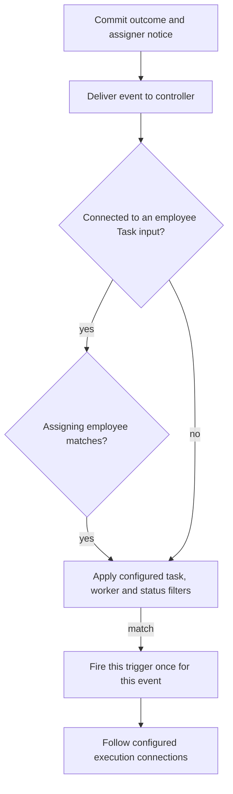

# Task Trigger (`taskTrigger`)

| Field | Value |
|------|-------|
| **Category** | workflow / trigger |
| **Backend handler** | Plugin [`server/nodes/trigger/task_trigger/__init__.py`](../../../server/nodes/trigger/task_trigger/__init__.py) (`TaskTriggerNode`); dispatch via `BaseNode.execute()`. The base `TriggerNode.execute` runs the event wait; the `@Operation("wait")` body is a stub. |
| **Tests** | [`server/tests/nodes/test_workflow_triggers.py`](../../../server/tests/nodes/test_workflow_triggers.py) |
| **Skill (if any)** | none |
| **Dual-purpose tool** | no |

## Purpose

Task Completed observes a submitted or failed Task Manager assignment. In
recipe v3, a connection from `output-main` to an employee's `input-task`
scopes the trigger to work that employee assigned. A worker finishing under
the Orchestrator wakes the Orchestrator. Chat receives the event for its own
outer assignment when the Orchestrator submits or fails it. A standalone
automation receives events matching its configured filters.

The instance service commits the task outcome and review notice together, and
records pending event delivery on the mutation receipt. The controller uses
the trigger node and event identity to deduplicate redelivery. Resuming a
scoped review requires the persisted task, assigner, instance and generation.
Earlier recipes retain their admitted routing. [Managed team workflow](../../employee_teams.md)

## Inputs (handles)

| Handle | Connection type | Required | Purpose |
|--------|-----------------|----------|---------|
| (none) | - | - | Trigger nodes have no inputs. |

## Parameters

| Name | Type | Default | Required | displayOptions.show | Description |
|------|------|---------|----------|---------------------|-------------|
| `task_id` | string | `""` | no | - | If set, only match events with this exact `task_id`. |
| `agent_name` | string | `""` | no | - | Case-insensitive substring match against `event.agent_name`. |
| `status_filter` | options | `all` | no | - | `all` / `completed` / `error`. |
| `parent_node_id` | string | `""` | no | - | If set, only match events with this exact `parent_node_id`. |

## Outputs (handles)

| Handle | Shape | Description |
|--------|-------|-------------|
| `output-main` | object | The `task_completed` event payload. |

### Output payload

Declared `TaskTriggerOutput` fields:

```ts
{
  task_id?: string;
  status?: 'completed' | 'error';
  agent_name?: string;
  result?: string;     // Present when status='completed'
  error?: string;      // Present when status='error'
  workflow_id?: string;
}
```

`TaskTriggerOutput` is `model_config extra="allow"`, so the producer's extra
fields (`agent_node_id`, `parent_node_id`, `team_id`, `execution_id`,
`root_execution_id`, `trace_id`) pass through to downstream nodes at runtime
even though they are not declared on the model. Wrapped in the standard
envelope.

## Logic Flow



## Decision Logic

`TaskTriggerNode.build_filter` applies all configured filters as AND:

- **task_id**: exact match if non-empty.
- **agent_name**: `agent_name_filter.lower() in event_agent.lower()` -
  substring match, case-insensitive.
- **status_filter**:
  - `completed` -> requires `event.status == 'completed'`
  - `error` -> requires `event.status == 'error'`
  - `all` -> no status restriction; other values fail the declared Literal schema
- **parent_node_id**: exact match if non-empty.

For v3 employee triggers, the owner check precedes the configured filters.
Validation flags overlapping filters on triggers connected to the same employee.
Teammate connections describe reporting lines and are excluded from forward
execution. If any filter rejects, this trigger keeps waiting.

## Side Effects

- **Database writes**: none.
- **Broadcasts**: the producer emits a CloudEvents `WorkflowEvent` via
  `dispatch.emit`. The controller (or legacy listener) emits firing-pulse
  status via `broadcast_trigger_status_activity` around each child spawn.
- **External API calls**: none.
- **File I/O**: none.
- **Subprocess**: none.

## External Dependencies

- **Credentials**: none.
- **Services**: `services.deployment` (canary listener), `services.events.dispatch`,
  `services.status_broadcaster`.
- **Upstream dispatchers**: `services.temporal.agent_activities.finish_agent_delegation`
  and the legacy `services.handlers.tools._execute_delegated_agent` use
  `nodes.agent._events` after persisting the outcome. A failed attempt that is
  requeued does not publish a terminal failure event.
- **Python packages**: stdlib only.
- **Environment variables**: none.

## Edge cases & known limits

- `agent_name` is a case-insensitive **substring** match, not an exact
  match. Two agents named `"TwitterAgent"` and `"TwitterAgentV2"` are both
  matched by `agent_name="Twitter"`.
- `status_filter` is validated as `all`, `completed`, or `error` before a direct wait registers; unknown values are rejected, not treated as wildcards.
- Waiter has no timeout; if the child agent never dispatches a
  `task_completed` event (e.g. it is still running or died silently) the
  trigger blocks until cancelled.
- Standalone consumers can observe a matching event. Job-scoped review tools
  validate authority separately before accepting a change.
- For v3, the event identifies the committed task attempt and revision, so
  a later revised submission can trigger a fresh review.

## Related

- **Stop/Resume**: new versioned generations retain accepted completion
  events while stopped and start the review graph after Resume. Detached
  delegation runners enroll as independent execution roots, so Stop controls
  them even after their assigning parent finishes. Safe Apply's producer-only
  review drain cannot reopen a whole-generation Stop. Signal acceptance
  acknowledges receipt. See [Workflow control](../../temporal-workflow-control.md).

- **Skills using this as a tool**: none.
- **Architecture docs**: [Event Waiter System](../../event_waiter_system.md),
  [Agent Delegation](../../agent_delegation.md)
- **Sibling triggers**: [`chatTrigger`](./chatTrigger.md), [`webhookTrigger`](./webhookTrigger.md)
