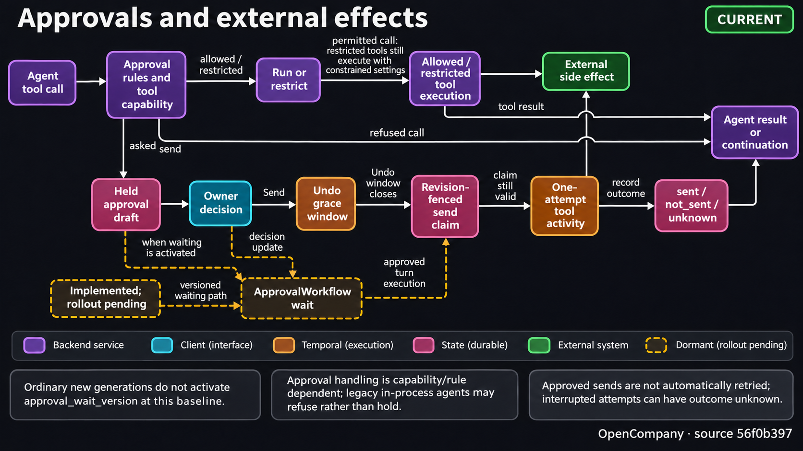

# Normal mode ("Home")

Normal mode is the landing screen for owners who are not technical. They
describe a job in plain words, an LLM on the server drafts a setup screen for
a new AI employee, they adjust it and press **Hire**, and the server builds,
saves and starts a workflow that does the job. Each employee appears in a
sidebar with a live status, and the owner talks to them on their page
(Talk), where they can also be asked to take on new tools and skills. The
workflow editor is **Dev mode**, one switch away.

**One employee is one workflow.** The workflow id is the employee id and the
workflow's name is the employee's name. Workflows created in the editor show
up in Home too, with details derived from their graph.

| Layer | Where |
|---|---|
| Shell (screen switch, mode toggle, theme rule) | [client/src/app/](../client/src/app/), [components/shell/ModeToggle.tsx](../client/src/components/shell/ModeToggle.tsx) |
| Home UI | [client/src/features/home/](../client/src/features/home/) |
| Setup-screen pipeline (parse, normalise, render) | [client/src/features/home/genui/](../client/src/features/home/genui/) |
| Employees service (list, setup, hire, start, run records) | [server/services/employees/](../server/services/employees/) |
| Approvals (the "ask me first" step) | [server/services/approvals/](../server/services/approvals/), node [approvalGate](./node-logic-flows/workflow_triggers/approvalGate.md) |
| Talk (the chat thread and the talk line) | [server/services/chat_thread.py](../server/services/chat_thread.py), chat runs in [server/services/chat/](../server/services/chat/) ([chat_protocol.md](./chat_protocol.md)), [services/employees/talk.py](../server/services/employees/talk.py), node [chatReply](./node-logic-flows/chat_utility/chatReply.md) |
| Growing a saved employee (Turn on Talk, the Agent Builder, Apply) | [server/services/graph_build.py](../server/services/graph_build.py), [services/employees/policy.py](../server/services/employees/policy.py), [services/workflow_storage/mutate.py](../server/services/workflow_storage/mutate.py), [services/deployment/restart.py](../server/services/deployment/restart.py), node [agentBuilder](./node-logic-flows/ai_tools/agentBuilder.md) |
| Built-in skills offered to new hires (Settings > Skills > Discover) | [server/skills/employee/](../server/skills/employee/) |

The design reference is the `design_handoff_opencompany_home/` bundle (kept
out of git; the 2026-09-25 export). Where its token values differ from the
repo's, the repo wins. Its README's Settings section predates the Settings
redesign, so for Settings the prototype (`reference/OpenCompany Home.dc.html`)
is the reference.

<!-- architecture-suite:start -->
## Architecture diagrams

Source baseline: `56f0b397`. [Complete diagram suite](../docs/diagrams/architecture/README.md).

**Approvals and external effects — Current implementation.**

Approval waiting is implemented; activation for ordinary new generations remains pending AP.7.

[](../docs/diagrams/architecture/11-approvals-effects-v1.png)

[Editable Mermaid](../docs/diagrams/architecture/11-approvals-effects.mmd) · [Source evidence and limitations](../docs/diagrams/architecture/11-approvals-effects.brief.md)

<!-- architecture-suite:end -->

## Switching screens

- **Flag**: `featureFlags.normalMode` ([lib/featureFlags.ts](../client/src/lib/featureFlags.ts))
  is on by default; `VITE_NORMAL_MODE=false` turns Home off. The app then
  opens straight into the editor, and the toolbar's Normal/Dev switch goes back
  to filtering the component palette.
- **State**: `useAppStore.shellMode` (`'normal' | 'dev'`), persisted as
  `ui_shell_mode`. While that key is unset it comes from the old palette
  choice: `ui_pro_mode === 'true'` starts in Dev.
- **Switching** goes through `enterNormal` / `enterDev` in
  [app/useShellActions.ts](../client/src/app/useShellActions.ts), never
  `setShellMode` directly. `enterDev({workflowId})` settles unsaved editor work
  first (saves it when auto-save is on, asks otherwise), opens the workflow and
  preloads the editor chunk; `enterNormal` preloads Home. Then
  [app/shellTransition.ts](../client/src/app/shellTransition.ts) fades the
  current screen out and swaps. Requests during a switch coalesce. The toggle
  lives in the editor toolbar and the Home header; Ctrl/Cmd+Shift+D toggles too.
- **Screens are lazy chunks** ([app/ShellModeSwitch.tsx](../client/src/app/ShellModeSwitch.tsx)),
  so ReactFlow stays out of a Normal-mode session and Home's screen out of
  a Dev one (the editor's Workspace dock uses the dock's shared body and
  the employee data it reads, from `features/home`).
- **App-level concerns** live in [app/AppShell.tsx](../client/src/app/AppShell.tsx)
  rather than in `Dashboard`: the `.app-frame`, boot effects (current workflow,
  sound sync, page activity, UI defaults, the shortcut), and the Settings and
  Credentials dialogs.
- **Themes**: Home shows the chosen theme, Light or Dark, as the editor does
  (a third, Atomic, was removed on 2026-11-09). The theme button
  ([components/ui/ThemeButton.tsx](../client/src/components/ui/ThemeButton.tsx)),
  the same in the Home header and the editor's toolbar, toggles between them,
  and Settings → Profile → Appearance offers both. See
  [Theme System](./theme_system.md).

## The Home screen

[features/home/](../client/src/features/home/):

| Folder | Contents |
|---|---|
| `HomeShell.tsx` | Sidebar, header, the current view (hire or one employee), the Workspace dock, Settings, the Welcome guide, the AI models dialog, the Get started checklist (on the hire view only) and the orb's stage |
| `sidebar/`, `header/` | The team list, New employee, the profile row; the view title, on an employee's page the Get started pill (standing in for the checklist's card), the Guide pill (opens the Welcome guide), the Workspace button (opens and closes the dock), the mode toggle (on an employee's page, Dev opens their workflow) and the theme button |
| `onboarding/` | The Welcome guide: three steps (Welcome, Connect an AI model, Your first hire) that open on first launch and again from Guide or Settings > Help; then the Get started checklist (connect a model, hire, say hello, approve a first draft) until it is hidden, as a card in the hire view's corner (at the Workspace dock's left edge while the dock is open) and a header pill on an employee's page; and the AI models dialog, which opens whenever Home needs an AI model ([onboarding.md](./onboarding.md)) |
| `hire/` | The hero, the composer, the template chips, the hire notice (`HireNotice.tsx`), and the starter bundles (`starters.json`), which the chips and Settings > Plugins both read |
| `genui/` | The setup draft under the composer, and the hire itself, from a setup or a starter (below) |
| `employee/` | One employee's page, which is the conversation with them (`EmployeeChat` over the shared chat, Talk below); the header names them. What to act on shows only while there is something to do: the drafts waiting for the owner after the conversation, and above the message box their main action while they can't read messages (Resume, Start, Retry reset while a Reset waits, or connect what is missing; `useEmployeeControl`, `PrimaryActionButton`) or Help in browser while they wait there. The conversation's Stop controls its run's owning generation; the Workspace's row offers generation Stop and Resume too |
| `workspace/` | The Workspace dock (below), the header's Workspace button (`WorkspaceButton.tsx`), the dock's Canvas tab (which loads in its own chunk), the steps that feed its status pill (`steps.ts`) and Take over (`takeover.ts`) |
| `settings/` | Settings pages (App access, Profile, Billing, Help, Skills, Connectors, Plugins). Catalog primitives live in `components/catalog`; Connectors embeds the shared `components/credentials/CredentialsBrowser`. Provider dialogs belong to AppShell. |
| `approvals/` | The drafts query, the decide mutation (optimistic), the approval broadcast listener |
| `data/` | zod-parsed queries for employees, connectors and the profile; `employeeCache.ts`, the team's query keys and `removeEmployee` (shared with the app store's delete); `talk.ts`, Turn on Talk, Apply and the retry note (the thread itself is the shared chat's); `presentation.ts` maps server state to pills, actions and the message box's mode without deriving new rules |
| `orb/` | The 3D orb (below) |
| `ui/` | Small shared pieces (avatar, status dot and pill, app mark), the pill toast, and `useAutoGrow` (the composer's and the message box's growing text area) |
| `state/homeStore.ts` | UI state only: the view, the sidebar, Settings, the Welcome guide (`guide`), the AI models dialog (`connectAI`), whether the Get started checklist is folded (`getStartedFolded`), new hires' first days (`firstDays`), the last hire's notice, the Workspace dock, one-shot glow and pulse signals; `openConnectAI` opens the AI models dialog |

Status comes from the server: an employee summary is `working` (control
`starting`, `running` or `resuming`), `ready` (never started, or reset),
`paused` or `attention` (an automatic pause, see below). The pill
(`presentEmployee` in `data/presentation.ts`, first match wins):

| State | Pill |
|---|---|
| a draft waits, or the browser waits for the owner | **Needs you** |
| Start pressed, or control `starting` / `resuming` | **Starting…** / **Resuming…** (cyan) |
| `working` and answering | **Working** (green, the pip pulses) |
| `working`, idle | **Ready** (cyan) |
| `ready` | **Not started** (grey) |
| `paused` / `attention` | **Stopped** / **Needs attention** |

"Answering" is live, not from the summary: one of the employee's
`watch_node_ids`, or their Talk agent (`talk.agent_node_id`), is `executing`
in the node status store (`useAnswering` in `data/liveTask.ts`). The hire
view's "N working now" counts the same way (`useAnsweringCount`). The
Workspace says **Live**, in red, while an employee works
(`workspaceStatus`, see [The Workspace](#the-workspace)). Durable
control transitions display **Stopping…** or **Resuming…** on the main button
even after the local request has ended. A pending draft
shows as "Needs you". So does a browser waiting for the owner: when an agent
calls `request_user`, the summary's `browser_request` (`{node_id, reason,
since}`, never the agent's message, since summaries reach every socket) is
said above the message box on their page, beside Help in browser, which opens
the Workspace on its Browser tab. The Browser plugin publishes
that state through `services/employees/node_signals.py` and re-sends the
summary when it changes. Motion goes through [lib/motion.ts](../client/src/lib/motion.ts),
which reads the `--dur-*` / `--ease-*` tokens, runs at 1 ms under reduced
motion and while the page is hidden ([lib/pageActivity.ts](../client/src/lib/pageActivity.ts)),
and never starts loops then. Toasts are a second sonner toaster
(`ui/pillToast.tsx`): one bottom-centre pill at a time, springing up from
16px below at .96 scale over `--dur-toast-in` and dropping 10px as it fades
over `--dur-toast-out` (`.pill-toaster` in index.css replaces sonner's slide).
Start, Resume, Stop and Retry reset say they went through ("{Name} started" /
"resumed" / "stopped" / "was reset"), and so does turning Ask first on or off
in the chat ("{Name} will ask before sending" / "will send without asking").
Where the chat shows the mode menu instead
(see [Asking before sending](#asking-before-sending)), choosing a mode says
"{Name} will ask before anything outside" / "before everything" / "only
before money and deletes".

Colour on Home marks a state or a role, never an action it does not mean
([Theme System](./theme_system.md#colour-marks-state-or-role)). An employee's
main action is the `invert` primary when it starts them (Start, Start
again, Resume; `PrimaryActionButton`, and the Workspace's round Resume; never green);
Stop, Retry reset and connecting what they are missing are neutral: outlines
above the message box, on a new hire's first-day strip and in the
Workspace's row, where Stop is a round quiet button. A screen's or card's one
primary action is the invert button (Create, the setup card's Hire, Turn on
Talk, Save changes in Settings > Profile, Add in the skill form and in the
custom connector form, Connect on the AI models dialog's plain page, the
Workspace's Hand back, Set up phone), and the
other buttons are neutral: outlines (Hire now, Apply and Stop work and apply,
the app-access and delivery choices, the draft panel's Connect an AI model and
Try again, Help in browser, Refresh progress) or plain quiet buttons, such as
the sidebar's delete X. Every switch uses the ink tone, and a picked chip is
neutral. The hire view's "N working now" pip is green only while someone is
working.

### Deleting an employee

Each row in the team sidebar has a delete button, a neutral X at its end (the
dialog's Delete is the destructive step): on a
device with hover it shows when the row is hovered or focused, on touch it is
always there. [HomeSidebar.tsx](../client/src/features/home/sidebar/HomeSidebar.tsx)
asks for confirmation; confirming closes the dialog and folds the row away
(opacity, height and 12px to the left over `--dur-slow`), then sends one
delete, with the X disabled while it is pending. Success says "{Name} was
deleted"; on failure the fold is cancelled, so the row is back where it was,
and a toast says so, so the owner can try again.

- **One delete for both modes.** Home and the editor's workflow list call
  `useAppStore.deleteWorkflow` ([store/useAppStore.ts](../client/src/store/useAppStore.ts)),
  which deletes the saved workflow (`DELETE /api/database/workflows/{id}`,
  the same handler as the `delete_workflow` WebSocket command).
- **The server stops the employee first.** `delete_workflow_with_context_archival`
  ([handlers.py](../server/services/workflow_storage/handlers.py)) calls
  `stop_workflow_for_deletion` ([deletion.py](../server/services/workflow_storage/deletion.py)).
  A generation that is live, paused, failed or still resetting, or a
  Workspace controller, goes through Reset; a legacy local deployment is
  cancelled. If that fails, or a Start slips in meanwhile, nothing is
  deleted: the answer is `workflow_shutdown_failed` with the reason in
  `detail`. An employee that never ran is deleted without connecting to
  Temporal.
- **Every tab forgets them.** After a successful delete, and on the
  `workflow.deleted` broadcast in any tab, `forgetWorkflow` closes the
  workflow if the editor has it open and drops it from the workflow list
  and its query; `removeEmployee` ([data/employeeCache.ts](../client/src/features/home/data/employeeCache.ts))
  drops the employee, goes back to Hire if their page was showing, and
  closes their Workspace and notices. The broadcast is handled app-wide
  (`WebSocketContext.tsx`), so this happens while Home is not showing too.
  Reads still in flight are cancelled first, so a late answer cannot bring
  the employee back; the next read asks the server. There is no client-side
  list of deleted ids.
- **Nothing replaces them.** Deleting the last workflow leaves the editor
  empty until the owner chooses New or hires someone; the editor no longer
  creates an Untitled workflow on its own.
- **A late write cannot restore them.** Saving an existing workflow is an
  update only (`save_workflow(..., require_existing=True)`): an editor's
  save or a read's migration that lands after
  the delete fails with `workflow_not_found` instead of writing the graph back.

### The orb

A 3D version of the logo drawn behind Home's content
([orb/orbEngine.ts](../client/src/features/home/orb/orbEngine.ts), a port of
the design prototype's scene on current three.js; loaded in its own chunk the
first time it runs). Its shapes are the mark's: the C, a ring open on one
side, around the core, and three heads each trailing a crescent that tapers
along the ring. The ring spins, the heads turn more slowly the same way, and a
line from the core to each head carries a packet.
[orb/orb.ts](../client/src/features/home/orb/orb.ts) holds what the engine
reads each frame (the slot to fill, an energy target, a spike, whether it
waits for the server) and its lifecycle: leaving Home keeps the renderer, and
the app (`App.tsx`, above the sign-in gate, so signing out never frees an orb
the sign-in screen has taken) disposes it. `OrbStage` is the canvas host
(`fill="home"` below Home's header, `fill="screen"` the whole window for the
Connecting and sign-in screens); each view's `OrbSlot` reserves the square the
orb glides into (`--size-orb-hire`, `--size-orb-employee`, and
`--size-orb-connecting` / `--size-orb-login`: large on the hire view, small on
an employee's page, where the conversation needs the room). Stages and slots
are stacks: a screen mounted over another (Connecting over Home) borrows the
orb and hands it back when it goes. The composer sets the energy target
(focused, holding text, a setup being written), and so does the message box on
an employee's page (through the chat host's `onComposerChange`). These spike
it: a hire, a theme or mode switch, a connect, a task change, opening Settings
or the Workspace, a setup arriving or failing, saving the profile, the server
answering again, signing in, a message sent and a draft approved (the host's
`onSent`), a start or resume, Apply, a skill added or created, and a plugin's
hire starting (`SPIKE` in orb.ts). While the server can't be reached
(`setOrbWaiting`) it eases into a waiting mode (onboarding handoff R3): slower,
a double heartbeat in the core, the heads breathing out and back in turn
(each head and its crescent are one group), one searching ping per line,
slightly dimmer, blended in and out over about a second with no jump. The
engine measures its host every frame, draws nothing until the host has a size,
and stops its frames while the page is hidden (`lib/pageActivity`); a visible
window keeps it moving whether or not it has focus. The logo itself is one
colour; in dark the orb keeps colours of its own (a purple-to-cyan ring; pink,
yellow and green heads) with white particles and packets; in light it is
glossy piano-black under a white rim light. Its glows and particles blend
additively in dark and normally in light (additive glow vanishes on white),
fading through zero at the midpoint of a theme change. Without WebGL or under
reduced motion the slot shows the static mark for the session. When the
browser takes the WebGL context away (after sleep, or when a laptop switches
GPU), the engine asks for it back (`preventDefault` on `webglcontextlost`) and
the slot shows the mark until `webglcontextrestored`; then the same engine
carries on, three.js having rebuilt the scene's GPU resources. When the
engine does not start (its chunk fails to load, or the renderer cannot be
created) the slot shows the mark until the page reloads, since a browser
keeps a failed module load for the page, and the console logs why (`[Orb]`;
`orb/__tests__/orb.test.ts`). One such failure: a server answering the
engine's URL with the app's HTML page ("Expected a JavaScript module script
but the server responded with a MIME type of text/html"); the backend's SPA
fallback now answers missing file paths with a 404 and sends its shell with
`Cache-Control: no-cache` (`core/approot.is_spa_route`).

## The Workspace

A dock on the right of Home ([workspace/WorkspaceDock.tsx](../client/src/features/home/workspace/WorkspaceDock.tsx))
that shows what one employee is working on, drawn after the ChatGPT agent
panel (the Nov 5 handoff, `design_handoff_opencompany_home/chat/V2.md`,
sections 4b and 4c): one row as tall as Home's header, the page under it,
and a status pill floating at its foot. The dock is the editor's too: both
screens mount one shell ([components/workspace/WorkspaceDockShell.tsx](../client/src/components/workspace/WorkspaceDockShell.tsx))
around one body ([workspace/WorkspaceView.tsx](../client/src/features/home/workspace/WorkspaceView.tsx)),
and `WorkspaceDock.tsx` is what Home adds: whose Workspace it is, their
main action in the row, their Canvas board and the pill toast (the editor's
side is under **In Dev mode** below).
The header's Workspace button ([workspace/WorkspaceButton.tsx](../client/src/features/home/workspace/WorkspaceButton.tsx))
opens and closes it. It is borderless like New conversation, with the
PanelRight icon, and filled while the dock is open; while the dock is
closed it carries a red blinking dot when the employee the dock would show
is live, unless the owner has their screen. The dock shows the employee
last opened (their page, or their Help in browser), else the first on the
team (`dockEmployee` in `homeStore`, which the button reads too). Who they
are is on their page's header, not in the dock.

- **The row** (`WorkspaceTabs`): pill tabs (Browser,
  Canvas, Mobile; the selected one raised on the elevated surface, the
  list scrolling sideways when the dock is narrow), then at its end:
  - the employee's status as a dot, named in its tooltip (`workspaceStatus`
    in `data/presentation.ts`, first match wins): Waiting while the owner
    has their screen, Needs you, **Live** in red while they work, otherwise
    the status pill's own label (Not started, Stopped, Needs attention);
  - their main action (`useEmployeeControl`): a round Stop while they run
    and a round Resume (the invert primary) while they are stopped, each named in its
    tooltip, otherwise a small labelled Start, Start again, Connect {app or
    AI model} or Retry reset (`PrimaryActionButton`);
  - Expand and Close.

  Stop becomes Stopping… while admitted work drains; the row follows
  authoritative generation control instead of treating a completed browser
  request as a completed Stop. A Reset the server has not finished, such as
  one whose Workspace cleanup took over 240 s, leaves the control
  `resetting`; the main action, here and above the message box, is then
  Retry reset (the editor's Retry Reset). It reads the control status first
  and sends the Reset again, with the summary's revision, only while the
  generation the summary shows is still resetting, so it never resets one
  started since; otherwise it says that changed and refetches the team.
  With no one on the team, or while the team loads or cannot be read, a
  plain row says "Workspace" beside Expand and Close.
- **Canvas**: the board named by the summary's `canvas_node_id`, drawn by
  the editor's Canvas renderer (`CanvasContent`, see [Canvas Node](./canvas_node.md)).
  It loads in its own chunk, which keeps the board's markdown, code and
  JSON viewers out of Home's, and refreshes on `canvas_updated` like the
  editor's hosts. An employee without a Canvas gets a note and Open
  workflow. A note shows as a document: its versions (‹ v2/3 ›), Preview or
  Markdown, Copy and Download. A document card in a reply (a note the
  employee wrote or revised while answering) opens the Workspace here, on
  that employee and item at that version (`homeStore.openCanvasItem`).
  Under the item: Library (the count), the six newest items as chips, and
  Latest while an older one is shown; the Library lists the board's
  Artifacts (notes) and Files (screenshots, uploads, pages).
- **Browser**: the shared `components/browser/BrowserWorkspace` attaches
  to the employee's saved Browser nodes, supplied by
  `browser_nodes` in its summary. Multiple nodes get a selector. Running
  sessions appear automatically; Start browser opens an idle session. One
  row of page controls sits over the page: back, forward and reload, which
  work only while the owner has control; a read-only pill with the page's
  domain (a lock for https, the whole address in its tooltip); Open in new
  tab for an http(s) page; and Take over, while the browser is live and not
  in a protected login (when the server would refuse it). Several page tabs get a picker on
  a line of its own; it, like a page's dialog, works only while the owner
  has control (a dialog says "Take over to respond"). The view shows the
  employee's cursor (an arrow with their name) gliding to each click,
  hover, field typed into or list chosen from (`agent_action`). Frames use
  `/ws/browser`, not a URL iframe. Help in browser, above the message box
  on the employee's page while the agent waits for the owner, opens the
  Workspace on this tab. The address box, Full view and browser tasks are
  Dev mode's extras. See [Browser workspace](./browser_workspace.md).
- **Mobile**: the managed local Android phone, streamed live through the
  shared `MobileWorkspace` (see [Mobile Workspace](../docs/mobile-workspace.md))
  in a phone frame shaped by its screen, under the server's line for which
  phone it is. The device bar has Back, Home, Recent apps and Rotate (while
  the owner uses the phone), Screenshot to Canvas, which saves the screen
  to the workspace and puts it on the employee's Canvas, and at its end
  Take over. Around the phone: setup, Start phone on the screen area while
  the phone is set up and off ("Starting phone…" beside it while it boots),
  Type on phone while the owner uses the phone, and a Help & diagnostics
  disclosure. Full view, the AI activity list, Ask AI and Phone controls
  (Stop phone, refresh, APK install, setup history) are Dev mode's extras.
- **Tabs**: an inactive tab whose surface is busy shows a pulsing red
  dot: Browser while one of the employee's Browser nodes
  runs or they wait for the owner there (`browser_request`), Mobile while a
  phone node runs. A switch brings the new body in with a short rise. Each
  body keeps 60px free at its foot for the status pill. Switching tabs,
  closing the dock or leaving the window no longer answers the employee's
  request for help; only the owner who took control hands it back (see [Browser workspace](./browser_workspace.md#when-the-agent-asks-for-help)).
- **Status pill**: centred 14px above the dock's foot, it says what is
  going on, after the status dot: while the owner has the screen it is
  the banner with Hand back (see Take over); their status while they are
  not live (Stopped, Needs you, …);
  while they are, their latest step and its time; before the first,
  "Waiting for work". Normal mode no longer lists the steps (the dock's
  footer timeline went with the Nov 5 handoff); the pill shows only the
  newest. The steps are the server's step log
  ([services/workspace_steps.py](../server/services/workspace_steps.py),
  read by `workspace/steps.ts` with `workspace_steps_list` and again on
  each `workspace_step` for this workflow): the Browser node's site actions
  and screenshots ("Opened example.com"), each Canvas display ("Showed The
  plan on the Canvas"), each action of an AI task on the phone ("Tapped the
  screen"), and the owner taking the phone over and handing it back, one
  line each, worded by whatever took the step. A step never says what was
  typed or shown, nothing is recorded during a protected login or for an
  action that failed, recording never fails the action, and a workflow
  keeps its newest 200 steps (deleted with it).
- **Take over** ([workspace/takeover.ts](../client/src/features/home/workspace/takeover.ts))
  sits with the screen it takes: in the Browser tab's row of page controls
  and at the end of the phone's device bar, each while the owner does not
  hold that screen. It takes the screen (the surface's `claim`,
  `components/workspace/surface.ts`: Browser asks for control and waits
  for the server's answer; Mobile takes the phone's lease), and the owner
  is in control from that moment: the body under the row is framed in the
  config colour (`--action-config-border`), and the status pill at the
  dock's foot becomes the banner, "You’re in control · {Name} is waiting",
  with the one **Hand back** (the invert button) whichever tab shows. At
  the foot it covers nothing (under the Browser's toolbar it hid the
  employee's request and the page-tab picker), and the live page keeps
  its size. The keyboard moves to Hand back, unless the owner went on
  elsewhere while the screen was being taken, and to the tab on show once
  the takeover ends. Then it stops a running employee
  (`pause_workflow`), also while they wait for the owner in the browser
  (`request_user`), so the employee never acts on the screen again once
  the owner has it. A screen can let go of the owner meanwhile: the
  browser when the window loses focus or its view hides, the phone when
  its view hides. Take over then shows again on that screen, and on no
  other, and taking it again sends no second Stop. A browser that lets go
  answers the employee's open request with control lost, as the browser
  always does for the viewer in control, so after Hand back they may ask
  for help again (kept on purpose). A Stop that fails gives the screen
  back, unless Hand back already has.

  **Hand back** first gives back the screen that was taken, which lets the
  call the employee waits in go on: a granted `claim` resolves to that
  screen's way of giving it back, which works after its view went away (an
  inactive tab is unmounted). Browser hands control back (hiding the view
  already did); Mobile releases the lease and lets a waiting phone task go
  on, through `/resume` when the view no longer holds the lease (the server
  resumes only this workflow's task, since the phone is shared). Then, only
  when Take over stopped them, it resumes the employee, from the newer of
  the summary's control and the Stop's answer. A Stop answers `pausing`
  after 10 s while admitted work still drains (the browser call the
  employee waited in is one), so while the control is still pausing Hand
  back sends the Stop again (each waits up to 10 s for the drain), then
  resumes at the paused revision, never a stale one.
  `homeStore.takeovers` keeps each employee's takeover (the tab whose
  screen was taken, the way to give it back, and Take over's Stop), so it
  holds across a closed dock, a changed tab, another employee's Take
  over, or going from Home to the editor and back. Taking a screen or
  handing it back is busy per employee
  (`homeStore.takeoverBusy`), so a Hand back that waits for one employee's
  drain never holds another's. A browser that is not running answers Take over's request `idle`,
  which the claim takes as no. Toasts: "You have control — {Name} will
  wait", "Handed back to {Name}".
- **Size and motion**: 460px wide by default. The left edge drags from
  360px to the window less 420px, and Expand gives a bigger dock without
  a drag. At 1100px and wider the dock pushes the page aside; narrower, it
  lies over it with the modal shadow (`shadow-modal`). While it pushes, the
  dock is never drawn wider than the window less what the page keeps
  (`useHomeDockWidth` in `workspace/dockWidth.ts`: the sidebar and 560px
  with the sidebar open, 760px with it closed; never under the 360px
  minimum), whatever width was dragged or saved, so the page's header and
  message box always have room. Home's header fits what it is left
  (`HomeHeader`): it clips sideways, and by its own width (a container
  query, so the dock and the sidebar both count) its buttons drop their
  words and keep their icons, the Get started pill goes, and on an
  employee's page at the narrowest so does Guide. A button's word is the
  span marked `data-label`, still read to a screen reader. Like the sidebar it
  stays mounted and transitions its width (`--dur-dock-in` to open,
  `--dur-sidebar-out` to close), so a reload with it open does not animate,
  and its contents mount on the first open. Open, width and tab persist
  under `home_workspace_v1`; Expand and the employee last only for the
  session. While the dock is open, the Get started card and its folded pill
  sit at its left edge and move with it, at once while the edge is dragged
  (`useHomeDockWidth` gives both one width,
  and `workspaceResizing` says when the edge is dragged; see
  [onboarding.md](./onboarding.md#get-started-checklist)).
- **In Dev mode**: the editor shows the same dock for the open workflow
  ([components/ui/CanvasDock.tsx](../client/src/components/ui/CanvasDock.tsx)):
  the same shell, row, tabs, views, status dot, status pill, Take over and
  Hand back. Every workflow is an employee, so while its dock is open the
  editor reads the open workflow's summary (`get_employee`, kept current
  by `useEmployeeLifecycle`). Until that read answers (while it loads, or
  fails) the row has no status, there is no pill and no Take over shows,
  so the owner never takes a screen the dock is about to run Take over
  for. A workflow not saved yet has no employee: no status and no pill
  either, and each screen would show its own Take over, which takes that
  screen and stops no one. What the editor adds:
  its nodes come from the canvas as it is now, so a node shows before a
  save; a picker when the workflow has several Canvas nodes; a workspace
  file's preview in the Canvas tab; opening when content is pushed or an
  agent asks for help in its browser; Dev mode's extras in the Browser
  and phone views (`dev`); the slow-model note at its foot; and toasts in
  the editor's own stack. Its row has no main action, because the toolbar
  has the workflow's Start, Stop and Resume. Its open state, width and tab
  are its own (`canvas_dock_prefs_v1`), within the same limits.

## Hiring

### 1. The setup screen

`generate_employee_setup {job, refine?, history?, draft_token}`
([services/employees/setup.py](../server/services/employees/setup.py)):

- **The server builds every message** ([setup_prompt.py](../server/services/employees/setup_prompt.py)):
  a preamble, the component catalogue (`config/genui_prompt.txt`, written
  from `config/genui_catalog.json` by json-render's `catalog.prompt()` with
  our template: `client/src/lib/jsonRender/prompts.ts`, `bun run
  genui:prompts`), and a context block
  ([context.py](../server/services/employees/context.py)) with the connected
  and connectable apps, the team's names, the owner profile and the local
  time. A change request carries the latest reply plus at most two earlier
  turns, within a character budget. That is while Generated UI is on; with it
  off, the form takes the catalogue's place and a change works on the form
  (see **Generated UI off** below).
- **Model choice** ([llm.py](../server/services/employees/llm.py)): a local
  provider when the owner prefers local AI, else the global default provider
  when it has a key, else the first usable provider, else the first saved
  endpoint. Calls go through `ChatUnifier` with a deadline (longer for local
  models). One retry when the reply was cut off or cannot be salvaged. Usage is
  recorded for every call.
- **One request in flight per owner**: a newer `draft_token` cancels the older
  call, and `cancel_employee_setup` cancels explicitly. The payload field is
  `draft_token` because `request_id` is the WebSocket correlation id.
- **Privacy**: neither the job nor the reply is ever logged.
- **Apps**: the response's `apps` maps each app the reply mentions to its
  AppRef plus `can_trigger` (the app can start the work), so the screen can
  offer "When something new arrives in Gmail" without its own copy of the app
  registry.
- **No preferred trigger**: every employee can be talked to on Home, so in
  the prompt one that works when the owner messages them is as good as any.
  The Hire button's `trigger` carries a schedule's time as one of the
  catalogue's `trigger.times`.
- **Errors**: `no_ai_provider` (the AI models dialog opens,
  below; the owner's words stay in the draft, which is sent again by itself
  once a model is connected), `timeout`, `provider_error`, `unparseable`,
  `cancelled`, `busy`, `invalid_request`.
- **Generated UI off** (the owner's switch in Settings > Profile, off by
  default; [services/genui/switch.py](../server/services/genui/switch.py)):
  the model gets no catalogue. It fills a fixed form instead
  (`config/genui_fields_prompt.txt`, from the same `prompts.ts`): name, role,
  description, apps, the routine's steps, one to three ground rules, the
  trigger and the app they answer through.
  [setup_form.py](../server/services/employees/setup_form.py) reads the form
  as Hire reads a hire, and draws the core of a setup screen from it: who they
  are, the routine, the ground rules with "Ask me before sending anything",
  and Change and Hire. A form without a name, a role or a step draws nothing
  and costs the one retry. The reply has the same `{"text", "spec"}` shape, so
  everything below applies to it unchanged. A change request sends the
  latest setup back as the form it describes.

A template chip under the composer fills the box with its starter's job for
the owner to read, change and send; it never sends by itself. While the box
still holds that job as written, the chip shows as picked with the starter's
summary and **Hire now** (see [One-click starters](#one-click-starters)). The
chips are neutral (onboarding v3): muted at rest, the foreground on hover, a
raised surface with a foreground border when picked. Hire now is a neutral
outline, since Create is the view's one invert button.
While the model writes, the draft panel shows one honest line, "Writing their
setup…", with the time so far and Cancel, and after `SLOW_AFTER_SECONDS` a
note that some models take a few minutes. A setup that fails says so on a
neutral card with the attention dot ("Couldn’t finish setting this up", or
"Couldn’t make that change" for a change, and why), with Try again, and
Connect an AI model for `no_ai_provider`. Development builds also show the
screen's spec and its patch stream (`spec.json` / `patches.jsonl`).

The reply is a flat JSON UI spec in json-render's shape (catalogue
`spec_version` 2): a Toggle binds `checked`, and a Button names its action in
the element's `on.press` (`{action, params}`). The client parses, repairs and
normalises it ([genui/](../client/src/features/home/genui/): `catalog.ts`,
`parse.ts`, `normalize.ts`) and json-render draws it from a
fixed component catalogue (`registry.ts`, `views.tsx`, `HireScreen.tsx`,
loaded lazily so json-render stays out of Home's first chunk). Expressions
outside the screen (the normaliser's trigger, the hire payload) are read with
json-render's own `resolvePropValue` and `evaluateVisibility`, loaded with
the reply (`await import('@json-render/core')`), so Hire reads values exactly
as the screen shows them and sends only the controls it shows. The normaliser
still reads the older shape a model may write (a Toggle's `value`, a
Button's `action` / `actionParams` props), keeps the root a vertical stack,
enforces a tree, lays the screen out as the setup card (below), guarantees one
Hire button, one change button and the "Ask me before sending anything" toggle
(on by default), caps sizes, and drops what json-render does not guard: any path through
`__proto__`, `constructor` or `prototype`, and `watch`, `repeat`, `slots`,
`$computed` and an action's `confirm`. That glue is shared with the chat's
generated replies in [lib/jsonRender/](../client/src/lib/jsonRender/)
(sanitising, including every path json-render may write state at, the
per-element guard that reads props through the catalogue's forgiving schema,
the paced reveal). The screen's state is the draft's own, which json-render
reads and writes through `createStoreAdapter`. The vocabulary
itself is [config/genui_catalog.json](../server/config/genui_catalog.json),
which `bun run genui:prompts` writes the setup prompt from
(`config/genui_prompt.txt`, which the server reads) and the client imports
(`catalog.ts`, `hirePayload.ts`); `genui/__tests__/catalog.test.ts` holds the prop schemas to
its components and props, and a shared
corpus of model replies in both shapes (`genui/__fixtures__/replies.json`) is
parsed the same way on both sides. Only what `genui/index.ts` exports
(`HireDraftPanel`, `DraftMessagePreview`, `useHireComposer`, `useJobComposer`,
`useSendJob`, `useStarterHire` and `HIRE_LIMITS`) leaves the folder: ESLint
refuses imports of its internal modules.

**The card** (onboarding handoff R2). Whatever the model wrote, the
normaliser lays the screen out one way and names the places in
`NormalizedSpec.layout`: the first `AgentCard` is the identity row (avatar,
name, "role · apps", the description in two lines, no status), then the
routine (the first `Plan`, else the `Schedule`), then everything else in the
order written, then the footer strip's two: the ask-first toggle, taken out of
whatever card held it, and a row of the change button (secondary) and the Hire
button (primary). Further agent cards and Plans are dropped. `HireScreen`
draws each place with its own `Renderer` over the same spec under one
`JSONUIProvider`, so they share state and handlers and the reveal still runs
element by element: the identity row with Discard beside it, the body, the
suggested team (the panel's children), then the footer strip, which bleeds to
the card's edges on `bg-bg-app` and gives its controls their own look
(`HireSpecContext.inFooter`): "Ask before sending" beside its switch,
"Change something" as a quiet pill and "Hire {name} →" as the inverted pill.
The model's other rules, choices and inputs stay in view in compact cards, so
nothing is hired unseen. A button the model places in the body is neutral even
when it is primary ("Connect {App}", "Open apps"), so Hire stays the card's one
strong control; every switch on the card is the ink tone at the `md` size.
Nothing on the card takes a role's colour: the routine's dots and labels are
neutral (the label names the role: When, Using, They, Then), the draft's face
is one of the team's portraits in a plain ring (`Avatar plain`, as the
owner's in the sidebar and in Settings > Profile; the portrait is picked by
the name, since a draft has no workflow id yet, so Hire may give them
another), and a `tone` in the spec is not drawn by any component.
The panel's header (NEW EMPLOYEE, the job, Discard) shows only while the
setup is written or after it failed, or for a screen with no agent card, and
the model's one-line introduction is not shown.

**When they work.** The routine says it in its When row. With a `Plan`, the
normaliser binds the plan's `trigger` to `/trigger` (`state_paths.trigger`)
and drops any `Schedule`; without one it inserts a single `Schedule` (the
catalogue marks it `inserted`, so the model is never offered it) bound there,
drawn as a routine of that one row. `/trigger` starts as the Hire button's
`trigger`, else a new message in the app the routine's first "When" step
names, else the owner messaging them, snapped to what the server builds: a
known kind, a frequency, a time from `trigger.times` (the builder's
`SCHEDULE_TIMES`; `test_genui_catalog_sync.py` holds them equal), and a weekday
or day of the month. The routine is a timeline
([ui/routine.tsx](../client/src/features/home/ui/routine.tsx): a rule down
the left, each step's dot on it, its role in mono as WHEN / THEY / USING /
THEN), and a routine with no "When" step still starts with one. The When row
ends in **Change**, which opens the editor under it: the owner messaging them,
a schedule, or a new message in any app whose `can_trigger` is true, each a
chip that reads as picked by a neutral fill and border. A change
rewrites the When row as one sentence ("Every weekday at 08:00"), and the hire
payload reads `/trigger` before the button's params.

### 2. Hire

`hire_employee` ([hire.py](../server/services/employees/hire.py)) takes a
`HireEmployeeRequest` ([hire_request.py](../server/services/employees/hire_request.py);
the client's `HIRE_PAYLOAD_KEYS` must match, locked by
`test_hire_payload_contract.py`) and:

1. checks size and shape, then the idempotency key: the same key with the same
   payload returns the employee already hired, a different payload `conflict`,
   and one whose first attempt is still building `busy`. A row a failed attempt
   left behind is resumed, and so is one still marked building after
   `BUILDING_STALE_AFTER` (the server stopped mid-way);
2. resolves the apps it names through the app registry
   ([config/employee_apps.json](../server/config/employee_apps.json),
   [apps.py](../server/services/employees/apps.py)): each app's provider,
   its trigger / reply / notify-owner / tool nodes with parameter templates,
   and a `side_effects` class. The owner's own apps join them: a plugin
   registers a source (`register_app_source`) that gives what the owner saved,
   such as each custom connector ([MCP Connectors](./mcp_connectors.md#in-hires)),
   and `Connections.apps` reads both, so the setup screen, Hire and the
   employee's card see the same apps. A saved app counts as connected. A node
   whose app a parameter names rather than its type declares that parameter
   (`BaseNode.app_field`), and the card reads it. Apps nobody knows are
   recorded as unsupported, named in the instructions, and never block a
   start;
3. builds the graph ([builder.py](../server/services/employees/builder.py),
   pure): one trigger (an app event, a schedule on `cronScheduler`, or manual
   chat), one `aiAgent` whose system message comes from
   [prompt.py](../server/services/employees/prompt.py), always-on tools (web
   search, todos, clock, a Canvas, plus memory when the owner allows it) and
   the apps' tools, the owner's skill library, delivery, an "Activity
   log" console node, and Talk ([the talk line](#the-talk-line)). Which tools
   and skills a hire may have is
   [policy.py](../server/services/employees/policy.py)'s rule, the same one
   the Agent Builder applies later. A schedule is recorded as it will run, in
   the owner's time (`cronScheduler` runs only at `SCHEDULE_TIMES`, in a short
   list of zones), with a warning when that is not what the owner asked for.
   Ids, labels and edges come from
   [services/graph_build.py](../server/services/graph_build.py), shared with
   every server-side graph writer, and
   `tests/fixtures/employee_builder_snapshot.json` pins the output
   (`UPDATE_BUILDER_SNAPSHOT=1` rewrites it). The instructions ask the
   employee to put finished
   work the owner will want to look at later on its Canvas, and to leave
   routine replies off it. The library is every skill that is on in Settings > Skills. It goes
   on one Skills node (`masterSkill`) with each skill's text copied in, so a
   later change to the library never alters an employee already hired. A
   skill named `skill`, or one ending in `-personality`, is left out: it would
   take over the Skill tool, or replace the whole system message. The rule is
   live (builder version 3, `LIVE_RULE_BUILDER_VERSION`): every app reply goes
   through `approvalGate`, which reads it each time; the apps' tools are all
   attached, and while the owner asks first a call that sends is held for
   them, Stripe is refused and the browser reads only, per call. The talk
   agent alone also gets its talk tools: generated UI in the chat (`chatUi`,
   "Show in chat", bound only while the owner has Generated UI on) and a way
   to send through each of the hire's apps (the
   registry's `talk_send`: WhatsApp, WhatsApp Business, Telegram, Discord,
   Gmail, Outlook, email), so the owner can ask it to send something; never on
   a worker strangers write to. The instructions read the same with the rule
   on or off (a test holds them byte for byte). An older tool that declares
   `ask_first_params` and no approval spec would still be attached in that
   form. The Web browser app has nothing to connect
   (its catalogue entry's `connected_check` is `builtin`); its Connectors
   panel manages optional login profiles. Every node type must pass
   `node_allowlist.is_hire_allowed` ([Node Allowlist](./node_allowlist.md));
   node types never come from the payload;
4. validates it with `validate_workflow` and saves it with
   [persist_new_workflow](../server/services/workflow_storage/persist.py)
   (shared with workflow import);
5. records on the row the apps the graph actually uses (`built.app_ids`), so
   an app the hire named but left out never shows as one to connect;
   summaries read apps off the graph the same way;
6. answers `{employee, started, missing_apps, needs_ai, unsupported_apps,
   node_count, warnings, idempotent, request_id, activation_state,
   readiness_issue}` and, when every app is connected and an AI model exists,
   starts the employee in the background
   ([activation.py](../server/services/employees/activation.py), which also
   retries a held start every ten seconds, so connecting what was missing
   starts them). `node_count` is the saved graph's size, read from the saved
   workflow so a replay of the same key says the same. The summary's
   `activation_state` says how that start went (`saved` until it is tried,
   then `blocked`, `running` or `failed`; null for a workflow built in the
   editor), and a change to it is broadcast at once, since a start that is
   held or fails before Start made a control row changes nothing else the
   page hears about. Errors: `invalid_request`, `too_large`, `conflict`,
   `busy`, `not_allowed`, `build_failed`, `save_failed`.

On the client ([genui/useHire.ts](../client/src/features/home/genui/useHire.ts))
every successful hire lands on the new employee's page, on their first day
(below), with a glow in the sidebar and a toast; the team list is then read
back from the server rather than taking the summary the hire answered with. The response's `warnings` show there once as the hire
notice ("A few notes on {Name}'s setup", `hire/HireNotice.tsx`), until the
owner dismisses it or opens another view; `needs_ai` opens the AI models
dialog; every error code has plain words (`busy`: they are still being set
up).

### 3. Start, Stop, Resume

`start_employee {workflow_id, expected_revision, idempotency_key}`
([start.py](../server/services/employees/start.py)) refuses with
`missing_apps` or `needs_ai`, moves every agent the employee has (the worker
and the agent it talks to the owner through, `node_roles` `agent` and
`talk_agent`) onto a usable model, and calls `start_saved_workflow`, the same
start path the editor uses. One that stopped after a problem is reset first
(`reset_if_failed`); the reset moves its control revision on, so the revision
the page sent is checked here instead. Stop and Resume retain the editor's
`pause_workflow` / `resume_workflow` request names and require
`expected_revision` and `idempotency_key`.

For new generations with `execution_control_version: 1`, Stop first closes
admission throughout the generation's execution tree. Already admitted model
requests, parallel tools and whole-activity agents finish under their existing
retry policies; their results and bookkeeping are retained. **Stopping** is the
persisted `pausing` transition, and **Stopped** is acknowledged `paused` after
that work settles. Resume releases the same continuations at the next pending
action and then reopens event and schedule producers. It never starts the
agent again at its opening prompt. A request timeout leaves the durable intent
in place and status reads reconcile it. Unlimited model retries can keep Stop
in Stopping during a provider outage. Independent Workspace tasks and approved
sends have their own execution lifecycle.

Older generations retain their recorded control paths. A missing versioned
controller fails closed; Resume does not rebuild an empty registry and claim
the suspended work was recovered. See
[Temporal Workflow Control](./temporal-workflow-control.md) for acknowledgements,
rollover, recovery and operating limits.

Automatic pauses now record why: `WorkflowControlExecution.pause_reason`
(`failures` from the circuit breaker, `recovery` after a crash,
`controller_missing`) and `pause_detail`, emitted by `serialize_control` and
cleared on resume. Home shows such an employee as "Needs attention". See
[Temporal Workflow Control](./temporal-workflow-control.md#recovery-policies).

### One-click starters

Each starter bundle in `hire/starters.json` (Receptionist on WhatsApp, Inbox
assistant on Gmail, Social media helper every week, Daily briefer every
weekday morning) carries a `hire` block, the starter's own setup: names to
pick an unused one from, the role, a one-line description, the routine, what
starts the work and the app it answers through (`hire/templates.ts` parses it
with zod). **Hire now**, on a picked chip or as Hire on a Settings > Plugins
card, puts the starter's skills in the library (switching on any that are
off), then hires that setup as it stands with "Ask me before sending
anything" on (`genui/useStarterHire.ts`, `starterHirePayload` in
`genui/hirePayload.ts`). It shares the one hire slot with the setup screen
and lands like any hire. `test_home_catalog_contract.py` builds every starter
that way and fails when one loses an app it names or the way it starts.

### Connecting an AI model

`homeStore.openConnectAI()` opens Home's AI models dialog
([onboarding/AiModelsDialog.tsx](../client/src/features/home/onboarding/AiModelsDialog.tsx),
780 by 600; the app shell's credentials dialog still connects apps and opens
from Settings > Connectors). It lists
every AI model (the Welcome guide's step 2 list, `ConnectStep`) and shows a
model's page in place of the list: a plain page for a model the catalogue
describes as one field and a button (an API key, or a local server's address:
the field, "Get a key from {name}" for the featured providers in
`components/credentials/aiProviderLinks.ts`, a help line, an invert Connect,
and a Disconnect that asks first), and the full connection form used in Dev
(`components/credentials/ProviderPage.tsx`) for the Gateway, named endpoints,
an install that requires 1Password and a key saved in 1Password. A connect
closes it (`closeOnConnect`), so what asked for a model goes on: setup's
`no_ai_provider` (the draft is sent again for review), hire's and Start's
`needs_ai`, and the employee's Connect an AI model action. The Get started
checklist opens it to stay on the list instead. Details in
[onboarding.md](./onboarding.md#the-ai-models-dialog).

The Welcome guide's step 2 is the other way in ([onboarding.md](./onboarding.md)):
the same browser cut to AI models, with the provider page shown in place of
the list. A pill says "{Provider} is connected" and the step returns to the
list; when step 3's job was waiting for a model, connecting one finishes the
guide and sends it.

## Talk

The owner talks to an employee on its page. The conversation is the chat
session whose id is the employee's workflow id, the thread the editor's chat
pane also shows for that workflow (there, only the live generation). The
owner's messages come in through `send_chat_message`
([services/chat/handlers.py](../server/services/chat/handlers.py)), answers
and reports from the [chatReply](./node-logic-flows/chat_utility/chatReply.md)
("Reply in Chat") node. Each row is stamped with the live generation and
appended to one chain, and each insert or clear is announced as
`chat.updated`. Clearing the chat in the editor's chat pane
(`clear_chat_messages`, `chat_thread.clear_chat_session`) deletes the thread
and, through the Context plugin's chat-cleared listener, every conversation
of the workflow, so the employee starts over with the chat.

A message the talk line will answer starts a **chat run**, saved with it: one
run at a time per conversation (a second send while one is live answers
`run_in_progress`), claimed and finished by the workflow run that answers it,
with the reply saved as the run's (`a_<run id>`). Sockets that subscribe
(`chat_subscribe`) receive the run's events; a watchdog ends runs nothing
will finish. The wire contract is [chat_protocol.md](./chat_protocol.md).

### On the employee's page

[employee/EmployeeChat.tsx](../client/src/features/home/employee/EmployeeChat.tsx)
is the page: the shared chat ([features/chat](../client/src/features/chat/),
the same `ChatPane` the editor's console Chat pane uses) with Home around it.
The header names the employee instead of the page (`HomeHeader`: avatar,
name, role and apps, the status pill, and New conversation). The pencil beside
the name renames them, and the avatar's menu uploads a photo for a hired
employee or takes it away ([data/identity.ts](../client/src/features/home/data/identity.ts));
the photo then stands in for their initial in the sidebar, the header, the
Workspace and beside each reply, and the initial comes back when it will not
load. `HomeShell`
gives the page a column that does not scroll: the conversation scrolls on its
own above the message box, and tells the shell when it has left the top so the
header draws its border. Turn on Talk and Apply are in
[data/talk.ts](../client/src/features/home/data/talk.ts); the thread, runs,
sending and drafts belong to the chat (wire and client rules in
[chat_protocol.md](./chat_protocol.md#client)).

- **A new hire's first day** ([employee/FirstDay.tsx](../client/src/features/home/employee/FirstDay.tsx),
  onboarding v3): a hire made in this session (`homeStore.firstDays`, set by
  `welcomeHire` from the response's `started` and `node_count`) shows one
  slim strip at the top of the conversation, its first item, for the rest of
  the session: from the hire until a reload, New conversation or deleting
  them. The first message does not end it. The strip has the header's accent
  avatar (a ring turning while they start, and the hire glow once they run,
  while the conversation has no message), "{Name} · {Role}", one status line
  that follows what happened, never timers (`firstDayLine` in
  `presentation.ts`: "Starting {Name}…", "Ready to talk · N blocks" ("{Name}
  is running" without Talk), or why the start did not go ahead
  (`firstDayNote`): "WhatsApp isn't connected yet.", "Connect an AI model
  first.", "{Name} couldn't start." when the hire's own start failed
  (`activation_state` `failed`, or control `failed` while `activation_state`
  is not `running`), else the usual state line (`stateNoticeText`), so a
  generation that fails after they ran reads "{Name} isn't running."), and
  the header's status as a dot and a label (Starting… while the hire's own
  start is under way). Until the conversation has a message, and again after
  a Reset empties the thread, the strip also offers their main action when
  the start did not go ahead (the `invert` primary for Start, Start again or Resume, neutral
  for the rest), so the line above the box stays away rather than say it
  twice, and under its first row lists their routine on one line from the
  hire's `plan` (`get_employee`), each step's label and title with no role
  colours (`RoutineLine` in `ui/routine.tsx`). Once there is a message, the
  line above the box and its action are back, since the strip scrolls away
  with the thread. `firstDayPhase` says where the start is: starting while
  the control state is starting or resuming, or never started (or ready) by
  a hire that started them and whose `activation_state` is not `blocked`,
  `failed` or `running`, so a later Reset does not read as a start under way.
  While they start and before the first message, the box shows but takes
  nothing ("{Name} is starting…", the host's `wait`). Once they can read
  messages, an empty first-day chat offers the suggestion cards any
  employee's page does. The small orb stays above.
- **The model picker** ([chat/composer/ModelPicker.tsx](../client/src/features/chat/composer/ModelPicker.tsx),
  design handoff chat v2) sits in the message box before Dictate, when the
  employee's talk agent runs as an AgentWorkflow (`get_chat_context`
  `model_choice`). Its button names the model ("Auto", "Sonnet 5.5") and the
  thinking level unless it is Balanced ("· Thorough"); its panel lists Auto
  (what it uses now: the owner's default model, else the employee's own),
  then the models in `llm_defaults.json` `chat_models` whose provider is
  connected, and a slider for Quick, Balanced and Thorough (or "{model} sets
  its own pace"). The choice is the owner's, kept in their settings, and
  every message, edit and retry carries it; a model that can't answer is
  refused in the server's words and the message comes back into the box.
  The Dev editor's chat has none: each node keeps its model. See
  [Chat Protocol → Model and thinking](./chat_protocol.md#model-and-thinking).
- **The thread** is `get_chat_messages` with `all_generations: true` (the
  newest 200 messages): the conversation since the employee last started,
  since a Reset clears it (see [Turn on Talk and Apply](#turn-on-talk-and-apply)).
  The orb (`min(96px, 14vh)`) stays above it, outside its scroll area, so a
  long conversation never takes it out of view; a new hire's first-day strip
  and notes are the thread's first items.
  Where a message's `run_key` (its generation) differs from the one before (a
  message left from before a Start, such as a test run in Dev mode), a divider
  reads "{Name} restarted — they start fresh from here", and over the first
  message of each day another names it ("Today", "Yesterday", the weekday
  within a week, else the date). The owner's messages
  are bubbles on the right; answers have no bubble, beside the employee's
  accent avatar on the left, as markdown (`ReplyMarkdown`, in its own chunk):
  a code block sits in a frame with its language, Copy and line numbers in the
  theme's code colours, and a table in a frame with one rule between rows,
  both 13px beside the 16px text. The turns are an `aria-live` log; the
  thread starts at the newest turn and stays there while new ones arrive or
  the dock under it grows, and scrolled up a "Jump to latest" button counts
  them. It refetches on `chat.updated`, after a
  runtime reset, and when the socket reopens. The drafts waiting for the
  owner's OK follow the conversation (the host's `afterThread`).
- **Working** follows the run the message started and its owning generation's
  control, not timers: from the
  moment the server admits it, the avatar spins its ring and skeleton lines
  stand where the answer will be, with "Thinking" under them, until that run
  ends or is intentionally suspended, whatever else lands meanwhile (a routine report does not end it). The
  talk agent's answer streams in as it is written ("Writing · N tok/s", a
  caret after the text), and the apps it uses show above it as steps
  ("Working…", then "Worked for 12s · 3 steps"). Meanwhile the Live work pill
  above the message box says what they are doing: the step under way and
  "2/3 · 4s" (the steps finished of those begun, and the time so far),
  opening to the steps' names, or "Waiting for your OK" while a call waits on
  the owner ([chat_protocol.md](./chat_protocol.md#client)). The employee's
  own work (`employee/EmployeeWork.tsx`: team tasks, scheduled work and
  waits) shows as the same kind of pill above the box while no reply is
  under way: the state's mark, its message and "1/3 · 3m 2s", opening to
  when it last moved and each step with who has it (a list that scrolls). It
  was a card until 2026-11-10 and crowded the conversation. A lost
  connection or a failed refresh says so under the pill; its Refresh
  progress buttons are neutral. A run that failed says so
  where the answer would be ("{Name} didn't pick up this message.", "…took too
  long to answer.", or "{Name} couldn't answer." with the error and its hint),
  also after a reload; a late answer replaces a failure that only said none
  came. While the talk agent waits to retry after a failed attempt, its retry
  message sits on the status line (`useRetryNote`, from the agent's node
  status).
- **Stop/Resume.** While the run works, Send is Stop, and Esc requests Stop
  too. In a controlled generation the current tool or model request finishes,
  its output stays, and the turn shows Stopping while work drains, then
  "Waiting for you to resume {Name}." The composer offers Resume, followed by
  disabled Resuming; Esc has no effect while stopping, stopped or resuming.
  The chat run keeps its run/reply identities and its occupied lane. Resume
  continues from the next pending action, so editing, trying another answer
  or sending a second message still waits for this run to end. The control
  snapshot and subscriptions reconcile on reload; unsaved streamed text still
  depends on the live server hub (see the chat protocol's streaming limits).
  For legacy or uncontrolled runs, Stop retains its terminal behavior: the
  partial answer says "You stopped this reply," or a queued message is
  withdrawn, and the lane is released.
- **The box's extras**: Attach (or paste, or drop files anywhere on the
  page) adds up to six files, uploaded at once and sent with the next message
  (a message can be files alone); the employee reads where they are in its
  workspace, and a model that can view images sees the pictures. Dictate
  shows when a speech provider has a key, and puts what was said in the box.
  Typing `/` lists commands (generic ones and those the employee's apps add,
  `employee_apps.json` `commands`) above the box, each on one row with what it
  does, and an empty conversation suggests a few.
  Web (when the employee has a search tool) keeps them off the web for the
  next messages. Cmd/Ctrl+K puts the cursor in the box. See
  [chat_protocol.md → Attachments](./chat_protocol.md#attachments).
- **Changing the conversation** (between runs): the owner's message has Edit
  (in place; ArrowUp in an empty box edits the last one) and ‹ 1 / 2 ›
  between their edits of it; the latest answer has Try again, and ‹ 1 / 2 ›
  moves between the answers tried. The employee's memory follows what is
  shown: an edit or a retry takes them back to before the message, and moving
  between versions brings back what they remembered on each
  ([chat_protocol.md → Branches](./chat_protocol.md#branches)). Drafts waiting
  on the part left behind are cancelled, and the employee hears of anything
  sent there. Good and Bad rate an answer; the toast says the employee will see
  it next time, which is when the rating reaches them.
- **The box** follows the control state the way `send_chat_message` does
  (`talkMode` in `presentation.ts`):
  - *send* (running, starting, resuming): a message accepted by the server shows at once
    ("Sending…") and goes to the employee; Send is then Stop while the run
    works, since overlapping runs would each save over the other's
    conversation (the server refuses a second message with
    `run_in_progress`).
  - *queue* (paused, pausing): the server can admit one queued message when
    the lane is free, and an accepted event waits for Resume ("Your message is
    waiting…" above the box, "Waiting for you to resume {Name}." in the
    thread). A suspended controlled run keeps the lane occupied; the composer
    offers Resume while paused, Resuming during release, and disabled Stop
    while its run drains. Legacy queued runs can still be withdrawn with Stop.
  - *start* (never started, ready, resetting, failed): no box; a line says
    they can't read messages, beside their main action (Start, Start again,
    Retry reset while a Reset waits, or what they are missing), which the
    Workspace's row offers too.
  - *wait* (a new hire still starting, before the conversation's first
    message): the box shows, disabled, saying "{Name} is starting…".
  - While the agent waits for the owner in the browser, the server's line
    for it ("Needs you to sign in to a site in the browser") sits above the
    box beside Help in browser; after a run of failures paused them, why.
  - What the owner writes is kept per conversation, so switching to another
    employee and back keeps it. A refused message leaves the thread and its
    text goes back in the box: `not_running` (the state moved meanwhile) says
    "{Name} isn't running" and refetches the team; `run_in_progress` says
    they are still working on the last message.
- **New conversation** (the header) asks first, then clears the thread and
  what the employee remembers of it (`clear_chat_messages`).
- **Turn on Talk**: an employee whose `talk.state` is `off` (hired before
  Talk, or built in Dev mode) shows Turn on Talk where the box would be, the
  invert button, as the one thing to do there. An
  `AlertDialog` confirms that Talk can wait for current work to finish;
  existing conversations and drafts waiting for approval stay in place.
  `unsupported` gets a note that
  their setup has no way to answer. Either way their main action still shows
  while they are not running, beside a line that says only their state
  ("{Name} isn't running.", "{Name} is paused."; `stateNoticeText`).
- **Pending changes**: while `pending_changes` is true, a notice above the box
  reads "{Name} has new abilities saved. Apply them after current work
  finishes. Their conversations and pending approvals stay in place."
  Its Apply, a neutral outline, calls `apply_employee_changes`. The separate
  **Stop work and apply** action, neutral too, explicitly interrupts active
  work; it is not the default Apply behavior.
- **Asking first**: under the box, a line says whether the employee asks
  before sending anything on the owner's behalf (the summary's `asks_first`).

### The talk line

A run keeps only the firing trigger's downstream nodes plus their tools and
config, so a line started by the owner's messages runs on those alone and
never disturbs the work path ([talk.py](../server/services/employees/talk.py)):

```
chatTrigger (session_id = workflow id) -> agent -> chatReply ("Reply in Chat")
```

- **A chat hire** (the owner gives them work by messaging them): its own
  "Chat" trigger and agent are the line, and Hire adds Reply in Chat after the
  agent. No second chat trigger is added: two on one session would start two
  runs per message.
- **App-event and schedule hires** get a line beside the worker: a "Talk" chat
  trigger on the workflow's session; a "Talk with {Name}" agent of the
  worker's type, on its provider and model, with the prompt `{{talk.message}}`
  and instructions written for Talk; its own Context (a conversation is never
  shared); the worker's tools and Skills node, when it has one, wired to it
  too (the same nodes, so Memory, the checklist, the Canvas and the skills are
  shared); and its Reply in Chat.
- **Schedule hires** also get "Post to Talk", a Reply in Chat fed by the
  worker, so its routine reports land in the thread. When the app the reports
  go out through can't be used yet, the hire's warning says they are in Talk
  meanwhile.
- **The Agent Builder**: the agent that answers the owner (a chat hire's
  agent, or the talk agent) gets the `agentBuilder` tool. A worker that
  strangers write to (a public app trigger) never has it.
- Answers and reports go out only when the agent had something to say: the
  edge into Reply in Chat carries `result.response neq NO_REPLY`.
- The talk agent's instructions use prompt.py's `talk` delivery: the answer
  goes straight to the owner, and it may add tools and skills with
  `agent_builder` when the owner asks, but nothing that sends or spends while
  they ask to check first.
- The parts join `node_roles`: `talk_trigger`, `talk_agent`, `talk_context`,
  `talk_reply`, `builder`, `report_post`. A chat hire's talk trigger, agent
  and Context are its `trigger`, `agent` and `context`.
- Labels are "Talk", "Talk with {Name}", "Reply in Chat", "Post to Talk" and
  "Agent Builder", numbered when a label is taken ("Talk 2"). A new trigger's
  label is also kept unique by `node_label_slug`, since a deployment registers
  one listener per trigger label slug.

`talk_state` reads a graph: `on` when a chat trigger feeds an agent (any
registered agent type) that answers through Reply in Chat; `off` when one step
adds it, either a chat trigger feeding an agent with no reply yet, or no chat
trigger and an `aiAgent` / `chatAgent` a talk agent can copy; `unsupported`
otherwise (a chat trigger that feeds no agent counts here). While a
generation is live the summary reads the running snapshot, whose node ids are
the ones that report status; otherwise the saved graph. `talk.agent_node_id`
is the agent that answers. It stays out of `watch_node_ids`, and `useLiveTask`
skips it: while it works, the conversation shows it working (its steps and
streamed answer), and the Workspace's task line stays on their other work.

### Turn on Talk and Apply

Both live in [handlers.py](../server/services/employees/handlers.py), run one
at a time per employee, and answer with the employee's fresh summary.
The client refreshes the employee queries after either outcome instead of
merging that snapshot, which may already be stale when the response arrives.

- **`enable_employee_talk`** plans the line (`plan_talk_line`), adds it
  through `apply_graph_additions` (one transaction; an editor with the
  workflow open adopts it), records its roles on a hired row
  (`store.merge_node_roles`), and applies the saved graph through Safe Apply. A
  hired employee's talk agent gets instructions written again from its hire,
  the Agent Builder, and, for a schedule worker, Post to Talk. A workflow built
  in Dev mode gets a talk agent with the worker's own instructions plus a note
  that this is Talk (`talk_addendum`), and neither extra. Talk already on
  succeeds without applying again unless saved changes are waiting.
- **`apply_employee_changes`** uses
  [Safe Apply](../server/services/employees/safe_apply.py) to activate the latest
  saved graph for future work.

Safe Apply is enabled by default (`EMPLOYEE_SAFE_APPLY_ENABLED=true`). It
pauses producer admission, lets admitted work and reviews finish, then swaps
the saved snapshot without Reset. Context, memory, chats, files, approvals,
accepted events and queued requests are preserved. A running employee returns
to running; a paused employee stays paused. It cannot reopen a stopped
generation to drain its work: Resume is needed for that work to finish.
While work remains, the request returns `activation_state: "waiting"`; an
in-progress handoff returns `starting`. The idempotency key identifies the
same durable apply request. Ready, failed, completed or reset employees keep
the saved graph for their next Start (`activation_state: "saved"`).
Transitional control states return `conflict`; invalid graphs return
`invalid_changes`. A disabled feature returns `safe_apply_disabled`, and an
unavailable required controller returns `safe_apply_runtime_required`, rather
than silently performing Reset. `stop_work: true` is the explicit
"Stop work and apply" path: it cancels active work and closes its team/job
records, while keeping queued requests for the applied snapshot.

**Reset is a separate destructive action.** It ends the chat session with
the generation: the Context node clears
the workflow's conversations and the chat nodes (`chatTrigger`, `chatReply`)
clear its thread through the same `reset_execution_state` hook, so Talk and
the editor's chat pane never show a conversation the agent no longer has.
It also drops messages queued while paused and cancels the drafts waiting
for the owner. It cancels the team's open tasks and requests too, so a later
Apply has nothing to wait on, and a queued request of the ended generation is
cancelled instead of started. An Apply still waiting is cancelled as well: the
next Start runs the graph saved by then, and that Apply's key answers
`conflict`. Deleting the workflow deletes its thread (a
workflow-deleted hook `chatReply` registers).

`pending_changes` is true while a generation is live (starting, running,
pausing, paused, resuming) and the saved graph, put through Start's own
normalization, differs from its snapshot in anything a run takes from it:
nodes (id, type, label key, disabled) and edges (ends, handles, condition).
Positions, edge ids and list order don't count, so moving a node in Dev mode
is not a change; that is why `control.graph_hash` can't answer it. The
summary refreshes after every save: `save_workflow` and
`apply_graph_additions` notify the graph-changed listeners
([services/workflow_storage/listeners.py](../server/services/workflow_storage/listeners.py)),
where Normal mode registers its coalesced summary refresh.

### Adding tools and skills from Talk

The agent that answers the owner extends the employee with the
[Agent Builder](./node-logic-flows/ai_tools/agentBuilder.md) when the owner
asks, within the rule Hire applies
([policy.py](../server/services/employees/policy.py)):

- **Tools**: the ones every hire gets (web search, checklist, clock, Memory,
  Canvas) and the apps' (`Connections.apps`: the registry's and the owner's
  own). A type several apps share, the Custom Connector node, is offered
  once per app with its `app_id`, which `add_tool` takes; the agent already
  has it only on a node naming the same app (its `app_field` parameter).
  A tool that sends or spends comes whole:
  while "Ask me before sending anything" is on, each call waits for the owner
  (or is refused, or reads only), per call. Only one that cannot wait (no
  approval spec) stays off, or comes in its `ask_first_params` form. Every
  type must pass `is_hire_allowed`, and an app's tool needs the app
  connected. A refusal is one plain sentence the agent passes on.
- **Skills**: from the owner's library (Settings > Skills, on or off for new
  hires) and the Discover folder (`server/skills/employee/`), with their text
  copied in; never `skill` or a `*-personality` skill.
- **No teammates**: `add_subagent` is refused for a hired employee.
- A new tool is wired to both the worker and the talk agent. A skill goes on
  the Skills node they share, else on a new one wired to both.

What goes live when:

- A tool is callable at once in the conversation that asked for it: the agent
  loop binds it for the rest of that run (`auto_rebind_tools_after_canvas_change`
  in user settings, on by default).
- A skill added to an existing Skills node applies from the next message:
  node parameters are read live.
- Everything else waits for a restart, because a live generation's runs take
  their nodes and edges from its snapshot: the worker gets a new tool, and a
  new Skills node starts working, after Apply. Meanwhile `pending_changes`
  shows the notice. On a later message the talk agent can ask for the tool
  again, which binds the saved node without adding a second one.

## Asking before sending

The rule is live: the workflow's Ask first (`workflow_rules`, seeded from the
hire's ground rules) is read every time something would send, and the Ask
first chip beside the chat's message box changes it with no restart (turning
it off asks first). With it on, a reply waits in an `approvalGate`, and a tool
call that sends (a plugin with an `approval` spec) is held as a draft instead
of running; both show as cards in the employee's chat, on the reply that made
them or after the conversation. Send goes after a 5-second Undo window, a
discarded draft can be restored, and a held call is sent once by its own
Temporal workflow, which tells the employee how it went on its next turn.
Nothing goes while the employee is stopped: an approved draft waits for
Resume (a held call can be undone until then), and one whose generation
ended is cancelled.
With it off, replies and calls go at once and the chat still shows what went.
The gate stores the draft in `approval_requests`, wakes the moment it is
decided, survives restarts (its idempotency key finds the same row on every
attempt), expires after `timeout_hours`, and fails closed: nothing is sent
unless it was approved, and the recipient always comes from the run's
trigger. Full contract: [Chat Protocol, Approvals](./chat_protocol.md#approvals)
and [approvalGate](./node-logic-flows/workflow_triggers/approvalGate.md).

A generation that waits for the owner (RFC-0007, `approval_wait_version` 1)
works differently. Start does not write that flag yet; it turns on one release
after the code that reads it.
- **Ask first becomes a mode,** chosen from a menu in place of the chip
  (`composer/AskModeMenu.tsx`): "Before anything outside" (`outside`, what Ask
  first on meant), "Before everything" (`everything`, its own files and notes
  too) or "Only for money and deletes" (`money_only`, what Ask first off
  became).
- **Every tool an agent calls** asks by its class (read, write, send, money;
  `services/approvals/classes.py`), with or without an `approval` spec.
- **The employee answering the owner in chat waits for the answer in its
  turn,** then goes on with the real result. Allow runs the call at once, with
  no Undo. Decline can carry a note. A message typed while it waits declines
  the call, the message its note.
- **Always allow** on a card adds a rule. The menu's "Allowed without asking"
  lists the rules and switches money tools on.
- **Stop pauses the employee** while a call waits. The call keeps waiting, and
  a call allowed meanwhile runs after Resume. An `approvalGate` no longer
  holds Stop.

The summary's `asks_first` follows the live rule (for a workflow built in Dev
mode with no rule, whether it has an approval gate), shown in a line under the
employee's page. A graph an older builder made (`builder_version` below 3) is
upgraded on Apply, Turn on Talk and Start
([upgrade.py](../server/services/employees/upgrade.py)): an ungated app reply
gets a gate (the edge from the agent now goes to the gate, and the reply reads
the gate's text and recipient; one saved mutation with a `delete_edge` op, so
an editor with it open follows), the tools asking first left out come in, a
browser saved read-only is saved whole, and the talk agent gets its talk
tools. Until then `set_ask_first` answers `needs_apply`.

## "Done today"

Every trigger-spawned run that finishes writes a `workflow_run_records` row
([runs.py](../server/services/employees/runs.py)): on Temporal from the
`workflow_runs.record_completion` activity, scheduled at the end of
`MachinaWorkflow.run` behind the `machina-run-record-v1` patch; in-process
from `DeploymentManager`. The count starts at local midnight in the owner's
timezone, and rows are pruned after 35 days, which is longer than a month, so
Billing's count of this month's tasks (from the 1st, in the owner's timezone,
across the whole team) is always complete. `get_employee_usage` also returns
that 1st as `since` (YYYY-MM-DD), so the page names the period in the owner's
own terms.

## Settings

A 1040x760 dialog ([settings/HomeSettings.tsx](../client/src/features/home/settings/HomeSettings.tsx))
with a 224px nav. One `PAGES` list drives the nav and the panels. The pages
are grouped under *Settings* (App access, Profile, Billing, Help) and
*Customize* (Skills, Connectors, Plugins), and the nav's search matches each page's label and
keywords, dropping a group with no match. Opening Settings on a category
(`openSettings('connectors', 'ai')`) only sets where the page starts:
changing page clears it.

- **Profile**: `profile_full_name`, `profile_call_name`, `profile_role`,
  `profile_preferences`, `profile_timezone` (written from `Intl` on save),
  `memory_across_chats`, `prefer_local_ai` and `generated_ui` on
  `UserSettings`, normalised on save by
  [services/settings/profile.py](../server/services/settings/profile.py).
  Every hire reads the profile into its instructions. **Generated UI** (off by
  default; also in Dev's Settings panel) lets employees show interfaces and
  suggested questions in their replies and gives each hire a setup screen
  made for the job; with it off, a hire gets the fixed form (see
  [Hiring](#1-the-setup-screen)) and nothing in a run asks for generated UI
  ([Chat Protocol](./chat_protocol.md#generated-ui)).
- **Billing**: usage only. It shows the tasks done this month
  (`get_employee_usage`), "Since {Mon D}, across your whole team", and the
  number of employees, "In your sidebar now". A count that can't be read
  shows a dash, never a zero. A page picked in the nav slides in from 14px
  to the right (`slideSettingsPage`) before its blocks stagger in.
- **Help**: Welcome guide · Replay, which closes Settings and opens the guide
  at its first step, and Get started checklist · Show, which brings the
  hidden checklist back ([onboarding.md](./onboarding.md)).
- **Skills**: the owner's library, which is the user-skills table. Each row is
  on (`is_active`) or off for employees hired from now on.
  - *Discover* lists the built-in `server/skills/employee/` folder. These are
    short skills written for AI employees, with no tools to connect, and their
    cards read the SKILL.md `metadata.title` and `metadata.summary`.
  - *Adding* a built-in copies its text into the library under the same name.
  - *Create* writes a new skill in plain words. Its name is the title's slug,
    never a taken, built-in or reserved one.

  The Dev editor's Master Skill panel reads the same library. It no longer
  switches a skill back on when saving it, and it keeps the extra keys a hired
  employee's Skills node carries. `DISCOVER_SKILL_FOLDER` in
  `features/home/data/skills.ts` names the folder.
- **Plugins**: starter bundles, from `features/home/hire/starters.json`, the
  same list the composer's template chips read. A bundle is a job, the apps it
  needs (named in the job, since the job is all the setup model reads), its
  skills, and its own setup (`hire`).
  - *Hire* adds the bundle's skills to the library, switching on any that
    are off, then hires the starter as it stands and shows the new employee
    (see [One-click starters](#one-click-starters)). A bundle can be hired
    again, so Discover offers Hire on every card.
  - A bundle counts as installed when all its skills are in the library;
    nothing else is stored.

  `tests/test_home_catalog_contract.py` holds the bundles and the Discover
  folder to each other and to the app registry.
- **Connectors**: every provider in `config/credential_providers.json`, the
  same set as the editor's Credentials modal, plus one card for each custom
  connector the owner added. Each declares a
  `consumer_category` (`messages`, `organize`, `business`, `research`,
  `language`, `developer`, `devices`, `custom`, `ai`), a short `description`, a
  `publisher` (the card's "by …" line) and `verified`, and
  `test_credential_catalogue_consumer_fields.py` fails when one does not, or
  when a plugin credential has no catalogue entry at all, so a new connector
  cannot silently miss the page. They are listed in category order, so apps
  come before AI models. The catalogue adds `connected`, which differs from
  `stored` for providers with a `connected_check` (WhatsApp's live pairing,
  the IMAP/SMTP account's keys; `builtin`, always connected, for the Web
  browser, whose panel manages optional login profiles). **Add** opens the
  custom connector form (`components/credentials/AddConnectorForm.tsx`): an
  MCP server's URL, a name, and how it signs in. The server reads the
  server's tools before it keeps anything, and the new connector's page opens
  once the catalogue holds it. That page tests the connection, refreshes the
  tools (a change waits for Accept), sets each tool on or off and to ask
  first, and removes the connector. See [MCP Connectors](./mcp_connectors.md).
  The Welcome guide's AI model step has no Add.

**The catalog page** ([settings/CatalogLayout.tsx](../client/src/features/home/settings/CatalogLayout.tsx)).
The implementation is shared in `components/catalog/`; Home paths are compatibility exports.
Connectors uses `components/credentials/CredentialsBrowser` in both modes.
Connected cards offer a bordered Manage and Disconnect, which asks first
(`components/credentials/ConfirmDisconnect.tsx`); connection dialogs are owned by
AppShell. Normal mode omits provider defaults, detailed usage and rate limits,
while preserving all setup fields. Disabled credential categories are filtered
from both browsing and directly requested providers.
Skills, Connectors and Plugins are built on a shared page:
- a title with Yours / Discover, search, and a category filter behind a
  button;
- an optional primary action that opens an inline form;
- a grid of cards.

The page supplies both lists, so the layout never needs to know which page it
is on:
- Discover shows eight cards until Show all.
- A card's "+" turns into a check, which removes on hover only when the page
  can remove. The check stays green, since it marks a state; the "+" and the
  remove hovers are neutral.
- Yours shows a switch, in the ink tone, only when the page can toggle.
- A card glows when its item turns added while it is on screen.

## Wire contract

WebSocket requests (snake_case; failures come back as `success: false` with an
`error` code):

| Type | Payload | Response |
|---|---|---|
| `list_employees` | `{}` | `{employees}`; each summary's `canvas_node_id` is its Canvas board: the one it was hired with, else the graph's first Canvas node, else null. `browser_request` is a browser waiting for the owner (`{node_id, reason, since}`), else null. `talk` is `{state: "on" \| "off" \| "unsupported", agent_node_id}` (the agent that answers the owner; not in `watch_node_ids`). `task` is `{label, text}`, or null when the page already says it (a running employee with Talk on whose only work is the owner's messages). `asks_first` is the hire's "ask me first" rule (built in Dev mode: whether it has an approval gate). `pending_changes` is true when the saved graph's structure differs from the live generation's snapshot. `photo_url` is the photo the owner gave them (the workspace file route, versioned), else null. `activation_state` is how the hire's own start went (`saved`, `blocked`, `running` or `failed`), null for a workflow built in the editor |
| `get_employee` | `{workflow_id}` | the summary plus `description`, `job`, `plan`, `rules`, `choices`, `trigger_text`, `last_run`, `latest_report` |
| `get_employee_usage` | `{}` | `{tasks_this_month, since}` (successful runs since the 1st, owner's timezone, whole team; `since` is that 1st as YYYY-MM-DD) |
| `generate_employee_setup` | `{job, refine?, history?, draft_token}` | `{draft_token, reply, provider, model, usage, retried, finish_reason, apps}`; `apps` maps each app the reply mentions to its AppRef plus `can_trigger` |
| `cancel_employee_setup` | `{draft_token}` | `{cancelled}` |
| `hire_employee` | `HireEmployeeRequest` | `{employee, started, missing_apps, needs_ai, unsupported_apps, node_count, warnings, idempotent, request_id, activation_state, readiness_issue}`: `node_count` is the saved graph's size; `activation_state` is `starting` or `blocked` (a replay of the same key: the stored one), `readiness_issue` why a team cannot start yet; errors include `busy` while the same key's first attempt is still building |
| `start_employee` | `{workflow_id, expected_revision, idempotency_key}` | as `start_workflow` |
| `pause_workflow` / `resume_workflow` | `{workflow_id, expected_revision, idempotency_key}` | Generation control snapshot: `state`, `revision`, root and execution identities, capabilities and `execution_control_version`; acknowledged `paused` means admitted work drained for version 1. Transitional status is reconciled after a timeout |
| `enable_employee_talk` | `{workflow_id, idempotency_key}` | Fresh `{employee}` plus Safe Apply result when activation is needed: `activation_state` can be `saved`, `waiting`, `starting`, `running` or `paused`. Errors include `invalid_request`, `not_found`, `unsupported`, `conflict`, `invalid_changes`, `safe_apply_disabled`, `safe_apply_runtime_required` and `apply_failed` |
| `apply_employee_changes` | `{workflow_id, idempotency_key, stop_work?: boolean}` | Safe Apply result with `activation_state` (`saved`, `waiting`, `starting`, `running`, `paused` or failure state). Ordinary Apply also returns fresh `employee`; explicit `stop_work` returns the apply result directly. Paused employees stay paused; queued work and conversation state survive. Errors include `invalid_request`, `not_found`, `conflict`, `invalid_changes`, `safe_apply_disabled`, `safe_apply_runtime_required` and `apply_failed` |
| `rename_employee` | `{workflow_id, name}` (spaces collapsed, at most 40 characters) | `{employee}`: renames the workflow (a new slug, the workspace folder moved, `workflow.renamed` sent), and each agent's instructions a hire wrote take the new name in their opening ("You are <name>, ..."); instructions the owner rewrote keep their words. Agents read them on every run, so nothing restarts. Errors: `invalid_request`, `not_found`, `save_failed` |
| `set_employee_photo` | `{workflow_id, path \| null}` | `{employee}`: `path` is a PNG, JPEG, WebP or GIF the owner uploaded under `uploads/` (`POST /api/workspace/{workflow_id}/uploads`), at most 5 MB (`EMPLOYEE_PHOTO_MAX_BYTES`); `null` takes the photo away. Errors: `invalid_request`, `not_found`, `invalid_photo` (with `detail`), `unsupported` (a workflow built in the editor has no employee row to keep it on) |
| `send_chat_message` | `{message, role: "user", session_id: <workflow_id>, timestamp, client_message_id?, options?: {web?, model?, effort?}}` (`model_unavailable` with `detail` when the model chosen can't answer) | `{timestamp, delivery, message_id, run_id}`: `"now"` while running, starting or resuming; `"queued"` while paused or pausing (it runs on Resume). In any other state `not_running`, and nothing is saved or sent; `run_in_progress` (with the live `run_id`) while a run is live, unless its turn waits on the owner's answer to a call: then a plain message declines that call and answers `{message_id: null, run_id: null, declined: {run_id, approval_ids}, delivery}` ([chat_protocol.md](./chat_protocol.md#approvals)). `run_id` is null when no deployed chat trigger answers the session. Session `"default"` works as before, with no `delivery` |
| `get_chat_messages` | `{session_id, limit?, all_generations?}` | `{protocol_version: 2, messages, thread, active_runs}`, messages oldest first, each `{id, role, message, timestamp, run_key, ...}` (the full shape is in [chat_protocol.md](./chat_protocol.md#messages)). Controlled active run snapshots also include their owning `workflow_control`. Timestamps carry their UTC offset; `run_key` is the generation the row was written in. Without `all_generations`, only the latest generation's rows (none after a Reset; every row when the workflow was never started). A failed read answers `read_failed`, never an empty thread |
| `stop_chat_run` | `{run_id, expected_revision, idempotency_key}` for controlled runs; `{run_id}` for legacy | Controlled: generation Stop payload with `run_id` and `resumable: true`; the owning root is checked. Legacy: terminal chat `stopping` / `stopped`. Full acknowledgement and error contract: [chat_protocol.md](./chat_protocol.md#controlled-stop-acknowledgement) |
| `get_chat_models` | `{session_id: <workflow_id>}` | `{auto, models, efforts}`: the model picker's rows, each `{id, name, short, description, effort, effort_note, available, reason}`; the owner's choice is `chat_model` / `chat_effort` in `get_user_settings`, saved with `save_user_settings` (refused with `chat_choice_refused` and `detail`) |
| `workspace_steps_list` | `{workflow_id}` | `{workflow_id, steps}`, oldest first, each `{id, surface: "browser" \| "canvas" \| "mobile", text, node_id, at}` (`at` an ISO time). Only the workflow's owner reads them (`access_denied` otherwise, and always for the internal worker socket) |
| `list_attention_items` | `{}` | `{items}`, newest first, each `{id, kind, severity, ref, count, first_seen, last_seen}`: the open attention items seen in the last hour (`services/attention.py`; `stuck_retry` is an activity still retrying past its limit, `stuck_runs` runs whose workflow tasks keep failing). The owner's sockets only, never the internal worker socket |
| `list_approvals` | `{workflow_id?, status?, limit <= 100}` | `{approvals, counts, server_time}` |
| `decide_approval` | `{approval_id, decision, text?, subject?, note?, always?, decision_key}` | `{approval, will_send_on_resume}` |
| `delete_workflow` | `{workflow_id}` | `{workflow_id, contexts_archived, context_archives_pending}`; `DELETE /api/database/workflows/{id}` is the same handler. Error `workflow_shutdown_failed` (with `detail`) when stopping the employee failed: nothing was deleted |

Broadcasts, all CloudEvents events broadcast directly (no Temporal
consumer; see [Event Framework](./event_framework.md#ui-only-lifecycle-events-broadcast-directly-never-through-emit));
every frame but `workflow_ops_apply` carries the whole envelope:

| Wire key | Type | Notes |
|---|---|---|
| `employee_lifecycle` | `com.opencompany.employee.{hired,updated,removed}` | Subject is the workflow id; `updated` is coalesced to one per second per employee, except control changes, browser control changes (each agent step, and the wait for the owner) and a change in how a hire's own start went (`activation_state`), which go out at once. Home refetches on `hired` and `updated` rather than taking the summary the event carries, which can already be out of date; `removed` drops the employee |
| `approval_lifecycle` | `com.opencompany.approval.{requested,decided,expired,cancelled}` | Identity only, never the message or the recipient |
| `workflow_lifecycle` | gains `created` and `deleted` stages | So open editors refresh their workflow lists. `deleted` also makes every tab forget the workflow and its employee (`forgetWorkflow`, see [Deleting an employee](#deleting-an-employee)) |
| `chat.updated` | `com.opencompany.chat.updated` | Sent after every chat insert and clear (`services/chat_thread.py`), and when a chat run ends. Data `{workflow_id, session_id, role}`, identity only: `role` is null for a clear or a run's end, `workflow_id` null for session `"default"`. Home's thread and the editor's chat pane refetch |
| `workspace_step` | `com.opencompany.workspace.step` | A step was recorded (`services/workspace_steps.py`). Subject is the workflow id; data `{workflow_id, surface, step_id}`, identity only. The Workspace dock reads that workflow's steps again, for its status pill |
| `attention_lifecycle` | `com.opencompany.attention.{opened,resolved}` | An attention item opened or was resolved (`services/attention.py`). Subject is the item's kind; data `{kind}`, identity only. Home's attention line under the header (`header/AttentionLine.tsx`) refetches; it also refetches once a minute, because an item drops off an hour after it was last seen without an event, and a standalone worker's broadcast stays in its process |
| `workflow_ops_apply` | `com.opencompany.workflow.ops.applied` | The frame is the event's flat data, `{workflow_id, caller_node_id, operations, persisted?}`, not the envelope. `persisted: true` marks a batch the server already saved (`apply_graph_additions`: Turn on Talk, the Agent Builder), whose ops carry the server's ids; editors adopt it without saving. See [Workflow Operations Protocol](./workflow_ops_protocol.md#persisted-batches) |

## Tests

Server: `tests/services/employees/`, `tests/services/approvals/`,
`tests/test_edge_condition_parity.py`, `tests/test_genui_catalog_sync.py`,
`tests/test_hire_payload_contract.py`, `tests/test_node_allowlist_hire.py`,
`tests/test_user_settings_profile_fields.py`,
`tests/test_credential_catalogue_consumer_fields.py`,
`tests/test_home_catalog_contract.py` (the starter bundles and the Discover
folder against each other and the app registry, and each starter built with
"ask me first" on),
`tests/temporal/test_machina_run_record.py` (including replay of a pre-patch
history), `tests/services/test_workspace_steps.py` (the step log). Talk and
growing a saved employee: `tests/services/employees/`
(`test_talk.py`, `test_enable_talk.py`, `test_apply_changes.py`,
`test_policy.py`, and `test_builder_snapshot.py` against
`tests/fixtures/employee_builder_snapshot.json`),
`tests/services/test_chat_thread.py`, `tests/services/chat/`,
`tests/temporal/test_machina_chat_run.py`, `tests/nodes/test_chat_reply.py`,
`tests/services/test_graph_build.py`, `tests/services/test_graph_additions.py`,
`tests/services/test_graph_listeners.py`,
`tests/services/test_deployment_restart.py`,
`tests/nodes/test_agent_builder_employee.py`. Deleting:
`tests/services/test_workflow_deletion_shutdown.py`,
`tests/services/test_workflow_context_archive_outbox.py` (a late save or read
cannot re-create a deleted workflow). Client:
`features/home/**/__tests__` (including `employeeChat.test.tsx`,
`homeHeader.test.tsx`, `connectAI.test.ts`, `aiModelsDialog.test.tsx`,
`getStarted.test.tsx`, `welcomeGuide.test.tsx`,
`employee/__tests__/FirstDay.test.tsx`, `employee/__tests__/EmployeeWork.test.tsx`),
`features/chat/__tests__` (the shared chat: turns, drafts, the pane against a
fake server, the Live work pill in `liveWork.test.tsx`, the approval card in
`approvalCard.test.tsx`, framed code blocks and tables in `markdown.test.tsx`),
`stores/__tests__/chatRunStore.test.ts`, `lib/agui/__tests__`, `app/__tests__`,
`contexts/__tests__/themePrePaint.test.ts`,
`contexts/__tests__/webSocketActions.test.tsx` (`chat.updated`, the editor
chat's rollback), `lib/__tests__/workflowOps.test.ts` and
`hooks/__tests__/useWorkflowOpsListener.test.ts` (persisted batches),
`store/__tests__/deleteWorkflow.test.ts`,
`features/home/__tests__/homeSidebar.test.tsx` and `employeesRemount.test.tsx`
(deleting), `lib/__tests__/debouncedInvalidate.test.ts`.

## Known gaps

- An employee's latest report is not captured yet (`latest_report` is always
  empty).
- `list_employees` is not filtered per owner (multi-user mode shares one
  store anyway; see [Authentication](./authentication.md)).
- OAuth sign-in is not opened ahead of the request, so a browser may block
  the popup.
- Each waiting draft holds one `triggers-event` worker slot.
- The self-hosted Home Billing page is local usage reporting: it has no plan
  purchase, payment-method or invoice controls. This does not describe the
  separate paid hosted Pro and Max offerings; their current terms are on
  [official pricing](https://opencompany.sh/pricing/). A deleted employee's
  runs leave the local month's count because workflow deletion removes its
  run records.
- Skill library changes reach only new hires: an employee keeps the skills it
  was hired with, and one hired before the library existed has none, until
  the owner asks them in Talk to add one. The library is shared across users
  in multi-user mode, like the team list.
- An employee hired before Canvas has no Canvas node, so its
  `canvas_node_id` is null. Adding one in Dev mode fills it in.
- The Workspace replays nothing: its status pill shows an employee's latest
  step, and the surfaces show only what is live now. A step recorded by a
  standalone worker reaches the pill when the dock next reads the steps (on
  opening, or on another step's broadcast), not at once: the
  `workspace_step` broadcast stays in the worker's process.
- The Web browser app counts as connected even on a machine with no
  installed Chrome, Edge or Chromium; the employee's first browser step
  reports it. An employee hired before the app existed has no browser;
  adding a Browser node in Dev mode gives it one.
- Current workflow saves resolve the owner from the authenticated socket
  ([workflow storage](../server/services/workflow_storage/handlers.py)); the
  Temporal node relay forwards the trusted `user_id`
  ([workflow router](../server/routers/workflow.py)). Canvas, Context and
  Memory panels authorize their saved workflow/node scope against that owner.
  The previous blanket login-enabled empty-panel failure is not the current
  contract. Older data saved under another owner can still be absent from
  the signed-in account and requires a separate data/ownership review; this
  documentation change does not migrate it.
- The contact has its own conversation. Current team hires also allocate
  separate Context and, when enabled, Memory nodes to the contact, lead and
  each specialist
  ([team recipe](../server/services/employees/team_recipe.py)). App/research
  tools move to the relevant specialists; the contact submits substantive
  jobs rather than inheriting their tool catalog. Original single-agent
  hires can share Memory, Canvas, checklist and skills between Talk and the
  worker, and custom wiring can intentionally share Memory. Inspect the
  saved bindings before assuming sender or member isolation.
- A tool added from Talk works at once only in the talk agent's current run.
  The next message is a new run from the live generation's snapshot, which
  lacks it until the agent asks the Agent Builder for it again (that binds
  the saved node, bind-only). The worker gets it only after Apply.
- A queued message whose Signal reached the controller starts its pending
  execution on Resume; a suspended run continues its existing execution.
  The lane permits one nonterminal run, including a stopped controlled run.
  Event ingress uses eventually consistent Visibility discovery and logs
  delivery failures; saving a message does not establish an end-to-end durable
  outbox guarantee. See [Chat Trigger](./node-logic-flows/workflow_triggers/chatTrigger.md#edge-cases--known-limits).
- Turn on Talk and Apply use Safe Apply: they preserve Context, chat threads,
  queued messages and approval drafts, and keep paused employees paused. A
  stopped generation may need Resume before existing work can drain. Reset
  separately clears generation execution/conversation state and accepted
  queues; "Stop work and apply" explicitly interrupts active work.
- A Dev editor holding unsaved edits made before a server-side change (Turn on
  Talk, the Agent Builder) can still overwrite it on its next save, because
  saves carry no revision check. Adopting persisted batches narrows the
  window. Such a save can no longer bring back a deleted workflow, though:
  saving an existing workflow is an update only.
- Pre-existing: with Temporal disabled, deployed chat triggers never fire,
  and a canvas Run of a `chatTrigger` waits forever.
- An example workflow whose agent serves several triggers posts all of that
  agent's answers into the thread: AI Employee and Claude Assistant answer
  Telegram through the same agent.
- Threads are per workflow, not per user.
- A chat trigger with a custom `session_id` still counts as Talk `on`, though
  Home's messages (session = the workflow id) never reach it.
- Turn on Talk on a chat hire made before Talk adds Reply in Chat and the
  Agent Builder but leaves the worker's instructions as they were, so they do
  not mention the `agent_builder` tool.
- A schedule in a time zone `cronScheduler` does not list runs in a zone with
  the same offset at hire time (else UTC, shifted), so it drifts across
  daylight-saving changes.
