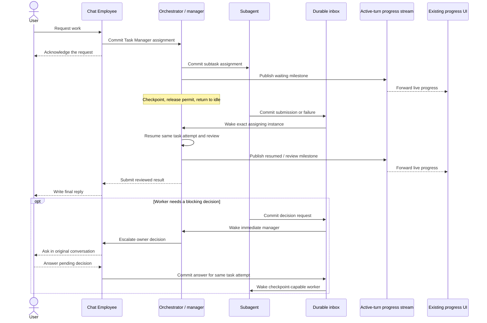

# Event-Driven Delegation with Active-Turn Progress Streams

Implementation plan for managed employee teams, aligned to the Dynamic Workflow repository study and the existing Temporal execution architecture.

## Goal

When a manager commits child work, it checkpoints the turn, releases its execution permit, and returns to idle. It makes no model calls or Task Manager checks while the child is working. The database inbox remains authoritative: a matching child submission, failure, or blocking decision wakes only the immediate assigner for the same job and task attempt. Ordinary progress and peer messages do not wake a parked manager.

Use Temporal Workflow Streams only for compact, live progress during active turns. The existing database-backed progress view remains the durable source and the fallback while an employee is parked or a viewer reconnects.

## Visible workflow

At each review, the assigning employee accepts the submission or requests changes on the same task. A specialist completing its work wakes its immediate manager. Chat's review trigger runs when the Orchestrator submits Chat's outer task. Greetings, clarifications, and status questions remain with Chat and do not create a new assignment.

## Design boundaries

- **Keep Temporal and the current inbox in charge.** The database inbox and mutation receipts own assignment, review, and answer state. Signal-With-Start is a wake hint; signal acceptance is not task processing. The existing reconciler recovers missed signals. Do not add a persistent supervisor, polling loop, event bus, or script engine. [Temporal message passing](https://docs.temporal.io/develop/python/workflows/message-passing) · [RFC-0005](../../../RFC-0005-EVENT-OS-ON-TEMPORAL.md) · [Workflow control](../../temporal-workflow-control.md)
- **Do not change prompts.** Keep each subagent's connected skill and existing specialized-agent system prompt intact. Do not append or rewrite manager instructions, connected skills, or the Task Manager skill. Enforce behavior through typed Task Manager operations, inbox data, execution traits, and runtime rules.
- **Keep task completion separate.** Parking, progress, questions, and answers do not create a task-completion outcome. A canvas Task Completed trigger still matches only the employee connected to its Task input and its existing filters. Matching standalone automation triggers continue to work. Teammate configuration edges remain excluded from forward trigger traversal.
- **Preserve the Dynamic Workflow division of work.** The repository study supports retaining durable task receipts, isolated agent instances, and a review inbox. Its pinned Pydantic implementation records child calls and returns child results or exceptions to the waiting computation; OpenCompany applies that boundary with Task Manager and Temporal rather than introducing a new executor. [Study, §11.3](CROSS-REFERENCE.md#113-what-changed-for-the-build) · [Pinned dispatch](https://github.com/pydantic/pydantic-ai/blob/d94586aad1acd640715f2bf1152e8d730c8f9938/src/pydantic_ai_harness/pydantic_ai_harness/dynamic_workflow/_toolset.py#L802) · [Pinned Code Mode executor](https://github.com/pydantic/pydantic-ai/blob/d94586aad1acd640715f2bf1152e8d730c8f9938/src/pydantic_ai_harness/pydantic_ai_harness/_monty_exec.py#L446)

## Implementation plan

1. **Freeze the protocol on admission.** Use the managed team plan's delegation runtime version for new admissions. Carry it through the job, instance configuration, Session Workflow input, tool preparation, and resumed turns. New managed bindings omit `wait_for_agents`; older session histories, opaque workers, and workflows without the version marker keep their admitted behavior. Never alter model prompts or skill contents.

2. **Park after a committed assignment batch.** Detect successful Task Manager operations that start or retry child work from their existing execution traits and committed receipts. Finish the tool batch in call order, checkpoint the transcript and receipts, then return an internal parked disposition before another model call or permit reacquisition. The session settles the AgentRun and releases its permit while leaving its parent task and attempt open. For the taskless Chat lead reviewing the initial Orchestrator task, park only when the committed operation names that exact outer task and the job, role, assigned instance, and attempt validate. A parked result does not run task completion, final delivery, or Task Completed triggers.

3. **Resume from actionable inbox state only.** Correlate each child task and result with the immediate assigning instance, logical run, upstream task, and attempt. Wake a `child_work` park only for the stored child task's matching submission or failure. Wake a `decision` park only for its matching answer. Ignore generic peer messages and progress for wake eligibility in both inbox admission and the reconciler. Validate every event against current task and attempt state before claiming it; stale or duplicate events cannot resume replacement work. Managers can review sibling results as they become actionable and park again while other children continue.

4. **Route blocking decisions to the immediate manager.** Add typed request, answer, and escalation operations backed by idempotent database receipts. Derive the intended assigner and task-attempt identity from the active task. A manager may answer or escalate; Chat asks the owner in the originating conversation, or on Home for the original task when no chat exists. The answer resumes the same job and task attempt. Expose mid-turn decisions only to checkpoint-capable native/Pi workers. Opaque CLI/RLM workers retain their current execution and review behavior.

5. **Stream small progress events during active turns.** Use the installed Temporal Python SDK 1.34.0 Workflow Streams API. The feature is Public Preview, so keep it as a progress-only observer. Construct the stream from `@workflow.init`, emit bounded lifecycle milestones such as running, waiting for a named teammate, decision requested, resumed, submitted, and failed, and forward them through the existing progress WebSocket path. Do not stream prompts, results, or token deltas. Keep the database progress projection authoritative while parked or disconnected. Carry the concrete `WorkflowStreamState` across AgentWorkflow Continue-As-New, truncate old stream entries to keep state bounded, and let the stream helper drain pollers and wait for handlers before rollover. Do not add a completion delay or subscriber acknowledgement handshake. [Workflow Streams](https://docs.temporal.io/develop/python/workflows/workflow-streams) · [Continue-As-New](https://docs.temporal.io/develop/python/workflows/continue-as-new)

6. **Preserve replay and existing operations.** Activities own database, model, network, and WebSocket side effects; Workflow code remains deterministic. Gate shared command-history changes with the repository's `workflow.patched` practice. Keep existing workflow types, retry ownership, inbox, generation controller, Stop/Resume, Reset, and Safe Apply. Old histories replay with their original admitted behavior. Replay representative old and new histories before enabling new admissions. [Temporal versioning](https://docs.temporal.io/develop/python/workflows/versioning) · [RFC-0006](../../../RFC-0006-TEMPORAL-DESIGN-PATTERNS.md)

## Release checks

| Scenario | Required result |
| --- | --- |
| Hire or Builder creates and retries a managed team | One outer task and one task per committed assignment; retries are idempotent and preserve the reviewed topology. |
| Greeting, clarification, status question, then substantive work | Chat responds directly to the first three; only substantive work creates a job and a visible Task Manager assignment. |
| Slow worker with one execution permit | After committing child work, its manager makes zero model calls, Task Manager reads, waits, or permit reacquisitions until actionable inbox work arrives. |
| Nested manager and worker complete in either order | Each result wakes and is reviewed by its immediate assigner, one level at a time; only matching employee triggers fire. |
| Worker asks a blocking question while also sending progress | Routine progress causes no manager turn; one matching decision wakes its manager and the valid answer resumes the same checkpoint-capable worker attempt. |
| Chat requests changes to the Orchestrator result | Chat parks against the exact outer task; the same board task receives a new attempt; Chat replies after accepting the revised result. |
| Standalone Task Completed observer and employee-connected trigger both match | Both retain their existing filters and deduplication; parking and decision events trigger neither. |
| Two jobs finish in reverse order with restart or duplicate events | Results stay bound to the original instance, task attempt, job, and conversation branch; accepted work is delivered once. |
| Stream disconnect, rollover, Stop/Resume, Reset, or Safe Apply | Live milestones resume on active turns; the database view remains correct while idle or disconnected; old histories and stale-attempt fences remain valid. |

The Dynamic Workflow study informs the call/result boundary; the repository's Temporal RFCs and official Temporal guidance define durable execution, wake, rollover, and replay behavior. Keep implementation inside those existing boundaries and avoid new framework layers.
