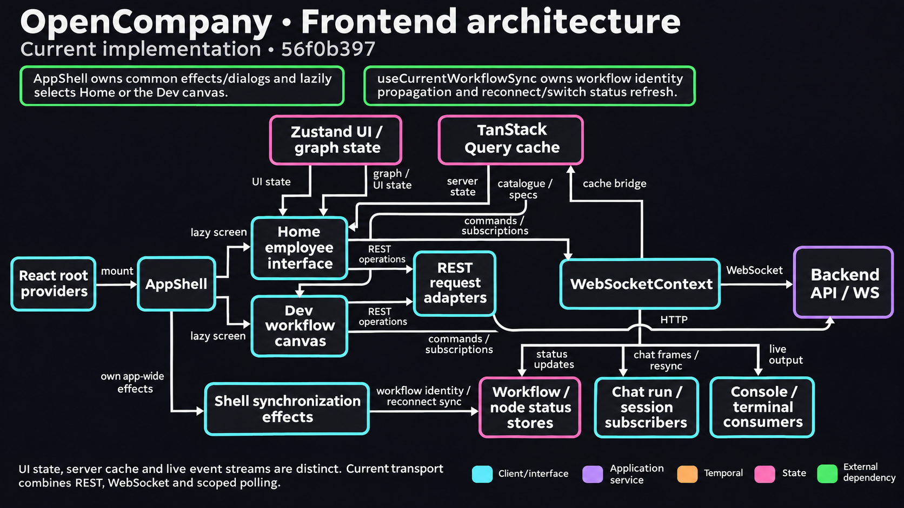

# WebSocket Status Broadcaster

OpenCompany uses WebSocket as the primary communication channel between the React frontend and the FastAPI backend. A single `StatusBroadcaster` service manages all active WebSocket connections and broadcasts real-time state updates (node status, workflow progress, Android device status, variable changes, etc.). This replaces polling for these status projections with push-based updates and is the reason the UI can animate node execution, show live tool calls, and update Android status without reloading.

This document covers the broadcaster architecture, the WebSocket message handlers, the broadcast message types, and the Android two-state connection model.

Source files:
- `server/services/status_broadcaster.py` - `StatusBroadcaster` singleton
- `server/routers/websocket.py` - WebSocket endpoint and message handlers
- `client/src/contexts/WebSocketContext.tsx` - frontend WebSocket provider with hooks

<!-- architecture-suite:start -->
## Architecture diagrams

Source baseline: `56f0b397`. [Complete diagram suite](../docs/diagrams/architecture/README.md).

**Frontend architecture — Current implementation.**

[](../docs/diagrams/architecture/04-frontend-architecture-v1.png)

[Editable Mermaid](../docs/diagrams/architecture/04-frontend-architecture.mmd) · [Source evidence and limitations](../docs/diagrams/architecture/04-frontend-architecture.brief.md)

<!-- architecture-suite:end -->

## Why WebSocket-First

Early iterations of OpenCompany used REST endpoints for most frontend-backend operations. That caused three recurring problems:

1. **Polling noise**: the frontend had to re-fetch parameters, workflows, Android status, and node outputs on an interval to look "live".
2. **No push**: node execution status changes (running, completed, errored) could not reach the UI without polling; tool calls during agent execution were invisible until the whole agent finished.
3. **Latency**: fetch -> parse -> re-render cycles added 100-200ms to every user action.

Moving execution/status projections and many commands to `/ws/status` enabled
real-time animations and reduced polling. The application still has REST
workflow CRUD and uploads, separate Browser streaming sockets, and bounded
Browser-task/Mobile polling. Each transport enforces its own admission and
ownership rules; see [Frontend architecture](frontend_architecture.md#real-time).

## Architecture

```
React UI (WebSocketContext.tsx)
        |
        | ws://host/ws/status (single persistent connection)
        v
FastAPI /ws/status endpoint (server/routers/websocket.py)
        |
        v
StatusBroadcaster (server/services/status_broadcaster.py)
        |
        +-- connection set: Set[WebSocket]
        +-- current status: Dict[str, Any]
        |     |-- android: {connected, paired, device_id, ...}
        |     |-- twitter: {connected, username, user_id, ...}
        |     |-- google: {connected, email, name, ...}
        |     |-- telegram: {connected, bot_id, bot_username, ...}
        |     |-- api_keys: {provider: validation status}
        |     |-- nodes: {node_id: {status, output, error, ...}}
        |     |-- variables: {name: value}
        |     |-- workflow: {executing, current_node, progress}
        |     |-- workflow_lock: {locked, workflow_id, locked_at, reason}
        |     `-- deployment: {isRunning, activeRuns, status, workflow_id}
        |
        +-- connect(ws)        -> accept + send initial_status
        |                         + deployment_snapshot CloudEvent (_send_deployment_snapshot)
        +-- disconnect(ws)     -> remove from set
        +-- update_*(...)      -> mutate state + broadcast()
        +-- broadcast(msg)     -> fan out to all connected clients
```

## Connection Lifecycle

```
Frontend mounts <WebSocketProvider>
        |
        v
WebSocket connects to /ws/status
        |
        v
Backend middleware checks JWT cookie (if auth enabled)
        |
        +-- invalid --> close(4001, "Not authenticated")
        |
        v
StatusBroadcaster.connect(ws)
        |
        +-- accept
        +-- add to _connections
        `-- send {"type": "initial_status", "data": current_status}
        |
        v
Message loop:
  receive_json -> dispatch: MESSAGE_HANDLERS.get(type) or get_ws_handlers().get(type)
  send_json    -> pushed by broadcaster on state change
  ping/pong    -> frontend heartbeat (WS_HEARTBEAT; visible pages only)
        |
        v
Frontend unmounts or logs out
        |
        v
StatusBroadcaster.disconnect(ws) -> remove from _connections, then call each
                                    register_disconnect_listener(fn) listener
```

`register_disconnect_listener(fn)` (module-level, idempotent) is for services that keep per-socket state:
`fn(websocket)` runs after the socket leaves `_connections`, synchronously, and must not block. Chat registers one so a
closed socket's run subscriptions are dropped (`services/chat/__init__.py`).

Auto-reconnect is handled by `WebSocketContext.tsx` through PartySocket's `ReconnectingWebSocket` (`partysocket/ws`), with jittered exponential backoff (`MIN_DELAY_MS` / `MAX_DELAY_MS` / `GROW_FACTOR` in `client/src/lib/connectionConfig.ts`). Requests queued while disconnected are sent after the next open; requests already in flight are rejected on close and never replayed. A remote close, even with code 1000, keeps the loop retrying; only the client's own `disposeConnection` (logout or unmount) closes with 1000 and stops it. The full client-side rules are in [frontend_architecture.md → Real-time](./frontend_architecture.md#real-time). A 100ms mount delay avoids React Strict Mode double-connect in dev.

## Handler Registry

Handlers are plain async functions wrapped by the `@ws_handler` decorator (`services/ws_handler_registry.py`):

```python
@ws_handler()
async def handle_get_node_parameters(data: Dict, websocket: WebSocket) -> Dict:
    node_id = data.get("node_id")
    params = await database.get_node_parameters(node_id)
    return {"success": True, "parameters": params}
```

The decorator does **not** register anything. It validates the listed required fields, default-injects `{"success": True}`, and wraps exceptions into a `{"success": False, "error": ...}` envelope. Registration is explicit and lives in two places: the core `MESSAGE_HANDLERS` dict in `server/routers/websocket.py` (`"get_node_parameters": handle_get_node_parameters, ...`), and the plugin-side `register_ws_handlers({...})` calls from each `nodes/<plugin>/__init__.py`, which write into the `_WS_REGISTRY` `IdempotentRegistry` in `services/ws_handler_registry.py`. The dispatcher reads the incoming message's `type` field and resolves `MESSAGE_HANDLERS.get(type) or get_ws_handlers().get(type)`. Plugin handlers that can fail user-correctably use `@ws_response` (from `services.plugin.ws`) instead, which keeps the one-WARN-line `NodeUserError` contract.

Live total = `len(MESSAGE_HANDLERS) + len(get_ws_handlers())` -- the `MESSAGE_HANDLERS` dict in `server/routers/websocket.py` plus plugin-registered handlers via `services.ws_handler_registry`. Do not hand-maintain a fixed count here.

### Handler Categories

| Category | Example handlers |
|---|---|
| Status / ping | `ping`, `get_status`, `get_android_status`, `get_node_status`, `get_variable` |
| Node parameters | `get_node_parameters`, `save_node_parameters`, `delete_node_parameters`, `get_all_node_parameters` |
| Tool schemas | `get_tool_schema`, `save_tool_schema`, `delete_tool_schema`, `get_all_tool_schemas` |
| Node execution | `execute_node`, `execute_workflow`, `cancel_execution`, `get_node_output`, `clear_node_output` |
| Triggers / events | `cancel_event_wait`, `get_active_waiters` |
| Dead letter queue | `get_dlq_entries`, `get_dlq_entry`, `replay_dlq_entry`, `remove_dlq_entry`, `purge_dlq`, `get_dlq_stats` |
| Deployment | `deploy_workflow` (Start's own step; refused without a live generation), `cancel_deployment`, `get_deployment_status`, `update_deployment_settings` |
| AI operations | `execute_ai_node`, `get_ai_models` |
| API keys | `validate_api_key`, `get_stored_api_key`, `save_api_key`, `delete_api_key` |
| OAuth / CLI login flows | `claude_code_login`, `claude_code_logout` (plugin-registered from `nodes/agent/claude_code_agent/_handlers.py`), `twitter_oauth_login`, `twitter_logout`, `google_oauth_login`, `google_logout` |
| Android | `get_android_devices`, `execute_android_action`, `android_relay_connect`, `android_relay_disconnect`, `android_relay_reconnect` |
| WhatsApp | `whatsapp_status`, `whatsapp_qr`, `whatsapp_send`, `whatsapp_chat_history`, `whatsapp_newsletters`, `whatsapp_diagnostics`, ... |
| Telegram | `telegram_connect`, `telegram_disconnect`, `telegram_status`, `telegram_send`, `telegram_get_me`, `telegram_get_chat` |
| Workflow storage | `save_workflow`, `get_workflow`, `get_all_workflows`, `delete_workflow` |
| Chat messages | `send_chat_message`, `get_chat_messages`, `chat_subscribe`, `chat_unsubscribe`, `get_chat_run`, `clear_chat_messages`, `save_chat_message` (`services/chat/handlers.py`; run events reach only subscribed sockets, see [chat_protocol.md](./chat_protocol.md)) |
| Console / terminal | `get_console_logs`, `clear_console_logs`, `get_terminal_logs`, `clear_terminal_logs` |
| Skills | `get_skill_content`, `save_skill_content`, `get_user_skills`, `create_user_skill`, `scan_skill_folder` |
| Memory | `clear_memory`, `reset_skill`, `configure_compaction`, `get_compaction_stats` |
| User settings | `get_user_settings`, `save_user_settings`, `get_provider_defaults`, `save_provider_defaults` |
| Pricing / usage | `get_pricing_config`, `save_pricing_config`, `get_api_usage_summary`, `get_provider_usage_summary` |
| Agent teams | `create_team`, `add_team_task`, `claim_team_task`, `complete_team_task`, `get_team_messages` |
| Model registry | `get_model_constraints`, `refresh_model_registry` |

The exact set drifts over time. The canonical count is `len(MESSAGE_HANDLERS) + len(get_ws_handlers())` at runtime (many handlers now live in `services/credentials/handlers.py`, `services/settings/handlers.py` and `nodes/<plugin>/_handlers.py`, so counting decorators in `websocket.py` undercounts).

## Broadcast Messages (Server -> Clients)

Broadcasts are sent to all connected clients without a request-response correlation. They fire on state changes in the backend:

| Message Type | Trigger | Payload |
|---|---|---|
| `android_status` | Android relay connect/disconnect/pair | `{connected, paired, device_id, device_name, connection_type, qr_data, ...}` |
| `node_status` | Node enters executing / waiting / success / error | `{node_id, status, data, workflow_id, timestamp}` |
| `node_output` | Node produces output | `{node_id, output, workflow_id}` |
| `variable_update` | Single variable changes | `{name, value}` |
| `variables_update` | Batch variable update | `{variables: Dict}` |
| `workflow_status` | Workflow start / progress / complete | `{executing, current_node, progress}` |
| `api_key_status` | Credential validation result; also fired by `delete_api_key` to clear `apiKeyStatuses[provider]` | `{provider, data: {valid, hasKey, models, message, timestamp}}` |
| `credential_catalogue_updated` | Credential mutation (save / delete / oauth-disconnect) — wraps `WorkflowEvent` (CloudEvents v1.0) from `services/events/envelope.py`. Outer `type` stays this string for FE back-compat; body's `type` follows `credential.<area>.<action>` (e.g. `credential.api_key.saved`). Frontend `WebSocketContext` invalidates `useCatalogueQuery` via the 300 ms `invalidateCatalogue` debounce. | `{specversion: "1.0", id, source: "opencompany://services/credentials", type, subject: provider, time, data: {provider, customer_id?}}` |
| `node_parameters_updated` | Parameters saved by parameter-panel user, Claude CLI memory bridge, or AgentWorkflow per-turn memory append — wraps `WorkflowEvent` (CloudEvents v1.0) from `services/events/envelope.py`. Body's `type` is `com.opencompany.node.parameters.updated`. `data.source` (`"user"` / `"cli"` / `"agent"`) distinguishes the three emission sites. Replaces the legacy raw-dict broadcast at commit `7c9e873`. Locked by `tests/test_cloudevents_node_parameters.py`. | `{specversion: "1.0", id, source: "opencompany://services/parameters", type: "com.opencompany.node.parameters.updated", subject: node_id, time, data: {node_id, parameters, version, source}}` |
| `agent_progress` | Agent-loop / AgentWorkflow lifecycle phase (canvas badge "N / max" + phase indicator) — wraps `WorkflowEvent.agent_progress` (CloudEvents v1.0). Emitted from `services/ai.py:execute_agent` (legacy) and via the `agent.broadcast_progress` Temporal activity (F4.B). F4.B fires the full phase set: `starting` (entry, drives `node_status="executing"`), `llm_step` (per iteration), `executing_tool` + `tool_completed` (around each per-type tool activity), `completed` (final, drives `node_status="success"`). The activity optionally drives a raw-dict `update_node_status` alongside the CloudEvents envelope so the canvas-glow color follows the lifecycle without a separate handler — same dual-channel pattern F4.A's `_node_activity` uses. | `{specversion: "1.0", id, source: "opencompany://services/agent", type: "com.opencompany.agent.progress", subject: node_id, time, data: {node_id, iteration, max_iterations, phase?, tool_name?}}` |
| `token_usage_update` | AI execution updates token counters | `{session_id, data: {total, threshold, needs_compaction}}` |
| `compaction_starting` | Memory compaction begins | `{session_id, node_id}` |
| `compaction_completed` | Memory compaction ends | `{session_id, success, tokens_before, tokens_after}` |
| `context.updated` | A conversation durably saved (`save_conversation` upsert), or cleared from the panel / workflow Reset — emitted from the store's save boundary via `register_conversation_listener`, so every writer (in-process loop, Temporal LLM activity, specialized-provider bridge) is covered without call-site code. Frontend invalidates `['agentContext']`. | `{specversion: "1.0", id, source: "opencompany://nodes/context", type: "com.opencompany.context.updated", subject: agent_node_id, time, data: {workflow_id, generation, agent_node_id, message_count}}` |
| `memory.updated` | A durable Memory mutation (remember / update / forget / clear) from either writer — the agent's tool call or the panel handlers. Frontend invalidates `['memoryItems']` + `['memoryItem']`. | `{specversion: "1.0", id, source: "opencompany://nodes/simple_memory", type: "com.opencompany.memory.updated", subject: memory_node_id, time, data: {workflow_id, memory_node_id, operation}}` |
| `chat.updated` | A chat row added or a thread cleared, sent after every insert and clear by `services/chat_thread.py` (`record_chat_message` / `clear_chat_thread`), the one write path for chat rows: `send_chat_message`, `save_chat_message`, `clear_chat_messages` and the `chatReply` node all go through it. Frontend invalidates Home's thread (`queryKeys.chatThread.bySession`) and reloads the editor's chat pane when the session is the open workflow's. | `{specversion: "1.0", id, source: "opencompany://services/chat_thread", type: "com.opencompany.chat.updated", subject: session_id, time, data: {workflow_id, session_id, role}}` (`workflow_id` null for session `"default"`, `role` null for a clear) |
| `workflow_ops_apply` | A workflow-ops batch for open editors, sent by the core factory `services/workflow_ops.broadcast_workflow_ops`. `services/workflow_storage/mutate.apply_graph_additions` (Turn on Talk, the Agent Builder) sends every batch it saved with `persisted: true`: the ops carry the server's node and edge ids, positions and full parameter rows, and editors adopt them without saving. See [workflow_ops_protocol.md](./workflow_ops_protocol.md#persisted-batches). | The event's flat data, not the envelope: `{workflow_id, caller_node_id, operations, persisted?}` (the event is built as `com.opencompany.workflow.ops.applied`) |
| `browser_updated` | A Browser profile's control state changes (`idle` / `agent` / `awaiting_user` / `user`), from `nodes/browser/_session.py`. Identity and state only; the live viewer reads the details over `/ws/browser`. Frontend opens the Dev dock on its Browser tab when the open workflow's browser reaches `awaiting_user`. | `{specversion: "1.0", id, source: "opencompany://nodes/browser", type: "com.opencompany.browser.updated", subject: session_id, time, data: {workflow_id, node_id, session_id, state, revision}}` |
| `browser_profiles_updated` | A Browser profile is added, renamed, deleted or gets new logins. Frontend invalidates `['browserProfiles']` (the Credentials "Web browser" panel). | `{specversion: "1.0", id, source: "opencompany://nodes/browser", type: "com.opencompany.browser.profiles.updated", subject: "profiles", time, data: {revision}}` |
| `browser_runtime` | Chrome for Testing download progress (`BROWSER_RUNTIME=testing` only; `_install_chrome.py`). No frontend case; the viewer polls `browser_runtime_status` while it waits. | `{specversion: "1.0", id, source: "opencompany://nodes/browser", type: "com.opencompany.browser.runtime.progress", subject: component, time, data: {component, phase, percent, version, error}}` |

`context.updated`, `memory.updated`, `chat.updated` and `workflow_ops_apply`
call `get_status_broadcaster().broadcast(...)` directly rather than
`services.events.dispatch.emit`. `emit` exists to reach Temporal consumers and
pays a Visibility `ListWorkflowExecutions` query to find them; no node type
registers a canary consumer for `com.opencompany.context.*` /
`com.opencompany.memory.*` / `com.opencompany.chat.updated` /
`com.opencompany.workflow.ops.*`, so that query can only ever match nothing —
once per save. Same pattern as `nodes/telegram/_events.py`. See
[event_framework.md → UI-only lifecycle events](./event_framework.md).

The `context.updated`, `memory.updated` and `chat.updated` payloads are
identity only (plus a count, an operation or a role) — no message bodies, no
item content — because
`StatusBroadcaster.broadcast()` fans out to **every** connected socket with no
per-workflow filtering. The panels refetch through the authorized
`get_agent_context` / `list_memory_items` handlers, which is where ownership
is enforced; chat views refetch through `get_chat_messages`, which reads a
session by id (threads are per workflow, not per user). `workflow_ops_apply`
is the exception: it carries the ops themselves, parameter rows included,
because an editor applies them as they arrive.

## Execution correlation IDs

Each `execute_node` request generates a `uuid4().hex` token at handler entry (`server/routers/websocket.py`, `handle_execute_node`). The token is:

- propagated through every `node_status` broadcast for the run (`executing` -> `success` / `error` / `idle`),
- propagated through the matching `node_output` broadcast,
- returned in the `execute_node` response payload as `execution_id`.

The frontend's `ExecutionResult` type carries the token as `executionId`. `OutputSection` dedups by `executionId` directly; the previous JSON-stringified output equality check collapsed two distinct executions whose payloads happened to match. The token also lets future replay / retry / observability work attach metadata to a single run -- same role as a request id in HTTP middleware or a trace id in OpenTelemetry. When neither side carries an `executionId` (legacy results, catch-block stubs), `OutputSection` falls back to structural equality on `outputs`.

## `clear_node_status` is an idle reset, not a delete

`StatusBroadcaster.clear_node_status(node_id)` resets the slot to `{status: "idle", data: {}, cleared: true}` instead of `del`'ing the dict entry. The previous implementation deleted the slot, which created a race window: an in-flight execution's subsequent `success` broadcast re-created the entry and the UI was stuck showing "completed" on a node the user just cancelled. Resetting to idle preserves entry identity (so subsequent broadcasts update it normally) and the `cleared: true` flag lets callers tell apart "never ran" from "explicitly cleared."

## Android Two-State Connection Model

Android support uses a two-state model because a relay WebSocket can be connected without a device being paired. The UI needs both signals.

| State | Meaning | Frontend behavior |
|---|---|---|
| `connected` | Relay WebSocket to `wss://relay.opencompany.sh/ws` is active | Not shown directly |
| `paired` | Android app has scanned QR and established session | Green dot on Android nodes |

```
User clicks Connect
        |
        v
Relay WebSocket opens --> broadcast_connected({connected: true, paired: false})
        |                                   QR code shown
        v
User scans QR with Android app
        |
        v
Device pairs            --> broadcast_connected({connected: true, paired: true, device_id, device_name})
        |                                   Green dot lights up
        v
App disconnects         --> broadcast_device_disconnected({connected: true, paired: false, qr_data, session_token})
        |                                   QR shown again for re-pairing
        v
Relay WebSocket closes  --> broadcast_relay_disconnected({connected: false, paired: false})
```

Android service nodes (`batteryMonitor`, `wifiAutomation`, etc.) check `androidStatus.paired` (not `connected`) before allowing execution. See `client/src/components/SquareNode.tsx`.

## Auto-Reconnect and Ping Keepalive

**Frontend** (`WebSocketContext.tsx`):

- While the socket is open and the page is visible, `startWebSocketHeartbeat` (`client/src/lib/webSocketHeartbeat.ts`) sends `{"type": "ping"}` every 30 s (`WS_HEARTBEAT`). If no `pong` arrives within 10 s, it reconnects with close code 4000 (`WS_CLOSE.HEARTBEAT_TIMEOUT`).
- On disconnect: PartySocket's `ReconnectingWebSocket` reconnects with jittered exponential backoff (`client/src/lib/connectionConfig.ts`). In-flight requests are rejected, and requests queued while disconnected are sent after the next open. A remote close, including code 1000, does not stop the loop; only `disposeConnection` (logout or unmount) does.
- 100ms mount delay avoids React Strict Mode double-connect in development.
- `isMountedRef` prevents connections after unmount.
- WebSocket is gated on `isAuthenticated` from `AuthContext`: if auth is disabled or not yet loaded, the provider defers connection.

**Backend** (`websocket.py`):

- Responds to `ping` with `{"type": "pong"}`.
- On `get_status`, returns the full current status snapshot.
- On disconnect, waits up to one second for the socket's in-flight handler tasks to finish (`_drain_handler_tasks`), cancels any still running, then removes the WebSocket from `StatusBroadcaster._connections`. The grace exists because a client that reconnects ~100 ms after connecting would otherwise cancel the init-burst handlers inside a database call; session teardown is additionally shielded from cancellation in `core/session_teardown.py` (see errors.md entry 13).
- `broadcast()` skips and prunes sockets that are no longer `CONNECTED` on either side, so a broadcast racing a close frame does not log a warning per message.

## Error Handling

All handlers use a try/except wrapper that returns a structured error response instead of killing the WebSocket:

```python
try:
    result = await handler(data, websocket)
    await websocket.send_json({"type": response_type, **result})
except Exception as e:
    logger.error(f"Handler {handler_name} failed: {e}")
    await websocket.send_json({
        "type": "error",
        "handler": handler_name,
        "code": type(e).__name__,
        "message": str(e)
    })
```

The frontend matches responses by a `request_id` field (set by the frontend, echoed by the backend) to resolve pending promises in `WebSocketContext`.

## Related Docs

- [DESIGN.md](DESIGN.md) - overall backend architecture
- [credentials_encryption.md](credentials_encryption.md) - credential handlers that go through this layer
- [event_waiter_system.md](event_waiter_system.md) - `cancel_event_wait` and `get_active_waiters` handlers
- [memory_compaction.md](memory_compaction.md) - token usage broadcast messages
