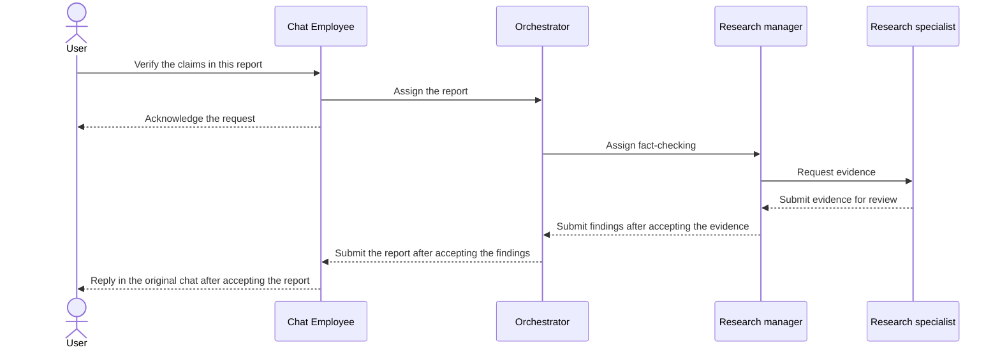

# Hire an employee and review their team's work

Each new managed hire creates one workflow. You talk to the **Chat Employee**.
When you ask it to do work, it opens a task on its own Task Manager board and
assigns it to the **Orchestrator**. The Orchestrator delegates to its direct
reports. Greetings, clarifying questions, and requests for status stay in chat.

## Choose who reports to whom

1. Open **Hire** in Home or choose **File → Hire an employee** in the editor.
2. In **Their team**, review the Chat Employee and the Orchestrator. You can add
   up to two more roles. Give each a name and responsibility. Choose
   **AI Employee** for a role that will manage another worker and
   **Specialist** for a role that will carry out its own assignment.
3. Use **Reports to** to choose each role's manager. Check the reporting lines
   shown above the role fields, then confirm the hire to save that structure.

For example, a research team can have the following reporting lines when the
installation allows two levels of delegation below the Orchestrator.

```text
Chat Employee
└── Orchestrator
    └── Research manager
        └── Research specialist
```

## Follow an assignment

Suppose you ask this team to verify three claims for a report. Open each
assigner's **Task Manager** on the canvas to see the corresponding work.

| Whose board | Assignment | Who reviews the submission |
| --- | --- | --- |
| Chat Employee | Orchestrator prepares the verified report | Chat Employee |
| Orchestrator | Research manager verifies the claims | Orchestrator |
| Research manager | Research specialist gathers evidence | Research manager |



When the specialist submits the evidence, the research manager reviews it and
can request changes on that same task. After accepting the evidence, the
manager submits its findings to the Orchestrator. The Orchestrator then submits
its reviewed report to Chat. Chat accepts it or requests a revision and writes
the final answer after acceptance.

If a specialist needs an approval it cannot obtain, it can submit what it
found and explain which step it could not take. Its manager can close the
assignment with that reason. Chat reviews the Orchestrator's report and tells
you what remains undone. The task board retains the evidence. A review retry
asks the assigning employee to decide what to do with the saved result.

In Home, expand the work status to see which assignment was **Blocked at
review**. A step marked **Closed with parent task** ended when its manager's
assignment closed.

For research through treg, a specialist can read the full saved search page
in its workspace, even when the preview shows only one record. It can check
dates and view counts across that page and report zero matches when none
qualify. Reading the saved page is free. Fetching additional pages from the
provider is a separate call.

Chat posts the answer in the branch where you made the request. If another
chat turn is running, the answer waits for that turn to finish. If you cleared
the conversation, open the original assignment on Chat's board and look for
**Chat Employee’s final answer** in its details. Work that arrives through an
app keeps its original destination and approval rule.

## Configure completion triggers

On the canvas, connect **Task Completed** to the assigning employee's **Task**
input. This trigger receives submissions and failures for work that employee
assigned. Its filters can narrow the match by task ID, worker name, or status.
For separate success and error actions, give each trigger its own status
filter. The editor flags overlapping filters on the same employee. A
standalone trigger feeding a dashboard or another automation continues to
receive events that match its filters.

## Add a role after hiring

Ask Chat to add a role and name the employee it should report to. If
**Ask first** is enabled, review Chat's requested change in **Access** and
choose **Allow and add**. You can also add a worker in the editor by selecting
its intended manager first. Choose **Apply** to activate the saved team for future work.
In-flight assignments finish with the team that received them. If a job
reported a missing capability, submit a fresh request after Apply.

Earlier hires keep their saved reporting lines. A workflow with a separate
Talk agent connected to a team lead continues to use that route.
